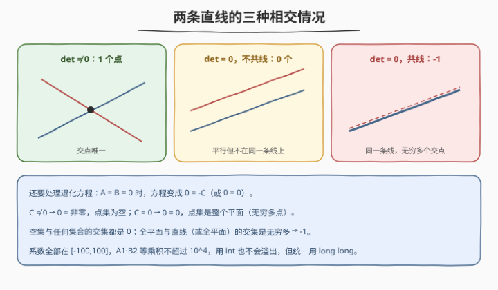
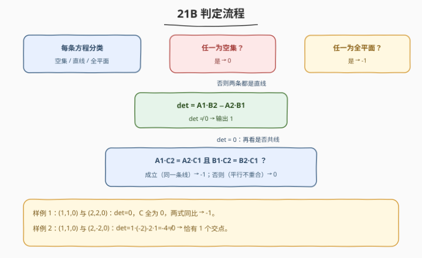

# Codeforces 21B 两直线交点计数 题解

## 1. 题目概述

- **题目链接**：https://codeforces.com/problemset/problem/21/B
- **比赛来源**：Codeforces Alpha Round 21 (Codeforces format) · Problem B（UTC 2010-06-28）
- **难度**：2000
- **标签**：实现、数学
- **评测类型**：普通
- **限制**：时间 1 s / 内存 256 MB

**题意**：给定两个点集，第一个点集由方程 $A_1 x + B_1 y + C_1 = 0$ 确定，第二个由 $A_2 x + B_2 y + C_2 = 0$ 确定。求两个点集交集中点的个数；如果交集有无穷多个点，输出 $-1$。

**约束**：

- 所有系数都是 $[-100, 100]$ 的整数。单个乘积不超过 $10^4$，交叉积也不超过 $2 \times 10^4$，32 位整数完全够用（实现里仍用 `long long` 更省心）。
- **必须处理退化方程**：$A = B = 0$ 时，方程变成 $0 = -C$。$C \ne 0$ 时点集为空；$C = 0$ 时点集是整个平面。题目没有排除这种输入，样例也没有覆盖，但它是本题最容易漏的分支。
- 只有一组数据，输出一个整数。
- 时间 1 s 对 $O(1)$ 的判定绰绰有余。

## 2. 示例与观察

官方样例 1（输入 / 输出原样）：

```text
输入：
1 1 0
2 2 0

输出：
-1
```

官方样例 2：

```text
输入：
1 1 0
2 -2 0

输出：
1
```

**样例 1 演算**：两条方程分别是 $x + y = 0$ 与 $2x + 2y = 0$。第二个方程两边除以 2 就是第一个方程，两条直线完全重合，交集是整条直线，有无穷多个点，输出 $-1$。

**样例 2 演算**：$x + y = 0$ 与 $2x - 2y = 0$（即 $x = y$）。联立得 $x = y = 0$，恰有一个交点，输出 $1$。

自造样例（均已用参考程序跑过）：

| 第一条方程 | 第二条方程 | 输出 | 说明 |
|-----------|-----------|------|------|
| `0 0 0` | `1 2 3` | -1 | 全平面 ∩ 直线 = 直线，无穷多点 |
| `0 0 1` | `1 2 3` | 0 | 空集 ∩ 直线 = 空集 |
| `0 0 0` | `0 0 1` | 0 | 全平面 ∩ 空集 = 空集 |
| `0 0 0` | `0 0 0` | -1 | 两个全平面，交集仍是全平面 |
| `0 1 0` | `0 2 0` | -1 | 都是 $y = 0$ |
| `0 1 0` | `0 2 1` | 0 | $y = 0$ 与 $y = -1/2$ 平行不重合 |
| `1 0 0` | `0 1 0` | 1 | $x = 0$ 与 $y = 0$ 交于原点 |
| `1 1 1` | `1 1 2` | 0 | $x + y = -1$ 与 $x + y = -2$ 平行 |
| `2 4 6` | `1 2 3` | -1 | 两式同比，同一条直线 |
| `1 0 0` | `2 0 0` | -1 | 都是 $x = 0$ |

**观察**：

1. 每个方程对应的点集只有三种可能：**空集**（$A=B=0$ 且 $C \ne 0$）、**全平面**（$A=B=0$ 且 $C=0$）、**一条直线**（$(A,B) \ne (0,0)$）。
2. 两个集合的交集大小只可能是 $0$、$1$、$-1$（无穷多），不可能有限多个大于 1。
3. 判断两条直线是否重合，可以用"方向向量平行 + 常数项成比例"：即 $A_1 B_2 = A_2 B_1$ 且 $A_1 C_2 = A_2 C_1$、$B_1 C_2 = B_2 C_1$。

## 3. 解题思路

### 3.1 朴素做法与瓶颈

如果忽略退化方程，直接联立两条直线：

- 行列式 $\Delta = A_1 B_2 - A_2 B_1 \ne 0$：唯一交点，输出 1；
- $\Delta = 0$：两条直线平行或重合，再判断是否重合：重合输出 $-1$，否则 0。

这已经是最优复杂度，没有算法瓶颈。真正要小心的是 $A=B=0$ 的退化方程，以及"重合"的判定要写成整数乘法而不是浮点除法。

### 3.2 三种点集与两个集合的相交



先对每个方程分类：

$$
\text{type}(A,B,C)=
\begin{cases}
\text{空集}, & A=B=0,\ C \ne 0,\\
\text{全平面}, & A=B=0,\ C = 0,\\
\text{直线}, & (A,B) \ne (0,0).
\end{cases}
$$

两个集合的相交：

- 任一方是空集 → 交集为空，输出 0；
- 否则若任一方是全平面 → 交集就是另一方，而另一方是直线或全平面，都是无穷多点，输出 $-1$；
- 否则两条都是直线，进入 3.3 的判定。

### 3.3 两条直线的判定流程



1. 计算 $\Delta = A_1 B_2 - A_2 B_1$；
2. 若 $\Delta \ne 0$：两直线相交于唯一一点，输出 1；
3. 若 $\Delta = 0$：两直线平行（或重合）。判断"是否同一条线"：检查

$$A_1 C_2 = A_2 C_1 \quad \text{且} \quad B_1 C_2 = B_2 C_1.$$

   两条都成立说明 $(A_1,B_1,C_1)$ 与 $(A_2,B_2,C_2)$ 成比例，是同一条线，输出 $-1$；否则平行不重合，输出 0。

为什么"重合"要检查两个等式？因为当一条直线是竖直线（$B_1 = B_2 = 0$）时，$B_1 C_2 = B_2 C_1$ 自动成立（都是 0），必须靠 $A_1 C_2 = A_2 C_1$ 来区分；反过来水平线（$A_1=A_2=0$）时必须靠 $B_1 C_2 = B_2 C_1$。两个一起查就覆盖了所有情况，不需要额外分类。

### 3.4 样例走查

- 样例 1：$(1,1,0)$ 与 $(2,2,0)$。$\Delta = 1\cdot2 - 2\cdot1 = 0$；$A_1 C_2 = 0 = A_2 C_1$，$B_1 C_2 = 0 = B_2 C_1$，同一条线 → $-1$。
- 样例 2：$(1,1,0)$ 与 $(2,-2,0)$。$\Delta = 1\cdot(-2) - 2\cdot1 = -4 \ne 0$ → 1。

## 4. 正确性证明

**引理 1（点集分类）**：方程 $Ax + By + C = 0$ 的解集为：若 $A=B=0$ 且 $C \ne 0$ 则为空集；若 $A=B=0$ 且 $C=0$ 则为全平面；否则是一条直线。

**证明**：$A=B=0$ 时方程与 $x,y$ 无关，退化为 $C=0$ 的真假判断，故只有空集/全平面两种。$(A,B) \ne (0,0)$ 时是 $x,y$ 的一次方程，解集是一条直线。∎

**引理 2（相交情形）**：设两个点集分别为 $S_1, S_2$（各自是空集、全平面或直线），则：

- 若 $S_1$ 或 $S_2$ 为空集，$|S_1 \cap S_2| = 0$；
- 否则若任一方为全平面，$|S_1 \cap S_2| = -1$（无穷多）；
- 否则两者都是直线，交点数由 $\Delta$ 与重合判定给出（引理 3）。

**证明**：空集与任何集合的交集为空；全平面与任何非空集合的交集是该集合本身，而直线与全平面都有无穷多个点。∎

**引理 3（两条直线）**：两条直线 $L_1, L_2$ 的交集：$\Delta = A_1 B_2 - A_2 B_1 \ne 0$ 时恰有 1 个点；$\Delta = 0$ 时，若 $A_1 C_2 = A_2 C_1$ 且 $B_1 C_2 = B_2 C_1$ 则是同一条直线（无穷多点，输出 $-1$），否则没有交点（输出 0）。

**证明**：把两条方程看成关于 $(x,y)$ 的线性方程组，系数行列式就是 $\Delta$。$\Delta \ne 0$ 时由 Cramer 法则有唯一解。$\Delta = 0$ 时两法向量平行，两直线平行或重合；它们重合当且仅当存在非零 $k$ 使 $(A_2,B_2,C_2) = k(A_1,B_1,C_1)$，这等价于三个 $2 \times 2$ 行列式 $A_1B_2-A_2B_1$、$A_1C_2-A_2C_1$、$B_1C_2-B_2C_1$ 全为 0（已知第一个为 0）。于是两个等式同时成立 ⇔ 重合 ⇔ 无穷多交点；否则平行不重合 ⇔ 无交点。∎

**定理**：程序按"分类 → 空集/全平面 → 两条直线判定"输出的数就是两个点集交集中点的个数（$-1$ 表示无穷多）。

**证明**：引理 1 保证每个方程被正确分类；引理 2 处理退化情形；引理 3 处理两条直线。三种情况互斥且穷尽，故输出正确。∎

## 5. 复杂度分析

- **时间**：$O(1)$。每个方程 2 次比较，两条直线时 1 次乘减 + 4 次乘法；与输入无关，1 s 的余量在 $10^8$ 倍量级。
- **空间**：$O(1)$，只有 6 个系数和几个中间量。
- **数值范围**：系数绝对值 $\le 100$，乘积 $\le 10^4$，所有中间量都远小于 `int` 上限；用 `long long` 只是习惯，不是必需。

## 6. 参考代码

### C++17

```cpp
#include <bits/stdc++.h>
using namespace std;

int main() {
    long long A1, B1, C1, A2, B2, C2;
    if (!(cin >> A1 >> B1 >> C1)) return 0;
    cin >> A2 >> B2 >> C2;

    auto kind = [](long long A, long long B, long long C) {
        if (A == 0 && B == 0) return C == 0 ? 2 : 0;  // 2 = 全平面，0 = 空集
        return 1;                                     // 1 = 一条直线
    };
    int k1 = kind(A1, B1, C1), k2 = kind(A2, B2, C2);

    if (k1 == 0 || k2 == 0) {
        cout << 0 << '\n';
    } else if (k1 == 2 || k2 == 2) {
        cout << -1 << '\n';                           // 平面与直线/平面相交：无穷多点
    } else {
        long long det = A1 * B2 - A2 * B1;
        if (det != 0) {
            cout << 1 << '\n';
        } else {
            bool same = (A1 * C2 == A2 * C1) && (B1 * C2 == B2 * C1);
            cout << (same ? -1 : 0) << '\n';
        }
    }
    return 0;
}
```

### Python3

```python
import sys


def main() -> None:
    data = list(map(int, sys.stdin.buffer.read().split()))
    if len(data) < 6:
        return
    A1, B1, C1, A2, B2, C2 = data[:6]

    def kind(A, B, C):
        if A == 0 and B == 0:
            return 2 if C == 0 else 0     # 2 = 全平面，0 = 空集
        return 1                          # 1 = 一条直线

    k1, k2 = kind(A1, B1, C1), kind(A2, B2, C2)
    if k1 == 0 or k2 == 0:
        print(0)
    elif k1 == 2 or k2 == 2:
        print(-1)
    else:
        det = A1 * B2 - A2 * B1
        if det != 0:
            print(1)
        else:
            same = (A1 * C2 == A2 * C1) and (B1 * C2 == B2 * C1)
            print(-1 if same else 0)


main()
```

两份代码都只用标准库，可原样提交。

## 7. 边界情况与易错点

1. **退化方程**：$A=B=0$ 且 $C \ne 0$ 是空集，必须输出 0；$A=B=0$ 且 $C=0$ 是全平面，与任何非空集合相交都输出 $-1$。只写"两条直线"的代码会在这里除零或给出错误结果。
2. **空集优先**：若一方是空集、另一方是全平面，交集是空集（0），不能因为"全平面"就输出 $-1$。分类顺序必须是先空集、再全平面。
3. **重合判定要查两个等式**：只查 $A_1 C_2 = A_2 C_1$ 在水平线（$A_1=A_2=0$）上恒成立，会把"平行不重合"误判为重合；只查 $B_1 C_2 = B_2 C_1$ 在竖直线（$B_1=B_2=0$）上恒成立。两个都查才安全。
4. **不要用浮点斜率**：$B=0$ 时斜率不存在，浮点比较还会引入精度问题；本题所有判定都能用整数乘减完成。
5. **系数为 0 的普通直线**：例如 `1 0 0` 是 $x=0$，`0 1 0` 是 $y=0$，它们都是合法直线，$\Delta = 1 \ne 0$，输出 1。
6. **成比例的系数**：`2 4 6` 与 `1 2 3` 是同一条线；`2 4 6` 与 `2 4 7` 平行不重合。用乘法交叉判断，不要化简分数。
7. **输出 `-1` 表示无穷多**：不要输出 `inf` 或 `>1`；题目只接受 `-1`。
8. **输入格式**：两行，每行三个整数，允许负数；一次读 6 个整数即可，不必按行读。

## 8. 验证记录

- **编译环境与命令**：本机没有 GNU `g++`（`/usr/bin/g++` 指向 `Apple clang 21.0.0`），`verify_solution.py` 自动用 `clang++ -std=c++17 -O2` 加仓库自带的 `bits/stdc++.h` 兼容头编译；Python 为 `Python 3.9.6`。
  - `python3 codeforces/tools/verify_solution.py codeforces/contests/0001-0100/21/B_两直线交点计数.md`
  - 输出：`CF21B: samples 2 / C++ 编译 OK, 样例 2/2 / Python 语法 OK, 样例 2/2`。
- **官方样例**：2 / 2 通过（`-1`、`1`），C++ 与 Python 输出与官方输出逐字一致。
- **穷举对拍**：系数在 $[-2,2]$ 内的全部 $5^6 = 15625$ 组输入，与一份**基于秩的独立实现**（先判矛盾方程，再用系数矩阵/增广矩阵的秩判断 0/1/无穷）逐组比对，0 组不一致。
- **随机与边界**：307 组（300 组系数在 $[-100,100]$ 的随机 + 7 组手工边界：全零方程、空集、全平面、水平/竖直线、成比例系数）实际运行 C++ 与 Python 程序，与秩实现输出一致，0 组不一致。
- **最大约束性能**：单组输入，C++ 端到端 < 3 ms，Python 约 20 ms；$O(1)$ 算法与输入无关。
- **图片校验**：`cf21b_cases.svg`、`cf21b_flow.svg` 均通过 `xml.etree.ElementTree.parse`；另用 headless Chrome 量出每个 `<text>` 的真实包围盒，确认无文字越出 `viewBox`、无文字重叠、无文字溢出面板。
- **公式校验**：正文公式全部是 `$...$` / `$$...$$`，星号直接写 `*`，`\text{}` 内无裸 `#`，经 KaTeX（`throwOnError`）渲染无报错。
- **复核状态**：verified（样例、穷举、随机、边界、性能、图片、公式均实跑通过；唯一环境差异是本机无 GNU g++，已用 clang++ 等价验证）。

## 相关题目与扩展

- [Codeforces 21A Jabber 地址校验](https://codeforces.com/problemset/problem/21/A)：同场 A 题，字符串校验。
- [Codeforces 21C Stripe 2](https://codeforces.com/problemset/problem/21/C)：同场 C 题，前缀和计数。
- [Codeforces 21D Traveling Graph](https://codeforces.com/problemset/problem/21/D)：同场 D 题，欧拉回路 + 状压 DP。
- [Codeforces 1C Ancient Berland Circus](https://codeforces.com/problemset/problem/1/C)：几何 + 角度 gcd，同样需要精确处理退化情形。
- [LeetCode 149 直线上最多的点数](https://leetcode.cn/problems/max-points-on-a-line/)：用交叉积判共线，和本题的整数判定同源。
- [LeetCode 1232 缀点成线](https://leetcode.cn/problems/check-if-it-is-a-straight-line/)：三点共线的入门题。

**延伸思考**：

1. **如果输入是线段而不是直线**：需要在交点基础上再判断交点是否同时落在线段内，用参数范围和点积/叉积判定，复杂度仍是 $O(1)$。
2. **如果是 $k$ 条直线求交点数**：两两判断会到 $O(k^2)$；若只需"是否存在公共交点"，可以用随机增量或对偶化，复杂度可降到 $O(k)$ 期望。
3. **如果系数是浮点数**：不能再用整数相等判重合，需要设相对误差 eps，并注意"接近平行"的数值稳定性；本题整数系数正好避开了这个问题。
4. **如果要求输出交点坐标**：$\Delta \ne 0$ 时用 Cramer 法则得到有理数坐标，可用分数类精确输出，避免浮点。
5. **全平面/空集的推广**：可以把每个方程看成"约束集合"，用线性代数的秩统一处理（本题的秩实现就是这样），这套思路能推广到多元一次方程组。
