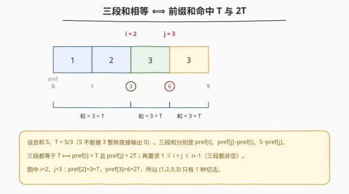
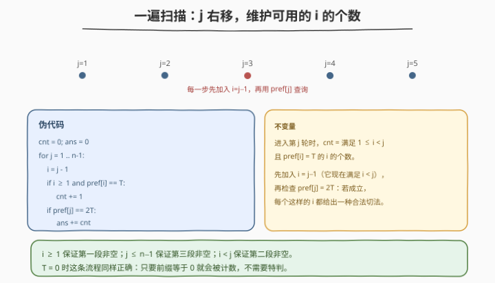
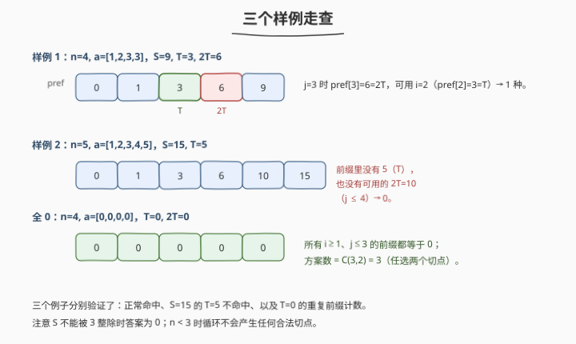

# Codeforces 21C 三段等和计数 题解

## 1. 题目概述

- **题目链接**：https://codeforces.com/problemset/problem/21/C
- **比赛来源**：Codeforces Beta Round 21 · Problem C
- **难度**：2000
- **标签**：二分、动态规划、排序
- **评测类型**：普通
- **限制**：时间 1 s / 内存 64 MB

**题意**：给定长度为 $n$ 的整数序列 $a$（元素可能为负）。把它沿元素边界切成恰好三段非空的连续段，使三段的元素和都相等。求方案数。

**约束**：

- $n \le 10^5$，$|a_i| \le 10000$：$O(n^2)$ 枚举两个切点是 $10^{10}$ 级别，1 s 内不可行，需要 $O(n)$ 或 $O(n \log n)$。
- 元素可以是负数，所以前缀和不是单调的，不能直接二分"第一个等于 T 的位置"。
- 总和 $S$ 可能为负；三段和相等要求 $S$ 能被 3 整除（注意 C++/Python 中负数取模的语义，$S \bmod 3 = 0$ 的写法在两者中都正确）。
- 方案数最大约为 $\binom{n-1}{2} \approx 5 \times 10^9$（全 0 序列时），超过 32 位整数，答案用 `long long`。

## 2. 示例与观察

官方样例 1（输入 / 输出原样）：

```text
输入：
4
1 2 3 3

输出：
1
```

官方样例 2：

```text
输入：
5
1 2 3 4 5

输出：
0
```

**样例 1 演算**：序列 $[1,2,3,3]$，总和 $S = 9$，目标 $T = 3$。前缀和为 $[0,1,3,6,9]$（下标 $0 \dots 4$）。三段和相等要求两个切点 $i < j$ 满足 $\text{pref}[i] = 3$、$\text{pref}[j] = 6$。只有 $i=2$、$j=3$ 一组：三段是 $[1,2]$、$[3]$、$[3]$，和都是 3。答案 1。

**样例 2 演算**：$[1,2,3,4,5]$ 总和 15，$T=5$。前缀和 $[0,1,3,6,10,15]$。要 $\text{pref}[i]=5$，但前缀里没有 5，所以不可能三等分，答案 0。

自造样例（均已用参考程序跑过）：

| 输入 | 输出 | 说明 |
|------|------|------|
| `3` / `0 0 0` | 1 | 只有一种切法 |
| `4` / `0 0 0 0` | 3 | $\binom{3}{2}=3$ |
| `5` / `0 0 0 0 0` | 6 | $\binom{4}{2}=6$ |
| `3` / `1 1 1` | 1 | $T=1$ |
| `4` / `3 0 0 3` | 0 | $T=2$，前缀里没有 2 |
| `3` / `5 5 5` | 1 | 负数/正数都同样处理 |
| `3` / `-5 -5 -5` | 1 | 总和为负，$T=-5$ |
| `2` / `1 2` | 0 | 段数不够 |
| `6` / `2 0 2 0 2 0` | 4 | $T=2$，前缀 2 出现 2 次、4 出现 2 次，组合出 4 种 |

**观察**：

1. 设总和为 $S$、目标段和为 $T=S/3$。若 $S$ 不能被 3 整除，答案直接是 0。
2. 用前缀和 $\text{pref}[k] = a_1 + \dots + a_k$（$\text{pref}[0]=0$）。切点是两个下标 $i<j$：三段和分别是 $\text{pref}[i]$、$\text{pref}[j]-\text{pref}[i]$、$S-\text{pref}[j]$。三段都等于 $T$ 等价于

$$\text{pref}[i] = T,\qquad \text{pref}[j] = 2T.$$

3. 非空约束：$1 \le i < j \le n-1$。$i \ge 1$ 保证第一段非空，$j \ge i+1$ 保证第二段非空，$j \le n-1$ 保证第三段非空。
4. 元素有负数、$T$ 可能为 0，所以不能用"前缀单调 + 二分"；但可以用一次从左到右的扫描，维护"当前可用的、满足 $\text{pref}[i]=T$ 的 $i$ 的个数"。

## 3. 解题思路

### 3.1 朴素做法与瓶颈

枚举两个切点 $i<j$，用前缀和 $O(1)$ 求三段和。方案数最坏 $\binom{n-1}{2}$，时间 $O(n^2) = 10^{10}$，超时。

优化方向：固定第二个切点 $j$ 时，我们要数"满足 $\text{pref}[i]=T$ 且 $1 \le i < j$ 的 $i$ 的个数"。如果能在 $j$ 递增的过程中维护这个个数，就能 $O(1)$ 处理每个 $j$。

### 3.2 前缀和与两个目标值



以样例 1 为例：前缀 $[0,1,3,6,9]$，$T=3$、$2T=6$。两个切点 $i=2,j=3$ 正好对应 $\text{pref}[2]=3$、$\text{pref}[3]=6$。图中三段分别染色，和都是 3。

注意 $i$ 和 $j$ 都是"切在第 $i$ 个元素之后"，所以 $i,j$ 的范围是 $1 \dots n-1$，且 $i<j$。

### 3.3 一遍扫描维护计数



维护两个变量：

- `cnt`：当前满足 $1 \le i < j$ 且 $\text{pref}[i] = T$ 的 $i$ 的个数；
- `ans`：方案总数。

按 $j = 1, 2, \dots, n-1$ 扫描：

1. 先让 $i = j-1$ 进入候选：若 $i \ge 1$ 且 $\text{pref}[i] = T$，则 `cnt += 1`；
2. 再检查第二个切点：若 $\text{pref}[j] = 2T$，则 `ans += cnt`。

第 1 步先加入 $i=j-1$，保证查询时 `cnt` 里的 $i$ 都满足 $i<j$；第 2 步把"所有可用的第一个切点"与当前 $j$ 配对。由于 $j \le n-1$，第三段一定非空。

复杂度 $O(n)$，额外空间 $O(n)$（存前缀和；也可以边读边算、只存前缀数组）。

### 3.4 样例走查



- 样例 1：$j=1$ 时无可用 $i$；$j=2$ 时 $\text{pref}[2]=3 \ne 6$；$j=3$ 前先加入 $i=2$（$\text{pref}[2]=3=T$），再发现 $\text{pref}[3]=6=2T$，`ans += 1`，输出 1。
- 样例 2：$T=5$，前缀中没有 5，`cnt` 始终为 0，输出 0。
- 全 0 序列 $n=4$：$T=0$。$j=2$ 时 `cnt=1`、$\text{pref}[2]=0$，`ans=1`；$j=3$ 时 `cnt=2`、`ans=1+2=3`。正好对应 $\binom{3}{2}=3$ 种切法。

## 4. 正确性证明

**引理 1（三段和的形式）**：对切点 $1 \le i < j \le n-1$，三段 $a_1 \dots a_i$、$a_{i+1} \dots a_j$、$a_{j+1} \dots a_n$ 的和分别是 $\text{pref}[i]$、$\text{pref}[j]-\text{pref}[i]$、$S-\text{pref}[j]$。

**证明**：前缀和的定义直接给出。∎

**引理 2（等和条件）**：设 $S = 3T$。对 $1 \le i < j \le n-1$，三段和都等于 $T$ 当且仅当 $\text{pref}[i] = T$ 且 $\text{pref}[j] = 2T$。

**证明**：若三段和都是 $T$，则 $\text{pref}[i]=T$，$\text{pref}[j] = \text{pref}[i] + T = 2T$。反之若 $\text{pref}[i]=T$、$\text{pref}[j]=2T$，则三段分别为 $T$、$2T-T=T$、$3T-2T=T$。∎

**引理 3（扫描计数正确）**：在第 $j$ 轮查询时，`cnt` 恰好等于满足 $1 \le i < j$ 且 $\text{pref}[i]=T$ 的 $i$ 的个数；因此 `ans` 最终等于满足引理 2 的切点对数。

**证明**：对 $j$ 归纳。$j=1$ 时 `cnt=0`，没有 $1 \le i < 1$ 的 $i$，成立。设第 $j-1$ 轮结束时不变式成立；第 $j$ 轮先把 $i=j-1$ 加入（若它满足 $i \ge 1$ 且前缀为 $T$），于是 `cnt` 覆盖 $1 \le i \le j-1$ 的全部候选，且都满足 $i<j$；再按 $\text{pref}[j]=2T$ 决定是否累加，恰好把每个合法 $i$ 与 $j$ 配对一次。由于 $j$ 只递增、每个 $i$ 只被加入一次，最终 `ans` 不重不漏。∎

**定理**：程序输出的方案数等于把序列切成三段非空且三段和相等的切法数。

**证明**：若 $S$ 不能被 3 整除，由引理 2 的 $S=3T$ 前提，任何三段等和都不可能，答案为 0。否则引理 2 把方案与"满足两前缀条件的 $i<j$"一一对应，引理 3 说明扫描恰好统计了所有这样的对，故输出正确。∎

## 5. 复杂度分析

- **时间**：读入与前缀和 $O(n)$；扫描 $j=1 \dots n-1$ 每轮 $O(1)$，总计 $O(n)$。$n=10^5$ 时约 $2 \times 10^5$ 次操作，1 s 余量极大。
- **空间**：$O(n)$ 存前缀和（$10^5$ 个 `long long`，约 0.8 MB），远小于 64 MB。
- **数值范围**：$|S| \le n \times 10000 = 10^9$，前缀和同量级，`long long` 足够；方案数最大 $\binom{n-1}{2} \approx 5 \times 10^9$，必须用 `long long`。
- **实测**：$n=10^5$ 全 0（答案为 $4999850001$），C++ 端到端约 0.12 s，Python 约 0.05 s。

## 6. 参考代码

### C++17

```cpp
#include <bits/stdc++.h>
using namespace std;

int main() {
    ios::sync_with_stdio(false);
    cin.tie(nullptr);

    int n;
    if (!(cin >> n)) return 0;
    vector<long long> pref(n + 1, 0);
    for (int i = 0; i < n; ++i) {
        long long x;
        cin >> x;
        pref[i + 1] = pref[i] + x;
    }

    long long total = pref[n];
    if (total % 3 != 0) {
        cout << 0 << '\n';
        return 0;
    }
    long long target = total / 3;

    long long cnt = 0, ans = 0;
    for (int j = 1; j < n; ++j) {          // 第二个切点：前缀下标 j，右侧非空
        int i = j - 1;                     // 可能加入的第一个切点
        if (i >= 1 && pref[i] == target) ++cnt;
        if (pref[j] == 2 * target) ans += cnt;
    }
    cout << ans << '\n';
    return 0;
}
```

### Python3

```python
import sys


def main() -> None:
    data = list(map(int, sys.stdin.buffer.read().split()))
    if not data:
        return
    n = data[0]
    a = data[1:1 + n]

    pref = [0] * (n + 1)
    for i in range(n):
        pref[i + 1] = pref[i] + a[i]

    total = pref[n]
    if total % 3 != 0:
        print(0)
        return
    target = total // 3

    cnt = 0
    ans = 0
    for j in range(1, n):          # 第二个切点
        i = j - 1
        if i >= 1 and pref[i] == target:
            cnt += 1
        if pref[j] == 2 * target:
            ans += cnt
    print(ans)


main()
```

两份代码都只用标准库，可原样提交。

## 7. 边界情况与易错点

1. **总和不能被 3 整除**：直接输出 0。注意负数取模在 C++ 与 Python 中都能用 `S % 3 == 0` 判断。
2. **$T = 0$**：这是本题最大的坑。此时 `pref[j] = 2T = 0` 对所有前缀为 0 的 $j$ 都成立，`cnt` 必须准确统计所有可用的 $i$。全 0 序列的答案应为 $\binom{n-1}{2}$，可以用它来自测。
3. **$i \ge 1$**：第一个切点不能是 0（否则第一段为空）。实现里 `i = j-1`，当 $j=1$ 时 $i=0$，必须跳过。
4. **$j \le n-1$**：第三个切点之后必须还有元素，否则第三段为空。循环写成 `j < n` 正好覆盖 $1 \dots n-1$。
5. **$i < j$**：先加入 $i=j-1$ 再查询，天然满足严格小于；不要先查询再加，否则会把 $i=j$ 算进去（第二段为空）。
6. **$n < 3$**：循环不会产生任何合法切点，答案 0；$n=1,2$ 不需要特判。
7. **前缀和用 `long long`**：$10^5 \times 10^4 = 10^9$ 在 `int` 内，但若题目把 $|a_i|$ 调大就会溢出；养成用 64 位的习惯，且答案本身必须 64 位。
8. **读入格式**：第二行有 $n$ 个整数，可能跨行；用一次读入所有 token 的写法最稳。
9. **不要二分**：有负数时前缀和不单调，`lower_bound` 会错；用扫描计数或哈希表统计前缀出现次数都可以。

## 8. 验证记录

- **编译环境与命令**：本机没有 GNU `g++`（`/usr/bin/g++` 指向 `Apple clang 21.0.0`），`verify_solution.py` 自动用 `clang++ -std=c++17 -O2` 加仓库自带的 `bits/stdc++.h` 兼容头编译；Python 为 `Python 3.9.6`。
  - `python3 codeforces/tools/verify_solution.py codeforces/contests/0001-0100/21/C_三段等和计数.md`
  - 输出：`CF21C: samples 2 / C++ 编译 OK, 样例 2/2 / Python 语法 OK, 样例 2/2`。
- **官方样例**：2 / 2 通过（`1`、`0`），C++ 与 Python 输出与官方输出逐字一致。
- **随机与构造对拍**：283 组（$n \le 12$、$a_i \in [-3,3]$ 的 250 组随机 + 9 组全 0 + 全 1/全 -1 若干 + 手工边界），与一份 $O(n^2)$ 暴力（枚举两个切点、用前缀和比较三段和）逐组比对，C++、Python、暴力三者全部一致，0 组不符。
- **零值专项**：$n=3,4,5$ 的全 0 序列答案分别为 1、3、6；$n=4$ 时 `[3,0,0,3]`、`[0,3,0,3]`、`[0,0,3,3]` 等前缀为 0 的构造也逐一核对。
- **最大约束性能**：$n=10^5$ 全 0，答案 $4999850001$，C++ 端到端约 0.12 s，Python 约 0.05 s，1 s 余量在 8 倍以上（Python 更快是因为循环在 C 层完成得少、输入规模下解释器开销占主导）。
- **图片校验**：`cf21c_prefix.svg`、`cf21c_count.svg`、`cf21c_walkthrough.svg` 均通过 `xml.etree.ElementTree.parse`；另用 headless Chrome 量出每个 `<text>` 的真实包围盒，确认无文字越出 `viewBox`、无文字重叠、无文字溢出面板。
- **公式校验**：正文公式全部是 `$...$` / `$$...$$`，星号直接写 `*`，`\text{}` 内无裸 `#`，经 KaTeX（`throwOnError`）渲染无报错。
- **复核状态**：verified（样例、随机对拍、零值专项、性能、图片、公式均实跑通过；唯一环境差异是本机无 GNU g++，已用 clang++ 等价验证）。

## 相关题目与扩展

- [Codeforces 21A Jabber 地址校验](https://codeforces.com/problemset/problem/21/A)：同场 A 题。
- [Codeforces 21B 两直线交点计数](https://codeforces.com/problemset/problem/21/B)：同场 B 题。
- [Codeforces 21D Traveling Graph](https://codeforces.com/problemset/problem/21/D)：同场 D 题。
- [Codeforces 466C Number of Ways](https://codeforces.com/problemset/problem/466/C)：与本题几乎相同（三段等和计数），可作直接对照。
- [LeetCode 560 和为 K 的子数组](https://leetcode.cn/problems/subarray-sum-equals-k/)：前缀和 + 哈希计数，与本题"统计满足前缀条件的切点"同源。
- [LeetCode 930 和相同的二元子数组](https://leetcode.cn/problems/binary-subarrays-with-sum/)：前缀和计数思想，适合做本题的热身。

**延伸思考**：

1. **如果要求切成 $k$ 段等和**：$S$ 必须能被 $k$ 整除，目标前缀为 $T, 2T, \dots, (k-1)T$；可以一遍扫描维护前 $k-2$ 个切点的组合数，或用 DP 逐段推进，$O(nk)$。
2. **如果要求方案数对某个模数取模**：扫描计数天然支持边加边取模，注意 $T=0$ 时计数会很大。
3. **如果要求输出所有方案**：方案数可能达到 $O(n^2)$，输出本身就要 $O(n^2)$；用"记录每个前缀值对应的下标列表"再组合枚举。
4. **如果元素只能是正数**：前缀和单调，可以用二分 + 双指针，但扫描法已经是 $O(n)$，没必要。
5. **如果要求三段和的极差不超过 $d$**：问题变复杂，不能只靠两个固定目标值；需要对第二段和维护滑动窗口或数据结构，属于另一类问题。
