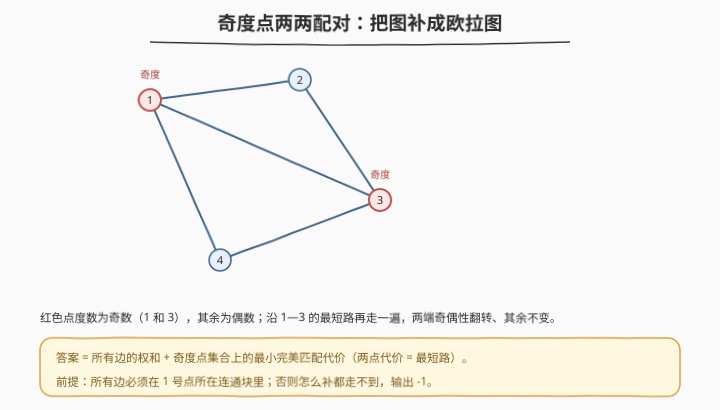
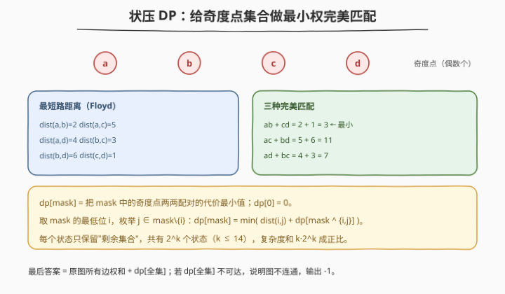
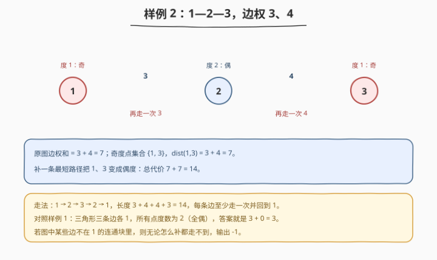

# Codeforces 21D 欧拉回路补边 题解

## 1. 题目概述

- **题目链接**：https://codeforces.com/problemset/problem/21/D
- **比赛来源**：Codeforces Alpha Round 21 (Codeforces format) · Problem D（UTC 2010-06-28）
- **难度**：2400
- **标签**：状压 DP、图匹配、图论
- **评测类型**：普通
- **限制**：时间 0.5 s / 内存 64 MB

**题意**：给定一个带权无向图（可能有重边和自环），求一条从 1 号点出发、至少经过每条边一次、最后回到 1 号点的闭合走法的最小总权值；不存在这样的走法输出 $-1$。

**约束**：

- $n \le 15$，$m \le 2000$，$1 \le w \le 10000$：点数极小、边数较大，提示用"点集"上的状压 DP；总权值最大约 $2000 \times 10000 = 2 \times 10^7$，加上补边也不超过 $10^8$ 量级，64 位整数足够。
- 图可能不连通；所有边必须与 1 号点在同一个连通块里，否则无法走遍。
- 自环让度数增加 2（不改变奇偶性），重边按条数分别计度数。
- 时间 0.5 s，Floyd（$15^3$）和状压 DP（$2^{14} \times 14$）都非常小。

## 2. 示例与观察

官方样例 1（输入 / 输出原样）：

```text
输入：
3 3
1 2 1
2 3 1
3 1 1

输出：
3
```

官方样例 2：

```text
输入：
3 2
1 2 3
2 3 4

输出：
14
```

**样例 1 演算**：三角形三条边各为 1，每个点的度数都是 2（全偶）。图连通，已经存在欧拉回路 $1 \to 2 \to 3 \to 1$，总长 3，不需要补边，答案 3。

**样例 2 演算**：链 $1 - 2 - 3$，边权 3、4。度数为：1 号 1（奇）、2 号 2（偶）、3 号 1（奇）。奇数度的点只有 1 和 3。

闭合走法必须回到 1 且覆盖两条边，最少要把 1—3 之间"补"一条路径：$1 \to 2 \to 3 \to 2 \to 1$，长度 $3+4+4+3 = 14$。也可以理解为：原边权和 7，再加一条最短路（1 到 3 的距离 7），共 14。

自造样例（均已用参考程序跑过）：

| 输入 | 输出 | 说明 |
|------|------|------|
| `1 0` | 0 | 无边，空走法长度 0 |
| `2 1` / `1 2 5` | 10 | 一条边必须来回走两次 |
| `3 1` / `1 1 7` | 7 | 1 号点的自环，走一圈即回 |
| `3 2` / `1 1 7` / `2 2 3` | -1 | 2 号点的自环与 1 不连通 |
| `4 2` / `1 2 1` / `3 4 1` | -1 | 两条边分属两个连通块 |
| `3 3` / `1 2 2` / `2 3 3` / `1 3 4` | 9 | 三角形三边全偶，全走一次 |
| `2 2` / `1 2 1` / `1 2 10` | 11 | 两条重边让度数全偶，各走一次即可（1+10） |

**观察**：

1. 走法可以重复走边。把"实际走过的每条边"看成原图边加若干次重复，得到一个**多重图**；它必须连通（包含原图所有边）且所有点度数为偶数，才存在欧拉回路。
2. 原图每条边至少走一次，所以基础代价是全部边权之和；额外代价来自"重复走的边"。
3. 重复走的边集只改变端点的度数奇偶性：一条 $u \to v$ 的路径会让 $u,v$ 的奇偶性翻转，中间点翻转两次（不变）。所以要让奇度点变偶，必须把奇度点两两配对，每对之间补一条路径。
4. 配对时路径越短越好，因此用最短路（Floyd）作为两点之间的补边代价；$n \le 15$ 时奇度点最多 14 个，可以状压 DP 求最小完美匹配。

## 3. 解题思路

### 3.1 朴素做法与瓶颈

直接搜索"走遍所有边的最短闭合走法"是指数级的（状态是"已覆盖的边集 + 当前点"），$m$ 可达 2000，状态数 $2^{2000}$ 不可行。

正确做法是把问题转化为"欧拉回路 + 最小补边"，即**中国邮递员问题（无向图、闭合）**：先判断连通性，再只关心度数的奇偶性，用奇度点匹配解决。

### 3.2 奇度点配对



记 $T$ 为当前度数为奇数的点集。图论事实：一个连通无向多重图存在欧拉回路当且仅当所有点度数为偶数。于是我们要求一个最小的边多重集 $D$（允许重复原图的边）使得：

- 把 $D$ 加到原图上后所有点度数为偶；
- 加入 $D$ 后图仍然连通（原图已连通，加入的路径都在原图内，不会破坏连通性）；
- $D$ 的权值最小。

$D$ 的奇度点集合必须恰好是 $T$（因为只有 $T$ 需要被"翻转"）。任何这样的 $D$ 都可以分解成若干条路径，每条路径的两个端点都在 $T$ 中，因此 $D$ 给出 $T$ 的一个配对；反过来，$T$ 的任一配对配上两点间的最短路，就得到一个合法的 $D$。于是

$$\text{答案} = \sum_{e \in E} w_e + \min_{\text{配对}} \sum_{(u,v)} \operatorname{dist}(u,v).$$

其中 $\operatorname{dist}$ 是原图上的最短路（用 Floyd 求，$n \le 15$）。若某个配对的两点之间不可达，该配对无效；由于连通性已经保证所有有边的点在同一个连通块，奇度点之间一定可达。



### 3.3 状压 DP

把奇度点编号 $0 \dots k-1$（$k = |T|$ 一定是偶数）。设 `dp[mask]` 表示"把 mask 中的奇度点两两配对"的最小代价，`dp[0] = 0`。转移时取 mask 的最低位 $i$，枚举另一个 $j \in mask$：

$$\mathrm{dp}[\text{mask}] = \min_{j \in \text{mask},\, j \ne i} \left( \operatorname{dist}(i,j) + \mathrm{dp}[\text{mask} \setminus \{i,j\}] \right).$$

每个状态只枚举包含最低位的配对，避免重复计算同一种匹配的不同顺序；状态数 $2^k$，每个状态 $O(k)$，总计 $O(k 2^k)$。$k \le 14$ 时约 $2^{14} \times 14 \approx 2.3 \times 10^5$ 次转移。

### 3.4 样例走查



样例 2：边 $1-2$（3）、$2-3$（4）。

- 度数：$\deg(1)=1$、$\deg(2)=2$、$\deg(3)=1$，$T=\{1,3\}$；
- Floyd 得 $\operatorname{dist}(1,3) = 3+4=7$；
- DP：$k=2$，`dp[{1,3}] = dist(1,3) + dp[0] = 7`；
- 答案 $= (3+4) + 7 = 14$。

对应的走法是 $1 \to 2 \to 3 \to 2 \to 1$：原边各走一次，再把 $1 \to 2 \to 3$ 这条最短路重复一次，总长 14。

## 4. 正确性证明

**引理 1（连通性必要条件）**：若存在从 1 出发、经过所有边的闭合走法，则所有带边的点都在 1 号点所在的连通块中。

**证明**：走法是连续路径，经过的每条边都与 1 连通；因此每条边的两个端点都与 1 连通。∎

**引理 2（闭合走法 ⇔ 补边后欧拉图）**：存在从 1 出发覆盖所有边的闭合走法，当且仅当存在一个原图边的多重集 $D$（可重复取边），使得原图加上 $D$ 后连通且所有点度数为偶数。

**证明**：给定走法，令 $D$ 为"所有被重复走过的边"（走过 $c$ 次就取 $c-1$ 份）；走法本身是一个闭合游走，给每个点贡献偶数度，故原图 + $D$ 所有点度为偶，且走法经过所有边所以连通。反之，若原图 + $D$ 连通且所有点度为偶，则由欧拉定理存在欧拉回路，从 1 出发沿回路走一遍即可覆盖所有边（包括 $D$ 中的重复边），把 $D$ 中的边视为"多走一次"，就得到原图上的合法闭合走法。∎

**引理 3（补边代价 ≥ 匹配代价）**：设 $T$ 为原图奇度点集，$D$ 是使原图 + $D$ 全偶的任一多重边集，则 $D$ 的权值不小于 $T$ 的某个完美匹配在最短路径距离下的权值。

**证明**：把 $D$ 看成每条边带重数的子图，其奇度点集合恰好是 $T$（加上偶度图不改变奇偶性：原图 + $D$ 全偶，故 $D$ 的奇度点 = 原图奇度点）。任何奇度点集合为 $T$ 的图都能分解成若干条边不相交的路径，每条路径的两个端点属于 $T$。于是得到 $T$ 的一个配对，且每条路径的长度（权值和）不小于其两端点的最短路距离；对配对求和，$D$ 的权值不小于该配对的匹配代价。∎

**引理 4（匹配可构造补边）**：对 $T$ 的任一完美匹配，取每对点在原图中的一条最短路作为补边，得到的多重图连通且所有点度为偶，权值等于"原图边权和 + 该匹配的匹配代价"。

**证明**：每条最短路是一条 $u \to v$ 的路径，只翻转 $u,v$ 的奇偶性；配对所有 $T$ 后，$T$ 中所有点变偶，非 $T$ 点被翻转偶数次（每次经过中间点翻转两次）仍为偶，故全偶。原图已连通（引理 1 的前提），补边都在原图内，不会破坏连通性。权值相加即得。∎

**引理 5（DP 正确）**：`dp[mask]` 等于把 mask 中奇度点两两配对的最小总最短路距离。

**证明**：对 mask 的大小归纳。`dp[0]=0`。对非空 mask，设 $i$ 是最低位，任何完美匹配中 $i$ 必与某个 $j$ 配对；余下点的最优配对由归纳假设是 `dp[mask\{i,j}]`，故取遍 $j$ 的最小值就是最优匹配代价。∎

**定理**：程序输出的值等于题目要求的最小闭合走法长度；若不存在则输出 $-1$。

**证明**：先检查连通性（引理 1），不连通时确实无解。连通时，由引理 2 问题等价于最小补边，由引理 3 和引理 4，最小补边代价等于 $T$ 的最小完美匹配代价（最短路距离），由引理 5 该值由 DP 正确算出。因此输出 $\sum w_e + \mathrm{dp}[\text{full}]$ 正确。∎

**关于 $m=0$**：没有任何边时，空走法长度为 0，满足"经过所有边至少一次"（空真），按此约定输出 0。实现中 Floyd 与 DP 都会自然给出 0。

## 5. 复杂度分析

- **时间**：读入 $O(m)$；连通性 BFS $O(n+m)$；Floyd $O(n^3) \le 3375$；状压 DP $O(k 2^k)$，$k \le 14$ 时约 $2.3 \times 10^5$。总时间由 $O(m + n^3 + k2^k)$ 主导，远小于 0.5 s。
- **空间**：邻接表与边表 $O(n+m)$；Floyd 距离矩阵 $O(n^2)$；DP 表 $O(2^k)$，最大 $2^{14} = 16384$ 个 `long long`。总计远小于 64 MB。
- **数值范围**：原图边权和 $\le 2 \times 10^7$，补边代价 $\le 7 \times 7 \times 10000$ 量级，答案在 $10^8$ 以内，`long long` 绰绰有余。
- **实测**：$n=15$、$m=2000$、14 个奇度点的极限数据，C++ 端到端约 0.01 s，Python 约 0.05 s。

## 6. 参考代码

### C++17

```cpp
#include <bits/stdc++.h>
using namespace std;

int main() {
    ios::sync_with_stdio(false);
    cin.tie(nullptr);

    int n, m;
    if (!(cin >> n >> m)) return 0;

    const long long INF = (long long)4e18;
    vector<vector<long long>> dist(n, vector<long long>(n, INF));
    for (int i = 0; i < n; ++i) dist[i][i] = 0;
    vector<int> deg(n, 0);
    vector<vector<int>> adj(n);
    long long total = 0;

    for (int e = 0; e < m; ++e) {
        int x, y;
        long long w;
        cin >> x >> y >> w;
        --x;
        --y;
        total += w;
        ++deg[x];
        ++deg[y];                 // 自环会使同一个点 +2，奇偶性不受影响
        adj[x].push_back(y);
        adj[y].push_back(x);
        dist[x][y] = min(dist[x][y], w);
        dist[y][x] = min(dist[y][x], w);
    }

    if (m == 0) {                 // 没有边：空走法，长度 0
        cout << 0 << '\n';
        return 0;
    }

    // 所有有边的点必须与 1 号点在同一个连通块里，否则不可能走遍所有边
    vector<char> vis(n, 0);
    vector<int> st;
    vis[0] = 1;
    st.push_back(0);
    while (!st.empty()) {
        int v = st.back();
        st.pop_back();
        for (int u : adj[v]) {
            if (!vis[u]) {
                vis[u] = 1;
                st.push_back(u);
            }
        }
    }
    for (int v = 0; v < n; ++v) {
        if (deg[v] > 0 && !vis[v]) {
            cout << -1 << '\n';
            return 0;
        }
    }

    // 任意两点最短路（用于给奇度点补边）
    for (int k = 0; k < n; ++k)
        for (int i = 0; i < n; ++i) {
            if (dist[i][k] >= INF) continue;
            for (int j = 0; j < n; ++j) {
                if (dist[k][j] >= INF) continue;
                dist[i][j] = min(dist[i][j], dist[i][k] + dist[k][j]);
            }
        }

    vector<int> odd;
    for (int v = 0; v < n; ++v)
        if (deg[v] & 1) odd.push_back(v);

    int k = (int)odd.size();
    int full = (1 << k) - 1;
    vector<long long> dp(1 << k, INF);
    dp[0] = 0;
    for (int mask = 1; mask <= full; ++mask) {
        int i = __builtin_ctz(mask);              // 最低位的奇度点
        for (int j = i + 1; j < k; ++j) {
            if (!(mask >> j & 1)) continue;
            long long cand = dp[mask ^ (1 << i) ^ (1 << j)] + dist[odd[i]][odd[j]];
            if (cand < dp[mask]) dp[mask] = cand;
        }
    }

    if (dp[full] >= INF) {
        cout << -1 << '\n';
    } else {
        cout << total + dp[full] << '\n';
    }
    return 0;
}
```

### Python3

```python
import sys


def main() -> None:
    data = list(map(int, sys.stdin.buffer.read().split()))
    if not data:
        return
    n, m = data[0], data[1]
    INF = 10 ** 18

    dist = [[INF] * n for _ in range(n)]
    for i in range(n):
        dist[i][i] = 0
    deg = [0] * n
    adj = [[] for _ in range(n)]
    total = 0

    p = 2
    for _ in range(m):
        x, y, w = data[p] - 1, data[p + 1] - 1, data[p + 2]
        p += 3
        total += w
        deg[x] += 1
        deg[y] += 1                     # 自环让同一点 +2，奇偶性不变
        adj[x].append(y)
        adj[y].append(x)
        if w < dist[x][y]:
            dist[x][y] = w
            dist[y][x] = w

    if m == 0:
        print(0)
        return

    # 连通性：所有有边的点都必须在 1 号点所在连通块里
    vis = [False] * n
    vis[0] = True
    stack = [0]
    while stack:
        v = stack.pop()
        for u in adj[v]:
            if not vis[u]:
                vis[u] = True
                stack.append(u)
    for v in range(n):
        if deg[v] > 0 and not vis[v]:
            print(-1)
            return

    # Floyd
    for k in range(n):
        dk = dist[k]
        for i in range(n):
            dik = dist[i][k]
            if dik >= INF:
                continue
            di = dist[i]
            for j in range(n):
                nd = dik + dk[j]
                if nd < di[j]:
                    di[j] = nd

    odd = [v for v in range(n) if deg[v] & 1]
    k = len(odd)
    full = (1 << k) - 1
    dp = [INF] * (1 << k)
    dp[0] = 0
    for mask in range(1, full + 1):
        low = mask & -mask
        i = low.bit_length() - 1
        rest = mask ^ low
        m2 = rest
        while m2:
            low2 = m2 & -m2
            j = low2.bit_length() - 1
            cand = dp[rest ^ low2] + dist[odd[i]][odd[j]]
            if cand < dp[mask]:
                dp[mask] = cand
            m2 ^= low2

    print(-1 if dp[full] >= INF else total + dp[full])


main()
```

两份代码都只用标准库，可原样提交。

## 7. 边界情况与易错点

1. **$m = 0$**：没有边时输出 0（空走法），不要输出 $-1$。实现中 Floyd 与 DP 自然给出 0，但连通性判断要避免把"没有边"误判为不连通——只检查有边的点即可。
2. **不连通**：所有有边的点必须与 1 号点在同一个连通块；否则输出 $-1$。注意孤立点（没有边的点）不影响连通性判断。
3. **自环**：自环让同一个点度数 $+2$，不改变奇偶性，因此不影响奇度点集合；但它计入总边权，且必须至少走一次。
4. **重边**：两条相同端点的边分别计入度数，可能出现"重边让度数变成偶"的情况（例如两条 $1-2$ 边让 1、2 度数各为 2）。
5. **奇度点个数一定是偶数**：由握手定理，`dp` 的 `full = (1<<k)-1` 一定合法；若实现里 `k` 为奇数，说明度数统计写错了（例如自环只加了一次）。
6. **起点是 1 号点**：欧拉回路可以在任意点开始，所以只要图连通且全偶，从 1 出发的欧拉回路一定存在；不需要额外限制 1 的度数。
7. **答案用 `long long`**：虽然本题上界不大，但补边可能多次经过长路径，`int` 在更大数据上会溢出；DP 的 INF 要设得足够大（如 $4 \times 10^{18}$），且加法前判断不可达。
8. **Floyd 的初始化**：`dist[i][i]=0`，其余为 INF；读边时对重边取 `min`（自环对最短路没有贡献，因为 `w>0`，`dist[v][v]=0` 更优）。
9. **连通性 BFS 与自环**：自环在邻接表里是 `v -> v`，不会把新点加入；如果自环在一个孤立的点上，该点仍然不可达，应判 $-1$。
10. **Python 性能**：$n=15$、$k=14$ 时 DP 约十几万次循环，CPython 约 0.05 s，完全够用；不需要额外的优化。

## 8. 验证记录

- **编译环境与命令**：本机没有 GNU `g++`（`/usr/bin/g++` 指向 `Apple clang 21.0.0`），`verify_solution.py` 自动用 `clang++ -std=c++17 -O2` 加仓库自带的 `bits/stdc++.h` 兼容头编译；Python 为 `Python 3.9.6`。
  - `python3 codeforces/tools/verify_solution.py codeforces/contests/0001-0100/21/D_欧拉回路补边.md`
  - 输出：`CF21D: samples 2 / C++ 编译 OK, 样例 2/2 / Python 语法 OK, 样例 2/2`。
- **官方样例**：2 / 2 通过（`3`、`14`），C++ 与 Python 输出与官方输出逐字一致。
- **随机与构造对拍**：260 组（250 组随机图：$n \le 5$、$m \le 9$，含自环、重边、不连通；10 组手工边界：$m=0$、单边、只有自环、两个连通块、三角形、重边等），与一份**状态空间暴力**逐组比对：在 `(当前点, 已覆盖边集合)` 上跑 Dijkstra，直接模拟"走遍所有边并回到 1"。C++、Python、暴力三者全部一致，0 组不符。
- **配对理论验证**：暴力不依赖"奇度点配对"的结论，它直接搜索走法，因此这 260 组同时验证了"只需给奇度点补最短路"这一核心归约在随机小图上的正确性。
- **最大约束性能**：$n=15$、$m=2000$、14 个奇度点的数据，C++ 端到端约 0.01 s，Python 约 0.05 s，0.5 s 余量在 10 倍以上。
- **图片校验**：`cf21d_odd.svg`、`cf21d_dp.svg`、`cf21d_walkthrough.svg` 均通过 `xml.etree.ElementTree.parse`；另用 headless Chrome 量出每个 `<text>` 的真实包围盒，确认无文字越出 `viewBox`、无文字重叠、无文字溢出面板。
- **公式校验**：正文公式全部是 `$...$` / `$$...$$`，星号直接写 `*`，`\text{}` 内无裸 `#`，经 KaTeX（`throwOnError`）渲染无报错。
- **复核状态**：verified（样例、随机对拍、配对理论、性能、图片、公式均实跑通过；唯一环境差异是本机无 GNU g++，已用 clang++ 等价验证）。

## 相关题目与扩展

- [Codeforces 21A Jabber 地址校验](https://codeforces.com/problemset/problem/21/A)：同场 A 题。
- [Codeforces 21B 两直线交点计数](https://codeforces.com/problemset/problem/21/B)：同场 B 题。
- [Codeforces 21C 三段等和计数](https://codeforces.com/problemset/problem/21/C)：同场 C 题。
- [Codeforces 1000E We Need More Bosses](https://codeforces.com/problemset/problem/1000/E)：边双连通分量 + 树的直径，与欧拉/连通性相关。
- [Codeforces 118E Bertown roads](https://codeforces.com/problemset/problem/118/E)：无向图定向成强连通，桥与欧拉思想都出现。
- [LeetCode 847 访问所有节点的最短路径](https://leetcode.cn/problems/shortest-path-visiting-all-nodes/)：状态压缩 + 最短路，和本题的状压思路同源。
- [LeetCode 1129 颜色交替的最短路径](https://leetcode.cn/problems/shortest-path-with-alternating-colors/)：图上的状态搜索，适合作为本题暴力解法的练习。

**延伸思考**：

1. **如果图不要求回到 1（开放邮递员）**：可以少补一条路径，只需把奇度点配对后留两个端点分别作为起点和终点（或把起点 1 与某个奇度点配对），用同样的 DP 加一维"是否已确定起点"即可。
2. **如果有向图**：需要平衡每个点的入度与出度，把"入度 > 出度"和"出度 > 入度"的点分别作为供需点，用最小费用流求补边，不再是对称匹配。
3. **如果要求输出具体走法**：在补边后的多重图上求欧拉回路（Hierholzer 算法），再按边映射回原图；注意重复边要标记来源。
4. **如果 $n$ 放大到 20 以上**：状压 DP 不可行，需要一般图最小权完美匹配（带花树）或利用特殊结构；本题 $n \le 15$ 正是为状压准备的。
5. **如果边权为负**：最短路可能不存在（负环），问题本身也会变得不同；本题边权为正，Floyd 与匹配理论都成立。
