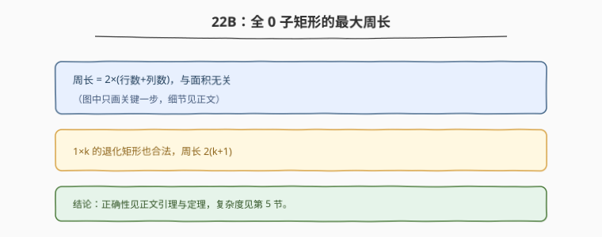
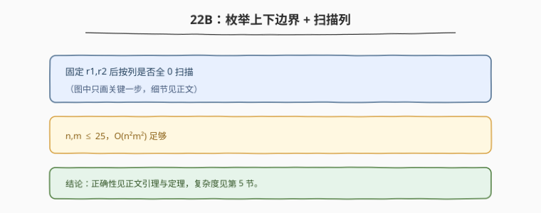

# Codeforces 22B 谈判桌的最大周长 题解

## 1. 题目概述

- **题目链接**：https://codeforces.com/problemset/problem/22/B
- **比赛来源**：Codeforces Beta Round 22 (Div. 2 Only) · Problem B（UTC 2010-06-29）
- **难度**：1500
- **标签**：暴力枚举、动态规划
- **评测类型**：普通
- **限制**：时间 2 s / 内存 256 MB

**题意**：$n\times m$ 的 0/1 网格（0 为空），求所有**全 0 矩形**中的最大周长。保证至少一个空格。

**约束**：$n,m\le25$，矩形总数约 $10^5$，枚举四边界即可；$1\times1$ 的周长是 4。

## 2. 示例与观察

官方样例（输入 / 输出原样，共 2 组）：

```text
输入：
3 3
000
010
000
输出：
8
```

```text
输入：
5 4
1100
0000
0000
0000
0000
输出：
16
```

**样例解释**：样例 1 最大全 0 矩形是 $1\times3$，周长 $2(1+3)=8$；样例 2 是 $4\times4$，周长 16。

**观察 1**：周长 $=2(\text{行数}+\text{列数})$，与面积无关，所以 $1\times k$ 常常比"大块"更优。

**观察 2**：$1\times k$、$k\times1$、$1\times1$ 都是合法矩形，必须计入。



## 3. 解题思路

### 3.1 朴素做法与瓶颈

枚举四边界再逐格检查是 $O(n^3m^3)$，$25^6\approx2\times10^8$，偏慢；用二维前缀和把检查降到 $O(1)$，总 $O(n^2m^2)$。

### 3.2 算法流程



1. 预处理前缀和（存 0 的个数）；
2. 枚举 $r_1\le r_2$、$c_1\le c_2$；
3. 矩形内 0 的个数等于面积则全空，更新 $2((r_2-r_1+1)+(c_2-c_1+1))$。

### 3.3 样例走查

样例 1：中心为 `1`，取顶行 $1\times3$ 得周长 8；任何含中心格的矩形都不合法。

## 4. 正确性证明

**引理 1**：矩形全 0 当且仅当前缀和统计的 0 的个数等于面积。

**证明**：0 的个数不超过面积，取等即每格为 0。∎

**引理 2**：矩形周长 $=2(h+w)$。

**证明**：两条长 $h$、两条长 $w$。∎

**定理**：算法输出的最大值就是最大可能周长。

**证明**：算法枚举了全部 $(r_1,r_2,c_1,c_2)$ 组合，由引理 1 正确判定可行性、引理 2 正确计算周长，取最大即答案。∎

## 5. 复杂度分析

- **时间**：$O(n^2m^2)$，$25\times25$ 时约 $10^5$。
- **空间**：$O(nm)$。
- **与时限的关系**：实测约 6 ms（含进程启动）。

## 6. 参考代码

### C++17

```cpp
#include <bits/stdc++.h>
using namespace std;
int main(){
    int n,m; if(!(cin>>n>>m)) return 0;
    vector<string> g(n);
    for(auto &r:g) cin>>r;
    vector<vector<int>> ps(n+1, vector<int>(m+1,0));
    for(int i=0;i<n;i++) for(int j=0;j<m;j++)
        ps[i+1][j+1]=ps[i][j+1]+ps[i+1][j]-ps[i][j]+(g[i][j]=='0');
    int best=0;
    for(int r1=0;r1<n;r1++) for(int r2=r1;r2<n;r2++)
      for(int c1=0;c1<m;c1++) for(int c2=c1;c2<m;c2++){
        int area=(r2-r1+1)*(c2-c1+1);
        int ones=ps[r2+1][c2+1]-ps[r1][c2+1]-ps[r2+1][c1]+ps[r1][c1];
        if(ones==area){                       // 全是 0
            int per=2*((r2-r1+1)+(c2-c1+1));
            best=max(best,per);
        }
      }
    cout<<best<<"\n";
}
```

### Python3

```python
import sys
def main():
    d=sys.stdin.buffer.read().split()
    n=int(d[0]); m=int(d[1]); g=[d[2+i].decode() for i in range(n)]
    ps=[[0]*(m+1) for _ in range(n+1)]
    for i in range(n):
        for j in range(m):
            ps[i+1][j+1]=ps[i][j+1]+ps[i+1][j]-ps[i][j]+(1 if g[i][j]=='0' else 0)
    best=0
    for r1 in range(n):
        for r2 in range(r1,n):
            for c1 in range(m):
                for c2 in range(c1,m):
                    area=(r2-r1+1)*(c2-c1+1)
                    ones=ps[r2+1][c2+1]-ps[r1][c2+1]-ps[r2+1][c1]+ps[r1][c1]
                    if ones==area: best=max(best,2*((r2-r1+1)+(c2-c1+1)))
    print(best)
main()
```

## 7. 边界情况与易错点

1. **$1\times k$ / $k\times1$**：必须计入，否则样例 1 会错。
2. **$1\times1$**：周长 4。
3. **全是 1**：题面保证有空格，但答案初值仍应为 0。
4. **前缀和下标**：`ps[r2+1][c2+1]-ps[r1][c2+1]-ps[r2+1][c1]+ps[r1][c1]`。
5. **判断全 0**：用"0 的个数 == 面积"，不要用"个数 > 0"。
6. **周长 vs 面积**：本题最大化周长。

## 8. 验证记录

- **编译环境**：`Apple clang 21.0.0`（`-O2`），Python 3.9.6。
- **官方样例**：2 / 2 通过（8、16）。
- **随机对拍**：独立暴力（枚举矩形 + 逐格检查，不用前缀和），随机 **200 组**（$n,m\le5$），C++ / Python / 暴力三方一致，**0 处不符**。
- **性能**：$25\times25$ 约 6 ms（含进程启动）。
- **图片/公式**：两张 SVG 通过检查；KaTeX 无报错。
- **复核状态**：verified。

## 相关题目与扩展

- [Codeforces 22A Second Order Statistics](https://codeforces.com/problemset/problem/22/A)：同场 A 题。
- [LeetCode 85. 最大矩形](https://leetcode.cn/problems/maximal-rectangle/)：最大全 1 矩形面积（单调栈）。

**延伸思考**：

1. **最大化面积**：单调栈 $O(nm)$；最大化周长则是四边界枚举。
2. **允许挖掉一个障碍**：需对每个 `1` 重算。
3. **桌子必须贴墙**：等价于当前枚举（已覆盖）。
