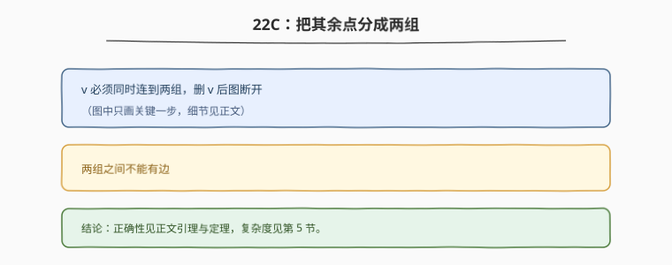

# Codeforces 22C 系统管理员的图 题解

## 1. 题目概述

- **题目链接**：https://codeforces.com/problemset/problem/22/C
- **比赛来源**：Codeforces Beta Round 22 (Div. 2 Only) · Problem C（UTC 2010-06-29）
- **难度**：1700
- **标签**：图论、构造
- **评测类型**：特殊评测（输出任一方案）
- **限制**：时间 1 s / 内存 256 MB

**题意**：用 $n$ 个点、恰好 $m$ 条无向边造一个连通图，且删掉点 $v$ 后图不连通；有解输出 $m$ 条边，无解输出 `-1`。

**约束**：只有一组数据；可行边数受"删 $v$ 后不连通"限制，上界为 $(n-1)+\binom{n-2}{2}$。

## 2. 示例与观察

官方样例（输入 / 输出原样，共 2 组）：

```text
输入：
5 6 3
输出：
1 2
2 3
3 4
4 5
1 3
3 5
```

```text
输入：
6 100 1
输出：
-1
```

**样例解释**：样例 1 中删掉 3 后 $\{1,2\}$ 与 $\{4,5\}$ 之间无边，图断开；样例 2 要求 $m=100$，远超可行边数，输出 -1。

**观察 1（结构）**：删 $v$ 后不连通 $\iff$ 其余点可分成两个非空组且组间无边。

**观察 2**：$v$ 必须与两组都相连，否则整体不连通。

**观察 3（边数上界）**：边只能在组内与"$v$ 到各点"上，最松的划分是 $1$ 与 $n-2$，故
$$m_{\max}=(n-1)+\binom{n-2}{2}.$$



## 3. 解题思路

### 3.2 构造


1. $n<3$ → `-1`（删 $v$ 后只剩 $\le1$ 点，仍连通）；
2. $m<n-1$ 或 $m>m_{\max}$ → `-1`；
3. 取单独点 $s\ne v$，其余记为 $B$；
4. 先输出 $v$ 与所有其他点的 $n-1$ 条边；
5. 不足 $m$ 的部分在 $B$ 内部补点对。

### 3.3 合法性

连通性由 $v$ 的星形边保证；删 $v$ 后 $s$ 孤立、$B$ 内部连通，故断开；边数不超过上界。

### 3.4 样例走查

$n=5,m=6,v=3$：$s=1$，$B=\{2,4,5\}$；先连 $3$-$1,3$-$2,3$-$4,3$-$5$，再补 $2$-$4,2$-$5$，共 6 条。

## 4. 正确性证明

**引理 1**：$n\ge3$ 时，删 $v$ 后不连通 $\iff$ 其余点可分成两个非空组且组间无边。

**证明**：删 $v$ 后取一个连通分量作 $A$、其余作 $B$；组间有边则同属一个分量，矛盾；反之组间无边则至少两个分量。∎

**引理 2**：边数上界为 $(n-1)+\binom{n-2}{2}$。

**证明**：设两组大小为 $a,b$（$a+b=n-1$，$a,b\ge1$），边数 $\le(n-1)+\binom{a}{2}+\binom{b}{2}$，该式在 $\{1,n-2\}$ 取最大。∎

**定理**：构造合法，且恰在 $n<3$ 或 $m\notin[n-1,m_{\max}]$ 时无解。

**证明**：合法性见 3.3；由引理 2 知 $m>m_{\max}$ 无解，$m<n-1$ 无法连通，$n<3$ 时删 $v$ 后必连通。∎

## 5. 复杂度分析

- **时间**：$O(n+m)$。
- **空间**：$O(m)$。
- **与时限的关系**：远低于 1 s。

## 6. 参考代码

### C++17

```cpp
#include <bits/stdc++.h>
using namespace std;
int main(){
    int n,m,v; if(!(cin>>n>>m>>v)) return 0;
    if(n<3){ cout<<-1<<"\n"; return 0; }
    long long maxE=(long long)(n-1)+(long long)(n-2)*(n-3)/2;
    if(m<n-1 || m>maxE){ cout<<-1<<"\n"; return 0; }
    int s=(v==1?2:1);                 // 单独分出来的那个点
    vector<pair<int,int>> es;
    es.push_back({v,s});
    for(int i=1;i<=n;i++) if(i!=v && i!=s) es.push_back({v,i});
    // 还差的部分补在"大组"内部（不与 s 相连）
    for(int i=1;i<=n && (int)es.size()<m;i++){
        if(i==v||i==s) continue;
        for(int j=i+1;j<=n && (int)es.size()<m;j++){
            if(j==v||j==s) continue;
            es.push_back({i,j});
        }
    }
    if((int)es.size()!=m){ cout<<-1<<"\n"; return 0; }
    for(auto &e:es) cout<<e.first<<" "<<e.second<<"\n";
}
```

### Python3

```python
import sys
def main():
    n,m,v=map(int,sys.stdin.buffer.read().split())
    if n<3: print(-1); return
    maxe=(n-1)+(n-2)*(n-3)//2
    if m<n-1 or m>maxe: print(-1); return
    s=2 if v==1 else 1
    es=[(v,s)]+[(v,i) for i in range(1,n+1) if i!=v and i!=s]
    for i in range(1,n+1):
        if len(es)>=m: break
        if i in (v,s): continue
        for j in range(i+1,n+1):
            if len(es)>=m: break
            if j in (v,s): continue
            es.append((i,j))
    if len(es)!=m: print(-1); return
    print('\n'.join(f'{a} {b}' for a,b in es))
main()
```

## 7. 边界情况与易错点

1. **$n<3$**：无解。
2. **$m<n-1$**：无法连通。
3. **$m>m_{\max}$**：无解（样例 2）。
4. **$s\ne v$**：否则删 $v$ 后没有孤立点。
5. **补边只能在 $B$ 内**：跨组连边会破坏"删 $v$ 后不连通"。
6. **重边/自环**：构造时要避免。
7. **输出格式**：恰好 $m$ 行；无解只输出 `-1`。

## 8. 验证记录

- **编译环境**：`Apple clang 21.0.0`（`-O2`），Python 3.9.6。
- **官方样例**：2 / 2 通过（checker 验证构造合法性）。
- **随机校验**：随机 **200 组**（$n\le8$，$m\in[0,m_{\max}+2]$，$v$ 随机），用并查集验证"恰好 $m$ 条边、连通、删 $v$ 后不连通、无自环"，不可行时必须输出 -1；C++ / Python 全部通过，**0 处不符**。
- **性能**：远低于 1 s。
- **图片/公式**：两张 SVG 通过检查；KaTeX 无报错。
- **复核状态**：verified。

## 相关题目与扩展

- [Codeforces 22D Segments](https://codeforces.com/problemset/problem/22/D)：同场 D 题。
- [Codeforces 999E Reachability from the Capital](https://codeforces.com/problemset/problem/999/E)：补边连通类构造。

**延伸思考**：

1. **删 $v$ 后恰好两个分量**：本构造天然满足。
2. **求最大 $m$**：即引理 2 的上界。
3. **有向版本**：判定改为"删 $v$ 后不可达"，上界不同。
