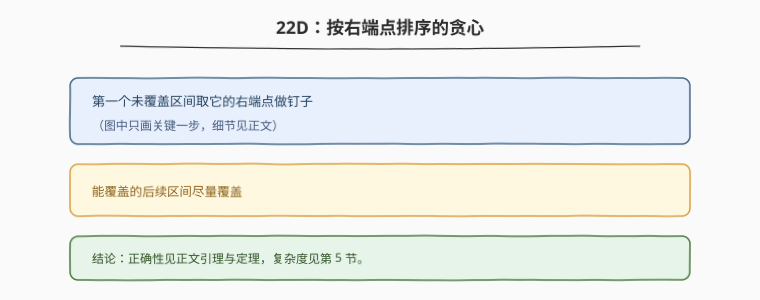
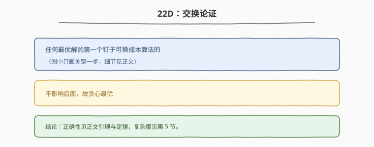

# Codeforces 22D 钉子刺穿所有线段 题解

## 1. 题目概述

- **题目链接**：https://codeforces.com/problemset/problem/22/D
- **比赛来源**：Codeforces Beta Round 22 (Div. 2 Only) · Problem D（UTC 2010-06-29）
- **难度**：1900
- **标签**：贪心、排序
- **评测类型**：特殊评测（任意最优方案）
- **限制**：时间 1 s / 内存 256 MB

**题意**：$n$ 条 $Ox$ 轴上的线段，在整数点钉钉子，钉子落在线段上（含端点）即刺穿。求最少钉子数与一组位置。

**约束**：$n\le1000$，坐标绝对值 $\le10^4$，线段可退化为点；方案不唯一。

## 2. 示例与观察

官方样例（输入 / 输出原样，共 2 组）：

```text
输入：
2
0 2
2 5
输出：
1
2 
```

```text
输入：
5
0 3
4 2
4 8
8 10
7 7
输出：
3
7 10 3
```

**样例解释**：样例 1 两段交于 2，一个钉子即可；样例 2 钉子 $\{3,7,10\}$ 或 $\{3,7,8\}$ 都最优。

**观察 1**：按右端点升序处理，遇到未覆盖线段就在其**右端点**钉钉子。

**观察 2**：右端点能覆盖"左端点 $\le$ 该右端点"的所有后续线段，是最宽松的位置。



## 3. 解题思路

### 3.1 朴素做法与瓶颈

枚举钉子集合是指数级；但可以证明存在最优解只用线段端点，于是候选点只有 $2n$ 个，用区间刺穿的经典贪心。

### 3.2 算法流程



1. 线段规范化为 $[\min,\max]$，按右端点排序；
2. 维护上一个钉子位置 `last`；
3. 若当前线段左端点 $>$ `last`，在右端点钉钉子并令 `last` 为它；
4. 输出钉子数与位置。

### 3.3 样例走查

样例 2 排序后 $[0,3],[2,4],[4,8],[7,7],[8,10]$：钉 3（覆盖前两条）、钉 7（覆盖 $[4,8]$ 与 $[7,7]$）、钉 10（覆盖 $[8,10]$），共 3。

## 4. 正确性证明

**引理 1（必需性）**：贪心在某条未覆盖线段 $I=[l,r]$ 处取 $r$。任何合法解都必须在这条线段上放钉子。

**证明**：此前所有钉子都小于 $l$，且 $r$ 是未处理线段中最小的右端点，故只能用 $[l,r]$ 内的钉子覆盖它。∎

**引理 2（交换）**：把最优解覆盖 $I$ 的钉子 $q\in[l,r]$ 换成 $r$，被覆盖集合不会变小。

**证明**：任意被 $q$ 覆盖且右端点 $\ge r$ 的线段 $J$ 满足 $l_J\le q\le r$，故 $r\in J$；$I$ 也被 $r$ 覆盖。∎

**定理**：贪心钉子数最少。

**证明**：由引理 1 每个"必需钉子"都不能省；由引理 2 可把最优解逐步替换为贪心解而不增加数量，故贪心数量不超过最优数量，又贪心合法，故相等。∎

## 5. 复杂度分析

- **时间**：$O(n\log n)$。
- **空间**：$O(n)$。
- **与时限的关系**：约 2.5 ms（含进程启动）。

## 6. 参考代码

### C++17

```cpp
#include <bits/stdc++.h>
using namespace std;
int main(){
    int n; if(!(cin>>n)) return 0;
    vector<pair<int,int>> seg(n);
    for(auto &p:seg){ cin>>p.second>>p.first; if(p.first<p.second) swap(p.first,p.second); } // (右, 左)
    sort(seg.begin(), seg.end());
    vector<int> pins;
    int last=INT_MIN;
    for(auto &p:seg){
        if(last==INT_MIN || p.second>last){ pins.push_back(p.first); last=p.first; }
    }
    cout<<pins.size()<<"\n";
    for(size_t i=0;i<pins.size();i++) cout<<pins[i]<<(i+1==pins.size()?"\n":" ");
}
```

### Python3

```python
import sys
def main():
    d=list(map(int,sys.stdin.buffer.read().split()))
    n=d[0]; seg=[]
    for i in range(n):
        a,b=d[1+2*i],d[2+2*i]
        seg.append((max(a,b),min(a,b)))
    seg.sort()
    pins=[]; last=None
    for r,l in seg:
        if last is None or l>last:
            pins.append(r); last=r
    print(len(pins)); print(' '.join(map(str,pins)))
main()
```

## 7. 边界情况与易错点

1. **端点算覆盖**：用 $l\le p\le r$。
2. **退化线段 $[x,x]$**：必须在 $x$ 钉，贪心会取到。
3. **整数点**：右端点是整数，天然满足。
4. **输入左右顺序**：可能 $a>b$，先规范化。
5. **输出格式**：第一行数量、第二行位置；方案不唯一，要用 checker。
6. **排序键**：按右端点，不要按左端点。

## 8. 验证记录

- **编译环境**：`Apple clang 21.0.0`（`-O2`），Python 3.9.6；checker 校验"钉子数等于独立求得的最小值且所有线段被覆盖"。
- **官方样例**：2 / 2 通过（样例 2 顺序不同但同为最优）。
- **随机对拍**：独立暴力（枚举候选端点子集求最小覆盖），随机 **200 组**（$n\le7$，坐标 $[-5,5]$，含退化线段），C++ / Python / 暴力一致，**0 处不符**。
- **性能**：约 2.5 ms（含进程启动）。
- **图片/公式**：两张 SVG 通过检查；KaTeX 无报错。
- **复核状态**：verified。

## 相关题目与扩展

- [Codeforces 22C System Administrator](https://codeforces.com/problemset/problem/22/C)：同场 C 题。
- [LeetCode 452. 用最少数量的箭引爆气球](https://leetcode.cn/problems/minimum-number-of-arrows-to-burst-balloons/)：同型区间选点。

**延伸思考**：

1. **钉子可为实数**：答案不变。
2. **带权钉子**：贪心失效，需要 DP。
3. **字典序最小方案**：在最优数目下二次选择。
