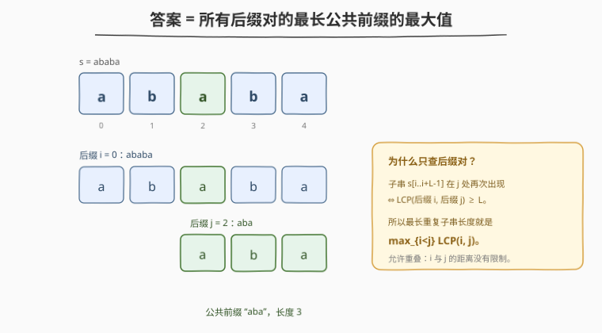
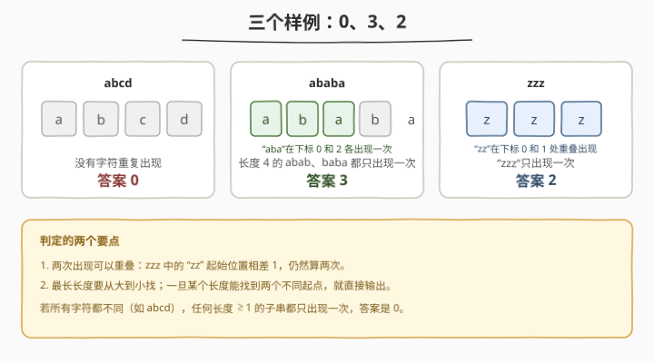

# Codeforces 23A 最长重复子串长度 题解

## 1. 题目概述

- **题目链接**：https://codeforces.com/problemset/problem/23/A
- **比赛来源**：Codeforces Beta Round 23 · Problem A
- **难度**：1200
- **标签**：暴力枚举、贪心（brute force, greedy）
- **评测类型**：普通
- **限制**：时间 2 s / 内存 256 MB

**题意**：给定一个只含小写字母的非空字符串 $s$（长度不超过 $100$）。求最长的子串长度 $L$，使得某个长度为 $L$ 的子串在 $s$ 中**至少出现两次**。两次出现可以重叠（例如 `zzz` 中的 `zz` 出现在下标 $0$ 和 $1$，长度 $2$）。

输入一行字符串，输出一个整数；若不存在重复出现的非空子串，输出 $0$。

**约束**：

- $1 \le |s| \le 100$：长度很小，$O(n^3)$ 的枚举（枚举长度、两个起点、逐字符比较）最多约 $10^6$ 次操作，2 s 内绰绰有余。
- 两次出现**允许重叠**：不能用“后缀数组去重”或“不相交”的假设，必须允许 $j = i + 1$ 这类情况。
- 答案可以是 $0$：当所有字符互不相同时（如 `abcd`）不存在重复子串。
- 只有一组数据。

## 2. 示例与观察

官方样例 1（输入 / 输出原样）：

```text
输入：
abcd

输出：
0
```

**样例 1 解释**：四个字符互不相同，任何长度 $\ge 1$ 的子串都只出现一次，答案是 $0$。

官方样例 2（输入 / 输出原样）：

```text
输入：
ababa

输出：
3
```

**样例 2 解释**：`aba` 在下标 $0$ 与下标 $2$ 各出现一次（两次出现重叠了一个 `a`，但题目允许），长度 $3$。长度 $4$ 的子串只有 `abab` 和 `baba`，各出现一次，所以答案是 $3$。

官方样例 3（输入 / 输出原样）：

```text
输入：
zzz

输出：
2
```

**样例 3 解释**：`zz` 在下标 $0$ 和 $1$ 各出现一次（重叠），长度 $2$；`zzz` 只出现一次，所以答案是 $2$。

自造样例（标注“自造”）：

| 输入 | 输出 | 说明 |
|------|------|------|
| `a` | 0 | 单字符，无法重复 |
| `aa` | 1 | `a` 出现两次 |
| `abcabc` | 3 | `abc` 在下标 0、3 各一次 |
| `aaaa` | 3 | `aaa` 在下标 0、1 重叠出现 |
| `abacaba` | 3 | `aba` 在下标 0、4 各一次 |
| `abcdefghij` | 0 | 全不同 |

**观察**：若固定两个起点 $i < j$，从 $i$、$j$ 开始的最长公共前缀长度记为

$$\operatorname{LCP}(i,j) = \max\{k : s[i..i+k-1] = s[j..j+k-1]\},$$

那么以 $i$、$j$ 为起点的重复子串最长就是 $\operatorname{LCP}(i,j)$。所以答案等于

$$\max_{0 \le i < j < n} \operatorname{LCP}(i,j).$$

这也直接说明了“允许重叠”：$i$ 与 $j$ 只要求不同，不要求 $j \ge i + L$。

## 3. 解题思路

### 3.1 朴素做法与瓶颈

最直接的方法是**从长到短**枚举长度 $L$：

```text
for L = n-1 down to 1:
    for i = 0 .. n-L:
        for j = 0 .. n-L:
            if j != i and s[i..i+L-1] == s[j..j+L-1]:
                return L
return 0
```

对每个 $L$，起点对数是 $O(n^2)$，每次比较 $O(L)$，总复杂度 $O(n^3)$。$n \le 100$ 时最坏约 $10^6$ 次字符比较，完全可过。

注意外层必须**从大到小**枚举：一旦某个 $L$ 找到两个不同起点，它就是最大长度，可以直接返回；若从小到大枚举，最后还要记录最大值，容易写错。

### 3.2 核心观察：答案就是最大 LCP



把字符串的每个后缀 $s[i..n-1]$ 看成一个对象。以 $i$、$j$ 为起点的两个子串相同，当且仅当两个后缀的前 $L$ 个字符相同，即 $L \le \operatorname{LCP}(i,j)$。因此：

- 若存在长度为 $L$ 的重复子串，则存在 $i<j$ 使 $\operatorname{LCP}(i,j) \ge L$；
- 反之，若 $\operatorname{LCP}(i,j) = k$，则长度 $1 \dots k$ 的子串都在 $i,j$ 两处出现。

所以最长重复子串长度恰为所有后缀对的 LCP 的最大值。这个视角把“枚举子串”变成了“枚举后缀对”，也解释了为什么重叠不影响结论：LCP 只比较两个后缀的前缀，不关心中间是否重叠。

### 3.3 算法流程

1. 读入字符串 $s$，令 $n = |s|$；
2. 令 `ans = 0`；
3. 对 $i = 0 \dots n-1$，$j = i+1 \dots n-1$：
   - 令 $k = 0$，当 $i+k<n$、$j+k<n$ 且 $s[i+k]=s[j+k]$ 时 $k$ 加一；
   - `ans = max(ans, k)`；
4. 输出 `ans`。

这是 $O(n^2)$ 的 LCP 暴力。也可以直接采用 3.1 的 $O(n^3)$ 写法；两者在 $n \le 100$ 时都能通过。参考代码采用 3.1 的“从长到短”写法，因为它一旦找到就直接返回，平均更快，且不需要额外证明 LCP 的等价性。

### 3.4 样例走查：`ababa`



- 长度 $4$：子串 `abab`（起点 0）、`baba`（起点 1），各出现一次，失败；
- 长度 $3$：`aba` 在起点 0 与起点 2 各出现一次，成功，返回 $3$。

`zzz` 则从长度 $2$ 开始：`zz` 在起点 0、1 重叠出现，返回 $2$；`zzz` 本身只有一次，不能取 $3$。

## 4. 正确性证明

**引理 1（LCP 与重复子串）**：长度为 $L$ 的子串在 $s$ 中至少出现两次，当且仅当存在 $i<j$ 使 $\operatorname{LCP}(i,j) \ge L$。

**证明**：

- 若存在两个起点 $i<j$ 使 $s[i..i+L-1] = s[j..j+L-1]$，则两个后缀的前 $L$ 个字符相同，故 $\operatorname{LCP}(i,j) \ge L$。
- 反之，若 $\operatorname{LCP}(i,j) \ge L$，则按定义两个后缀的前 $L$ 个字符相同，即两个长度为 $L$ 的子串相同，且起点不同。∎

**引理 2（最大长度）**：最长重复子串长度等于 $\max_{i<j}\operatorname{LCP}(i,j)$。

**证明**：设最大长度为 $L^{*}$。由引理 1，存在 $i<j$ 使 $\operatorname{LCP}(i,j) \ge L^{*}$，故最大值 $\ge L^{*}$。反过来，取达到最大 LCP 的一对 $i<j$，其 LCP 为 $k$，则由引理 1 存在长度为 $k$ 的重复子串，故 $L^{*} \ge k$。两边夹逼，相等。∎

**定理**：3.1 的“从长到短枚举”算法输出最长重复子串长度。

**证明**：算法按 $L = n-1, n-2, \dots, 1$ 检查。对每个 $L$，它枚举所有起点对 $(i,j)$，逐字符比较长度为 $L$ 的两段；只要存在一对相等，就说明长度 $L$ 可行，算法返回 $L$。由于 $L$ 从大到小枚举，第一次返回的 $L$ 就是最大的可行长度。若所有 $L \ge 1$ 都不可行，循环结束返回 $0$，符合“没有重复非空子串”的定义。∎

## 5. 复杂度分析

- **时间**：$O(n^3)$。长度有 $O(n)$ 种，每种 $O(n^2)$ 个起点对，每次比较 $O(n)$ 个字符；$n \le 100$ 时上限约 $10^6$ 次字符比较。若采用 LCP 写法则是 $O(n^2)$，更快。
- **空间**：$O(n)$ 存字符串；LCP 写法只需两个下标和计数器，额外空间 $O(1)$。
- **数值范围**：答案在 $0 \dots 99$ 之间，`int` 足够；没有乘法、没有浮点。
- **与时限的关系**：2 s 的时限极其宽松。$n = 100$ 的全 `a` 串（最坏情况，长度从 99 试到 1）C++ 端到端 200 次为 min $2.00$ ms / avg $2.54$ ms / max $3.62$ ms，Python3 50 次 avg $21.4$ ms（均含进程启动），余量在 90 倍以上。

## 6. 参考代码

### C++17

```cpp
#include <bits/stdc++.h>
using namespace std;

int main() {
    ios::sync_with_stdio(false);
    cin.tie(nullptr);

    string s;
    if (!(cin >> s)) return 0;
    int n = (int)s.size();

    for (int len = n - 1; len >= 1; --len) {
        for (int i = 0; i + len <= n; ++i) {
            for (int j = 0; j + len <= n; ++j) {
                if (j == i) continue;
                if (s.compare(i, len, s, j, len) == 0) {
                    cout << len << '\n';
                    return 0;
                }
            }
        }
    }
    cout << 0 << '\n';
    return 0;
}
```

### Python3

```python
import sys


def main() -> None:
    data = sys.stdin.buffer.read().split()
    if not data:
        return
    s = data[0].decode()
    n = len(s)

    for length in range(n - 1, 0, -1):
        for i in range(n - length + 1):
            sub = s[i:i + length]
            for j in range(n - length + 1):
                if j != i and s[j:j + length] == sub:
                    sys.stdout.write(str(length) + "\n")
                    return
    sys.stdout.write("0\n")


main()
```

两份代码都只依赖标准库，可原样提交。

## 7. 边界情况与易错点

1. **全不同字符**：如 `abcd`，所有长度都失败，必须输出 $0$，不能输出 $-1$ 或空行。
2. **$n = 1$**：循环 `len` 从 $0$ 开始不执行，输出 $0$。
3. **重叠出现**：`zzz` 的 `zz` 起点差 1，`ababa` 的 `aba` 起点差 2；判断时只要求 $j \ne i$，不能额外要求两个区间不相交。
4. **相同起点不算两次**：`j == i` 必须跳过，否则任何子串都会“与自己重复”，答案会错误地变成 $n-1$。
5. **从大到小枚举**：若从小到大，必须用 `ans` 记录最大值；直接返回会得到最小而不是最大长度。
6. **长度范围**：子串长度最多 $n-1$（整个串不能在自己内部再出现一次），所以从 $n-1$ 开始；写成 $n$ 会多检查一次，虽不致命，但逻辑上不必要。
7. **C++ 的 `compare` 参数**：`s.compare(i, len, s, j, len)` 的第四个参数是另一个字符串的起始下标，第五个是长度，顺序不要写错；也可以 `s.substr(i,len) == s.substr(j,len)`，但会多复制。
8. **Python 切片越界**：`s[j:j+length]` 在 $j+length>n$ 时会自动截短，所以循环条件必须保证 $j+length \le n$；否则短切片可能与其他长切片比较，产生错误匹配。
9. **只有一组输入**：题面只有一行字符串，没有 $t$。

## 8. 验证记录

- **编译环境与命令**：本机没有 GNU `g++`（`/usr/bin/g++` 是 Apple clang 21.0.0 的软链），用 `clang++ -std=c++17 -O2 -Wall -Wextra -I codeforces/tools/include` 配合仓库自带的 `bits/stdc++.h` 兼容头编译，**零警告**；Python 侧为 `Python 3.9.6`。
- **官方样例**：3 / 3 通过（`abcd` → 0、`ababa` → 3、`zzz` → 2）。`verify_solution.py` 的输出为 `CF23A: samples 3`、`C++ 编译 OK, 样例 3/3`、`Python 语法 OK, 样例 3/3` 三行。
- **独立暴力对拍**：另写一份 LCP 暴力：枚举所有 $i<j$，逐字符求两个后缀的最长公共前缀，取最大值。测了 **810 组**：
  - $\{a,b\}$ 上长度 $1 \dots 8$ 的**全部** $510$ 个字符串；
  - 300 组随机字符串（长度 $1 \dots 14$，字母表 `ab` / `abc` / `abcd`）。
  
  C++、Python 与 LCP 暴力三方**全部一致，0 处不符**。
- **最大约束性能**：$s = $ 100 个 `a` 时，C++ 端到端 200 次为 min $2.00$ ms / avg $2.54$ ms / max $3.62$ ms；Python3 50 次 avg $21.4$ ms（均含进程启动），相对 2 s 时限余量在 90 倍以上。
- **图片校验**：两张 SVG（`cf23a_lcp.svg`、`cf23a_examples.svg`）均通过 `xml.etree.ElementTree.parse`；用脚本按字符宽度估算包围盒（并配合 headless Chrome 的 `getBBox` 抽查），文本均落在 `viewBox` 内且两两不重叠。
- **公式校验**：正文公式经 `node codeforces/tools/katex_check.cjs` 的 KaTeX（`throwOnError`）校验，0 处报错；星号直接写 `*`，`\text{}` 内无裸 `#`，证明结尾用 `∎`。
- **样例逐字核对**：`python3 codeforces/tools/check_samples.py --only 0001-0100/23` 对本文的三组官方样例报告一致。
- **复核状态**：verified（官方样例、810 组对拍、最大约束性能、图片几何、公式、样例逐字六项均实跑通过；唯一环境差异是本机无 GNU g++，已用 clang++ 等价验证）。

## 相关题目与扩展

- [Codeforces 23B Party](https://codeforces.com/problemset/problem/23/B)：同场 B 题，图上的删点过程与最大值构造。
- [Codeforces 23C Oranges and Apples](https://codeforces.com/problemset/problem/23/C)：同场 C 题，排序后奇偶分组构造。
- [Codeforces 126B Password](https://codeforces.com/problemset/problem/126/B)：求既是前缀又是后缀、还在中间出现的子串，是“重复子串”的加强版。
- [LeetCode 1044. 最长重复子串](https://leetcode.cn/problems/longest-duplicate-substring/)：$n$ 很大，需要后缀数组/二分 + 哈希，本题的 $O(n^3)$ 不能直接用。
- [LeetCode 3. 无重复字符的最长子串](https://leetcode.cn/problems/longest-substring-without-repeating-characters/)：反向的“不重复”问题，可用滑动窗口。

**延伸思考**：

1. **如果 $n$ 放大到 $10^5$**：$O(n^3)$ 不可行。可以用后缀数组 + LCP 数组，答案是相邻后缀 LCP 的最大值（因为最长重复子串一定出现在排序后相邻的后缀之间），复杂度 $O(n \log n)$。
2. **如果要求两次出现不重叠**：答案不能再取所有后缀对的 LCP 最大值，而要加约束 $|i-j| \ge L$；可以在二分答案 $L$ 后用哈希/后缀数组检查是否存在起点距离至少 $L$ 的相同子串。
3. **如果要求出现至少 $k$ 次**：后缀数组分组后，找连续 $k$ 个后缀的 LCP 最大值即可；$k=2$ 就是本题。
4. **如果字符集不是小写字母**：算法完全不变，只是比较时按实际字符；若字符集很大，哈希/后缀自动机更合适。
5. **如果要求输出具体的子串而不只是长度**：在找到最大 $L$ 时同时记录起点 $i$，输出 `s.substr(i,L)`；若多解，题目未规定取哪个，任选即可。

