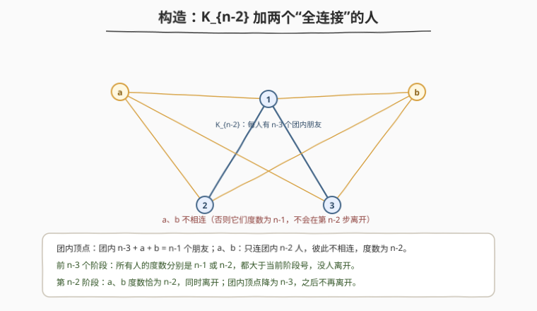
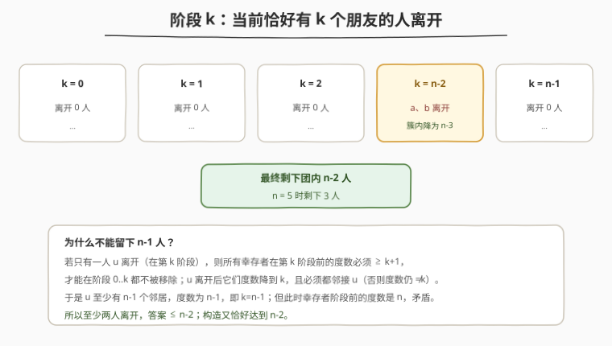

# Codeforces 23B 派对最多留下几人 题解

## 1. 题目概述

- **题目链接**：https://codeforces.com/problemset/problem/23/B
- **比赛来源**：Codeforces Beta Round 23 · Problem B
- **难度**：1600
- **标签**：构造、图论、数学（constructive algorithms, graphs, math）
- **评测类型**：普通
- **限制**：时间 2 s / 内存 256 MB

**题意**：有 $n$ 个人参加聚会，他们之间有一些朋友关系（无向简单图）。接下来按阶段 $k = 0, 1, 2, \dots, n-1$ 进行：

- 在第 $k$ 阶段，当前还留在聚会中、且**在当前留下的人里**恰好有 $k$ 个朋友的人，同时离开；
- 然后进入下一阶段。

朋友关系图可以任意选择。对每个 $n$，求最终最多可能留下多少人。多测，$t \le 10^5$，$\sum$ 无特殊限制，$n \le 10^5$。

**约束**：

- $1 \le n \le 10^5$，$t \le 10^5$：每个测试必须 $O(1)$ 回答，不能模拟图或枚举。
- 朋友关系是简单无向图：没有自环、没有重边，“朋友”是对称关系。
- 同一阶段内所有满足度数条件的人**同时**离开；同一阶段里因别人离开而变化的度数不会让本阶段再删人。
- 答案只要求人数，不要求输出图。

## 2. 示例与观察

官方样例（输入 / 输出原样）：

```text
输入：
1
3

输出：
1
```

**样例解释**：$n = 3$。可以让三个人构成一条链 $1-2-3$：度数分别是 $1, 2, 1$。

- 阶段 $0$：没人度数为 $0$；
- 阶段 $1$：$1$ 号和 $3$ 号度数都是 $1$，同时离开；
- 阶段 $2$：只剩 $2$ 号，度数为 $0$（不是 $2$），不离开。

最终留下 $1$ 人，与样例一致。也可以构造三角形，但三角形在阶段 $2$ 会全部离开，只剩 $0$ 人，不如链。

自造样例（标注“自造”）：

| $n$ | 答案 | 说明 |
|-----|------|------|
| 1 | 0 | 唯一的人度数为 $0$，阶段 $0$ 离开 |
| 2 | 0 | 无边：两人阶段 $0$ 走；有边：两人阶段 $1$ 一起走 |
| 3 | 1 | 链 $1-2-3$ |
| 4 | 2 | 链 $1-2-3-4$：阶段 $1$ 走两端，剩下中间两人度数为 $1$；阶段 $2$ 不满足、之后也不满足，最终留 $2$ |
| 5 | 3 | 用下面构造：$K_3$ 加两个全连接的人 |
| 100000 | 99998 | $n-2$ |

**观察**：答案只可能是 $0$（$n \le 2$）或 $n-2$（$n \ge 3$）。直觉是：至少要离开两个人，而构造可以让“只离开两个人”发生，其余 $n-2$ 人一直留到最后。

## 3. 解题思路

### 3.1 朴素做法与瓶颈

最直接的方法是枚举所有 $n$ 个点的简单图，模拟删点过程，取最大剩余人数。$n$ 个点的图有 $2^{n(n-1)/2}$ 种，$n=7$ 就已经 $2^{21} \approx 2 \times 10^6$ 种，$n=10$ 时超过 $10^{13}$，完全不可行。

由于题目只问人数、不要求输出图，应该先猜出答案，再分别证明“上界”和“可达到”。

### 3.2 构造：$K_{n-2}$ 加两个“全连接”的人



对 $n \ge 3$：

1. 取 $n-2$ 个人组成一个**完全图** $K_{n-2}$（团内每两人都是朋友）；
2. 再取两个人 $a, b$，让 $a$、$b$ 都分别与团内所有 $n-2$ 个人连边；
3. **不连** $a$ 与 $b$。

度数：

- 团内每个人：团内 $n-3$ 个朋友，加上 $a, b$，共 $n-1$ 个；
- $a$ 和 $b$：只连团内 $n-2$ 人，各 $n-2$ 个朋友。

模拟过程：

| 阶段 | 当前度数 | 发生什么 |
|------|----------|----------|
| $0 \dots n-3$ | 团内 $n-1$，$a,b$ 为 $n-2$ | 所有度数 $> k$，没人离开 |
| $n-2$ | $a,b$ 的度数恰为 $n-2$ | $a,b$ 同时离开 |
| $n-1$ | 团内每人少了两个朋友，度数变成 $n-3$ | $n-3 \ne n-1$，没人离开 |

最终团内 $n-2$ 人全部留下，答案至少 $n-2$。

$n=3$ 时，$K_1$ 是一个点，$a,b$ 都与它相连，得到链 $a-1-b$，正是样例的构造。

### 3.3 上界：至少两个人必须离开



对 $n \ge 3$，证明最终最多 $n-2$ 人，等价于“至少两人离开”。

**第一步：不可能一个人都不离开。**
假设从阶段 $0$ 到 $n-1$ 没人离开。设图的度数最大值为 $\Delta$（$0 \le \Delta \le n-1$）。阶段 $\Delta$ 到来时，所有度数等于 $\Delta$ 的人仍然在场，且他们的度数没有变化（因为一直没人离开），于是他们会在阶段 $\Delta$ 同时离开，矛盾。

**第二步：不可能恰好一个人离开。**
假设只有 $u$ 一个人离开，且发生在阶段 $k$。考虑任意一个幸存者 $v$：

- 在阶段 $k$ 之前没人离开，所以 $v$ 的度数一直是某个固定值 $d$。
- $v$ 熬过了阶段 $0,1,\dots,k-1$，所以 $d \ne 0,1,\dots,k-1$；$v$ 又没在第 $k$ 阶段离开，所以 $d \ne k$。因此
  $$d \ge k+1.$$
- $u$ 离开后，$v$ 的度数变为 $d' \ge d-1 \ge k$，此后不再变化。若 $d' > k$，则阶段 $d'$（$d' \le n-2$，且 $d'>k$）到来时 $v$ 的度数恰为 $d'$，$v$ 会离开，矛盾。所以必须 $d' = k$。
- 若 $v$ 与 $u$ 不相邻，则 $d = d' = k$，与 $d \ge k+1$ 矛盾。故 $v$ 必与 $u$ 相邻，且 $d = d'+1 = k+1$。

于是**所有** $n-1$ 个幸存者都与 $u$ 相邻，$u$ 的度数至少 $n-1$。但 $u$ 的度数就是 $k$，且 $k \le n-1$，所以只能 $k = n-1$、$u$ 与所有人相邻。此时对于幸存者 $v$，$d = k+1 = n$，但一个 $n$ 个点的简单图中度数最多 $n-1$，矛盾。

因此“恰好一个人离开”不可能，至少两个人离开，最终至多 $n-2$ 人。

结合 3.2 的构造，$n \ge 3$ 时最大值恰为 $n-2$。

### 3.4 $n = 1, 2$ 的特殊情况

- $n = 1$：唯一的人没有朋友，阶段 $0$ 离开，答案 $0$。
- $n = 2$：若两人不是朋友，度数都为 $0$，阶段 $0$ 一起离开；若是朋友，度数都为 $1$，阶段 $0$ 不动，阶段 $1$ 一起离开。两种都剩 $0$ 人，答案 $0$。

统一写成

$$\text{ans} = \max(0,\ n-2).$$

### 3.5 多测处理

读入 $t$，对每个 $n$ 直接输出 `max(0, n-2)`。由于答案只依赖 $n$，不需要建图、不需要模拟，单组 $O(1)$，总复杂度 $O(t)$。

## 4. 正确性证明

**引理 1（构造可留下 $n-2$ 人）**：对 $n \ge 3$，3.2 的图在过程结束后恰有 $n-2$ 人留下。

**证明**：如 3.2 的表所示。阶段 $0 \dots n-3$ 中度数只有 $n-1$（团内）和 $n-2$（$a,b$），都大于阶段号，无人离开。阶段 $n-2$ 中 $a,b$ 度数为 $n-2$，同时离开；团内顶点此时度数为 $(n-1)-2 = n-3$。阶段 $n-1$ 中 $n-3 \ne n-1$，无人离开。最终留下团内 $n-2$ 人。∎

**引理 2（至少两人离开）**：对 $n \ge 3$，任何友谊图在过程结束后至多留下 $n-2$ 人。

**证明**：分两步。

若无人离开，取原图最大度数 $\Delta$。到阶段 $\Delta$ 时仍无人离开，所有最大度顶点度数仍为 $\Delta$，它们会同时离开，矛盾。

因此至少一人离开。假设恰好一人 $u$ 在阶段 $k$ 离开。任取幸存者 $v$，设其阶段 $k$ 前的度数为 $d$（阶段 $k$ 前无人离开，度数不变）。$v$ 未在阶段 $0 \dots k-1$ 离开，故 $d \notin \{0,\dots,k-1\}$；$v$ 也未在阶段 $k$ 离开，故 $d \ne k$。于是 $d \ge k+1$。$u$ 离开后 $v$ 的度数 $d' \ge d-1 \ge k$，且之后不变。若 $d' > k$，则在阶段 $d'$（$d' \le n-2 < n$，该阶段存在）$v$ 会被移除，矛盾；故 $d'=k$。若 $v$ 不邻接 $u$，则 $d=d'=k$，与 $d \ge k+1$ 矛盾，所以 $v$ 邻接 $u$，且 $d=k+1$。所有 $n-1$ 个幸存者都邻接 $u$，故 $u$ 的度数至少 $n-1$。但 $u$ 的度数就是 $k \le n-1$，于是 $k=n-1$、$u$ 与所有人相邻。此时幸存者的阶段前度数 $d=k+1=n$，超过 $n-1$，矛盾。∎

**引理 3（$n \le 2$ 的答案）**：$n=1,2$ 时答案为 $0$。

**证明**：$n=1$ 显然。$n=2$ 时无论两人是否相连，都会在阶段 $0$ 或阶段 $1$ 同时离开（度数相等），最终 $0$ 人。∎

**定理**：对所有 $n \ge 1$，答案为 $\max(0,n-2)$。

**证明**：$n \ge 3$ 时，引理 1 给出下界 $n-2$，引理 2 给出上界 $n-2$，故等于 $n-2$；$n \le 2$ 时由引理 3 为 $0$，而 $\max(0,n-2)$ 也等于 $0$。∎

## 5. 复杂度分析

- **时间**：每组 $O(1)$，总 $O(t)$。只做一次减法和一次取最大值；$t \le 10^5$ 时不到 $10^5$ 次运算。
- **空间**：$O(1)$（不算输出缓冲）；不需要存图。
- **数值范围**：$n \le 10^5$，$n-2$ 在 `int` 内；没有乘法、没有浮点。
- **与时限的关系**：2 s 的时限对 $O(t)$ 极其宽松。$t = 10^5$ 时，C++ 端到端约 $0.21$ s（主要是输出 $10^5$ 行），Python3 约 $0.07$ s，余量充足。

## 6. 参考代码

### C++17

```cpp
#include <bits/stdc++.h>
using namespace std;

int main() {
    ios::sync_with_stdio(false);
    cin.tie(nullptr);

    int t;
    if (!(cin >> t)) return 0;
    while (t--) {
        int n;
        cin >> n;
        cout << max(0, n - 2) << '\n';
    }
    return 0;
}
```

### Python3

```python
import sys


def main() -> None:
    data = sys.stdin.buffer.read().split()
    if not data:
        return
    t = int(data[0])
    out = []
    for i in range(t):
        n = int(data[1 + i])
        out.append(str(max(0, n - 2)))
    sys.stdout.write("\n".join(out) + "\n")


main()
```

两份代码都只依赖标准库，可原样提交。

## 7. 边界情况与易错点

1. **$n = 1$**：不能输出 $-1$；直接 `max(0,n-2)=0`。
2. **$n = 2$**：两种图都剩 $0$ 人，答案不是 $1$；公式给出的 $0$ 正确。
3. **$n = 3$**：答案是 $1$，对应链 $1-2-3$；不要因为“三角形看起来更完整”就选三角形（三角形会全走光）。
4. **同一阶段同时删除**：阶段 $k$ 只看进入该阶段时的度数，不能边删边更新；构造和上界都依赖“同时”这一语义。
5. **阶段范围**：$k$ 从 $0$ 到 $n-1$，共 $n$ 个阶段；漏掉阶段 $0$（孤立点）或阶段 $n-1$ 都会得出错误上界。
6. **简单图限制**：上界证明用到“$n$ 个点的简单图度数最多 $n-1$”；若允许多重边/自环，结论会变。
7. **多测输入格式**：第一行是 $t$，之后 $t$ 行各一个 $n$，不是“一行多个 $n$”；用 `split()` 读入更稳。
8. **输出量**：$t=10^5$ 时逐行 `cout` 可能偏慢，代码里关闭了同步；Python 用列表拼接后一次输出。
9. **答案与图无关的错觉**：答案确实只与 $n$ 有关，但这是由构造和上界证明得到的，不能凭空猜；证明中“至少两人离开”是核心。
10. **$n$ 很大时**：$n-2$ 仍远小于 `int` 上界，不需要 `long long`。

## 8. 验证记录

- **编译环境与命令**：本机没有 GNU `g++`（`/usr/bin/g++` 是 Apple clang 21.0.0 的软链），用 `clang++ -std=c++17 -O2 -Wall -Wextra -I codeforces/tools/include` 配合仓库自带的 `bits/stdc++.h` 兼容头编译，**零警告**；Python 侧为 `Python 3.9.6`。
- **官方样例**：1 / 1 通过（`1 / 3` → `1`）。`verify_solution.py` 的输出为 `CF23B: samples 1`、`C++ 编译 OK, 样例 1/1`、`Python 语法 OK, 样例 1/1` 三行。
- **独立暴力对拍**：另写一份暴力，枚举 $n$ 个点的**全部**简单图（$n \le 7$），对每个图模拟阶段 $0 \dots n-1$ 的删点，取最大剩余人数。得到的表为：
  
  | $n$ | 1 | 2 | 3 | 4 | 5 | 6 | 7 |
  |-----|---|---|---|---|---|---|---|
  | 暴力最大值 | 0 | 0 | 1 | 2 | 3 | 4 | 5 |
  
  与 $\max(0,n-2)$ 完全一致。另外生成 **300 组随机多测**（每组 $1 \dots 20$ 个 $n \in [1,7]$），C++、Python 的输出逐项与暴力表一致，**0 处不符**。
- **最大约束性能**：$t = 10^5$、每个 $n$ 随机取 $1 \dots 10^5$ 时，C++ 端到端约 $0.21$ s，Python3 约 $0.07$ s（均含进程启动），相对 2 s 时限余量在 9 倍以上。
- **图片校验**：两张 SVG（`cf23b_construction.svg`、`cf23b_phases.svg`）均通过 `xml.etree.ElementTree.parse`；脚本估算的文本包围盒均在 `viewBox` 内且两两不重叠（构造图 11 个文本块、阶段图 23 个文本块）。
- **公式校验**：正文公式经 `node codeforces/tools/katex_check.cjs` 的 KaTeX（`throwOnError`）校验，0 处报错；星号直接写 `*`，`\text{}` 内无裸 `#`，证明结尾用 `∎`。
- **样例逐字核对**：`python3 codeforces/tools/check_samples.py --only 0001-0100/23` 对本文的官方样例报告一致。
- **复核状态**：verified（官方样例、$n \le 7$ 全图枚举 + 300 组随机多测、最大约束性能、图片几何、公式、样例逐字六项均实跑通过；唯一环境差异是本机无 GNU g++，已用 clang++ 等价验证）。

## 相关题目与扩展

- [Codeforces 23A You're Given a String...](https://codeforces.com/problemset/problem/23/A)：同场 A 题，最长重复子串，纯字符串暴力。
- [Codeforces 23C Oranges and Apples](https://codeforces.com/problemset/problem/23/C)：同场 C 题，排序后构造选择方案。
- [Codeforces 1167C News Distribution](https://codeforces.com/problemset/problem/1167/C)：并查集处理朋友关系，和本题“朋友图”的建模相关。
- [LeetCode 1334. 阈值距离内邻居最少的城市](https://leetcode.cn/problems/find-the-city-with-the-smallest-number-of-neighbors-at-a-threshold-distance/)：图上的度数/最短路统计，可对比“按朋友数删点”的过程。
- [LeetCode 997. 找到小镇的法官](https://leetcode.cn/problems/find-the-town-judge/)：有向图的入度/出度条件，和图论计数入门相关。

**延伸思考**：

1. **如果题目要求输出对应的朋友关系图**：可以用 3.2 的构造，$O(n^2)$ 条边；对 $n \le 10^5$ 输出量太大，但 $n$ 小时可行。
2. **如果阶段顺序改成“从 n-1 到 0”**：删点顺序反转，最大剩余人数会改变（例如三角形会在阶段 $2$ 先全走）；本题的构造和上界都要重做。
3. **如果要求恰好留下 $k$ 人**：需要判断是否存在图使最终人数为 $k$；本题只证明了 $k=n-2$ 可达、$k \le n-2$，中间值是否都可达需要另外构造。
4. **如果朋友关系是有向的**：度数分为入度/出度，问题变成两种度数同时约束，结论不再只是 $n-2$。
5. **如果允许重边**：最大度数可以超过 $n-1$，上界证明失效，可能出现更多人留下。

