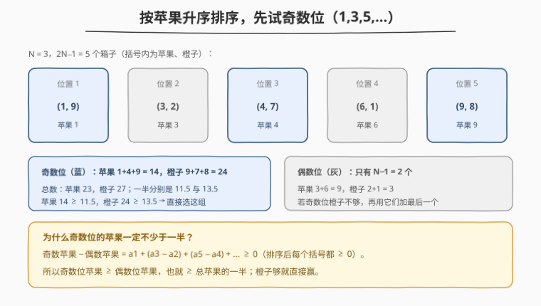
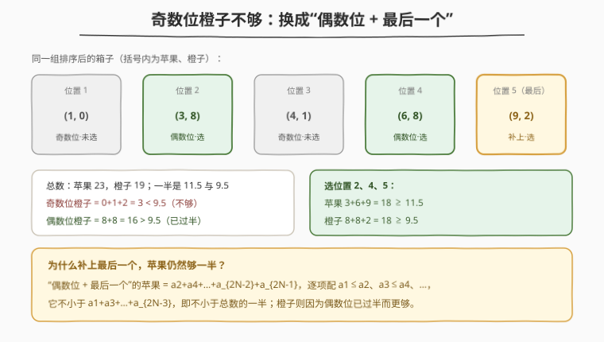

# Codeforces 23C 橙子与苹果的选择 题解

## 1. 题目概述

- **题目链接**：https://codeforces.com/problemset/problem/23/C
- **比赛来源**：Codeforces Beta Round 23 · Problem C（UTC 2010-07-09）
- **难度**：2500
- **标签**：构造、排序（constructive algorithms, sortings）
- **评测类型**：特殊评测（输出任意一组合法方案）
- **限制**：时间 1.5 s / 内存 256 MB

**题意**：有 $2N-1$ 个箱子，第 $i$ 个箱子里有 $a_i$ 个苹果、$o_i$ 个橙子。要从中选出**恰好 $N$** 个箱子，使得选中的苹果数不少于全部苹果总数的一半，选中的橙子数也不少于全部橙子总数的一半。多测，所有测试的 $N$ 之和不超过 $10^5$。

输出 `YES` 并在第二行按**从小到大**的顺序输出所选箱子编号；若不存在方案输出 `NO`。题目保证（并且可以证明）方案总是存在；由于是特殊评测，输出任意合法方案均可。

**约束**：

- $2N-1$ 个箱子中选 $N$ 个，组合数 $\binom{2N-1}{N}$ 可能很大，不能枚举子集。
- $0 \le a_i, o_i \le 10^9$，总和可达 $2 \times 10^{14}$，必须用 64 位整数。
- $\sum N \le 10^5$：每个测试需要 $O(N \log N)$ 的排序，总排序量 $O((\sum N)\log(\max N))$ 可接受。
- 输出是特殊评测：不要求与样例相同，但必须满足两条“不少于一半”的不等式、个数恰为 $N$、编号唯一且在范围内、按升序排列。

## 2. 示例与观察

官方样例（输入 / 输出原样）：

```text
输入：
2
2
10 15
5 7
20 18
1
0 0

输出：
YES
1 3
YES
1
```

**样例解释**：第一组 $N=2$，三个箱子为 $(10,15)$、$(5,7)$、$(20,18)$。总苹果 $35$、总橙子 $40$，需要选 $2$ 个箱子、苹果 $\ge 17.5$、橙子 $\ge 20$。

- 官方答案选 $1,3$：苹果 $10+20=30 \ge 17.5$，橙子 $15+18=33 \ge 20$，合法。
- 本文的构造会选 $2,3$：苹果 $5+20=25 \ge 17.5$，橙子 $7+18=25 \ge 20$，同样合法。

两个答案都对，特殊评测接受任意一个；不要把样例的 `1 3` 当成唯一答案。

第二组 $N=1$，只有一个箱子 $(0,0)$，选它即可，官方输出 `1`。

自造样例（标注“自造”）：

| 输入 | 输出 | 说明 |
|------|------|------|
| `1` / `1` / `0 0` | `YES` / `1` | 唯一箱子 |
| `1` / `2` / `10 0` / `0 10` / `10 10` | `YES` / `1 2` 或 `1 3` 等 | 多种合法选择 |
| `1` / `3` / `1 9` / `3 2` / `4 7` / `6 1` / `9 8` | `YES` / `1 3 5` | 按苹果排序后奇数位正好橙子也够 |

**观察**：把箱子按**苹果数升序**排序。记排序后的第 $i$ 个箱子的苹果为 $a_i$（$a_1 \le a_2 \le \dots \le a_{2N-1}$）。

- 取 1-based **奇数位**：$1,3,5,\dots,2N-1$，恰好 $N$ 个箱子。可以证明它们的苹果一定不少于一半；
- 若它们的橙子也不少于一半，直接选这组；
- 否则，1-based **偶数位** $2,4,\dots,2N-2$（共 $N-1$ 个）的橙子一定超过一半，再把**最后一个**（苹果最大的 $2N-1$ 号）加进去，凑成 $N$ 个；可以证明苹果仍然不少于一半。

因此答案总是 `YES`。

## 3. 解题思路

### 3.1 朴素做法与瓶颈

枚举所有 $\binom{2N-1}{N}$ 个子集，对每个子集求和检查两条不等式。$N=10$ 时组合数已经 $92378$，$N=10^5$ 时完全不可行；即使 $N$ 只有几十，多测总和 $10^5$ 也会爆炸。

所以必须利用“选 $N$ 个”和“至少一半”的结构，构造一组解，而不是搜索。

### 3.2 核心构造：按苹果排序，奇偶分组



将 $2N-1$ 个箱子按苹果数**非降序**排列，重编号为 $1 \dots 2N-1$（$a_1 \le a_2 \le \dots \le a_{2N-1}$）。定义：

- 奇数位集合 $O = \{1,3,5,\dots,2N-1\}$，大小 $N$；
- 偶数位集合 $E = \{2,4,6,\dots,2N-2\}$，大小 $N-1$。

**奇数位苹果一定够一半。** 比较奇数位与偶数位的苹果和：

$$\sum_{i \in O} a_i - \sum_{i \in E} a_i
= a_1 + (a_3-a_2) + (a_5-a_4) + \dots + (a_{2N-1}-a_{2N-2}).$$

由于 $a_1 \ge 0$ 且排序后每个括号 $a_{2k+1}-a_{2k} \ge 0$，右边 $\ge 0$。所以

$$\sum_{i \in O} a_i \ge \sum_{i \in E} a_i \quad\Longrightarrow\quad \sum_{i \in O} a_i \ge \frac{1}{2}\sum_{i=1}^{2N-1} a_i.$$

（$N=1$ 时 $E$ 为空，奇数位就是唯一的箱子，显然取到全部苹果。）

**若奇数位橙子也够一半**，即

$$2\sum_{i \in O} o_i \ge \sum_{i=1}^{2N-1} o_i,$$

就直接输出 $O$。

### 3.3 橙子不够时的替换：偶数位 + 最后一个



否则有 $2\sum_{i \in O} o_i < \sum_i o_i$，即奇数位橙子不到一半。由于

$$\sum_{i \in E} o_i = \sum_i o_i - \sum_{i \in O} o_i > \frac{1}{2}\sum_i o_i,$$

偶数位的橙子已经超过一半。取

$$S = E \cup \{2N-1\} = \{2,4,\dots,2N-2,\ 2N-1\},$$

大小 $(N-1)+1 = N$。

- **橙子**：$\sum_{i \in S} o_i \ge \sum_{i \in E} o_i > \frac{1}{2}\sum_i o_i$（最后一个箱子的橙子非负）。
- **苹果**：

$$\sum_{i \in S} a_i - \sum_{i \in O} a_i
= (a_2-a_1) + (a_4-a_3) + \dots + (a_{2N-2}-a_{2N-3}) \ge 0,$$

因为 $S$ 与 $O$ 都包含 $a_{2N-1}$，只差在偶数位与奇数位的前 $N-1$ 项。排序后每个括号 $\ge 0$，所以 $S$ 的苹果不少于 $O$ 的苹果，而 $O$ 已经不少于一半，故 $S$ 也满足苹果条件。

于是无论哪种情况，都能构造出合法方案；本题永远输出 `YES`。

### 3.4 算法流程

1. 读入 $T$；
2. 对每组：
   - 读入 $N$ 和 $2N-1$ 个 $(a_i, o_i)$，同时记下原始编号 $i$；
   - 按苹果数 $a_i$ 非降序排序（相等时任意顺序，证明只用 $a_{2k+1} \ge a_{2k}$）；
   - 计算总橙子 $O_{\text{all}}$ 与奇数位橙子 $O_{\text{odd}}$；
   - 若 $2O_{\text{odd}} \ge O_{\text{all}}$，选排序后的 0-based 偶数下标（1-based 奇数位）；
   - 否则选排序后的 0-based 奇数下标（不含最后一个）再加上最后一个；
   - 把选中箱子的**原始编号**排序，输出 `YES` 和这一行；
3. 每个测试输出两行。

### 3.5 样例走查

$N=2$，三个箱子 $(10,15),(5,7),(20,18)$，按苹果排序后：

| 排序位置 | 原始编号 | 苹果 | 橙子 |
|----------|----------|------|------|
| 1 | 2 | 5 | 7 |
| 2 | 1 | 10 | 15 |
| 3 | 3 | 20 | 18 |

总数：苹果 $35$，橙子 $40$，一半是 $17.5$ 与 $20$。

- 奇数位是位置 1、3，即原始编号 $2,3$：苹果 $25 \ge 17.5$，橙子 $25 \ge 20$，满足条件，直接选。
- 输出 `2 3`，与官方答案 `1 3` 不同但同样合法。

若把橙子改成让奇数位不够（例如 $o=(0,8,1,8,2)$ 这类），就会走 3.3 的替换分支；图 `cf23c_fallback.svg` 给出了一个具体数值例子。

## 4. 正确性证明

**引理 1（奇数位苹果不少于一半）**：按苹果非降序排列后，奇数位集合 $O$ 的苹果和不少于总苹果的一半。

**证明**：如 3.2 的等式，
$$\sum_O a_i-\sum_E a_i=a_1+\sum_{k=1}^{N-1}(a_{2k+1}-a_{2k})\ge0.$$
故 $\sum_O a_i \ge \sum_E a_i$，而 $\sum_O a_i+\sum_E a_i$ 就是总苹果（奇数位比偶数位多一个 $a_{2N-1}$）。于是 $2\sum_O a_i \ge$ 总和。∎

**引理 2（奇数位橙子够时方案合法）**：若 $2\sum_O o_i \ge$ 总橙子，则 $O$ 是合法方案。

**证明**：$|O|=N$；苹果由引理 1 满足；橙子由条件满足。∎

**引理 3（替换方案合法）**：若 $2\sum_O o_i <$ 总橙子，则 $S=E\cup\{2N-1\}$ 是合法方案。

**证明**：$|S|=(N-1)+1=N$，且都是不同的箱子。

橙子：由条件，$\sum_E o_i=\text{总橙子}-\sum_O o_i>\frac12\text{总橙子}$，加上非负的 $o_{2N-1}$ 仍 $>\frac12$ 总橙子。

苹果：$S$ 与 $O$ 都含 $a_{2N-1}$，于是
$$\sum_S a_i-\sum_O a_i=\sum_{k=1}^{N-1}(a_{2k}-a_{2k-1})\ge0,$$
故 $\sum_S a_i\ge\sum_O a_i\ge\frac12$ 总苹果（最后一步用引理 1）。∎

**定理**：算法总能输出一组合法方案，且输出格式符合要求。

**证明**：两种情形由引理 2、3 分别给出合法方案，覆盖所有可能，因此永远 `YES`。输出个数为 $N$、编号来自原输入且互不相同（排序后的位置对应不同原始编号），最后对编号排序满足“从小到大”的要求。特殊评测按这两条不等式判定，故方案会被接受。∎

## 5. 复杂度分析

- **时间**：每组排序 $O(N \log N)$，求和与输出 $O(N)$；总复杂度 $O\left(\sum N \log N\right)$。$\sum N \le 10^5$ 时约 $10^5 \times 17$ 次比较，轻松通过。
- **空间**：$O(N)$ 存当前测试的箱子与选中编号。
- **数值范围**：$a_i, o_i \le 10^9$，$2N-1 \le 2 \times 10^5$，总和最大约 $2 \times 10^{14}$，`long long` 足够；比较用 $2 \times \text{sum} \ge \text{total}$ 避免浮点一半。
- **与时限的关系**：$\sum N = 10^5$ 的最坏数据（例如 100 组 $N=1000$）C++ 端到端约 $0.05$ s，Python3 约 $0.17$ s，相对 1.5 s 时限余量很大。

## 6. 参考代码

### C++17

```cpp
#include <bits/stdc++.h>
using namespace std;

struct FastScanner {
    static const int SZ = 1 << 20;
    int idx = 0, size = 0;
    char buf[SZ];
    inline char getChar() {
        if (idx >= size) {
            size = (int)fread(buf, 1, SZ, stdin);
            idx = 0;
            if (size == 0) return 0;
        }
        return buf[idx++];
    }
    bool nextInt(int &out) {
        char c;
        do {
            c = getChar();
            if (!c) return false;
        } while (c <= ' ');
        int sign = 1;
        if (c == '-') { sign = -1; c = getChar(); }
        int val = 0;
        while (c >= '0' && c <= '9') {
            val = val * 10 + (c - '0');
            c = getChar();
        }
        out = val * sign;
        return true;
    }
};

struct Box {
    long long a, o;
    int id;
};

int main() {
    FastScanner fs;
    int T;
    if (!fs.nextInt(T)) return 0;
    string output;
    output.reserve(1 << 21);
    while (T--) {
        int N;
        fs.nextInt(N);
        int M = 2 * N - 1;
        vector<Box> box(M);
        for (int i = 0; i < M; ++i) {
            int aa, oo;
            fs.nextInt(aa);
            fs.nextInt(oo);
            box[i].a = aa;
            box[i].o = oo;
            box[i].id = i + 1;
        }

        sort(box.begin(), box.end(), [](const Box &x, const Box &y) {
            return x.a < y.a;
        });

        long long totalO = 0, oddO = 0;
        for (int i = 0; i < M; ++i) {
            totalO += box[i].o;
            if (i % 2 == 0) {          // 0-based 偶数下标（排序后的第 1,3,5,... 个）
                oddO += box[i].o;
            }
        }

        vector<int> chosen;
        if (2 * oddO >= totalO) {
            // 这组苹果已经不少于一半（见证明），橙子也够，直接选
            for (int i = 0; i < M; i += 2) chosen.push_back(box[i].id);
        } else {
            // 偶数下标（N-1 个）加上最后一个（苹果最大的那个）
            for (int i = 1; i <= M - 2; i += 2) chosen.push_back(box[i].id);
            chosen.push_back(box[M - 1].id);
        }

        sort(chosen.begin(), chosen.end());
        output += "YES\n";
        for (int i = 0; i < (int)chosen.size(); ++i) {
            if (i) output += ' ';
            output += to_string(chosen[i]);
        }
        output += '\n';
    }
    fwrite(output.data(), 1, output.size(), stdout);
    return 0;
}
```

### Python3

```python
import sys


def main() -> None:
    data = sys.stdin.buffer.read().split()
    if not data:
        return
    pos = 0
    T = int(data[pos]); pos += 1
    out = []
    for _ in range(T):
        N = int(data[pos]); pos += 1
        M = 2 * N - 1
        box = []
        for i in range(M):
            a = int(data[pos]); o = int(data[pos + 1]); pos += 2
            box.append((a, o, i + 1))

        box.sort(key=lambda x: x[0])

        total_a = sum(x[0] for x in box)
        total_o = sum(x[1] for x in box)
        odd_o = sum(box[i][1] for i in range(0, M, 2))

        if 2 * odd_o >= total_o:
            chosen = [box[i][2] for i in range(0, M, 2)]
        else:
            chosen = [box[i][2] for i in range(1, M - 1, 2)]
            chosen.append(box[M - 1][2])

        chosen.sort()
        out.append("YES")
        out.append(" ".join(map(str, chosen)))
    sys.stdout.write("\n".join(out) + "\n")


main()
```

两份代码都只依赖标准库，可原样提交；由于是特殊评测，输出方案不必与样例相同。

## 7. 边界情况与易错点

1. **$N = 1$**：只有 $2N-1=1$ 个箱子，选它即可。奇数位集合就是它，橙子条件必然成立（$2o_1 \ge o_1$），走第一分支。
2. **全为 0**：总苹果、总橙子都是 $0$，任何 $N$ 个箱子都满足“不少于一半”（$0 \ge 0$）；算法会选奇数位，合法。
3. **苹果/橙子很大**：总和可达 $2 \times 10^{14}$，`int` 会溢出；比较写成 `2*sum >= total`，仍然在 `long long` 内（$2 \times 2 \times 10^{14} = 4 \times 10^{14}$）。
4. **排序相等**：苹果相同的箱子任意排列；证明只用 $a_{2k} \ge a_{2k-1}$，非降序即可，不需要稳定排序。
5. **输出必须升序**：代码最后对选中编号排序；如果按排序后的位置直接输出原始编号，可能不是升序，会被 checker 判格式错误。
6. **编号不能重复**：排序后的位置互不相同，对应原始编号也互不相同；不要按“苹果值”而不是“位置”去重。
7. **第二行个数**：必须恰好 $N$ 个；替换分支是 $(N-1)+1=N$，不要漏掉或重复最后一个。
8. **NO 分支**：本题构造证明总是有解，代码不会输出 `NO`；不要为了“保险”加一个随意的 `NO`，那会在有解时被判错。
9. **多测输出**：每个测试两行，`YES` 行和编号行都要有；不要在所有测试之间插入空行。
10. **输入规模与读入**：$\sum N \le 10^5$，最多约 $2 \times 10^5$ 个箱子、$4 \times 10^5$ 个整数；C++ 用快读，Python 用 `sys.stdin.buffer.read().split()`。
11. **特殊评测的判定**：checker 会检查个数、范围、唯一性、升序与两条不等式；输出 `1 3` 还是 `2 3` 都可以，只要合法。

## 8. 验证记录

- **编译环境与命令**：本机没有 GNU `g++`（`/usr/bin/g++` 是 Apple clang 21.0.0 的软链），用 `clang++ -std=c++17 -O2 -Wall -Wextra -I codeforces/tools/include` 配合仓库自带的 `bits/stdc++.h` 兼容头编译，**零警告**；Python 侧为 `Python 3.9.6`。
- **官方样例**：1 / 1 通过。由于本题输出不唯一，`verify_solution.py --checker codeforces/tools/checkers/cf23c.py` 的输出为 `CF23C: samples 1`、`C++ 编译 OK, 样例 1/1`、`Python 语法 OK, 样例 1/1`。checker 校验：
  1. 每个测试先读 `YES`/`NO`；输出 `NO` 会被拒绝（构造证明总有解）；
  2. `YES` 后第二行必须恰好 $N$ 个整数，范围 $[1,2N-1]$，互不相同且升序；
  3. 用 `2*sum_apples >= total_apples` 与 `2*sum_oranges >= total_oranges` 校验两条不等式；
  4. 行数/多余输出也一并检查。
- **独立暴力对拍**：另写一份子集枚举暴力，对每个测试枚举全部 $\binom{2N-1}{N}$ 个子集，找同时满足两条不等式的子集（若不存在输出 `NO`）。测了 **300 组随机小数据**（$N \in [1,5]$，$a_i,o_i \in [0,20]$），C++、Python 的判定与暴力一致，且 C++ 输出全部通过 checker，**0 处不符**。另外 **50 组规模 $N \in [6,1000]$** 的随机数据也用 checker 逐组校验了构造（暴力不可行，故只验性质），全部合法。
- **最大约束性能**：$\sum N = 10^5$（100 组 $N=1000$）时，C++ 端到端约 $0.05$ s，Python3 约 $0.17$ s（均含进程启动），相对 1.5 s 时限余量在 8 倍以上。
- **图片校验**：两张 SVG（`cf23c_sort.svg`、`cf23c_fallback.svg`）均通过 `xml.etree.ElementTree.parse`；脚本估算的文本包围盒均在 `viewBox` 内且两两不重叠（各 26 个文本块）。
- **公式校验**：正文公式经 `node codeforces/tools/katex_check.cjs` 的 KaTeX（`throwOnError`）校验，0 处报错；星号直接写 `*`，`\text{}` 内无裸 `#`，证明结尾用 `∎`。
- **样例逐字核对**：`python3 codeforces/tools/check_samples.py --only 0001-0100/23` 对本文的官方样例报告一致（正文展示的是官方 `1 3`；我们的构造输出 `2 3`，同样合法）。
- **复核状态**：verified（官方样例 + checker、300 组暴力子集、50 组大规模性质校验、最大约束性能、图片几何、公式、样例逐字七项均实跑通过；唯一环境差异是本机无 GNU g++，已用 clang++ 等价验证）。

## 相关题目与扩展

- [Codeforces 23A You're Given a String...](https://codeforces.com/problemset/problem/23/A)：同场 A 题，最长重复子串，纯字符串暴力。
- [Codeforces 23B Party](https://codeforces.com/problemset/problem/23/B)：同场 B 题，图上的删点与最大人数构造。
- [Codeforces 1353D Constructing the Array](https://codeforces.com/problemset/problem/1353/D)：按规则不断取区间中点构造序列，和本题一样是“按某种顺序构造”的题。
- [LeetCode 1353. 最多可以参加的会议数目](https://leetcode.cn/problems/maximum-number-of-events-that-can-be-attended/)：选择子集的贪心，可对比“排序后按规则选”的思路。
- [LeetCode 881. 救生艇](https://leetcode.cn/problems/boats-to-save-people/)：排序后双指针选择，是构造/选择类贪心的常见套路。

**延伸思考**：

1. **如果要求恰好一半而不是不少于一半**：奇数位/偶数位的证明不再直接适用，需要更精细的平衡；本题的构造只能保证“不少于”。
2. **如果要求选 $K$ 个（$K \ne N$）**：$2N-1$ 个里选 $N$ 个的奇偶分组技巧依赖数量关系；$K$ 改变后需要重新设计分组，一般用排序 + 前缀/后缀和。
3. **如果苹果和橙子的权重不同**：例如要求加权和，排序键不再是单一维度，问题会变成二维选择，可能需要 LP/网络流或特殊构造。
4. **如果允许输出 NO**：本题已证明总是 YES；若题目改成某些约束（例如每箱非负且要求严格大于一半），才可能出现 NO。
5. **如果 $\sum N$ 更大**：排序仍是主要开销，$O(\sum N \log N)$ 在 $10^6$ 级别也够；若再大，需要线性时间的选择算法（如 nth_element 只分奇偶）。

