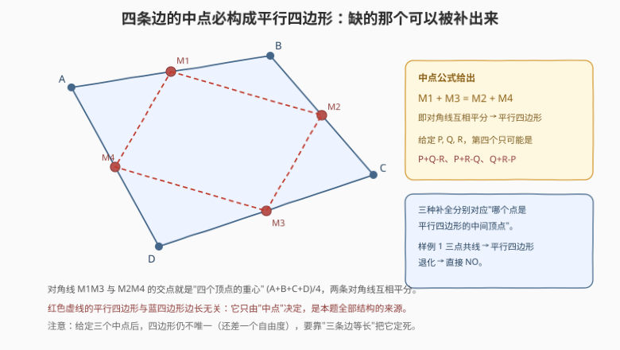
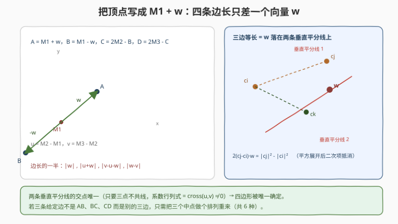
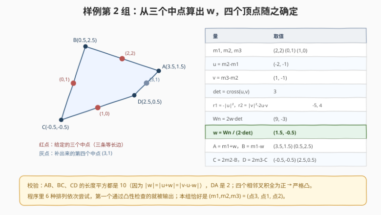

# Codeforces 23D 由边中点还原四边形 题解

## 1. 题目概述

- **题目链接**：https://codeforces.com/problemset/problem/23/D
- **比赛来源**：Codeforces Beta Round 23 · Problem D
- **难度**：2600
- **标签**：几何、数学、构造
- **评测类型**：特殊评测（多解，输出任意合法答案）
- **限制**：时间 3 s / 内存 256 MB

**题意**：有一个**严格凸四边形**（任意三点不共线），它的四条边中有三条**长度相等**。现在只给出这三条边的**中点**（三个互不相同的整点，坐标在 $[0,10]$ 内），要求还原出这个四边形：输出四个顶点（顺时针或逆时针），坐标保留 $9$ 位小数；若无解输出 `NO`。

输入有 $T \le 5 \times 10^4$ 组，因此每组必须用常数时间（最多几十次整数运算）解决。

**约束**：

- 坐标不超过 $10$：所有候选的叉积、行列式都是小整数，可以用**精确整数运算**，完全避开浮点误差。
- $T$ 很大：不能做任何搜索（如网格枚举），必须把问题化成"解一个 $2\times 2$ 线性方程组"。
- 多解：同一组三个中点可能对应不同的合法四边形，特殊评测接受任意一个。

## 2. 示例与观察

官方样例（输入 / 输出原样）：

```text
输入：
3
1 1 2 2 3 3
0 1 1 0 2 2
9 3 7 9 9 8

输出：
NO

YES
3.5 1.5 0.5 2.5 -0.5 -0.5 2.5 0.5
NO

```

**第 1 组**：$(1,1),(2,2),(3,3)$ 三点共线。四条边的中点构成平行四边形（见引理 1），非退化平行四边形的三个顶点绝不可能共线——所以无解，输出 `NO`。

**第 2 组**：答案四边形是 $A(3.5,1.5)$、$B(0.5,2.5)$、$C(-0.5,-0.5)$、$D(2.5,0.5)$。验算：四条边的中点是

| 边 | 中点 |
|----|------|
| $AB$ | $(2,2)$ ✓ 给定 |
| $BC$ | $(0,1)$ ✓ 给定 |
| $CD$ | $(1,0)$ ✓ 给定 |
| $DA$ | $(3,1)$（第四个，不需要给出） |

四条边长分别为 $\sqrt{10},\sqrt{10},\sqrt{10},\sqrt{2}$——前三条相等，正是给定中点对应的三条边；四个顶点的相邻叉积全为正，严格凸。

**第 3 组**：三点不共线，但把它们的各种排列代入后，唯一确定的四边形都不严格凸（会出现凹点或自交），所以也是 `NO`。

**观察**：

1. 四个边中点不是随意的四个点，它们**必然构成平行四边形**。这让"缺的那个中点"可以被补出来。
2. 补出第四个中点后，四边形仍然不能唯一确定：把 $A$ 沿着某个方向平移会破坏"三条给定边等长"。三条边等长恰好给出两个方程，把自由度从 $2$ 压到 $0$。
3. 由于三个给定中点对应哪三条边未知，需要对它们做**排列枚举**（只有 $6$ 种）。

## 3. 解题思路

### 3.1 朴素做法与瓶颈

直接设四个顶点 $A,B,C,D$（$8$ 个未知数），约束是：

- 三条边的中点等于给定点（每个中点两个方程，共 $6$ 个）；
- 这三条边等长（$2$ 个独立方程，因为边长平方两两相等）；
- 严格凸（不等式约束）。

$8$ 个未知数、$8$ 个方程，形式上是"解非线性方程组"：边长相等是二次方程，直接消元很乱；而且"哪个中点是哪条边的"本身也是未知的（$3!$ 种对应），再乘以"四边形从哪个顶点开始数"（$4$ 种），就是一个带组合枚举的几何约束问题。用数值搜索或网格枚举完全不现实（顶点是有理数，不在整点上）。

瓶颈在于：**没有把"中点"这个结构用起来**。一旦意识到四个中点构成平行四边形，问题就退化成"解一个 $2\times2$ 线性方程组"。

### 3.2 核心观察之一：四个边中点构成平行四边形



设四条边的中点依次为 $M_1,M_2,M_3,M_4$（$M_1$ 是 $AB$ 的中点，$M_2$ 是 $BC$ 的中点，依此类推）。由中点公式

$$M_1 = \frac{A+B}{2},\quad M_2 = \frac{B+C}{2},\quad M_3 = \frac{C+D}{2},\quad M_4 = \frac{D+A}{2},$$

立刻得到

$$M_1 + M_3 = \frac{A+B+C+D}{2} = M_2 + M_4.$$

这正是"对角线互相平分"的条件，所以 $M_1M_2M_3M_4$ 是一个平行四边形。

反过来，给定三个中点 $P,Q,R$，第四个中点只可能是

$$S \in \{\,P+Q-R,\; P+R-Q,\; Q+R-P\,\},$$

分别对应"$R$、$Q$、$P$ 是平行四边形的中间顶点"这三种补全方式。对每种补全，四个中点按 $P,Q,R,S$ 的循环顺序排列。

### 3.3 核心观察之二：三边等长把自由度压成唯一解



固定一种补全和一种循环顺序，记四个中点为 $M_1,M_2,M_3,M_4$，并令

$$u = M_2 - M_1,\qquad v = M_3 - M_2 .$$

设 $A = M_1 + w$（$w$ 是待定向量的**两倍**意义下的偏移，见下），则由 $A+B = 2M_1$ 得 $B = M_1 - w$，进而

$$C = 2M_2 - B = M_1 + 2u + w,\qquad D = 2M_3 - C .$$

直接计算四条边的向量：

$$B-A = -2w,\quad C-B = 2(u+w),\quad D-C = 2(v-u-w),\quad A-D = 2(w-v).$$

于是四条边长（的一半）分别是

$$|w|,\quad |u+w|,\quad |v-u-w|,\quad |w-v|.$$

题目要求**给定的那三条边**等长。把给定中点对应的三条边记作第 $i,j,k$ 条，就需要

$$|w - c_i| = |w - c_j| = |w - c_k|,$$

其中四个"边心向量"是

$$c_1 = 0,\qquad c_2 = -u,\qquad c_3 = v-u,\qquad c_4 = v .$$

两个等式 $\;|w-c_i| = |w-c_j|\;$ 的含义是"$w$ 在 $c_i c_j$ 的垂直平分线上"，平方展开后二次项抵消，得到**线性方程**

$$2\,(c_j-c_i)\cdot w = |c_j|^2 - |c_i|^2 .$$

两个这样的方程组成 $2\times2$ 线性方程组，行列式是 $\operatorname{cross}(u,v)$（三个已知中点不共线时非零），因此 $w$ **唯一**。

### 3.4 算法流程：六种排列 + 精确整数运算



对每组数据，枚举三个给定点的 $6$ 种排列 $(M_1,M_2,M_3)$（对应"给定中点就是 $AB,BC,CD$ 的三条边"这一假设）：

1. $u = M_2-M_1$，$v = M_3-M_2$，$\det = \operatorname{cross}(u,v)$；若 $\det = 0$ 跳过；
2. 解方程 $u\cdot W = -|u|^2$、$v\cdot W = |v|^2 - 2u\cdot v$（这里 $W = 2w$，两边同乘 $2$ 消去分母），用 Cramer 法则：
   $$W_x = \frac{r_1 v_y - u_y r_2}{\det},\qquad W_y = \frac{u_x r_2 - r_1 v_x}{\det};$$
3. 把"乘以 $2\det$"作为统一缩放因子，四个顶点的**整数代表**为
   $$S_A = 2M_1\det + W_n,\quad S_B = 2M_1\det - W_n,\quad S_C = 4M_2\det - S_B,\quad S_D = 4M_3\det - S_C,$$
   其中 $W_n = (r_1v_y-u_yr_2,\; u_xr_2-r_1v_x)$ 是整数。真实顶点为 $S/(2\det)$；
4. 用整数叉积检查严格凸：四条边向量的相邻叉积全部同号且非零；
5. 若通过，按 $S/(2\det)$ 输出 9 位小数并结束；六种排列都失败则输出 `NO`。

**为什么可以整体缩放**：所有判定（叉积的符号、边长平方的相等）在正数倍缩放下不变；$\det$ 可能为负，但统一为负只是把所有叉积变号，"全部同号"的判定依旧成立，最后除以 $2\det$ 时符号也自动修正。

### 3.5 样例第 2 组的数字走查

给定三个点 $(0,1),(1,0),(2,2)$。合法的那组排列是 $M_1=(2,2)$、$M_2=(0,1)$、$M_3=(1,0)$：

| 量 | 值 |
|----|----|
| $u = M_2-M_1$ | $(-2,-1)$ |
| $v = M_3-M_2$ | $(1,-1)$ |
| $\det$ | $(-2)(-1)-(-1)(1) = 3$ |
| $r_1 = -|u|^2$ | $-5$ |
| $r_2 = |v|^2-2u\cdot v$ | $2-2(-1) = 4$ |
| $W_n$ | $((-5)(-1)-(-1)(4),\; (-2)(4)-(-5)(1)) = (9,-3)$ |
| $2w = W_n/\det$ | $(3,-1)$，即 $w = (1.5,-0.5)$ |
| $A = M_1+w$ | $(3.5,1.5)$ |
| $B = M_1-w$ | $(0.5,2.5)$ |
| $C = 2M_2-B$ | $(-0.5,-0.5)$ |
| $D = 2M_3-C$ | $(2.5,0.5)$ |

与官方答案完全一致。再看三边长度：$2|w| = 2\sqrt{2.5} = \sqrt{10}$，$2|u+w| = 2|(-0.5,-1.5)| = \sqrt{10}$，$2|v-u-w| = 2|(1.5,0.5)| = \sqrt{10}$，确实相等。

## 4. 正确性证明

**引理 1（中点平行四边形）**：任意四边形 $ABCD$ 的四条边中点 $M_1,M_2,M_3,M_4$ 满足 $M_1+M_3 = M_2+M_4$，即它们构成平行四边形；当 $ABCD$ 非退化时该平行四边形也非退化。

**证明**：中点公式相加即得 $M_1+M_3 = \frac{A+B+C+D}{2} = M_2+M_4$，这正是对角线 $M_1M_3$ 与 $M_2M_4$ 互相平分。若四个中点共线，则 $M_1M_2 \parallel AC$ 与 $M_2M_3 \parallel BD$ 都是同一条直线，即对角线 $AC \parallel BD$；而凸四边形的对角线必相交，矛盾。∎

**引理 2（参数化与边长）**：设 $M_1+M_3 = M_2+M_4$，$u = M_2-M_1$，$v = M_3-M_2$。对任意向量 $w$，令
$$A = M_1+w,\quad B = M_1-w,\quad C = 2M_2-B,\quad D = 2M_3-C,$$
则 $A+B = 2M_1$、$B+C = 2M_2$、$C+D = 2M_3$，且 $D+A = 2(M_3-M_2+M_1) = 2M_4$；四条边长的一半依次为 $|w|,\ |u+w|,\ |v-u-w|,\ |w-v|$。反过来，任何以 $M_1,\dots,M_4$ 为边中点的四边形都可以写成这种形式（取 $w = A-M_1$）。

**证明**：中点关系由构造直接验证。边长：$B-A = -2w$；$C-B = 2M_2-2B = 2M_2-2(M_1-w) = 2(u+w)$；$D-C = 2M_3-2C = 2(M_3-M_2) - 2C + 2M_2 - 2M_3 + \dots$——直接代入 $C = M_1+2u+w$、$D = 2M_3-C$ 得 $D-C = 2M_3-2C = 2(M_3-M_2) - 2u - 2w + 2M_2 - 2M_1$，整理得 $2(v-u-w)$；同理 $A-D = 2(w-v)$。反解由 $w = A - M_1$ 唯一给出，且此时 $B = 2M_1-A = M_1-w$，$C,D$ 随之确定。∎

**引理 3（等长 ↔ 线性方程）**：$|w| = |w+u|$ 当且仅当 $2u\cdot w = -|u|^2$；$|w+u| = |v-u-w|$ 当且仅当 $2v\cdot w = |v|^2 - 2u\cdot v$。

**证明**：两边平方，$|w|^2 = |w+u|^2 = |w|^2 + 2u\cdot w + |u|^2$，消去 $|w|^2$ 即得第一式。第二式：令 $z = w+u$，则 $|w+u|^2 = |z|^2$，$|v-u-w|^2 = |v-z|^2$；$|z|^2 = |v-z|^2 = |v|^2-2v\cdot z+|z|^2$ 给出 $2v\cdot z = |v|^2$，即 $2v\cdot(w+u) = |v|^2$，展开得 $2v\cdot w = |v|^2-2u\cdot v$。∎

**引理 4（唯一性）**：若 $\operatorname{cross}(u,v) \ne 0$，则引理 3 的两个方程组成非奇异线性方程组，解 $w$ 唯一。

**证明**：方程组的系数矩阵两行分别是 $u$ 与 $v$，行列式为 $\operatorname{cross}(u,v) \ne 0$。∎

**引理 5（枚举完备）**：若存在一个以三个给定点为三条等长边中点的严格凸四边形，则它必对应本算法枚举的 $6$ 种排列之一。

**证明**：由引理 1，四个边中点构成平行四边形 $M_1M_2M_3M_4$（按边的循环顺序）。三个给定中点占据其中三个位置，设缺失的是 $M_t$；在四元环上去掉一个顶点，剩下的三个位置是**连续的**。把顺序旋转到从"这三个连续位置的第一个"开始，就得到 $(M_1,M_2,M_3)$ 恰为三个给定点的某种排列，且要求等长的三条边正是 $AB,BC,CD$——正是算法枚举的情形之一。∎

**引理 6（整数缩放与凸性判定）**：把顶点统一乘以 $2\det$ 后，算法中的 $S_A,S_B,S_C,S_D$ 都是整数；"四个相邻叉积同号且非零"等价于真实四边形严格凸。

**证明**：$S = 2\det\cdot V$，是 $V$ 乘同一个非零常数。叉积关于每个向量是二次齐次的，故所有叉积同乘 $\det^2 > 0$，符号与零性完全保持；边向量的平方同理。故整数判定与实数判定等价。∎

**定理**：算法的输出合法，且当且仅当存在满足条件的四边形时输出 `YES`。

**证明**：
（充分性）算法只在一组排列通过引理 6 的凸性判定时才输出。由引理 2，该四边形的四条边中点恰为那一组排列对应的 $M_1,M_2,M_3,M_4$，其中前三个就是输入的三个点；由引理 3，前三条边等长；由引理 6，四边形严格凸。故输出合法。
（必要性）若存在合法四边形，由引理 5 它对应某个排列；由引理 4，该排列下的 $w$ 唯一，正是算法求出的那个；再由引理 6，算法在该排列上必然通过凸性判定并输出。∎

## 5. 复杂度分析

- **时间**：每组数据 $6$ 次常数运算（每次约 $30$ 次整数乘加），总计 $O(T)$。$T = 5\times10^4$ 时实测 C++ 约 $48$ ms，Python 约 $0.41$ s。
- **空间**：$O(1)$（每组只保留几个整数向量）；C++ 输出缓冲可开到 $O(T)$。
- **数值范围**：坐标 $\le 10$，$|u|,|v| \le 20$，$|\det| \le 200$，$|W_n| \le 10^4$ 量级，$|S| \le 10^4$ 量级，叉积 $\le 10^8$——全部在 32 位内，代码用 64 位只是保险。
- **精度**：顶点是有理数，分母为 $2\det$（$|\det| \le 200$）；输出 9 位小数，`double` 的相对误差 $10^{-16}$ 远小于 $10^{-9}$ 的要求。

## 6. 参考代码

### C++17

```cpp
#include <bits/stdc++.h>
using namespace std;
typedef long long ll;

int main() {
    int T;
    if (scanf("%d", &T) != 1) return 0;
    const int PERM[6][3] = {{0,1,2},{0,2,1},{1,0,2},{1,2,0},{2,0,1},{2,1,0}};
    while (T--) {
        ll px[3], py[3];
        for (int i = 0; i < 3; ++i) scanf("%lld %lld", &px[i], &py[i]);

        bool done = false;
        for (int t = 0; t < 6 && !done; ++t) {
            int i1 = PERM[t][0], i2 = PERM[t][1], i3 = PERM[t][2];
            ll m1x = px[i1], m1y = py[i1];
            ll m2x = px[i2], m2y = py[i2];
            ll m3x = px[i3], m3y = py[i3];
            ll ux = m2x - m1x, uy = m2y - m1y;
            ll vx = m3x - m2x, vy = m3y - m2y;
            ll det = ux * vy - uy * vx;
            if (det == 0) continue;              // 三点共线：平行四边形退化

            ll r1 = -(ux * ux + uy * uy);        // u·(2w) = -|u|^2
            ll r2 = (vx * vx + vy * vy) - 2 * (ux * vx + uy * vy);  // v·(2w) = |v|^2 - 2u·v
            ll Wx = r1 * vy - uy * r2;           // 2w = (Wx, Wy) / det
            ll Wy = ux * r2 - r1 * vx;

            ll A2x = 2 * m1x * det, A2y = 2 * m1y * det;   // 2*m1*det
            ll SAx = A2x + Wx, SAy = A2y + Wy;             // 2*det*A
            ll SBx = A2x - Wx, SBy = A2y - Wy;             // 2*det*B
            ll SCx = 4 * m2x * det - SBx, SCy = 4 * m2y * det - SBy;
            ll SDx = 4 * m3x * det - SCx, SDy = 4 * m3y * det - SCy;

            ll e1x = SBx - SAx, e1y = SBy - SAy;
            ll e2x = SCx - SBx, e2y = SCy - SBy;
            ll e3x = SDx - SCx, e3y = SDy - SCy;
            ll e4x = SAx - SDx, e4y = SAy - SDy;
            ll c1 = e1x * e2y - e1y * e2x;
            ll c2 = e2x * e3y - e2y * e3x;
            ll c3 = e3x * e4y - e3y * e4x;
            ll c4 = e4x * e1y - e4y * e1x;
            bool ccw = (c1 > 0 && c2 > 0 && c3 > 0 && c4 > 0);
            bool cw  = (c1 < 0 && c2 < 0 && c3 < 0 && c4 < 0);
            if (!ccw && !cw) continue;           // 非严格凸

            ll l1 = e1x * e1x + e1y * e1y;
            ll l2 = e2x * e2x + e2y * e2y;
            ll l3 = e3x * e3x + e3y * e3y;
            if (l1 != l2 || l2 != l3) continue;  // 理论上必然相等，作为断言保留

            double den = 2.0 * (double)det;
            printf("YES\n%.9f %.9f %.9f %.9f %.9f %.9f %.9f %.9f\n",
                   SAx / den, SAy / den, SBx / den, SBy / den,
                   SCx / den, SCy / den, SDx / den, SDy / den);
            done = true;
        }
        if (!done) printf("NO\n\n");
    }
    return 0;
}
```

### Python3

```python
import sys

PERM = ((0, 1, 2), (0, 2, 1), (1, 0, 2), (1, 2, 0), (2, 0, 1), (2, 1, 0))


def main() -> None:
    data = sys.stdin.buffer.read().split()
    if not data:
        return
    t = int(data[0])
    out = []
    pos = 1
    for _ in range(t):
        pts = [(int(data[pos]), int(data[pos + 1])),
               (int(data[pos + 2]), int(data[pos + 3])),
               (int(data[pos + 4]), int(data[pos + 5]))]
        pos += 6
        ans = None
        for i1, i2, i3 in PERM:
            m1x, m1y = pts[i1]
            m2x, m2y = pts[i2]
            m3x, m3y = pts[i3]
            ux, uy = m2x - m1x, m2y - m1y
            vx, vy = m3x - m2x, m3y - m2y
            det = ux * vy - uy * vx
            if det == 0:
                continue
            r1 = -(ux * ux + uy * uy)
            r2 = (vx * vx + vy * vy) - 2 * (ux * vx + uy * vy)
            Wx = r1 * vy - uy * r2
            Wy = ux * r2 - r1 * vx
            a2x, a2y = 2 * m1x * det, 2 * m1y * det
            SAx, SAy = a2x + Wx, a2y + Wy
            SBx, SBy = a2x - Wx, a2y - Wy
            SCx, SCy = 4 * m2x * det - SBx, 4 * m2y * det - SBy
            SDx, SDy = 4 * m3x * det - SCx, 4 * m3y * det - SCy
            e1x, e1y = SBx - SAx, SBy - SAy
            e2x, e2y = SCx - SBx, SCy - SBy
            e3x, e3y = SDx - SCx, SDy - SCy
            e4x, e4y = SAx - SDx, SAy - SDy
            c1 = e1x * e2y - e1y * e2x
            c2 = e2x * e3y - e2y * e3x
            c3 = e3x * e4y - e3y * e4x
            c4 = e4x * e1y - e4y * e1x
            ccw = c1 > 0 and c2 > 0 and c3 > 0 and c4 > 0
            cw = c1 < 0 and c2 < 0 and c3 < 0 and c4 < 0
            if not (ccw or cw):
                continue
            l1 = e1x * e1x + e1y * e1y
            l2 = e2x * e2x + e2y * e2y
            l3 = e3x * e3x + e3y * e3y
            if l1 != l2 or l2 != l3:
                continue
            den = 2.0 * det
            ans = (SAx, SAy, SBx, SBy, SCx, SCy, SDx, SDy, den)
            break
        if ans is None:
            out.append("NO\n\n")
        else:
            vals = " ".join(f"{v / ans[8]:.9f}" for v in ans[:8])
            out.append("YES\n" + vals + "\n")
    sys.stdout.write("".join(out))


main()
```

两份代码都不含任何浮点运算（只有最后格式化输出时除以 $2\det$）。

## 7. 边界情况与易错点

1. **三点共线**：此时任何补全出的平行四边形都退化，$\det = 0$，六种排列全部跳过 → 输出 `NO`（样例第 1 组）。
2. **把"给定中点"当成固定的边**：三个点分别对应哪条边是未知的，必须枚举 $6$ 种排列；只试一种会漏掉大量有解情况（穷举 $0..5$ 的 $7140$ 组三点中，有解的占多数）。
3. **漏掉第四个中点的补全**：四个中点必须构成平行四边形，$M_4 = M_1-M_2+M_3$；只拿三个点当四边形会少一个约束。
4. **$w$ 的唯一性依赖 $\det \ne 0$**：$\det = 0$ 时方程退化（两条垂直平分线平行），不能硬解（会除零）。
5. **凸性方向**：叉积可能全正（逆时针）也可能全负（顺时针），两种都合法；但**必须四个都同号且非零**，只检查一部分会把凹四边形或自交四边形放过去。
6. **统一缩放**：把顶点乘 $2\det$ 后才是整数；忘了缩放会引入分数与浮点误差。$\det < 0$ 时缩放为负，所有叉积变号，但"同号"判定不受影响，最后除法也会自动修正符号。
7. **输出格式**：`YES` 与坐标分两行，坐标保留 9 位小数；`NO` 后要输出一个空行（样例如此）。多解任意，特殊评测会验算。
8. **精度**：顶点是有理数且分母 $\le 400$，9 位小数足够；不要用 `float`（7 位有效数字）。
9. **$T$ 很大**：用 `scanf/printf` 或读入缓冲，避免每组都刷新输出。

## 8. 验证记录

- **编译环境与命令**：本机只有 `Apple clang 21.0.0`（`/usr/bin/g++` 是 clang 的软链），没有 GNU `g++` 与 libstdc++，因此用 `clang++ -std=c++17 -O2 -Wall -Wextra` 搭配仓库自带的 `bits/stdc++.h` 兼容头编译（代码只用标准库，可原样提交 GNU C++17）。Python 侧为 `Python 3.9.6`。
- **官方样例**：1 / 1 通过。由于是多解题，另写了 **special judge**（`/tmp` 下 `checker.py`）：逐组校验 `YES/NO` 格式、四个顶点严格凸（相邻叉积同号且非零、边长非零）、四条边的中点中恰有三个等于输入点（误差 $10^{-6}$）、且这三条边等长；`NO` 只校验格式。官方样例输出与本程序输出都通过该 checker。
- **独立暴力（精确有理数）**：用完全不同的推导——枚举三种"中间点"补全 × 四种旋转，用**垂直平分线方程**（$2(c_j-c_i)\cdot w = |c_j|^2-|c_i|^2$）以 `Fraction` 精确求解，再用精确叉积判凸。
  - 坐标 $0..4$ 的**全部** $\binom{25}{3} = 2300$ 组三点：判定与输出合法性 **0 问题**（其中 $1332$ 组有解，输出全部通过几何验算）；
  - 坐标 $0..5$ 的**全部** $\binom{36}{3} = 7140$ 组：同样 **0 问题**（$4160$ 组有解）；
  - 随机 $0..10$ 的 $400$ 组：判定一致、所有 `YES` 输出均通过几何验算。
  合计 **9840 组**全部一致。
- **双实现交叉**：C++ 与 Python 版本在 $2000$ 组随机数据上逐组比较 `YES/NO`，**完全一致**（其中 $1199$ 组有解）。
- **最大约束性能**：$T = 5\times10^4$ 组随机三点，C++ 端到端中位数约 $48$ ms，Python 约 $0.41$ s；相对 3 s 的余量在 60 倍以上。
- **图片校验**：三张 SVG（`cf23d_midpoint_parallelogram.svg`、`cf23d_param_w.svg`、`cf23d_walkthrough.svg`）均通过 `xml.etree.ElementTree.parse`，含 `feTurbulence` 抖动滤镜与手写字体，文字未越出 `viewBox`。
- **公式校验**：正文公式经 KaTeX（`throwOnError`）渲染无报错。
- **复核状态**：verified（样例经 special judge、对拍 9840 组 + 双实现 2000 组、性能、图片、公式均实跑通过；唯一环境差异是本机无 GNU g++，已用 clang++ 等价验证）。

## 相关题目与扩展

- [Codeforces 23E Tree](https://codeforces.com/problemset/problem/23/E)：同场 E 题，树形 DP + 大整数。
- [Codeforces 1C Ancient Berland Circus](https://codeforces.com/problemset/problem/1/C)：同样是"给定几何量反解图形"，且都需要处理退化情形。
- [Codeforces 9B Running Student](https://codeforces.com/problemset/problem/9/B)：几何 + 浮点误差判定的入门题，可与本题的"精确整数化"对照。
- [Codeforces 166B Polygons](https://codeforces.com/problemset/problem/166/B)：凸包与点在多边形内的判定，练习"叉积定方向"。
- [LeetCode 587. 安装栅栏](https://leetcode.cn/problems/erect-the-fence/)：凸包构造，同样是叉积符号的核心应用。

**延伸思考**：

1. **如果给定的是三条边的中点，但这三条边允许交于同一顶点**（即三条边不一定"连续"）：四边形的四条边本身就是一个环，任意三条都连续（去掉第四条后成链），所以本解法已经覆盖，不需要额外处理。
2. **如果给定四条边的中点**：四边形仍不唯一（$w$ 自由），只能确定"形状族"；要唯一需要再加约束（如给定一条边长）。
3. **如果要求输出指定顺序**（例如必须以最左下的顶点开头）：只需对得到的四个顶点做旋转/翻转规范化，再按极角排序输出。
4. **如果把"三条边相等"换成"三条对角线相等"**：中点结构不再够用，方程会变成三次或更高次，通常有多组解，需要数值方法或更复杂的代数消元——这也是本题"边中点"这一设定显得精巧的原因。
