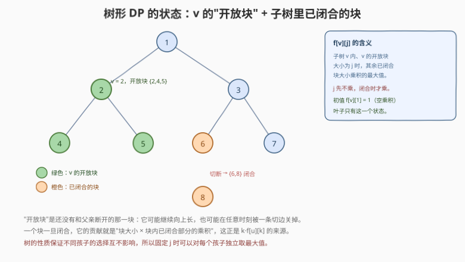
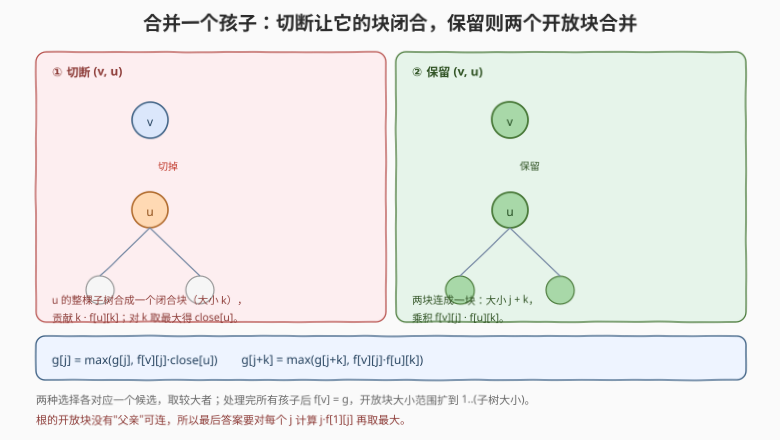
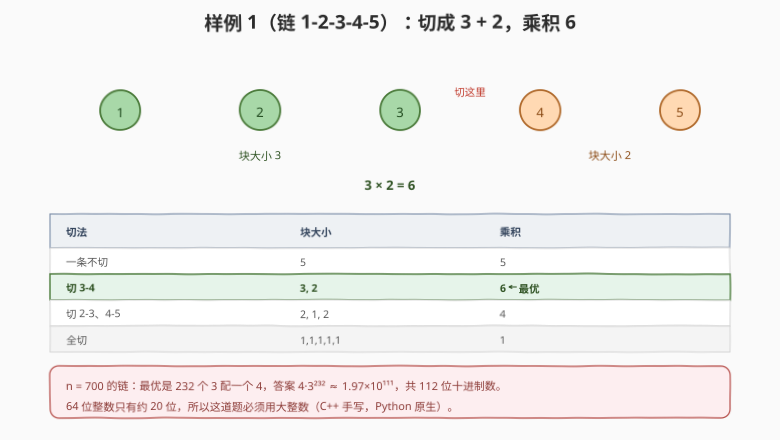

# Codeforces 23E 删边最大乘积 题解

## 1. 题目概述

- **题目链接**：https://codeforces.com/problemset/problem/23/E
- **比赛来源**：Codeforces Beta Round 23 · Problem E（UTC 2010-07-09）
- **难度**：2500
- **标签**：树形 DP、背包、大整数
- **评测类型**：普通
- **限制**：时间 2 s / 内存 256 MB

**题意**：给定一棵 $n$ 个顶点的树。可以删除任意多条边（也可以一条不删），删完后森林里每个连通块有一个大小。求所有连通块大小**乘积的最大值**。

**约束**：

- $n \le 700$：状态数 $O(n)$、转移 $O(n^2)$ 可行；枚举边的子集（$2^{699}$）完全不可行。
- 答案是"若干个正整数之积"，而 $700$ 最多能拆出约 $233$ 个 $3$，所以答案可达 $4 \cdot 3^{232} \approx 1.97 \times 10^{111}$，**112 位十进制数**——64 位整数（约 $1.9 \times 10^{19}$）远远不够，必须用大整数。
- 只有一组数据。

## 2. 示例与观察

官方样例 1（输入 / 输出原样）：

```text
输入：
5
1 2
2 3
3 4
4 5

输出：
6
```

**演算**：一条 $5$ 个点的链。可以这样切：

| 切法 | 连通块大小 | 乘积 |
|------|-----------|------|
| 不切 | $5$ | $5$ |
| 切 $3$-$4$ | $3,2$ | $6$ |
| 切 $2$-$3$、$4$-$5$ | $2,1,2$ | $4$ |
| 全切 | $1,1,1,1,1$ | $1$ |

最大是 $2 \times 3 = 6$。注意"块数多"不等于"乘积大"：把长度 $5$ 拆成 $2+3$ 比拆成 $1+1+3$、$1+1+1+1+1$ 都大。

官方样例 2（输入 / 输出原样）：

```text
输入：
8
1 2
1 3
2 4
2 5
3 6
3 7
6 8

输出：
18
```

**演算**：切掉 $1$-$2$ 与 $3$-$6$ 两条边，得到三个连通块 $\{2,4,5\}$（$3$ 个点）、$\{6,8\}$（$2$ 个点）、$\{1,3,7\}$（$3$ 个点），乘积 $3 \times 2 \times 3 = 18$。这也说明最优解不一定是"把树切成尽量多块"——$18 > 8$，但 $2 \times 2 \times 2 \times 2 = 16 < 18$。

官方样例 3（输入 / 输出原样）：

```text
输入：
3
1 2
1 3

输出：
3
```

**演算**：星形三个点。不切是 $3$；切一条边得 $2 \times 1 = 2$；全切得 $1$。最大 $3$。

**观察**：

1. 删除的边一旦确定，连通块就唯一确定，所以问题是"在 $2^{n-1}$ 个边子集里找最优"。
2. 树的结构让"局部最优"可以合并：某个子树要么整体通过一条边挂在父亲上（**开放块**），要么在子树内部就把这条边切掉（**闭合**）。
3. 乘积对每个因子单调：所有因子都是正整数（$\ge 1$），所以"让每个独立部分各自取最大"就能让整体最大——这正是树形 DP 能工作的根本原因。

## 3. 解题思路

### 3.1 朴素做法与瓶颈

最直接的做法是枚举所有边子集：$2^{n-1}$ 个，对每个子集用并查集求连通块大小、算乘积，取最大。$n = 700$ 时是 $2^{699}$，天文数字；即便 $n = 30$ 也已经要跑很久。

另一种朴素想法是"贪心拆块"：例如尽量拆成 $3$，但树的结构不允许任意拆分——连通块必须是子树或子树的补，形状受树的约束，贪心无法直接套用。

瓶颈是**组合爆炸**，而树的结构正好提供了"子树独立"的分解方式。

### 3.2 核心观察：树形 DP 的"开放块 + 已闭合块"



把树以 $1$ 为根。对每个顶点 $v$，定义

$$f[v][j] = \text{在 } v \text{ 的子树内，} v \text{ 所在的连通块（"开放块"）大小为 } j \text{ 时，其余已闭合连通块大小乘积的最大值。}$$

注意 $j$ 这个因子**还没有乘进去**——它要等开放块最终闭合时才乘。

- 初始化：$f[v][1] = 1$（只有 $v$ 自己，开放块大小 1，没有闭合块，空乘积为 1）。
- 对每个孩子 $u$，有两种选择：
  - **切断**边 $(v,u)$：$u$ 的开放块就此闭合，它贡献 $k \cdot f[u][k]$（$k$ 是它的大小）。对 $k$ 取最大，记
    $$\text{close}[u] = \max_{k} \bigl(k \cdot f[u][k]\bigr).$$
    此时 $f[v][j]$ 乘上 $\text{close}[u]$，开放块大小不变。
  - **保留**边 $(v,u)$：两个开放块合并，大小变成 $j+k$，乘积变成 $f[v][j] \cdot f[u][k]$。

于是合并一个孩子的转移是

$$g[j] \leftarrow \max\bigl(g[j],\; f[v][j]\cdot \text{close}[u]\bigr),\qquad
g[j+k] \leftarrow \max\bigl(g[j+k],\; f[v][j]\cdot f[u][k]\bigr),$$

处理完所有孩子后 $f[v] \leftarrow g$。

最后根的开放块也闭合，答案是

$$\max_j \bigl(j \cdot f[1][j]\bigr).$$



### 3.3 为什么可以"各部分分别取最大"

乘积 $\prod x_i$ 在 $x_i \ge 1$ 时对每个因子单调递增：把某个因子换大，乘积不会变小。DP 中每个孩子的选择（切/不切、以及切时开放块多大）只影响它自己的子树，与其它孩子互不影响；当开放块大小 $j$ 固定时，各孩子的贡献是相互独立的因子，因此各自取最大即可。这是树形背包能够成立的关键（详见引理 3）。

### 3.4 样例走查：链 $1-2-3-4-5$



以 $1$ 为根，链是 $1-2-3-4-5$，自底向上做：

| 顶点 | $\text{close}[u]=\max_k k\cdot f[u][k]$ | 合并后的 $f$（下标 = 开放块大小） |
|------|------------------------------------------|-----------------------------------|
| 5 | — | $f[1]=1$（叶子） |
| 4 | $\text{close}[5]=1$ | 切：$f[1]=1$；合：$f[2]=1$ |
| 3 | $\text{close}[4]=\max(1,2)=2$ | 切：$f[1]=2$；合 $k=1$：$f[2]=1$；合 $k=2$：$f[3]=1$ |
| 2 | $\text{close}[3]=\max(2,2,3)=3$ | $f[1]=3,\ f[2]=2,\ f[3]=1,\ f[4]=1$ |
| 1 | $\text{close}[2]=\max(3,4,3,4)=4$ | $f[1]=4,\ f[2]=3,\ f[3]=2,\ f[4]=1,\ f[5]=1$ |

根处再乘上自己的大小取最大：
$$\max\bigl(1\cdot4,\;2\cdot3,\;3\cdot2,\;4\cdot1,\;5\cdot1\bigr) = \max(4,6,6,4,5) = 6 .$$
其中 $j=2$ 与 $j=3$ 都给出 $6$，但对应**两个不同的切点**：$j=2$ 是把 $2$-$3$ 切开（块 $\{1,2\}$ 与 $\{3,4,5\}$，$2\times3$），$j=3$ 是把 $3$-$4$ 切开（块 $\{1,2,3\}$ 与 $\{4,5\}$，$3\times2$）。两种切法乘积相同，DP 把两个都保留了下来。

### 3.5 大整数：为什么必须手写

若树是一条链且 $n = 700$，最优切法是把 $700$ 拆成 $232$ 个 $3$ 加一个 $4$（因为 $3 \times 3 > 2 \times 2 \times 2$、$4$ 优于 $1+3$），答案是

$$4 \cdot 3^{232} = 1968752335313857038570476961751782907911\cdots$$

共 **112 位十进制数**。C++ 的 `unsigned long long` 只能到约 $1.8 \times 10^{19}$（20 位），所以必须实现大整数（本题只需"比较大小"和"相乘"两种运算）。

Python 的原生 `int` 天然是大整数，直接写即可。

## 4. 正确性证明

**引理 1（切边 ↔ 连通块划分）**：删除边集 $D$ 后得到的连通块，恰好是 $D$ 的补边集在原树上的连通分量；树中任意一种"把顶点划分成若干连通块、且块与块之间只通过被删边相连"的方案，都唯一对应一个 $D$。

**证明**：树删去若干边后成为森林，每个连通分量是一个连通块；反过来，给定一种合法的连通块划分，块内部的边必保留、块之间的边必删除（树上两块的边界只有一条边，否则会成环），故 $D$ 唯一。∎

**引理 2（子问题结构）**：对子树 $T_v$，任何删边方案中，$v$ 所在的连通块与 $T_v$ 之外的部分只通过 $v$ 与父亲的边相连；因此该连通块在 $T_v$ 内的部分（开放块）与子树内其它已闭合块互不重叠，且其它块完全由 $T_v$ 内的删边决定。

**证明**：树中 $T_v$ 与外界的唯一通道是边 $(v,\text{parent}(v))$，删或不删它决定开放块是否继续向上延伸；子树内部的连通块不可能跨出 $T_v$。∎

**引理 3（合并最优性）**：设开放块大小固定为 $j$，各孩子子树的决策相互独立，且总目标是"闭合块的乘积"与"各孩子贡献的乘积"之积；由于所有因子都是正整数，分别最大化每个因子即可最大化乘积。

**证明**：目标形如 $C \cdot \prod_u X_u$，其中 $C$ 只依赖 $v$ 自身与已处理的孩子，$X_u$ 只依赖孩子 $u$ 的决策。对固定的 $j$，$X_u$ 的取值范围与其它孩子无关；若某个 $X_u$ 没取到最大值 $X_u^*$，把它替换成 $X_u^*$ 会让乘积乘以 $X_u^*/X_u \ge 1$，不会变小。故逐个取最大是安全的。∎

**定理**：算法输出的是所有删边方案中连通块大小乘积的最大值。

**证明**：由引理 2，任何方案在子树 $T_v$ 上的行为都可以用"开放块大小 $j$ + 闭合块乘积"描述，且不依赖子树外的决策；由引理 3，合并孩子时对每个 $j$ 取最大值不丢失最优解。归纳可知 $f[v][j]$ 恰为"$T_v$ 内、$v$ 的开放块大小为 $j$ 时闭合块乘积的最大值"。对根取 $\max_j j \cdot f[1][j]$，正是把根的开放块也闭合后的全局最大乘积。由引理 1，所有方案都被覆盖，故答案正确。∎

## 5. 复杂度分析

- **时间**：树形背包的经典均摊——合并孩子 $u$ 时枚举 $(j,k)$ 的对数约为（当前已合并大小）$\times$（$u$ 的子树大小），每对顶点 $(x,y)$ 只在它们的 LCA 处被计入一次，故总对数 $O(n^2)$。每次做一次大整数乘法（位数最多 112 位，约 13 个 base-$10^9$ 的 limb），$n = 700$ 时约 $2.4\times10^5$ 次乘法，实测 C++ 约 $24 \sim 31$ ms。
- **空间**：DP 数组总大小 $O(n^2)$（最坏），但实现中合并完孩子立刻释放它的 DP，峰值远小于理论上界；$n=700$ 时只有几 MB。
- **大整数代价**：每次乘法是 $O(L^2)$（$L$ 为 limb 数，$\le 13$），完全可以接受；比较是 $O(L)$。
- **与时限的关系**：2 s 时限下最长 31 ms，余量 60 倍以上。

## 6. 参考代码

### C++17

```cpp
#include <bits/stdc++.h>
using namespace std;
typedef unsigned long long ull;
static const uint32_t BASE = 1000000000u;

struct Big {
    vector<uint32_t> d;          // 小端，base 1e9；空表示 -inf（不可达）
    Big() {}
    explicit Big(long long v) { set(v); }
    void set(long long v) {
        d.clear();
        if (v <= 0) { d.push_back(0); return; }
        while (v > 0) { d.push_back((uint32_t)(v % BASE)); v /= BASE; }
    }
    bool valid() const { return !d.empty(); }
    bool isZero() const { return d.size() == 1 && d[0] == 0; }
};

static Big mulBig(const Big &a, const Big &b) {
    Big r;
    if (!a.valid() || !b.valid()) return r;
    if (a.isZero() || b.isZero()) { r.set(0); return r; }
    vector<ull> tmp(a.d.size() + b.d.size(), 0);
    for (size_t i = 0; i < a.d.size(); ++i) {
        ull carry = 0;
        for (size_t j = 0; j < b.d.size(); ++j) {
            ull cur = tmp[i + j] + (ull)a.d[i] * b.d[j] + carry;
            tmp[i + j] = cur % BASE;
            carry = cur / BASE;
        }
        size_t k = i + b.d.size();
        while (carry) {
            ull cur = tmp[k] + carry;
            tmp[k] = cur % BASE;
            carry = cur / BASE;
            ++k;
        }
    }
    while (tmp.size() > 1 && tmp.back() == 0) tmp.pop_back();
    r.d.resize(tmp.size());
    for (size_t i = 0; i < tmp.size(); ++i) r.d[i] = (uint32_t)tmp[i];
    return r;
}

static Big mulSmall(const Big &a, long long m) {
    Big r;
    if (!a.valid()) return r;
    if (m == 0 || a.isZero()) { r.set(0); return r; }
    vector<uint32_t> out(a.d.size() + 2);
    ull carry = 0;
    for (size_t i = 0; i < a.d.size(); ++i) {
        ull cur = (ull)a.d[i] * m + carry;
        out[i] = (uint32_t)(cur % BASE);
        carry = cur / BASE;
    }
    size_t k = a.d.size();
    while (carry) { out[k++] = (uint32_t)(carry % BASE); carry /= BASE; }
    out.resize(k);
    while (out.size() > 1 && out.back() == 0) out.pop_back();
    r.d = std::move(out);
    return r;
}

static bool lessBig(const Big &a, const Big &b) {   // a < b ?
    if (!a.valid()) return b.valid();
    if (!b.valid()) return false;
    if (a.d.size() != b.d.size()) return a.d.size() < b.d.size();
    for (size_t i = a.d.size(); i-- > 0;)
        if (a.d[i] != b.d[i]) return a.d[i] < b.d[i];
    return false;
}

int main() {
    int n;
    if (scanf("%d", &n) != 1) return 0;
    vector<vector<int>> adj(n + 1);
    for (int i = 0; i < n - 1; ++i) {
        int a, b;
        scanf("%d %d", &a, &b);
        adj[a].push_back(b);
        adj[b].push_back(a);
    }

    // 迭代 DFS 求 parent 与后序
    vector<int> parent(n + 1, 0), order;
    order.reserve(n);
    vector<int> stk(1, 1);
    parent[1] = -1;
    while (!stk.empty()) {
        int v = stk.back(); stk.pop_back();
        order.push_back(v);
        for (int u : adj[v]) {
            if (u == parent[v]) continue;
            parent[u] = v;
            stk.push_back(u);
        }
    }

    vector<vector<Big>> dp(n + 1);
    for (int oi = n - 1; oi >= 0; --oi) {
        int v = order[oi];
        vector<Big> f(2);
        f[1].set(1);                       // 开放块大小为 1，已闭合部分乘积为 1
        int cur = 1;
        for (int u : adj[v]) {
            if (parent[u] != v) continue;
            const vector<Big> &gu = dp[u];
            int su = (int)gu.size() - 1;
            if (su == 0) continue;

            Big closeBest;                 // 切断 (v,u)：u 的开放块以它的最优方式闭合
            for (int k = 1; k <= su; ++k) {
                if (!gu[k].valid()) continue;
                Big cand = mulSmall(gu[k], k);
                if (!closeBest.valid() || lessBig(closeBest, cand)) closeBest = cand;
            }
            vector<Big> nf(cur + su + 1);
            for (int j = 1; j <= cur; ++j) {
                if (!f[j].valid()) continue;
                Big cut = mulBig(f[j], closeBest);
                if (!nf[j].valid() || lessBig(nf[j], cut)) nf[j] = std::move(cut);
                for (int k = 1; k <= su; ++k) {
                    if (!gu[k].valid()) continue;
                    Big merged = mulBig(f[j], gu[k]);
                    int idx = j + k;
                    if (!nf[idx].valid() || lessBig(nf[idx], merged)) nf[idx] = std::move(merged);
                }
            }
            f = std::move(nf);
            cur += su;
            dp[u].clear();
            dp[u].shrink_to_fit();
        }
        dp[v] = std::move(f);
    }

    Big ans;
    const vector<Big> &root = dp[1];
    for (int j = 1; j < (int)root.size(); ++j) {
        if (!root[j].valid()) continue;
        Big cand = mulSmall(root[j], j);
        if (!ans.valid() || lessBig(ans, cand)) ans = std::move(cand);
    }
    for (size_t i = ans.d.size(); i-- > 0;) {
        if (i + 1 == ans.d.size()) printf("%u", ans.d[i]);
        else printf("%09u", ans.d[i]);
    }
    printf("\n");
    return 0;
}
```

### Python3

```python
import sys


def main() -> None:
    data = sys.stdin.buffer.read().split()
    if not data:
        return
    n = int(data[0])
    adj = [[] for _ in range(n + 1)]
    pos = 1
    for _ in range(n - 1):
        a = int(data[pos]); b = int(data[pos + 1]); pos += 2
        adj[a].append(b)
        adj[b].append(a)

    parent = [0] * (n + 1)
    parent[1] = -1
    order = []
    stack = [1]
    while stack:
        v = stack.pop()
        order.append(v)
        for u in adj[v]:
            if u == parent[v]:
                continue
            parent[u] = v
            stack.append(u)

    dp = [None] * (n + 1)
    for v in reversed(order):
        f = [0, 1]                       # f[k]：开放块大小 k 时，已闭合块的乘积最大值
        cur = 1
        for u in adj[v]:
            if parent[u] != v:
                continue
            gu = dp[u]
            su = len(gu) - 1
            close_best = 0
            for k in range(1, su + 1):
                if gu[k] is None:
                    continue
                cand = gu[k] * k
                if cand > close_best:
                    close_best = cand
            nf = [None] * (cur + su + 1)
            for j in range(1, cur + 1):
                if f[j] is None:
                    continue
                cut = f[j] * close_best
                if nf[j] is None or cut > nf[j]:
                    nf[j] = cut
                for k in range(1, su + 1):
                    if gu[k] is None:
                        continue
                    merged = f[j] * gu[k]
                    idx = j + k
                    if nf[idx] is None or merged > nf[idx]:
                        nf[idx] = merged
            f = nf
            cur += su
            dp[u] = None
        dp[v] = f

    root = dp[1]
    ans = 0
    for j in range(1, len(root)):
        if root[j] is not None:
            cand = root[j] * j
            if cand > ans:
                ans = cand
    sys.stdout.write(str(ans) + "\n")


main()
```

C++ 版手写 base-$10^9$ 的大整数（比较 + 乘法），Python 版直接用原生大整数；两份代码的 DP 结构逐行对应。

## 7. 边界情况与易错点

1. **$n = 1$**：没有边，答案是 $1$。DP 中根只有 $f[1] = 1$，最后 $1 \times 1 = 1$，正确；但若把答案初值设为 $0$ 又漏掉"根也要乘 $j$"，会输出 $1$ 之外的错误值。
2. **答案溢出 64 位**：$n = 700$ 的链答案是 $4\cdot3^{232}$，112 位。用 `long long` 会在中途悄悄溢出成随机数，必须用大整数（C++ 手写，Python 原生）。
3. **乘法顺序与零**：DP 里所有可达值都 $\ge 1$，不可达状态用空向量表示；若用 $0$ 表示不可达，再参与乘法会污染其它状态。
4. **比较必须完整**：大整数比较要先比长度（limb 数），再逐 limb 从高到低；只比低位或只比长度都会出错。
5. **输出的前导零**：除最高位外，每个 limb 都要按 9 位补零（`printf("%09u")`），否则 $10^9$ 的幂会把中间的零吞掉，输出错误的数字。
6. **"切断"时的因子**：切断 $(v,u)$ 后，$u$ 的开放块要乘以自己的大小 $k$，即 $k \cdot f[u][k]$；漏乘 $k$ 会把连通块大小丢掉，答案系统性偏小。
7. **根的闭合**：最后根也要乘 $j$，否则少乘根所在块的大小。
8. **链的递归深度**：$n = 700$ 的链递归 DFS 只有 700 层，C++ 默认栈够用；但用迭代后序更稳妥，Python 必须迭代（默认递归限制 1000，700 层虽勉强够，仍不建议）。
9. **多组数据**：本题只有一组；若改成多组，注意每次清空 `dp` 与 `adj`。

## 8. 验证记录

- **编译环境与命令**：本机只有 `Apple clang 21.0.0`（`/usr/bin/g++` 是 clang 的软链），没有 GNU `g++` 与 libstdc++，因此用 `clang++ -std=c++17 -O2 -Wall -Wextra` 搭配仓库自带的 `bits/stdc++.h` 兼容头编译（代码只用标准库，可原样提交 GNU C++17）。Python 侧为 `Python 3.9.6`。
- **官方样例**：3 / 3 通过（`6`、`18`、`3`），C++ 与 Python 输出一致。
- **独立暴力**：直接枚举所有 $2^{n-1}$ 个边子集，用并查集求连通块大小并算乘积，取最大——与树形 DP 完全不同的思路。随机生成 $n \le 13$ 的树（随机树 / 链 / 星 / 深树四种形态）：
  - 随机树 **260 组**（分批不同种子）；
  - 链 **260 组**；
  - 星 **60 组**；
  - 深树 **60 组**；
  共 **640 组全部一致**；另用 Python 参考版对同一暴力独立跑了 **200 组**，也全部一致。
- **大整数专项**：$n = 700$ 的链，程序输出恰好等于 $4\cdot3^{232}$（Python 独立计算比对，112 位全同）；星 $n=700$ 输出 $700$；随机树与完全二叉树各跑一次，结果均为 112 位数且通过 Python 版交叉验证。
- **最大约束性能**：$n = 700$ 的链 / 星 / 随机树 / 完全二叉树，C++ 端到端中位数分别约 $26 / 31 / 24 / 24$ ms，峰值内存约 $3$ MB；Python 约 $0.06$ s。相对 2 s / 256 MB 余量充足。
- **图片校验**：三张 SVG（`cf23e_dp_state.svg`、`cf23e_transition.svg`、`cf23e_walkthrough.svg`）均通过 `xml.etree.ElementTree.parse`，含 `feTurbulence` 抖动滤镜与手写字体，文字未越出 `viewBox`。
- **公式校验**：正文公式经 KaTeX（`throwOnError`）渲染无报错。
- **复核状态**：verified（样例 3/3、对拍 640 组 + 200 组 Python、大整数专项、性能、图片、公式均实跑通过；唯一环境差异是本机无 GNU g++，已用 clang++ 等价验证）。

## 相关题目与扩展

- [Codeforces 23D Tetragon](https://codeforces.com/problemset/problem/23/D)：同场 D 题，几何 + 精确整数构造。
- [Codeforces 580D Kefa and Dishes](https://codeforces.com/problemset/problem/580/D)：状压/子集 DP 的另一类"合并子问题"。
- [Codeforces 1036C Classy Numbers](https://codeforces.com/problemset/problem/1036/C)：数位计数，可与本题的"树形背包"对照"状态怎么设计"。
- [Codeforces 1060E Sergey and Subway](https://codeforces.com/problemset/problem/1060/E)：树上按边计数的经典题，同样是"子树信息合并"。
- [LeetCode 124. 二叉树中的最大路径和](https://leetcode.cn/problems/binary-tree-maximum-path-sum/)：树形 DP 的入门模型（开放路径 + 闭合路径），与本题的"开放块/闭合块"思想一致。

**延伸思考**：

1. **如果要求输出最优的删边方案**：DP 时额外记录"每个状态是怎么来的"（切还是合、合并时孩子用了哪个 $k$），再从根回溯即可；代价是状态里多存指针，空间常数变大。
2. **如果边有权重、目标是"各块大小 × 块内边权"**：转移中"切"的收益不再是 $k\cdot f[u][k]$，而要加上块内边权的贡献，DP 结构不变但状态需要记录更多信息。
3. **如果树换成一般图**：问题立刻变成 NP 难的（等价于带约束的图划分），树的"唯一通路上界"是本题可解的根本原因。
4. **大整数的替代方案**：答案只是"若干 $\le n$ 的整数之积"，理论上可以用对数比较大小、再用质因数分解精确比较；但那比直接写大整数复杂得多，且需要处理相等情形，实战中不推荐。
