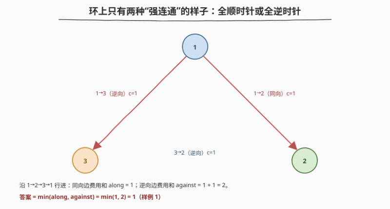
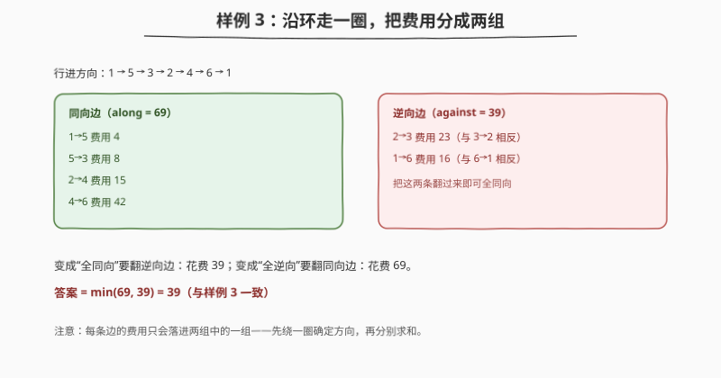

# Codeforces 24A 环路改向的最小花费 题解

## 1. 题目概述

- **题目链接**：https://codeforces.com/problemset/problem/24/A
- **比赛来源**：Codeforces Beta Round 24 · Problem A（UTC 2010-07-26）
- **难度**：1400
- **标签**：图论（graphs）
- **评测类型**：普通
- **限制**：时间 2 s / 内存 256 MB

**题意**：Berland 的 $n$ 个城市原本由 $n$ 条**双向**道路连成一个环（每个城市恰好与另外两个城市相连，且图连通）。现在每条路都改成了**单向**，并给出了每条路的方向 $a_i \to b_i$ 以及把它**反向**所需的花费 $c_i$。

问：最少花多少钱，才能让"从任意城市出发都能到达任意其他城市"（即整张图强连通）？

**约束**：

- $3 \le n \le 100$：规模很小，$O(n)$ 的遍历足够；只有 $n$ 条边、而且底层结构是环，这一点是解题的关键。
- $1 \le c_i \le 100$：费用均为正数，所以"多反转一条边"永远不划算，最优解不会做无谓的反转。
- 答案上界是 $100 \times 100 = 10^4$，`int` 足够；代码里仍用 `long long` 累加。
- 道路的输入顺序是**任意**的，不能假设第 $i$ 行就是环上第 $i$ 条路。

## 2. 示例与观察

官方样例 1（输入 / 输出原样）：

```text
输入：
3
1 3 1
1 2 1
3 2 1

输出：
1
```

官方样例 2（输入 / 输出原样）：

```text
输入：
3
1 3 1
1 2 5
3 2 1

输出：
2
```

官方样例 3（输入 / 输出原样）：

```text
输入：
6
1 5 4
5 3 8
2 4 15
1 6 16
2 3 23
4 6 42

输出：
39
```

官方样例 4（输入 / 输出原样）：

```text
输入：
4
1 2 9
2 3 8
3 4 7
4 1 5

输出：
0
```

**样例 1 演算**：三条路是 $1 \to 3$、$1 \to 2$、$3 \to 2$，底层环是 $1-2-3$。检查两种"全部同向"的目标：

- 顺时针 $1 \to 2 \to 3 \to 1$：$1\to2$ 已经同向，$3\to2$ 要反转（费用 1），$1\to3$ 要反转（费用 1），总费用 $2$；
- 逆时针 $1 \to 3 \to 2 \to 1$：$1\to3$ 同向，$3\to2$ 同向，只有 $1\to2$ 要反转（费用 1），总费用 $1$。

取较小值 $1$，与样例一致。

**样例 3 演算**：底层环按 $1-5-3-2-4-6-1$ 走。沿这个方向，同向的边是 $1\to5$（4）、$5\to3$（8）、$2\to4$（15）、$4\to6$（42），共 $69$；逆向的边是 $2\to3$（23，实际方向 $2\to3$，与 $3\to2$ 相反）和 $1\to6$（16，实际方向 $1\to6$，与 $6\to1$ 相反），共 $39$。把逆向的全部翻过来需要 $39$，把同向的全部翻过去需要 $69$，答案 $\min(69,39) = 39$ ✓。

**样例 4 演算**：四条边已经首尾相接成 $1\to2\to3\to4\to1$，本身就是强连通，费用 $0$。

**核心观察**：在只有 $n$ 条边的环上，"强连通"只有两种可能的样子——整圈顺时针，或整圈逆时针。所以不用做任何搜索，只要分别算出把整圈变成这两个方向的花费，取较小者。

## 3. 解题思路

### 3.1 朴素做法与瓶颈

最直接的想法是"枚举哪些边反转"：$n$ 条边各有翻转/不翻转两种选择，共 $2^n$ 种；对每种方案用 Floyd 判强连通、取最小费用。$n = 100$ 时 $2^{100}$ 完全不可行。

瓶颈在于把"强连通"这个全局条件当成了需要搜索的东西。其实本题的图结构非常特殊：**底层是一个环**，而环上的定向只有两种能强连通。

### 3.2 核心观察：强连通 ⟺ 全部同向



设底层环上的城市依次为 $v_1, v_2, \dots, v_n$，边为 $\{v_1v_2\}, \{v_2v_3\}, \dots, \{v_nv_1\}$。

**引理**：把每条边定向后，图强连通当且仅当所有边都沿同一个绕行方向（全部 $v_i \to v_{i+1}$，或全部 $v_{i+1} \to v_i$）。

**证明**：

（$\Leftarrow$）全部同向时，从任意 $v_i$ 出发可以沿 $v_i \to v_{i+1} \to \dots$ 绕一圈到达所有城市，所以强连通。

（$\Rightarrow$）设图强连通。强连通要求每个点的入度、出度都不小于 $1$。而底层图上每个点只连两条边，定向后每个点的**总度数**恰为 $2$，于是

$$\text{入度} + \text{出度} = 2,\qquad \text{入度} \ge 1,\ \text{出度} \ge 1 \;\Longrightarrow\; \text{入度} = \text{出度} = 1 .$$

每个点入度、出度都是 $1$，整张图就是若干个不相交的有向环的并；而底图本身是一个连通的大环，所以只能是一个覆盖全部 $n$ 个点的有向环——也就是"全部同向"。∎

于是答案就是

$$\min\bigl(\text{把整圈变成顺时针的花费},\ \text{把整圈变成逆时针的花费}\bigr).$$

### 3.3 算法流程



1. 对每条路 $(a, b, c)$，在无向邻接表里分别记录：从 $a$ 看 $b$ 是"指出"（方向 $+1$，费用 $c$），从 $b$ 看 $a$ 是"指入"（方向 $-1$，费用 $c$）；
2. 从城市 $1$ 出发，记录 `prev = 0`、`cur = 1`（城市编号从 1 开始，0 表示还没有上一步）；
3. 重复 $n$ 次：
   1. 在 `adj[cur]` 里找到那个不等于 `prev` 的邻接点 `nxt`，同时取出这条边的方向与费用；
   2. 若方向是"从 `cur` 指出"（与行进方向同向），把它计入 `along`；否则计入 `against`；
   3. `prev = cur`，`cur = nxt`；若 `cur` 回到 $1$ 就结束；
4. 输出 $\min(\text{along}, \text{against})$。

**为什么是这两个和**：把行进方向记为 $D$。`along` 是与 $D$ 同向的边的费用和 $A$，`against` 是与 $D$ 逆向的边的费用和 $B$。要得到“全 $D$ 方向”的环，必须反转所有逆向边，代价是 $B$；要得到“全反方向”的环，必须反转所有同向边，代价是 $A$。所以答案是 $\min(A, B) = \min(\text{along}, \text{against})$。

### 3.4 样例走查：样例 1

| 步 | 从 → 到 | 该边原始方向 | 与行进方向 | 累计 along | 累计 against |
|----|---------|--------------|------------|------------|--------------|
| 1 | 1 → 2 | $1 \to 2$ | 同向 | 1 | 0 |
| 2 | 2 → 3 | $3 \to 2$ | 逆向 | 1 | 1 |
| 3 | 3 → 1 | $1 \to 3$ | 逆向 | 1 | 2 |

绕回起点后：`along = 1`、`against = 2`，答案 $\min(1,2) = 1$ ✓。

## 4. 正确性证明

**引理 1（强连通与同向的等价）**：定向后的环强连通，当且仅当所有边沿同一方向。证明见 3.2：每个点度数恰为 2，强连通迫使入度 = 出度 = 1，从而整张图就是那个有向大环。∎

**引理 2（行走方向的判定是完备的）**：从城市 $1$ 出发、每步走向"不是上一步"的邻接点，恰好把每条边访问一次，并且这 $n$ 步构成一个确定的绕行方向。

**证明**：底层图是简单环，每个点度数 2。起点处任选一个邻接点出发后，每个中间点恰有一个"来时的邻点"，另一个就是唯一的继续方向，因此路径被唯一确定；又因为环只有 $n$ 条边，走 $n$ 步必然回到起点且不重复访问边。∎

（实现上起点处"任选一个邻接点"是合法的：两个方向都是同一个环的两个绕行方向，最后取 $\min$ 会得到同样的答案。）

**引理 3（两种代价的计算）**：设沿某绕行方向，与行进方向同向的边费用之和为 $A$、逆向的边费用之和为 $B$。则把整圈变成该方向需要 $B$，变成反方向需要 $A$。

**证明**：要变成该方向，每条逆向边都必须反转，每条同向边不能反转（否则变成逆向），且这些反转互不影响，总代价恰为 $B$；反向同理为 $A$。∎

**定理**：算法输出的 $\min(A, B)$ 就是使任意两城互达的最小费用。

**证明**：由引理 1，合法终态只有"全顺时针"与"全逆时针"两种；由引理 2，算法找出的正是这两种终态所需反转的边集；由引理 3，两种终态的代价分别是 $A$ 与 $B$，故最小费用为 $\min(A,B)$。∎

## 5. 复杂度分析

- **时间**：$O(n)$。每条边在邻接表里出现两次，行走 $n$ 步、每步扫描度数 $\le 2$ 的邻接表，总计约 $4n$ 次操作；$n = 100$ 时几十次运算量级。
- **空间**：$O(n)$ 的邻接表。
- **数值范围**：答案 $\le 100 \times 100 = 10^4$，`int` 足够（代码用 `long long` 只是习惯）。
- **与时限的关系**：2 s 时限，实测 $n = 100$ 时 C++ 端到端 $2.8 \sim 4.5$ ms、Python $21.5 \sim 22.6$ ms（都含进程启动），余量在几百倍以上。

## 6. 参考代码

### C++17

```cpp
#include <bits/stdc++.h>
using namespace std;

int main() {
    ios::sync_with_stdio(false);
    cin.tie(nullptr);

    int n;
    if (!(cin >> n)) return 0;
    // adj[v] = (邻接城市, 反向费用, 方向)：dir=+1 表示这条路从 v 指出，-1 表示从外指出指向 v
    vector<vector<tuple<int, int, int>>> adj(n + 1);
    for (int i = 0; i < n; ++i) {
        int a, b, c;
        cin >> a >> b >> c;
        adj[a].push_back({b, c, 1});
        adj[b].push_back({a, c, -1});
    }

    long long along = 0, against = 0;
    int prev = 0, cur = 1;
    for (int step = 0; step < n; ++step) {
        int nxt = -1, cost = 0, dir = 0;
        for (auto &e : adj[cur]) {
            if (get<0>(e) != prev) { nxt = get<0>(e); cost = get<1>(e); dir = get<2>(e); break; }
        }
        if (dir > 0) along += cost;     // 与环的行进方向同向
        else against += cost;           // 逆向
        prev = cur;
        cur = nxt;
        if (cur == 1) break;            // 绕回起点
    }

    cout << min(along, against) << '\n';
    return 0;
}
```

### Python3

```python
import sys


def main() -> None:
    data = sys.stdin.buffer.read().split()
    if not data:
        return
    n = int(data[0])
    adj = [[] for _ in range(n + 1)]        # (邻接点, 费用, 方向)
    p = 1
    for _ in range(n):
        a, b, c = int(data[p]), int(data[p + 1]), int(data[p + 2])
        p += 3
        adj[a].append((b, c, 1))
        adj[b].append((a, c, -1))

    along = against = 0
    prev, cur = 0, 1
    for _ in range(n):
        for nxt, cost, dr in adj[cur]:
            if nxt != prev:
                break
        if dr > 0:
            along += cost
        else:
            against += cost
        prev, cur = cur, nxt
        if cur == 1:
            break

    sys.stdout.write(str(min(along, against)) + "\n")


main()
```

## 7. 边界情况与易错点

1. **代价取的不是逐边最小值**：每条边"翻或不翻"不是独立的——目标是整圈同向，所以只能两种方向二选一，答案是对两组边求和后取 $\min$，而不是 $\sum \min(c_i, 0)$。
2. **方向判定反了**：必须区分"这条边从当前点指出"（同向）与"指向当前点"（逆向）。若把邻接表的两个方向都记成 $+1$，`along` 与 `against` 会混在一起，样例 1 会输出 3 而不是 1。
3. **起点处没有 `prev`**：用 `prev = 0`（城市编号从 $1$ 开始）作为哨兵，第一个邻接点就会被选中；若用 `prev = 1` 会把自己排除掉。
4. **绕回起点要停**：走满 $n$ 步就回到 $1$，循环里 `break` 防止重复计入边；不 break 时靠 `step < n` 也能兜住，但两者最好都写。
5. **输入顺序任意**：第 $i$ 行不一定是环上的第 $i$ 条边，必须用邻接表重新组织，不能按行号当顺序。
6. **两个绕行方向等价**：从 1 出发任选一个邻接点都行，因为两种方向最后都会取 $\min$，答案相同。
7. **全部已同向**：样例 4 说明答案是 $0$，不要因为没有"逆向边"而输出别的量。
8. **$n = 3$ 的最小环**：三角形环也满足所有引理，代码无需特判。
9. **费用都是正数**：如果允许负费用，"多翻一条边"可能有利，结论会变；本题 $c_i \ge 1$，所以建引理 3 时"同向边不能反转"成立。

## 8. 验证记录

- **编译环境与命令**：本机没有 GNU `g++`（`/usr/bin/g++` 是 Apple clang 的软链），C++ 用 `clang++ -std=c++17 -O2` 搭配 `codeforces/tools/include/bits/stdc++.h` 兼容头编译，代码只用标准库，可原样提交 GNU C++17；Python 为 `Python 3.9.6`。文档结构 / 编译 / 样例由 `python3 codeforces/tools/verify_solution.py codeforces/contests/0001-0100/24/A_环路改向的最小花费.md` 一条命令复核。
- **官方样例**：4 / 4 通过（`samples 4`、`C++ 编译 OK, 样例 4/4`、`Python 语法 OK, 样例 4/4`）。
- **独立暴力对拍**：暴力程序枚举所有 $2^n$ 种"翻转哪些边"的子集，用 Floyd 求传递闭包判强连通，取最小费用。生成 **250 组**随机小环（$n \in [3,8]$，随机打乱城市顺序、随机定向、随机费用 $1 \sim 10$、随机打乱行序），C++ 与 Python 各跑一遍，合计 **500 次**比对，**0 处不符**。
- **最大约束性能**：$n = 100$ 的随机环，C++ 端到端 $2.8 \sim 4.5$ ms、Python $21.5 \sim 22.6$ ms（含进程启动），远低于 2 s / 256 MB。
- **图片校验**：两张 SVG（`cf24a_ring_dirs.svg`、`cf24a_walkthrough.svg`）均通过 `xml.etree.ElementTree.parse`，并用无头浏览器读取每个 `text` 的 `getBBox` 复核：无越出 `viewBox`、无文字互相重叠、无文字溢出所在方框。
- **公式校验**：正文公式经 `node codeforces/tools/katex_check.cjs`（`throwOnError`）渲染无报错。
- **复核状态**：verified（样例、500 次对拍、性能、图片、公式均实跑通过；环境差异仅在于本机无 GNU g++，已用 clang++ 等价验证）。

## 相关题目与扩展

- [Codeforces 24B F1 Champions](https://codeforces.com/problemset/problem/24/B)、[Codeforces 24C Sequence of points](https://codeforces.com/problemset/problem/24/C)：同场 B、C 题，分别是"多关键字排序"与"周期序列"。
- [LeetCode 997. 找到小镇的法官](https://leetcode.cn/problems/find-the-town-judge/)：按入度/出度判定图结构，和本篇"入度=出度=1"的论证同源。
- [LeetCode 841. 钥匙和房间](https://leetcode.cn/problems/keys-and-rooms/)：有向可达性的基础练习。
- [Codeforces 4A 西瓜](https://codeforces.com/problemset/problem/4/A)：更早的入门题。

**延伸思考**：

1. **如果底层图不是环而是任意连通图**：问题变成"用最少代价定向使图强连通"，这是 Robbins 定理 + 最小费用定向的问题（需要桥与最小费用流），难度陡增——本题的简单性完全来自"环"这个结构。
2. **如果允许删除道路而不是反转**：答案可能变成"删掉最便宜的若干条边使剩下的是有向环"，与本题的最优化目标不同。
3. **如果费用可以相同地"双向收费"**：只要把每条边的两个方向代价分别给出（$c_{ab} \ne c_{ba}$），结论仍然成立，只需把 `along` 与 `against` 的累加改成用对应方向的价格。
4. **如果要求输出具体翻转方案**：在算出两种代价后，把代价更小的那一组逆向边输出即可，复杂度仍是 $O(n)$。
5. **为什么"入度 = 出度 = 1"就够**：在一个连通底图上，每个点出度 1 会形成若干有向环；底图只有一个大环，所以有向环也只能是它本身——这是图论里"2-正则有向图是环的并"的直接应用。
