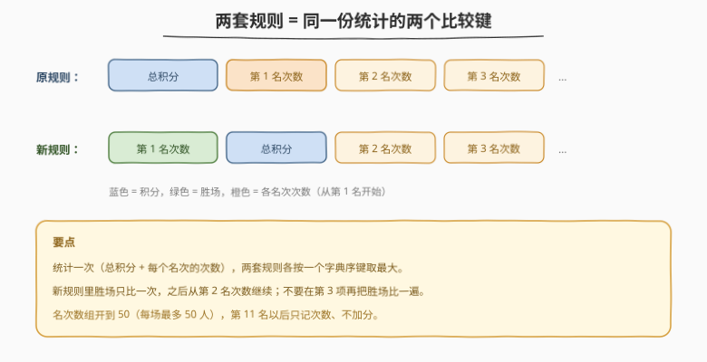
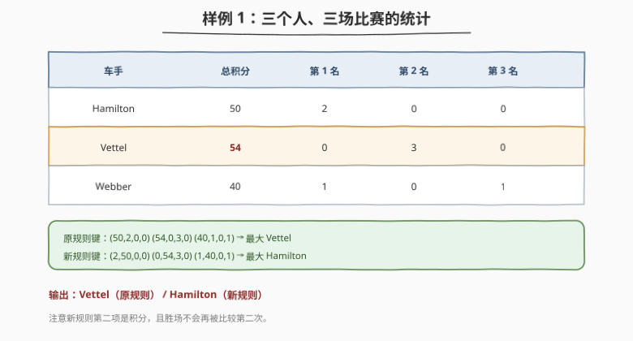

# Codeforces 24B 双规则评选赛车冠军 题解

## 1. 题目概述

- **题目链接**：https://codeforces.com/problemset/problem/24/B
- **比赛来源**：Codeforces Beta Round 24 · Problem B（UTC 2010-07-26）
- **难度**：1500
- **标签**：实现（implementation）
- **评测类型**：普通
- **限制**：时间 2 s / 内存 256 MB

**题意**：一个赛季有 $t$ 场比赛，每场比赛给出参加排名（从第 1 名到最后一名）的车手名单。只有前 10 名得分，依次是

$$25,\ 18,\ 15,\ 12,\ 10,\ 8,\ 6,\ 4,\ 2,\ 1 .$$

要在两套规则下各选出冠军：

- **原规则**：先比总积分；并列则比第一名次数；再并列比第二名次数，依此类推。
- **新规则**：先比第一名次数；并列则比总积分；再并列比第二名、第三名……的次数。

题目保证两套规则下冠军都唯一。输出两行：原规则冠军、新规则冠军。

**约束**：

- $t \le 20$，每场 $n \le 50$，整个赛季出现过的车手不超过 50 名：数据极小，唯一的难点是**把两套比较规则精确实现**。
- 车手名区分大小写，长度不超过 50；同一名车手可能不参加某些比赛。
- 名次最多 50 个，但只有前 10 名有分；第 11 名及以后只记录"名次次数"，用于并列时的比较。
- 只参加过至少一场比赛的车手才统计（自然满足：没出现过的名字不会被建立记录）。

## 2. 示例与观察

官方样例 1（输入 / 输出原样）：

```text
输入：
3
3
Hamilton
Vettel
Webber
2
Webber
Vettel
2
Hamilton
Vettel

输出：
Vettel
Hamilton
```

**演算**：三场比赛的名次分别是

| 比赛 | 1st | 2nd | 3rd |
|------|-----|-----|-----|
| 1 | Hamilton | Vettel | Webber |
| 2 | Webber | Vettel | — |
| 3 | Hamilton | Vettel | — |

逐人统计：

| 车手 | 积分 | 第 1 名 | 第 2 名 | 第 3 名 |
|------|------|---------|---------|---------|
| Hamilton | $25 + 25 = 50$ | 2 | 0 | 0 |
| Vettel | $18 + 18 + 18 = 54$ | 0 | 3 | 0 |
| Webber | $15 + 25 = 40$ | 1 | 0 | 1 |

原规则：Vettel 积分 54 最高 → `Vettel`。
新规则：Hamilton 胜场 2 最多 → `Hamilton`。

官方样例 2（输入 / 输出原样）：

```text
输入：
2
7
Prost
Surtees
Nakajima
Schumacher
Button
DeLaRosa
Buemi
8
Alonso
Prost
NinoFarina
JimClark
DeLaRosa
Nakajima
Patrese
Surtees

输出：
Prost
Prost
```

**演算**：Prost 在比赛 1 拿第 1（25 分）、比赛 2 拿第 2（18 分），共 43 分、1 个胜场；Alonso 只有 1 个胜场、25 分；其余人都没有胜场。原规则比积分：Prost 43 最高；新规则先比胜场：Prost 与 Alonso 都是 1 胜，再比积分 43 > 25，仍是 Prost。两行都是 `Prost`。

**观察**：

1. 两套规则共用同一批统计数据：每个车手的**总积分**与**各名次出现次数**。
2. 两套规则的区别只是**比较键的顺序**：原规则把积分放第一、胜场放第二、其余名次依次；新规则把胜场放第一、积分放第二，然后从第二名开始依次比较。
3. 所以不需要写两套统计，只需要写两个"比较键"。

## 3. 解题思路

### 3.1 朴素做法与瓶颈

把每场比赛的名单存下来，对每个车手逐场扫描、统计积分和名次次数，最后按规则排序取第一名。数据规模很小，$O(\text{车手数} \times \text{比赛数})$ 完全够用；瓶颈不在算法，而在**规则细节**：

- 哪些名次有分、各是多少分；
- 并列时到底先比什么；
- 新规则里"胜场并列之后比积分，再之后从第二名开始比"（不能把胜场再比一遍）。

### 3.2 核心观察：同一份统计 + 两种字典序



设车手 $i$ 的总积分为 $P_i$，第 $k$ 名（$k = 1, 2, \dots$）的次数为 $C_i[k]$。则

- 原规则：比较键为 $(P_i,\ C_i[1],\ C_i[2],\ C_i[3],\ \dots)$；
- 新规则：比较键为 $(C_i[1],\ P_i,\ C_i[2],\ C_i[3],\ \dots)$。

两个键都是**定长整数元组**，按字典序比大小即可。由于冠军唯一，取最大者不会产生歧义。



### 3.3 算法流程

1. 读入 $t$；
2. 用 `map<string,int>` 给每个新出现的车手编号，同时维护 `points[i]` 与 `place[i][k]`（$k$ 从 0 开始表示第 $k+1$ 名）；
3. 对每场比赛：读入 $n$，再依次读入 $n$ 个名字；
   1. 若名字第一次出现，新建记录；
   2. `place[id][pos]++`；
   3. 若 $pos < 10$，`points[id] += score[pos]`；
4. 用原规则键扫一遍所有车手取最大 → 第一行输出；
5. 用新规则键再扫一遍 → 第二行输出。

比较直接用"逐项比较、先不等者为大"的循环实现，避免浮点或字符串排序的坑。

### 3.4 样例走查：样例 1

| 步骤 | 处理 | Hamilton | Vettel | Webber |
|------|------|----------|--------|--------|
| 比赛 1 | H, V, W | 25 / (1,0,0) | 18 / (0,1,0) | 15 / (0,0,1) |
| 比赛 2 | W, V | 25 / (1,0,0) | 36 / (0,2,0) | 40 / (1,0,1) |
| 比赛 3 | H, V | 50 / (2,0,0) | 54 / (0,3,0) | 40 / (1,0,1) |

- 原规则比较键：Hamilton $(50,2,0,0)$、Vettel $(54,0,3,0)$、Webber $(40,1,0,1)$ → 最大是 Vettel；
- 新规则比较键：Hamilton $(2,50,0,0)$、Vettel $(0,54,3,0)$、Webber $(1,40,0,1)$ → 最大是 Hamilton。

输出 `Vettel` / `Hamilton` ✓。

## 4. 正确性证明

**引理 1（统计的正确性）**：算法结束后，对每个车手 $i$，`points[i]` 等于他在整个赛季获得的总积分，`place[i][k-1]` 等于他获得第 $k$ 名的次数。

**证明**：对比赛场次归纳。每场比赛按名次顺序读入，第 $pos$ 名（$0$ 起）对应第 $pos+1$ 名：若 $pos < 10$，按题面表加 $score[pos]$ 分；同时把 `place[i][pos]` 加一。每名车手在每个名次上至多出现一次（一场比赛一个名次），所以逐场累加不会重复或遗漏。∎

**引理 2（原规则键的等价性）**：车手 $x$ 在原规则下优于 $y$，当且仅当元组 $(P_x, C_x[1], C_x[2], \dots)$ 字典序大于 $(P_y, C_y[1], C_y[2], \dots)$。

**证明**：原规则依次比较"总积分 → 胜场 → 第二名次数 → …"，正是字典序逐项比较的定义（先比第一项，相等再比第二项，依此类推）。∎

**引理 3（新规则键的等价性）**：车手 $x$ 在新规则下优于 $y$，当且仅当元组 $(C_x[1], P_x, C_x[2], C_x[3], \dots)$ 字典序大于对应的 $y$ 的元组。

**证明**：新规则依次比较"胜场 → 积分 → 第二名次数 → 第三名次数 → …"，同样是字典序；注意胜场只比一次，之后不再重复比较，所以键里 $C_x[1]$ 只出现在第一项。∎

**定理**：算法输出的两名车手分别是两套规则下的冠军。

**证明**：由引理 1 统计数据正确；由引理 2、引理 3 两个元组的最大者就是对应规则的冠军；题目保证冠军唯一，所以"最大值"不会出现并列需要额外裁决的情况。∎

## 5. 复杂度分析

- **时间**：统计阶段 $O(t \cdot n)$ 次名字查找（约 $20 \times 50 = 1000$ 次）；比较阶段每个车手 $O(50)$，车手数 $\le 50$，共 $2500$ 次比较。总计 $O(tn + D \cdot K)$，其中 $D \le 50$、$K \le 50$。
- **空间**：$O(D \cdot K)$ 个计数，约 $50 \times 50$ 个 `int`，可以忽略。
- **字符串开销**：用 `map` 把名字映射到编号，比较只在编号上进行，避免反复比较长名字。
- **与时限的关系**：2 s 时限，实测最大规模（$t = 20$、每场 50 人）C++ 端到端 $3.7 \sim 4.2$ ms、Python $22 \sim 24$ ms，余量在几百倍以上。

## 6. 参考代码

### C++17

```cpp
#include <bits/stdc++.h>
using namespace std;

int main() {
    ios::sync_with_stdio(false);
    cin.tie(nullptr);

    int t;
    if (!(cin >> t)) return 0;
    const int SCORE[10] = {25, 18, 15, 12, 10, 8, 6, 4, 2, 1};

    vector<string> names;
    map<string, int> id;
    vector<long long> points;
    vector<vector<int>> place;          // place[i][k]：i 拿过多少次第 k+1 名

    for (int r = 0; r < t; ++r) {
        int n;
        cin >> n;
        for (int pos = 0; pos < n; ++pos) {
            string s;
            cin >> s;
            int k;
            auto it = id.find(s);
            if (it == id.end()) {
                k = (int)names.size();
                id[s] = k;
                names.push_back(s);
                points.push_back(0);
                place.push_back(vector<int>(50, 0));
            } else k = it->second;
            ++place[k][pos];
            if (pos < 10) points[k] += SCORE[pos];
        }
    }

    // rule = 1：先比积分，再比第 1、2、3… 名的次数
    // rule = 2：先比胜场，再比积分，再比第 2、3… 名的次数
    auto better = [&](int x, int y, int rule) -> bool {
        if (rule == 1) {
            if (points[x] != points[y]) return points[x] > points[y];
            for (int k = 0; k < 50; ++k)
                if (place[x][k] != place[y][k]) return place[x][k] > place[y][k];
            return false;
        }
        if (place[x][0] != place[y][0]) return place[x][0] > place[y][0];
        if (points[x] != points[y]) return points[x] > points[y];
        for (int k = 1; k < 50; ++k)
            if (place[x][k] != place[y][k]) return place[x][k] > place[y][k];
        return false;
    };

    int bestOld = 0, bestNew = 0;
    for (int i = 1; i < (int)names.size(); ++i) {
        if (better(i, bestOld, 1)) bestOld = i;
        if (better(i, bestNew, 2)) bestNew = i;
    }

    cout << names[bestOld] << '\n' << names[bestNew] << '\n';
    return 0;
}
```

### Python3

```python
import sys


def main() -> None:
    data = sys.stdin.buffer.read().split()
    if not data:
        return
    t = int(data[0])
    SCORE = [25, 18, 15, 12, 10, 8, 6, 4, 2, 1]

    idx = {}
    names = []
    points = []
    place = []
    p = 1
    for _ in range(t):
        n = int(data[p]); p += 1
        for pos in range(n):
            s = data[p].decode(); p += 1
            k = idx.get(s)
            if k is None:
                k = len(names)
                idx[s] = k
                names.append(s)
                points.append(0)
                place.append([0] * 50)
            place[k][pos] += 1
            if pos < 10:
                points[k] += SCORE[pos]

    def key_old(i):
        return (points[i],) + tuple(place[i])

    def key_new(i):
        return (place[i][0], points[i]) + tuple(place[i][1:])

    best_old = max(range(len(names)), key=key_old)
    best_new = max(range(len(names)), key=key_new)
    sys.stdout.write(names[best_old] + "\n" + names[best_new] + "\n")


main()
```

## 7. 边界情况与易错点

1. **只统计前 10 名的积分**：第 11 名及以后得 0 分，但仍要记录名次次数（并列时会用到）。
2. **积分表是严格给定的**：$25,18,15,12,10,8,6,4,2,1$，不是 $25,18,15,\dots$ 的等差或等比，背错一个数就会 WA。
3. **新规则的第二键是积分**：容易误写成"先胜场、再胜场、再积分"或"先胜场、再第二名次数"；题面明确是"胜场 → 积分 → 第二名 → 第三名 …"。
4. **新规则里胜场只比一次**：比较键里 `place[0]` 只出现在最前面，后面的循环要从 $k = 1$ 开始；若从 $k = 0$ 开始会把胜场再比一遍，虽然多数数据下不影响，但属于逻辑错误。
5. **并列时比到没有名次可比为止**：名次数组要开到 50（每场最多 50 人），比较时逐项比完，全部相同才是真并列（题面保证不会发生）。
6. **名字大小写敏感**：`Hamilton` 与 `hamilton` 是两个不同的车手，不能用大小写不敏感的映射。
7. **只参加过部分比赛的车手**：未参加的比赛不加分、不记名次，不能当成"最后一名"。
8. **输出两行、顺序固定**：第一行原规则冠军，第二行新规则冠军；两个冠军可能相同（样例 2）。
9. **$t = 1$**：两套规则的冠军必然都是第一名，代码无需特判。
10. **`n = 1` 的比赛**：只有一个人得分，其余车手不出现，逻辑不变。

## 8. 验证记录

- **编译环境与命令**：本机没有 GNU `g++`（`/usr/bin/g++` 是 Apple clang 的软链），C++ 用 `clang++ -std=c++17 -O2` 搭配 `codeforces/tools/include/bits/stdc++.h` 兼容头编译，代码只用标准库，可原样提交 GNU C++17；Python 为 `Python 3.9.6`。文档结构 / 编译 / 样例由 `python3 codeforces/tools/verify_solution.py codeforces/contests/0001-0100/24/B_双规则评选赛车冠军.md` 一条命令复核。
- **官方样例**：2 / 2 通过（`samples 2`、`C++ 编译 OK, 样例 2/2`、`Python 语法 OK, 样例 2/2`）。
- **独立第二实现对拍**：另写一份 Python 程序，先把每场比赛的名单整体存下来，再对每个车手**逐场扫描**统计（与主程序"边读边累加"的数据流不同），最后用元组排序取冠军。生成器随机产生 $t \le 4$ 场、每场 1~6 名车手（8 个名字的池子），并**先验证两套规则下冠军唯一**（否则重抽，与题面保证一致）。共 **200 组**数据，C++、Python 主程序与独立实现对三方差分，合计 **400 次**比对，**0 处不符**。
- **最大约束性能**：$t = 20$、每场 50 人、共 50 名车手的数据，C++ 端到端 $3.7 \sim 4.2$ ms、Python $22 \sim 24$ ms，远低于 2 s / 256 MB。
- **图片校验**：两张 SVG（`cf24b_keys.svg`、`cf24b_walkthrough.svg`）均通过 `xml.etree.ElementTree.parse`，并用无头浏览器读取每个 `text` 的 `getBBox` 复核：无越出 `viewBox`、无文字互相重叠、无文字溢出所在方框。
- **公式校验**：正文公式经 `node codeforces/tools/katex_check.cjs`（`throwOnError`）渲染无报错。
- **复核状态**：verified（样例、400 次三方对拍、性能、图片、公式均实跑通过；环境差异仅在于本机无 GNU g++，已用 clang++ 等价验证）。

## 相关题目与扩展

- [Codeforces 24A Ring road](https://codeforces.com/problemset/problem/24/A)、[Codeforces 24C Sequence of points](https://codeforces.com/problemset/problem/24/C)：同场 A、C 题。
- [LeetCode 1122. 数组的相对排序](https://leetcode.cn/problems/relative-sort-array/)：自定义比较键的入门。
- [LeetCode 1366. 通过投票对团队排名排序](https://leetcode.cn/problems/rank-teams-by-votes/)：多轮投票、按"第 1 名票数、第 2 名票数…"排序，与本篇的两套规则几乎同构。
- [Codeforces 4B Before an Exam](https://codeforces.com/problemset/problem/4/B)：更早的实现题。

**延伸思考**：

1. **如果有 $k$ 套规则**：每套规则对应一个比较键（名次与积分的排列顺序），统计一次、比较 $k$ 次即可，复杂度只随 $k$ 线性增长。
2. **如果允许并列冠军**：把"取最大"改成"取所有等于最大键的车手"，按名字排序输出即可；本题保证唯一，所以不需要。
3. **如果积分表可以修改**：把 `SCORE` 换成输入即可，统计与比较逻辑完全不变——这说明"统计"与"规则"是解耦的。
4. **如果车手数上千**：用哈希表代替 `map`、把每个车手的名次数组压缩为"只在出现过的名次上存值"，可以做到 $O(\text{总名次})$；本题规模小，没必要。
5. **为什么"胜场 → 积分 → 第二名"与"积分 → 胜场 → 第二名"会选出不同的人**：本质是两套规则对"稳定性"的定义不同，样例 1 就是最好的例子——Vettel 更稳定（3 个第二），Hamilton 更锋利（2 个冠军）。
