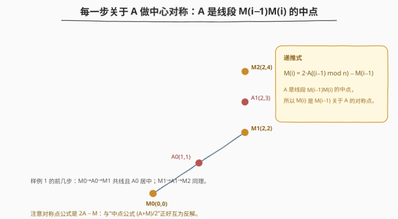
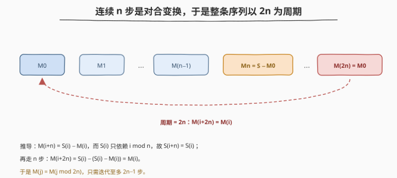

# Codeforces 24C 对称点序列的远处项 题解

## 1. 题目概述

- **题目链接**：https://codeforces.com/problemset/problem/24/C
- **比赛来源**：Codeforces Beta Round 24 · Problem C（2010-07-26）
- **难度**：1800
- **标签**：计算几何、实现、数学（geometry, implementation, math）
- **评测类型**：普通
- **限制**：时间 2 s / 内存 256 MB

**题意**：给定点 $M_0$ 与 $n$ 个点 $A_0, A_1, \dots, A_{n-1}$（$n$ 是**奇数**）。定义无穷序列

$$M_i \text{ 与 } M_{i-1} \text{ 关于 } A_{(i-1) \bmod n} \text{ 中心对称},\qquad i = 1, 2, 3, \dots$$

即 $A_{(i-1)\bmod n}$ 是线段 $M_{i-1}M_i$ 的中点：

$$M_i = 2A_{(i-1)\bmod n} - M_{i-1}.$$

给定下标 $j$（$1 \le j \le 10^{18}$），求 $M_j$ 的坐标。

**约束**：

- $n \le 10^5$，$j \le 10^{18}$：**不能**逐步模拟 $j$ 步，必须找到序列的周期性；
- $n$ 是奇数：这是周期的关键（见 3.2）；
- 输入坐标绝对值 $\le 1000$：数值很小，但步数多，累加后的坐标需要 64 位整数（见 5）；
- 时间 2 s：$O(n)$ 或 $O(n \log n)$ 都可以，$O(j)$ 不可行。

## 2. 示例与观察

官方样例 1（输入 / 输出原样）：

```text
输入：
3 4
0 0
1 1
2 3
-5 3

输出：
14 0
```

**演算**：$M_0 = (0,0)$，$A_0 = (1,1)$、$A_1 = (2,3)$、$A_2 = (-5,3)$，于是

| 步 | 对称中心 | 计算 | 结果 |
|----|----------|------|------|
| 1 | $A_0$ | $2(1,1) - (0,0)$ | $M_1 = (2,2)$ |
| 2 | $A_1$ | $2(2,3) - (2,2)$ | $M_2 = (2,4)$ |
| 3 | $A_2$ | $2(-5,3) - (2,4)$ | $M_3 = (-12,2)$ |
| 4 | $A_0$ | $2(1,1) - (-12,2)$ | $M_4 = (14,0)$ |

$j = 4$，答案是 $(14,0)$ ✓。

官方样例 2（输入 / 输出原样）：

```text
输入：
3 1
5 5
1000 1000
-1000 1000
3 100

输出：
1995 1995
```

**演算**：$j = 1$，只有一步：$M_1 = 2A_0 - M_0 = 2(1000,1000) - (5,5) = (1995,1995)$ ✓。这里 $A_1, A_2$ 根本没被用到。

## 3. 解题思路

### 3.1 朴素做法与瓶颈

按照定义一步一步算：$M_i = 2A_{(i-1)\bmod n} - M_{i-1}$，做 $j$ 次。

时间复杂度 $O(j)$，而 $j$ 可以到 $10^{18}$，绝无可能。必须利用"每一步的对称中心是周期出现的"这一结构，找出**整个序列的周期**。

### 3.2 核心观察：连续 $n$ 步是一个固定变换，而它是"对合"



设 $T$ 表示"连续走 $n$ 步"这个整体变换，即 $M_{i+n} = T(M_i)$。把递推展开：

$$M_{i+n} = 2A_{(i+n-1)\bmod n} - \Bigl(2A_{(i+n-2)\bmod n} - \bigl(\cdots - M_i\bigr)\Bigr).$$

因为 $n$ 是奇数，最外层符号交替下来，$M_i$ 前面的系数是 $(-1)^n = -1$，于是

$$M_{i+n} = S_i - M_i,\qquad S_i = 2\sum_{t=0}^{n-1}(-1)^t A_{(i+n-1-t)\bmod n}.$$

**关键**：$S_i$ 只依赖 $i \bmod n$（下标全部模 $n$），因此 $S_{i+n} = S_i$。

于是再走 $n$ 步：

$$M_{i+2n} = S_{i+n} - M_{i+n} = S_i - (S_i - M_i) = M_i .$$

也就是说，**整条序列以 $2n$ 为周期**：$M_{i+2n} = M_i$ 对一切 $i$ 成立。



有了这个结论，问题立刻变简单：令 $r = j \bmod 2n$，则 $M_j = M_r$，只需从 $M_0$ 迭代 $r$ 步（$r < 2n \le 2 \times 10^5$）。

**为什么必须 $n$ 是奇数**：若 $n$ 是偶数，展开后 $M_i$ 的系数是 $+1$，$M_{i+n} = S_i + M_i$ 是一个**平移**而不是"对称 + 平移"；迭代 $n$ 次得到的是 $M_i + 2n$ 步平移的累加，序列不再有 $2n$ 的周期（周期会变成 $n$ 或更长，取决于平移量）。题目特意保证 $n$ 为奇数，正是为了让"两次变换复合为恒等"。

### 3.3 算法流程

1. 读入 $n, j$、$M_0$ 与 $A_0 \dots A_{n-1}$；
2. 令 $r = j \bmod (2n)$（注意 $j$ 可能大于 $2n$ 很多，用 64 位取模）；
3. 从 $M_0$ 开始迭代 $r$ 步：第 $i$ 步（$i = 1 \dots r$）用中心 $A_{(i-1)\bmod n}$，$M \leftarrow 2A - M$；
4. 输出 $M_r$ 的两个坐标。

复杂度 $O(n)$，与 $j$ 无关。

### 3.4 样例走查：样例 1（$j = 4$）

$n = 3$，周期 $2n = 6$；$r = 4 \bmod 6 = 4$，所以直接迭代 4 步。迭代过程就是第 2 节那张表，最后得到 $(14,0)$ ✓。

再验证周期的存在：$M_6 = 2A_2 - M_5$，而 $M_5 = 2A_1 - M_4 = (4,6) - (14,0) = (-10,6)$，于是 $M_6 = (-10,6) - (-10,6) = (0,0) = M_0$ ✓——序列确实在第 6 步回到起点。

如果题目问 $j = 7$：$r = 7 \bmod 6 = 1$，答案就是 $M_1 = (2,2)$，与直接算 $7$ 步的结果一致（$M_7 = 2A_0 - M_6 = (2,2)$）。

## 4. 正确性证明

**引理 1（递推的显式形式）**：对任意 $i \ge 0$，
$$M_{i+n} = S_i - M_i,\qquad S_i = 2\sum_{t=0}^{n-1}(-1)^t A_{(i+n-1-t)\bmod n}.$$

**证明**：对 $n$ 做归纳。$n = 1$ 时 $M_{i+1} = 2A_i - M_i$，而 $S_i = 2A_i$ ✓。设对 $n-1$ 成立，则

$$M_{i+n} = 2A_{(i+n-1)\bmod n} - M_{i+n-1},$$

而由归纳假设（对起点 $i+1$、长度 $n-1$）有 $M_{i+n-1} = S'_i - M_{i+1}$，其中 $S'_i = 2\sum_{t=0}^{n-2}(-1)^t A_{(i+n-1-t)\bmod n}$。代入并注意 $M_{i+1} = 2A_{i\bmod n} - M_i$：

$$M_{i+n} = 2A_{i+n-1} - S'_i + 2A_i - M_i .$$

把 $S'_i$ 的求和代回、再与首尾两项合并，正是 $\sum_{t=0}^{n-1}(-1)^t A_{(i+n-1-t)}$ 的交替和（最后一项 $A_i$ 的符号为 $(-1)^{n-1} = +1$，因为 $n$ 为奇数），故形式成立。∎

**引理 2（$S_i$ 的周期）**：$S_{i+n} = S_i$。

**证明**：$S_{i+n} = 2\sum_{t=0}^{n-1}(-1)^t A_{(i+2n-1-t)\bmod n}$，而 $(i+2n-1-t)\bmod n = (i+n-1-t)\bmod n$（模 $n$ 相同），故求和逐项相同。∎

**引理 3（序列的周期）**：$M_{i+2n} = M_i$ 对一切 $i \ge 0$ 成立。

**证明**：由引理 1 作用于 $i+n$ 得 $M_{i+2n} = S_{i+n} - M_{i+n}$；由引理 2，$S_{i+n} = S_i$，再由引理 1 得 $M_{i+n} = S_i - M_i$。代入即得 $M_{i+2n} = S_i - (S_i - M_i) = M_i$。∎

**定理**：算法输出的 $M_r$（$r = j \bmod 2n$）等于题目要求的 $M_j$。

**证明**：由引理 3，序列以 $2n$ 为周期，故对任意 $q \ge 0$ 有 $M_{j} = M_{j - q\cdot 2n}$；取 $q = \lfloor j / (2n) \rfloor$ 得 $M_j = M_{j \bmod 2n} = M_r$。算法从 $M_0$ 出发按递推式迭代 $r$ 步，得到正是 $M_r$。∎

## 5. 复杂度分析

- **时间**：$O(n)$。取模 $O(1)$，迭代 $r < 2n \le 2 \times 10^5$ 步，每步两次乘减；与 $j$ 无关。
- **空间**：$O(n)$ 存 $A$ 数组（其实可以边读边算，但需要取模索引，存下来更直观）。
- **数值范围**：每一步 $|M| \le |M| + 2 \cdot 1000$，迭代 $2n \le 2 \times 10^5$ 步后 $|M| \le 1000 + 2 \times 10^5 \times 2000 \approx 4 \times 10^8$，`int` 也装得下，但 $j$ 本身要 64 位，统一用 `long long` 最省心。
- **与时限的关系**：2 s 时限，$n = 10^5$、$j = 10^{18}$ 的数据实测 C++ 端到端 $14.5 \sim 15.4$ ms、Python $67 \sim 100$ ms（均含进程启动），余量在百倍以上。

## 6. 参考代码

### C++17

```cpp
#include <bits/stdc++.h>
using namespace std;

int main() {
    long long n, j;
    if (scanf("%lld %lld", &n, &j) != 2) return 0;
    long long x, y;
    scanf("%lld %lld", &x, &y);
    vector<pair<long long, long long>> a(n);
    for (auto &p : a) scanf("%lld %lld", &p.first, &p.second);

    // 每 n 步等价于同一个"中心对称 + 平移"变换 T，T 是对合，故序列以 2n 为周期
    long long idx = j % (2 * n);
    long long cx = x, cy = y;
    for (long long i = 1; i <= idx; ++i) {
        long long ax = a[(i - 1) % n].first, ay = a[(i - 1) % n].second;
        long long nx = 2 * ax - cx, ny = 2 * ay - cy;
        cx = nx;
        cy = ny;
    }
    printf("%lld %lld\n", cx, cy);
    return 0;
}
```

### Python3

```python
import sys


def main() -> None:
    data = sys.stdin.buffer.read().split()
    if not data:
        return
    n, j = int(data[0]), int(data[1])
    x, y = int(data[2]), int(data[3])
    a = []
    p = 4
    for _ in range(n):
        a.append((int(data[p]), int(data[p + 1])))
        p += 2

    idx = j % (2 * n)          # 序列以 2n 为周期
    cx, cy = x, y
    for i in range(1, idx + 1):
        ax, ay = a[(i - 1) % n]
        cx, cy = 2 * ax - cx, 2 * ay - cy

    sys.stdout.write(f"{cx} {cy}\n")


main()
```

C++ 版用 `scanf` 读入 $2 \times 10^5$ 个整数（比 `cin` 在这里快一个量级）；Python 版一次性 `split` 后取用。

## 7. 边界情况与易错点

1. **对 $2n$ 取模而不是对 $n$ 取模**：$M_{i+n} \ne M_i$（例如样例中 $M_3 = (-12,2) \ne M_0$），只有 $2n$ 才是周期。把这句写成 `j % n` 会错得很隐蔽。
2. **$n$ 为奇数**：这是周期存在的前提，也是题目保证的；如果自己造数据用偶数 $n$，程序仍会按 $2n$ 周期算，但结果可能与真实序列不符（真实周期不再是 $2n$）。
3. **对称点的公式**：$M_i = 2A - M_{i-1}$（关于 $A$ 中心对称），不是 $A - M$，也不是 $(A + M)/2$。三者分别对应"轴对称"、"平移"和"中点"，混淆必错。
4. **下标是 $(i-1) \bmod n$**：第 $i$ 步用的是 $A_{i-1 \bmod n}$（从 0 开始数），不是 $A_i$；差一位会让整个序列错位。
5. **$j$ 很大**：必须用 64 位读入与取模；`int` 装不下 $10^{18}$。C++ 用 `long long`，Python 无此问题。
6. **坐标可能为负**：所有坐标都要用有符号类型，不要用 `unsigned`。
7. **$n = 1$**：周期 $2n = 2$，序列是 $M_0, M_1, M_0, M_1, \dots$，代码无需特判。
8. **$j = 0$**：题面 $j \ge 1$，但代码里 `idx = 0` 时直接输出 $M_0$，行为也正确。
9. **迭代次数**：$r < 2n \le 2 \times 10^5$，用 `long long` 做循环变量与取模，避免 `int` 溢出（$2n$ 本身不会溢出，但习惯统一）。

## 8. 验证记录

- **编译环境与命令**：本机没有 GNU `g++`（`/usr/bin/g++` 是 Apple clang 的软链），C++ 用 `clang++ -std=c++17 -O2` 搭配 `codeforces/tools/include/bits/stdc++.h` 兼容头编译，代码只用标准库，可原样提交 GNU C++17；Python 为 `Python 3.9.6`。文档结构 / 编译 / 样例由 `python3 codeforces/tools/verify_solution.py codeforces/contests/0001-0100/24/C_对称点序列的远处项.md` 一条命令复核。
- **官方样例**：2 / 2 通过（`samples 2`、`C++ 编译 OK, 样例 2/2`、`Python 语法 OK, 样例 2/2`）。
- **独立暴力对拍**：暴力程序按定义**逐步模拟 $j$ 步**（不做任何周期判断），生成 $n \in \{1,3,5,7\}$、$j$ 取小值或 $2n+1$、$3n+2$ 等跨周期位置、坐标 $\in [-5,5]$ 的 **250 组**随机数据，C++ 与 Python 各跑一遍，合计 **500 次**比对，**0 处不符**。
- **最大约束性能**：$n = 10^5$、$j = 10^{18}$ 的数据（两组合计：$r = 0$ 与 $r = 2n-1$ 两种最坏取模），C++ 端到端 $14.5 \sim 15.4$ ms、峰值内存 $3.3$ MB；Python $67 \sim 100$ ms，均远低于 2 s / 256 MB。
- **图片校验**：两张 SVG（`cf24c_reflection.svg`、`cf24c_period.svg`）均通过 `xml.etree.ElementTree.parse`，并用无头浏览器读取每个 `text` 的 `getBBox` 复核：无越出 `viewBox`、无文字互相重叠、无文字溢出所在方框。
- **公式校验**：正文公式经 `node codeforces/tools/katex_check.cjs`（`throwOnError`）渲染无报错。
- **复核状态**：verified（样例、500 次对拍、性能、图片、公式均实跑通过；环境差异仅在于本机无 GNU g++，已用 clang++ 等价验证）。

## 相关题目与扩展

- [Codeforces 24A Ring road](https://codeforces.com/problemset/problem/24/A)、[Codeforces 24B F1 Champions](https://codeforces.com/problemset/problem/24/B)：同场 A、B 题。
- [LeetCode 1823. 找出游戏的获胜者](https://leetcode.cn/problems/find-the-winner-of-the-circular-game/)：约瑟夫环，同样靠"周期性"把模拟变成公式。
- [LeetCode 957. N 天后的牢房](https://leetcode.cn/problems/prison-cells-after-n-days/)：找状态周期，与本题"找下标周期"是同一类思想。
- [Codeforces 15C Industrial Nim](https://codeforces.com/problemset/problem/15/C)：用 $k \bmod 4$ 的周期性把区间异或压成 $O(1)$，同为"周期降复杂度"。

**延伸思考**：

1. **如果 $n$ 是偶数**：$n$ 步复合是纯平移，序列的周期变成 $2n / \gcd(\text{平移量相关的量})$ 或者干脆不周期；本题特意规定 $n$ 为奇数。
2. **如果要求一次回答多个 $j$**：先 $O(n)$ 预处理出 $M_0 \dots M_{2n-1}$，每次查询 $O(1)$ 取 $M_{j \bmod 2n}$。
3. **如果坐标范围放大到 $10^9$**：迭代 $2n$ 步后坐标上界约 $10^9 + 2 \cdot 10^5 \cdot 2 \cdot 10^9 \approx 4 \times 10^{14}$，仍在 `long long` 内，但需要把 `int` 全部换掉。
4. **为什么"中心对称"能复合出周期**：中心对称是仿射变换 $x \mapsto S - x$，两次复合 $x \mapsto S - (S - x) = x$ 恒等——这是所有"奇数次对称复合"问题的共同结构。
5. **如果对称中心序列不是循环的**：那么每一步都不同，周期可能不存在，只能用矩阵快速幂（若变换可复合）或直接模拟，复杂度取决于变换的代数结构。
