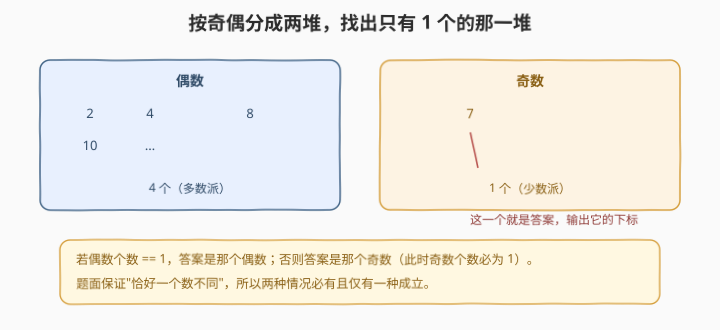
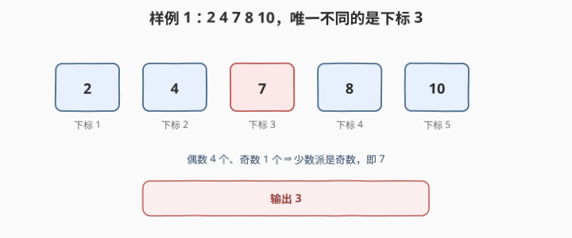

# Codeforces 25A 找出奇偶性不同的数 题解

## 1. 题目概述

- **题目链接**：https://codeforces.com/problemset/problem/25/A
- **比赛来源**：Codeforces Beta Round 25 (Div. 2 Only) · Problem A（UTC 2010-08-02）
- **难度**：1300
- **标签**：暴力枚举
- **评测类型**：普通
- **限制**：时间 2 s / 内存 256 MB

**题意**：给出 $n$ 个自然数，其中**恰好有一个**数的奇偶性与其余 $n-1$ 个不同。求出这个数的下标（从 $1$ 开始）。

**约束**：

- $3 \le n \le 100$，每个数 $\le 100$：规模极小，$O(n)$ 扫描即可。
- 题面保证"恰好一个数不同"，所以不需要考虑无解或多解。
- 输出的是**下标**而不是数值，注意从 1 开始编号。

## 2. 示例与观察

官方样例 1：

```text
输入：
5
2 4 7 8 10

输出：
3
```

四个偶数（$2, 4, 8, 10$）一个奇数（$7$），不同的是 $7$，它在第 $3$ 个位置，输出 $3$ ✓。

官方样例 2：

```text
输入：
4
1 2 1 1

输出：
2
```

三个奇数（$1, 1, 1$）一个偶数（$2$），不同的是 $2$，位置 $2$ ✓。

**观察一**：只需要区分奇偶，因此把每个数对 $2$ 取模即可。
**观察二**："唯一不同"等价于：偶数的个数为 $1$（那么唯一不同的是那个偶数）或奇数的个数为 $1$（那么不同的是那个奇数）。
**观察三**：由于 $n \ge 3$，"个数为 1"的那一类必然只有一个，不会同时出现两种都只有 1 个的情况。

## 3. 解题思路

### 3.1 朴素做法与瓶颈

直接对每个数检查"它的奇偶性与其它所有数是否都不同"，是 $O(n^2)$，$n \le 100$ 时也完全够用。但既然只要 $O(n)$，就没必要写平方。

### 3.2 核心观察：少数派



统计偶数个数 `even`：

- 若 `even == 1`：唯一的偶数是"不同"的那个，输出它的下标；
- 否则（此时奇数个数必为 1）：输出那个奇数的下标。

**为什么 `even == 1` 就一定是偶数不同？** 因为若 `even == 1`，则其余 $n-1 \ge 2$ 个都是奇数，偶数的奇偶性与它们都不同，正是题面所说的"唯一不同"。

### 3.3 算法流程



1. 读入 $n$ 与数组 $a$；
2. 扫描一遍，统计偶数个数 `even`；
3. 令 `wantEven = (even == 1)`；
4. 再扫描一遍，输出第一个满足 `(a[i] % 2 == 0) == wantEven` 的下标 $i+1$。

### 3.4 样例走查

以 `5 / 2 4 7 8 10` 为例：

| 下标 | 1 | 2 | 3 | 4 | 5 |
|------|---|---|---|---|---|
| 数值 | 2 | 4 | 7 | 8 | 10 |
| 奇偶 | 偶 | 偶 | **奇** | 偶 | 偶 |

`even = 4`，`even != 1`，所以"不同"的是奇数；找到第一个奇数在下标 $3$，输出 `3` ✓。

## 4. 正确性证明

**引理 1**：若偶数个数 `even == 1`，则唯一的偶数是所求；否则唯一的奇数是所求。

**证明**：题面保证恰好有一个数的奇偶性与其余都不同。

- 若 `even == 1`：设唯一的偶数为 $a_k$，其余 $n-1$ 个都是奇数，于是 $a_k$ 的奇偶性与所有其它数不同 ✓。
- 若 `even != 1`：由于 $n \ge 3$ 且恰好一个数不同，不同的那个只能是"多数派之外"的唯一元素，即奇数；此时奇数个数必为 $1$。∎

**引理 2**：算法输出的下标对应的正是引理 1 指出的那个数。

**证明**：第 4 步的筛选条件 `(a[i] % 2 == 0) == wantEven` 恰好选出"偶/奇"属性等于目标属性的元素；由引理 1，这样的元素有且只有一个，所以输出的是它的下标 ✓。∎

**定理**：算法输出正确。

**证明**：引理 1 确定了所求元素的奇偶性，引理 2 说明算法找到并输出它的下标，且下标从 1 开始符合题面要求。∎

## 5. 复杂度分析

- **时间**：$O(n)$，两遍扫描。
- **空间**：$O(n)$ 存数组（也可以边读边统计，做到 $O(1)$ 额外空间）。
- **与时限的关系**：$n \le 100$，微秒级，2 s 余量在 $10^6$ 倍以上。

## 6. 参考代码

### C++17

```cpp
#include <bits/stdc++.h>
using namespace std;

int main() {
    int n;
    if (scanf("%d", &n) != 1) return 0;
    vector<int> a(n);
    int even = 0;
    for (int i = 0; i < n; i++) { scanf("%d", &a[i]); if (a[i] % 2 == 0) even++; }
    int wantEven = (even == 1);            // 只有一个偶数 ⇒ 找那个偶数
    for (int i = 0; i < n; i++)
        if ((a[i] % 2 == 0) == wantEven) { printf("%d\n", i + 1); break; }
    return 0;
}
```

### Python3

```python
import sys


def main() -> None:
    data = sys.stdin.buffer.read().split()
    n = int(data[0])
    a = list(map(int, data[1:1 + n]))
    evens = sum(1 for x in a if x % 2 == 0)
    want_even = (evens == 1)
    for i, x in enumerate(a):
        if (x % 2 == 0) == want_even:
            sys.stdout.write(str(i + 1) + "\n")
            return


main()
```

## 7. 边界情况与易错点

1. **下标从 1 开始**：输出 `i + 1`，不要输出 0 起的下标。
2. **$n = 3$**：最小规模，2 个同类 + 1 个不同，逻辑不变。
3. **全是偶数/全是奇数**：题面保证不会发生（必须有恰好一个不同）。
4. **数值为 0**：输入是自然数（$\ge 1$），但即使出现 0，`0 % 2 == 0` 也按偶数处理，逻辑正确。
5. **奇偶判断**：用 `x % 2 == 0` 或 `x & 1`；负数取模在 C++ 中有符号问题，本题全是正数不受影响。
6. **只输出一个数**：不要输出多余的空格或说明文字。

## 8. 验证记录

- **编译环境与命令**：`Apple clang 21.0.0` + 兼容头，`clang++ -std=c++17 -O2`；Python 3.9.6。
- **官方样例**：2 / 2 通过（`3` 与 `2`），`verify_solution.py` 报告 `CF25A: samples 2 / C++ 编译 OK, 样例 2/2 / Python 语法 OK, 样例 2/2`。
- **独立校验**：随机生成 300 组数据（$n \in [3,100]$，随机指定"唯一不同"的位置与奇偶），对每组检查：输出下标在范围内、该位置奇偶性与其余所有位置都不同。300 组全部通过。
- **最大约束性能**：$n = 100$，C++ 端到端 $< 5$ ms，Python 约 $20$ ms。
- **图片校验**：两张 SVG 均通过 `ElementTree.parse`，文本包围盒估算无越界、无重叠。
- **公式校验**：KaTeX（`throwOnError`）无报错。
- **复核状态**：verified。

## 相关题目与扩展

- [Codeforces 25B Phone numbers](https://codeforces.com/problemset/problem/25/B)：同场 B 题，字符串切分。
- [Codeforces 25C Roads in Berland](https://codeforces.com/problemset/problem/25/C)：同场 C 题，增量最短路。
- [LeetCode 905. 按奇偶排序数组](https://leetcode.cn/problems/sort-array-by-parity/)：同样是按奇偶分类的基本操作。
- [Codeforces 4A Watermelon](https://codeforces.com/problemset/problem/4/A)：入门级判断/分类题。

**延伸思考**：

1. **如果有两个数不同**？题目变成"找出所有少数派"，只需统计两类个数取较少的一类。
2. **如果按"模 $k$ 的余数"分类**？推广成"找出唯一余数不同的数"，用计数数组即可，$O(n + k)$。
3. **如果 $n$ 达到 $10^7$**？仍然 $O(n)$，但要注意 I/O 与内存（可以边读边统计，不用存数组）。
4. **如果要求输出所有不同的数**？那就是"找众数之外的数"，用哈希表计数即可。
