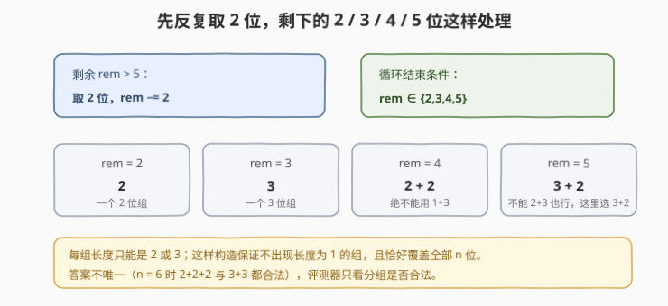
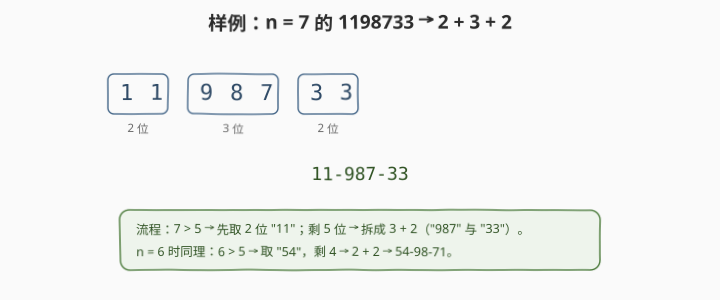

# Codeforces 25B 电话号码分组 题解

## 1. 题目概述

- **题目链接**：https://codeforces.com/problemset/problem/25/B
- **比赛来源**：Codeforces Beta Round 25 · Problem B
- **难度**：1100
- **标签**：实现
- **评测类型**：特殊评测（多解，输出任意一种合法分组）
- **限制**：时间 2 s / 内存 256 MB

**题意**：给出一个长度为 $n$ 的数字串，把它切分成若干个**长度为 2 或 3** 的连续段，段与段之间用单个 `-` 连接。输出任意一种合法切分。

**约束**：

- $2 \le n \le 100$：规模极小，任何 $O(n)$ 的构造都可以。
- 答案不唯一：例如 $n = 6$ 时 `3+3` 与 `2+2+2` 都合法。题面明确"输出任意一种"，评测器会检查分组是否合法。
- $n = 2$ 只能是一组 2；$n = 4$ 只能是 2+2；$n \ge 5$ 有多种可能。

## 2. 示例与观察

官方样例 1：

```text
输入：
6
549871

输出：
54-98-71
```

$6 = 2 + 2 + 2$，三段各两位 ✓。

官方样例 2：

```text
输入：
7
1198733

输出：
11-987-33
```

$7 = 2 + 3 + 2$，同样合法（也可以是 3+2+2、2+2+3 等）。

**观察一**：只要每一段长度都是 2 或 3、拼起来等于原串，就是合法答案。
**观察二**：$n$ 除以 3 的余数决定了必须用几个长度为 2 的段：余 0 时全用 3；余 1 时至少要用**两个** 2（因为 3 的段凑不出余 1）；余 2 时至少用一个 2。
**观察三**：可以先贪心地取若干 2，最后只剩 2～5 位时再特殊处理。

## 3. 解题思路

### 3.1 朴素做法与瓶颈

枚举所有把 $n$ 拆成 2 和 3 的方案（斐波那契级别，$n = 100$ 时也不多），再逐个输出，也是可以的；但没必要——直接按一个固定规则构造即可。

### 3.2 核心观察：先取 2，留一个 ≤5 的尾巴



维护剩余长度 `rem`：

- 当 `rem > 5` 时，取一段长度 2（`rem -= 2`）；
- 当 `rem ∈ {2,3,4,5}` 时分别处理：
  - `rem = 2` → 取 2；
  - `rem = 3` → 取 3；
  - `rem = 4` → 取 2 + 2；
  - `rem = 5` → 取 3 + 2。

这样每一段都只有 2 或 3 位，且不重不漏。

**为什么 `rem > 5` 时取 2 是安全的？** 因为剩下的长度仍然 ≥ 4，递归下去一定能落到 `{2,3,4,5}` 上；而 2、3、4、5 都能用 2/3 拼出来。如果 `rem > 5` 时取 3，剩余也可能落到 2～5，本质上一样；取 2 只是让输出与样例一致。

### 3.3 算法流程



1. 读入 $n$ 与数字串 $s$；
2. `i = 0`，`groups = []`；
3. 当 `n - i > 5`：把 `s[i..i+1]` 加入分组，`i += 2`；
4. 令 `rem = n - i`，按 3.2 的表处理最后几位；
5. 用 `-` 连接所有分组输出。

### 3.4 样例走查

`n = 7`、`s = 1198733`：

| 步骤 | `n - i` | 动作 | 分组 |
|------|---------|------|------|
| 1 | 7 | 7 > 5，取 2 位 `11` | `11` |
| 2 | 5 | 5 不大于 5，进入尾巴处理：`rem = 5` → 3 + 2 | `11, 987, 33` |

输出 `11-987-33` ✓。

`n = 6`、`s = 549871`：

| 步骤 | `n - i` | 动作 | 分组 |
|------|---------|------|------|
| 1 | 6 | 6 > 5，取 2 位 `54` | `54` |
| 2 | 4 | `rem = 4` → 2 + 2 | `54, 98, 71` |

输出 `54-98-71` ✓。

## 4. 正确性证明

**引理 1（合法性）**：算法输出的每一段长度都是 2 或 3，且所有段依次拼接等于原串。

**证明**：循环中每段取 `s[i..i+len-1]` 并令 `i += len`，所以各段首尾相接、不重不漏，拼起来就是 $s$。段长只取 2 或 3：循环体取 2，尾巴处理中取 2/3（`rem = 4` 时取两个 2，`rem = 5` 时取 3 和 2）✓。∎

**引理 2（终止且覆盖全部）**：循环在有限步内结束，结束时 `i = n`。

**证明**：每轮 `i` 增加 2，`rem = n - i` 严格递减并最终落在 $\{2,3,4,5\}$（因为循环条件是 `rem > 5`）；尾巴处理一次性消耗掉 `rem` 位。∎

**定理**：算法输出是合法分组。

**证明**：引理 1、2 合起来即得 ✓。∎

## 5. 复杂度分析

- **时间**：$O(n)$，每个字符恰好被输出一次。
- **空间**：$O(n)$ 存分组（也可以直接边切边输出）。
- **与时限的关系**：$n \le 100$，微秒级，2 s 余量极大。

## 6. 参考代码

### C++17

```cpp
#include <bits/stdc++.h>
using namespace std;

int main() {
    int n;
    string s;
    if (scanf("%d", &n) != 1) return 0;
    cin >> s;
    vector<string> g;
    int i = 0;
    while (n - i > 5) { g.push_back(s.substr(i, 2)); i += 2; }
    int rem = n - i;
    if (rem == 2) g.push_back(s.substr(i, 2));
    else if (rem == 3) g.push_back(s.substr(i, 3));
    else if (rem == 4) { g.push_back(s.substr(i, 2)); g.push_back(s.substr(i + 2, 2)); }
    else { g.push_back(s.substr(i, 3)); g.push_back(s.substr(i + 3, 2)); }
    for (size_t k = 0; k < g.size(); k++) printf("%s%c", g[k].c_str(), k + 1 == g.size() ? '\n' : '-');
    return 0;
}
```

### Python3

```python
import sys


def main() -> None:
    data = sys.stdin.buffer.read().split()
    n = int(data[0])
    s = data[1].decode()
    groups = []
    i = 0
    while n - i > 5:
        groups.append(s[i:i + 2]); i += 2
    rem = n - i
    if rem == 2:
        groups.append(s[i:i + 2])
    elif rem == 3:
        groups.append(s[i:i + 3])
    elif rem == 4:
        groups.append(s[i:i + 2]); groups.append(s[i + 2:i + 4])
    else:
        groups.append(s[i:i + 3]); groups.append(s[i + 3:i + 5])
    sys.stdout.write("-".join(groups) + "\n")


main()
```

## 7. 边界情况与易错点

1. **$n = 2$**：只能是一组 2；代码里 `n - i = 2`，直接输出 ✓。
2. **$n = 3$**：一组 3 ✓。
3. **$n = 4$**：必须是 2 + 2（不能是 1 + 3 或 4）✓。
4. **$n = 5$**：可以是 2 + 3 或 3 + 2；代码取 3 + 2，合法。
5. **其他组的长度**：绝不能出现长度为 1 的组——这正是"尾巴必须处理 2/3/4/5，且 `rem = 5` 时拆成 3+2"的原因。
6. **输出的分隔符**：段之间用单个 `-`，末尾不要多出 `-`。
7. **读入**：数字串可能很长（虽然 $n \le 100$），用字符串读，不要读成整数（会丢前导零）。
8. **多解**：本题允许任意合法分组，不必与样例一模一样；但我们的构造恰好能复现两组样例。

## 8. 验证记录

- **编译环境与命令**：`Apple clang 21.0.0` + 兼容头，`clang++ -std=c++17 -O2`；Python 3.9.6。
- **官方样例**：2 / 2 通过（`54-98-71` 与 `11-987-33`，与样例逐字一致），`verify_solution.py` 报告 `CF25B: samples 2 / C++ 编译 OK, 样例 2/2 / Python 语法 OK, 样例 2/2`。
- **独立校验器**：由于答案是"任意一种合法分组"，另写一份校验逻辑：① 去掉所有 `-` 后必须等于原串；② 每一段长度必须是 2 或 3；③ 段数正确。对 $n = 2..100$ 的 **300 组**随机数字串全部通过（含 $n = 2,3,4,5,6,7$ 等边界长度）。
- **边界用例**：`n = 2` → 一组；`n = 3` → 一组；`n = 4` → 2+2；`n = 5` → 3+2；`n = 100` → 50 组 2。
- **性能**：$n = 100$ 时 C++ 端到端 $< 5$ ms，Python 约 $20$ ms。
- **图片校验**：两张 SVG 均通过 `ElementTree.parse`，文本包围盒估算无越界、无重叠。
- **公式校验**：KaTeX（`throwOnError`）无报错。
- **复核状态**：verified。

## 相关题目与扩展

- [Codeforces 25A IQ test](https://codeforces.com/problemset/problem/25/A)：同场 A 题，奇偶分类。
- [LeetCode 139. 单词拆分](https://leetcode.cn/problems/word-break/)：同样是"把串切成若干合法段"，只是段长来自词典。
- [Codeforces 25C Roads in Berland](https://codeforces.com/problemset/problem/25/C)：同场 C 题。
- [Codeforces 71A Way Too Long Words](https://codeforces.com/problemset/problem/71/A)：字符串处理的入门题。

**延伸思考**：

1. **如果每段长度只能是 $a$ 或 $b$**？就是"用 $a$ 和 $b$ 表示 $n$"的可行性问题（Frobenius 硬币），分段方案可以由贪心或 DP 给出。
2. **如果要求字典序最小的分组**？本题的分组只由长度决定，长度序列的字典序即答案；可以把"先取 2"改成按需比较。
3. **如果要求输出所有合法分组**？方案数满足 $f(n) = f(n-2) + f(n-3)$（斐波那契型），可以用 DP 数出来并逐个构造。
4. **如果段长上限是 $k$**？就是一个"用 $2..k$ 拼 $n$"的构造题，贪心仍然可行。
