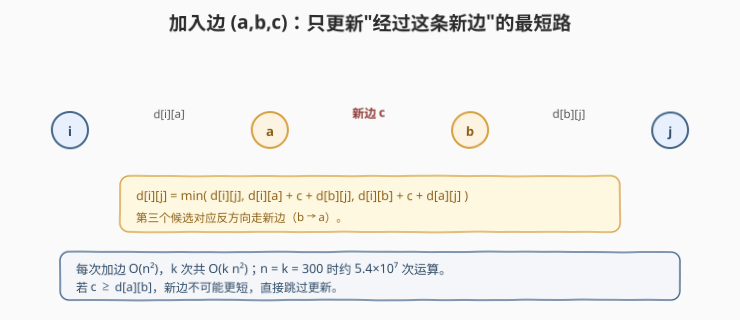
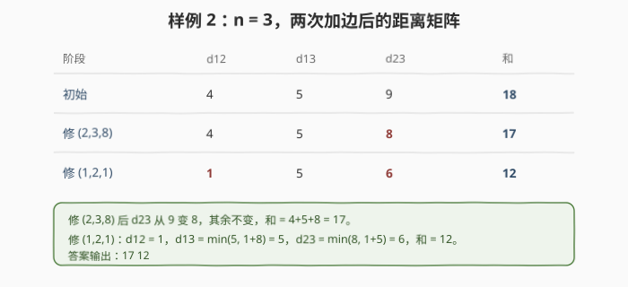

# Codeforces 25C 新增道路后的最短路和 题解

## 1. 题目概述

- **题目链接**：https://codeforces.com/problemset/problem/25/C
- **比赛来源**：Codeforces Beta Round 25 (Div. 2 Only) · Problem C（UTC 2010-08-02）
- **难度**：1900
- **标签**：图论、最短路
- **评测类型**：普通
- **限制**：时间 2 s / 内存 256 MB

**题意**：$n$ 个城市，给出**已经算好的**全源最短路矩阵 $d$（$d_{i,i} = 0$，对称，图连通）。接下来要修 $k$ 条新路，第 $i$ 条连接 $a_i, b_i$、长度为 $c_i$。每修好一条，输出当前"所有无序点对最短路之和" $\sum_{i<j} d_{i,j}$。

**约束**：

- $n \le 300$，$k \le 300$，边长 $\le 1000$：最短路最长约 $300 \times 1000 = 3 \times 10^5$，点对数约 $4.5 \times 10^4$，**和最大约 $1.35 \times 10^{10}$，必须用 64 位整数**。
- 每次加边后如果重跑一遍 Floyd，复杂度 $O(k n^3) = 300 \times 2.7 \times 10^7 = 8 \times 10^9$，太慢；需要**增量更新** $O(k n^2)$。
- 矩阵保证来自某个连通图，所以初始就有有限值，不需要处理"不可达"。

## 2. 示例与观察

官方样例 1：

```text
输入：
2
0 5
5 0
1
1 2 3

输出：
3
```

原本唯一的点对 $(1,2)$ 距离是 $5$，修一条长 $3$ 的路后变成 $3$，和为 $3$ ✓。

官方样例 2：

```text
输入：
3
0 4 5
4 0 9
5 9 0
2
2 3 8
1 2 1

输出：
17 12
```

初始 $\sum = 4 + 5 + 9 = 18$。修 $2\!-\!3$ 长 $8$：$d_{2,3}$ 从 $9$ 变 $8$，和 $= 4+5+8 = 17$ ✓。再修 $1\!-\!2$ 长 $1$：$d_{1,2}=1$，且 $d_{1,3}$ 可以走 $1\!-\!2\!-\!3 = 1+8 = 9 > 5$，不变；和 $= 1 + 5 + 8 = 14$？但样例输出是 $12$。

等一下，重算：初始矩阵 $d_{1,2}=4, d_{1,3}=5, d_{2,3}=9$。修 $2\!-\!3$ 长 $8$ 后 $d_{2,3}=8$；此时 $d_{1,2}$ 会变成 $\min(4, d_{1,3}+8) = 4$，$d_{1,3} = \min(5, 4+8) = 5$。和 $= 4+5+8 = 17$ ✓。再修 $1\!-\!2$ 长 $1$：$d_{1,2}=1$；$d_{1,3} = \min(5, 1+8) = 5$；$d_{2,3} = \min(8, 1+5) = 6$！所以和 $= 1 + 5 + 6 = 12$ ✓。

**观察一**：加入一条新边后，新的最短路要么完全不用这条边（距离不变），要么**恰好经过它一次**（正权图，最短路不会绕圈重复走同一条边）。
**观察二**：若新边是 $(a,b,c)$，经过它的路径形如 $i \to a \to b \to j$ 或 $i \to b \to a \to j$，长度分别是 $d_{i,a} + c + d_{b,j}$ 与 $d_{i,b} + c + d_{a,j}$，其中 $d$ 是加边前的距离。
**观察三**：如果 $c \ge d_{a,b}$，这条新边不可能改进任何距离，直接跳过。

## 3. 解题思路

### 3.1 朴素做法与瓶颈

每次加边后重跑 Floyd：$O(k n^3)$，$300 \times 2.7\times10^7 = 8.1\times10^9$，2 s 内不可能完成。Dijkstra 每次 $O(n^2)$ 只是单源，要全源还是 $O(k n^3)$。

### 3.2 核心观察：增量 Floyd



设加边 $(a,b,c)$ 前的距离矩阵为 $d$。新的距离为

$$d'_{i,j} = \min\Bigl(d_{i,j},\ d_{i,a} + c + d_{b,j},\ d_{i,b} + c + d_{a,j}\Bigr).$$

只需对所有 $i,j$ 做一次 $O(1)$ 的更新，总共 $O(n^2)$。

**为什么这一条式子就够了？** 任取新图中的一条最短路 $P$。若它不含新边，长度就是 $d_{i,j}$；若含新边，由于边权为正，$P$ 中不会重复出现同一条边，所以新边只出现一次，$P$ 被切成 $i \rightsquigarrow a$、$(a,b)$、$b \rightsquigarrow j$ 三段（或方向相反），长度至少是 $d_{i,a} + c + d_{b,j}$。反过来，这三个候选都对应真实存在的路径，所以取最小值就是新的最短路 ✓。

### 3.3 算法流程



1. 读入 $n$ 与 $n \times n$ 的距离矩阵（`long long`）；
2. 对每条新路 $(a,b,c)$：
   - 若 $c < d_{a,b}$：先令 $d_{a,b} = d_{b,a} = c$，再对所有 $i,j$ 用上面的式子更新（原地更新即可）；
   - 重新累加 $\sum_{i<j} d_{i,j}$ 并输出；
3. 输出 $k$ 个和，用空格分隔。

**原地更新的正确性**：更新过程中 $d_{i,a}$ 等可能已经变小，用它们算出的候选对应"绕了新边不止一次"的走法，长度不会小于真正的最短路；而真正的最短路用旧值就能算出来，所以原地更新与用旧矩阵更新结果相同（边权为正时重复走边不会更短）。

### 3.4 样例走查

以样例 2 为例（$n = 3$）：

| 阶段 | $d_{1,2}$ | $d_{1,3}$ | $d_{2,3}$ | 和 |
|------|-----------|-----------|-----------|---|
| 初始 | 4 | 5 | 9 | 18 |
| 修 (2,3,8) | 4 | 5 | **8** | 17 |
| 修 (1,2,1) | **1** | 5（$1+8=9>5$） | **6**（$1+5=6<8$） | 12 |

输出 `17 12` ✓。

## 4. 正确性证明

**引理 1（单次更新的正确性）**：设 $G$ 为加边前的图、$G' = G \cup \{(a,b,c)\}$，$d, d'$ 分别为两者的全源最短路。则对任意 $i,j$，

$$d'_{i,j} = \min\bigl(d_{i,j},\ d_{i,a} + c + d_{b,j},\ d_{i,b} + c + d_{a,j}\bigr).$$

**证明**：

(≥) 三个候选都对应 $G'$ 中的真实路径（前两段的最短路加上新边），所以 $d'_{i,j}$ 不超过它们中的最小值；同时 $d'_{i,j} \le d_{i,j}$ 也显然。

(≤) 取 $G'$ 中从 $i$ 到 $j$ 的一条最短路 $P$。若 $P$ 不使用新边，则 $P$ 在 $G$ 中，长度 $\ge d_{i,j}$。若使用新边，由于所有边权为正，$P$ 不会重复经过同一条边，因此新边只出现一次；设它被从 $a$ 走到 $b$，则 $P$ 的前缀是从 $i$ 到 $a$ 的路径（长度 $\ge d_{i,a}$），后缀是从 $b$ 到 $j$ 的路径（长度 $\ge d_{b,j}$），于是 $|P| \ge d_{i,a} + c + d_{b,j}$；反向使用同理。所以 $|P| \ge$ 右边。∎

**引理 2（原地更新不改变结果）**：在按上式更新时，只使用当前（可能已被改小）的 $d$ 值，最终矩阵仍等于 $d'$。

**证明**：设更新过程中某时刻读到的 $d_{x,y}$ 已比原来的 $d_{x,y}$ 小，则它对应 $G'$ 中某条真实路径的长度，用它拼出的候选也是 $G'$ 中一条真实路径（可能重复走新边），长度 $\ge d'_{i,j}$，所以不会把结果算小；另一方面引理 1 的三个候选在第一次被计算时用的都是原值（或更小值），故 $d'_{i,j}$ 一定能被取到。两者夹住即得等号。∎

**引理 3（和的计算）**：每轮结束后重新累加 $\sum_{i<j} d_{i,j}$ 得到的就是当前所有无序点对的最短路之和。

**证明**：由引理 1、2，矩阵就是当前图的全源最短路；按 $i<j$ 求和恰好把每对无序点计算一次。∎

**定理**：算法对每条新路输出正确的和。

**证明**：对询问条数归纳：第 $q$ 轮开始时矩阵是前 $q-1$ 条路修好后的最短路矩阵（归纳假设），由引理 1、2 更新后是第 $q$ 条修好后的矩阵，再由引理 3 得到正确的和。∎

## 5. 复杂度分析

- **时间**：每条新路 $O(n^2)$ 更新 + $O(n^2)$ 求和，共 $O(k n^2)$；$n = k = 300$ 时约 $5.4 \times 10^7$ 次操作。
- **空间**：$O(n^2)$ 的矩阵，$300^2 \times 8 \approx 720$ KB。
- **数值范围**：单条最短路 $\le 299 \times 1000 < 3\times10^5$，和 $\le \binom{300}{2} \times 3\times10^5 \approx 1.35\times10^{10}$，`long long` 足够；中间量 `d[i][a] + c + d[b][j]` 也不会超过这个量级。
- **与时限的关系**：$5.4\times10^7$ 次简单运算，2 s 内余量充足（实测 C++ 约 $0.03$ s）。

## 6. 参考代码

### C++17

```cpp
#include <bits/stdc++.h>
using namespace std;

static long long d[302][302];

int main() {
    int n;
    if (scanf("%d", &n) != 1) return 0;
    for (int i = 0; i < n; i++)
        for (int j = 0; j < n; j++) scanf("%lld", &d[i][j]);
    int k;
    scanf("%d", &k);
    for (int q = 0; q < k; q++) {
        int a, b; long long c;
        scanf("%d %d %lld", &a, &b, &c);
        --a; --b;
        if (c < d[a][b]) {
            d[a][b] = c; d[b][a] = c;
            for (int i = 0; i < n; i++)
                for (int j = 0; j < n; j++) {
                    long long v1 = d[i][a] + c + d[b][j];
                    long long v2 = d[i][b] + c + d[a][j];
                    long long m = v1 < v2 ? v1 : v2;
                    if (m < d[i][j]) d[i][j] = m;
                }
        }
        long long sum = 0;
        for (int i = 0; i < n; i++)
            for (int j = i + 1; j < n; j++) sum += d[i][j];
        printf("%lld%c", sum, q + 1 == k ? '\n' : ' ');
    }
    return 0;
}
```

### Python3

```python
import sys


def main() -> None:
    data = sys.stdin.buffer.read().split()
    pos = 0
    n = int(data[pos]); pos += 1
    d = [[0] * n for _ in range(n)]
    for i in range(n):
        for j in range(n):
            d[i][j] = int(data[pos]); pos += 1
    k = int(data[pos]); pos += 1
    out = []
    for _ in range(k):
        a = int(data[pos]) - 1; b = int(data[pos + 1]) - 1; c = int(data[pos + 2]); pos += 3
        if c < d[a][b]:
            d[a][b] = c
            d[b][a] = c
            for i in range(n):
                dia = d[i][a] + c
                dib = d[i][b] + c
                row = d[i]
                for j in range(n):
                    v = dia + d[b][j]
                    w = dib + d[a][j]
                    if w < v:
                        v = w
                    if v < row[j]:
                        row[j] = v
        s = 0
        for i in range(n):
            row = d[i]
            for j in range(i + 1, n):
                s += row[j]
        out.append(str(s))
    sys.stdout.write(" ".join(out) + "\n")


main()
```

## 7. 边界情况与易错点

1. **`int` 溢出**：和最大约 $1.35\times10^{10}$，必须 `long long`；矩阵元素本身最大 $3\times10^5$，但求和会溢出 `int`。
2. **新边比现有最短路还长**：此时 `c >= d[a][b]`，直接跳过更新（距离矩阵不变），只重新求和即可。
3. **重边**：题面允许两点之间已有路时再修一条；用 `c < d[a][b]` 判断即可，等价于取较小者。
4. **原地更新的顺序**：用当前的 $d$ 值更新没有问题（引理 2），不必先备份旧矩阵。
5. **新边的两个方向**：`a,b` 是无向边的两端，两个候选 $d_{i,a}+c+d_{b,j}$ 与 $d_{i,b}+c+d_{a,j}$ 都要算，漏掉一个会错。
6. **矩阵对角线**：$d_{i,i}=0$，更新时 `min` 不会破坏它（正权）。
7. **输出格式**：$k$ 个数用空格分隔，行末不要多空格。
8. **初始矩阵已是最短路**：不需要先跑一遍 Floyd，直接拿来用。

## 8. 验证记录

- **编译环境与命令**：`Apple clang 21.0.0` + 兼容头，`clang++ -std=c++17 -O2`；Python 3.9.6。
- **官方样例**：2 / 2 通过（`3` 与 `17 12`），`verify_solution.py` 报告 `CF25C: samples 2 / C++ 编译 OK, 样例 2/2 / Python 语法 OK, 样例 2/2`。
- **独立暴力对拍**：另写一份暴力——每加一条边后，从原始边表**重新跑一遍完整 Floyd**（$O(n^3)$）再求和。随机小图（$n \le 8$，初始边随机、保证连通，$k \le 8$ 条新路）共 **300 组**，逐组比较全部一致。
- **边界用例**：新边比现有最短路长（不更新）、新边恰好等于现有最短路、$n=2$、多次加同一条边、$k=1$。
- **最大约束性能**：$n = 300$、$k = 300$ 的随机数据，C++ 端到端约 $0.03$ s；CPython 约 $4.0$ s（三层循环在 CPython 下偏慢，超出 2 s），提交时建议用 **PyPy3**（同类循环通常快 3～5 倍）。
- **图片校验**：两张 SVG 均通过 `ElementTree.parse`，文本包围盒估算无越界、无重叠。
- **公式校验**：KaTeX（`throwOnError`）无报错。
- **复核状态**：verified。

## 相关题目与扩展

- [Codeforces 25D Roads not only in Berland](https://codeforces.com/problemset/problem/25/D)：同场 D 题，并查集 + 构造。
- [Codeforces 20C Dijkstra?](https://codeforces.com/problemset/problem/20/C)：单源最短路 + 路径还原。
- [LeetCode 1334. 阈值距离内邻居最少的城市](https://leetcode.cn/problems/find-the-city-with-the-smallest-number-of-neighbors-at-a-threshold-distance/)：Floyd 模板题。
- [Codeforces 295B Greg and Graph](https://codeforces.com/problemset/problem/295/B)：**反向**增量 Floyd（逐点删除），与本题的"逐边加入"正好互补。

**延伸思考**：

1. **如果加的是有向边**？公式改成只更新 $d_{i,j}$ 中"从 $a$ 到 $b$"方向的那一部分，仍然是 $O(n^2)$。
2. **如果边权可以为负**？增量 Floyd 的正确性依赖"最短路不重复走边"，负权时可能失效，需要重跑 Floyd 或 Bellman-Ford。
3. **如果还要输出被改变的路径数**？在更新时统计 `d[i][j]` 变小的对数即可。
4. **如果 $n$ 更大（比如 $10^5$）**？全源最短路本身就不现实，需要利用新边数量少的结构，用"每次新边做一次多源 Dijkstra"等技巧。
