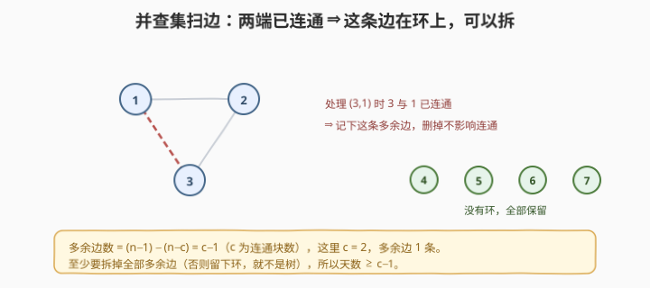
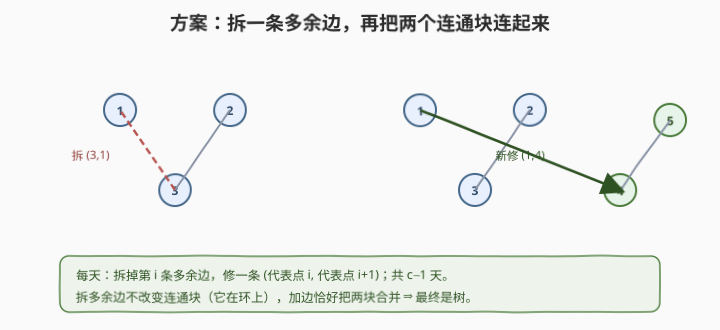

# Codeforces 25D 把图补成树的最少重建 题解

## 1. 题目概述

- **题目链接**：https://codeforces.com/problemset/problem/25/D
- **比赛来源**：Codeforces Beta Round 25 · Problem D
- **难度**：1900
- **标签**：并查集、图论、树
- **评测类型**：特殊评测（多解，输出任意一种合法方案）
- **限制**：时间 2 s / 内存 256 MB

**题意**：$n$ 个城市之间已有**恰好 $n-1$** 条无向道路（无重边、无自环）。每天可以**拆掉一条旧路、同时修一条新路**。求最少需要多少天，才能让所有城市连通（即最终的 $n-1$ 条路构成一棵树），并输出任意一种方案。

每天输出一行 `i j u v`：拆掉 $i$ 与 $j$ 之间的路，修一条 $u$ 与 $v$ 之间的路。

**约束**：

- $n \le 1000$，初始边数固定为 $n-1$：最终也必须是 $n-1$ 条边且连通，所以**最终一定是一棵树**（不能多也不能少）。
- 天数最小时，每天拆一条、修一条，边数不变 ✓。
- 方案不唯一（样例 2 给出的是一种），题面明确"输出任意一种"，评测器会验证方案合法性。

## 2. 示例与观察

官方样例 1：

```text
输入：
2
1 2

输出：
0
```

两个点一条边，已经是树，0 天 ✓。

官方样例 2：

```text
输入：
7
1 2
2 3
3 1
4 5
5 6
6 7

输出：
1
3 1 3 7
```

图中有两个连通块：$\{1,2,3\}$（含三角形环 $1\!-\!2\!-\!3$）和 $\{4,5,6,7\}$（一条链）。拆掉环上的一条边 $(3,1)$，再修一条连接两个块的路 $(3,7)$，1 天即可 ✓。

**观察一**：初始有 $n-1$ 条边；若它连通就是树，答案 0（样例 1）。
**观察二**：若不连通，设有 $c$ 个连通块。每个块 $i$ 有 $v_i$ 个点、$e_i$ 条边，块内至少要有 $v_i - 1$ 条边才连通，多出来的 $e_i - (v_i-1)$ 条就是"环上的边"。总数

$$\sum_i \bigl(e_i - (v_i-1)\bigr) = (n-1) - (n - c) = c - 1.$$

**观察三**：这 $c-1$ 条多余边必须全部拆掉（否则保留下来就会形成环，最终不是树），而每天只能拆一条，所以**至少要 $c-1$ 天**。
**观察四**：拆掉这些多余边不会破坏任何块的连通性（它们都在环上），再用 $c-1$ 条新边把 $c$ 个块串起来，正好 $c-1$ 天。

## 3. 解题思路

### 3.1 朴素做法与瓶颈

如果枚举"拆哪条、连哪条"的所有组合，是组合爆炸。但由观察二/三，**天数与要拆的边都是确定的**（恰好是每个块里形成环的那些边），只需要把它们找出来，再决定怎么连。

### 3.2 核心观察：并查集找"多余边"



按输入顺序处理每条边 $(u,v)$：

- 若 $u,v$ 已经连通（`find(u) == find(v)`），说明这条边加入后形成了环，它是一条**可拆的多余边**，记下来；
- 否则合并两个集合。

处理完后，每条"多余边"都满足：删掉它不影响所在连通块的连通性（因为它在一个环上）。

### 3.3 构造方案



1. 用并查集求出所有连通块，每个块任取一个代表点（例如该块中编号最小的点）；
2. 设多余边列表为 $E = [e_1, \dots, e_t]$，块代表为 $r_1, \dots, r_c$，由观察二 $t = c-1$；
3. 对 $i = 1 \dots t$：第 $i$ 天拆掉 $e_i$，并修一条 $(r_i, r_{i+1})$。

这样第 $i$ 天之后，原来第 $1..i+1$ 个块被串成一条链，而每个块内部仍然连通，所以最终整张图连通、边数仍是 $n-1$ ⇒ 是一棵树 ✓。

### 3.4 样例走查

样例 2：边依次为 $(1,2),(2,3),(3,1),(4,5),(5,6),(6,7)$。

| 边 | 并查集动作 | 多余边 |
|----|-----------|--------|
| (1,2) | 合并 1,2 | — |
| (2,3) | 合并 {1,2} 与 3 | — |
| (3,1) | 3 与 1 已连通 | **(3,1)** |
| (4,5) | 合并 | — |
| (5,6) | 合并 | — |
| (6,7) | 合并 | — |

连通块：$\{1,2,3\}$、$\{4,5,6,7\}$，代表点取 $1$ 和 $4$。$t = 1$，输出：

```text
1
3 1 1 4
```

拆 $(3,1)$、修 $(1,4)$，最终边为 $1\!-\!2, 2\!-\!3, 4\!-\!5, 5\!-\!6, 6\!-\!7, 1\!-\!4$，是一棵树 ✓（与样例给出的方案不同，但同样合法）。

## 4. 正确性证明

**引理 1（下界）**：设初始图有 $c$ 个连通块，则至少需要 $c-1$ 天。

**证明**：最终图必须是连通的 $n$ 个点、$n-1$ 条边，即一棵树。设初始第 $i$ 个连通块有 $v_i$ 个点、$e_i$ 条边（$\sum v_i = n$，$\sum e_i = n-1$）。若最终是树，则每个块内部保留下来的边不能有环，至多 $v_i - 1$ 条，所以第 $i$ 个块至少删 $e_i - (v_i-1)$ 条边。总数

$$\sum_i \bigl(e_i - (v_i-1)\bigr) = (n-1) - (n-c) = c-1 .$$

每天只删一条边，故天数 $\ge c-1$。∎

**引理 2（多余边可拆）**：并查集标记出的每条边都在某个环上，删除它不改变任何连通块。

**证明**：该边 $(u,v)$ 被标记时，$u$ 与 $v$ 已经通过其它边连通，因此 $(u,v)$ 属于一个环。删掉环上的一条边不会破坏剩余部分的连通性。∎

**引理 3（构造合法）**：按 3.3 的方案，$t = c-1$ 天后整张图连通且恰有 $n-1$ 条边，因此是一棵树。

**证明**：边数不变（每天拆一条、修一条，初始 $n-1$）✓。连通性：由引理 2，拆多余边后每个块仍连通；每加一条 $(r_i, r_{i+1})$ 就把两个不同的块连起来，$t = c-1$ 条边后 $c$ 个块连成一体 ✓。$n$ 个点、$n-1$ 条边、连通 ⇒ 树 ✓。∎

**定理**：算法输出的天数是最少的（$c-1$），且方案合法。

**证明**：下界由引理 1，构造由引理 3，两者都是 $c-1$ ✓。∎

## 5. 复杂度分析

- **时间**：并查集 $O(n \alpha(n))$，找代表点 $O(n)$，输出 $O(n)$，总计 $O(n \alpha(n))$。
- **空间**：$O(n)$。
- **与时限的关系**：$n \le 1000$，微秒级，2 s 余量极大。

## 6. 参考代码

### C++17

```cpp
#include <bits/stdc++.h>
using namespace std;

static int par[1005];
int find(int x) { while (par[x] != x) { par[x] = par[par[x]]; x = par[x]; } return x; }

int main() {
    int n;
    if (scanf("%d", &n) != 1) return 0;
    for (int i = 1; i <= n; i++) par[i] = i;
    vector<pair<int,int>> extra;
    for (int i = 0; i < n - 1; i++) {
        int u, v;
        scanf("%d %d", &u, &v);
        int ru = find(u), rv = find(v);
        if (ru == rv) extra.push_back({u, v});   // 这条边在环上，可以拆
        else par[ru] = rv;
    }
    vector<int> reps;
    vector<char> seen(n + 1, 0);
    for (int v = 1; v <= n; v++) {
        int r = find(v);
        if (!seen[r]) { seen[r] = 1; reps.push_back(v); }
    }
    int t = (int)extra.size();
    printf("%d\n", t);
    for (int i = 0; i < t; i++)
        printf("%d %d %d %d\n", extra[i].first, extra[i].second, reps[i], reps[i + 1]);
    return 0;
}
```

### Python3

```python
import sys


def main() -> None:
    data = sys.stdin.buffer.read().split()
    pos = 0
    n = int(data[pos]); pos += 1
    par = list(range(n + 1))

    def find(x):
        while par[x] != x:
            par[x] = par[par[x]]
            x = par[x]
        return x

    extra = []
    for _ in range(n - 1):
        u = int(data[pos]); v = int(data[pos + 1]); pos += 2
        ru, rv = find(u), find(v)
        if ru == rv:
            extra.append((u, v))
        else:
            par[ru] = rv
    reps = []
    seen = [False] * (n + 1)
    for v in range(1, n + 1):
        r = find(v)
        if not seen[r]:
            seen[r] = True
            reps.append(v)
    t = len(extra)
    out = [str(t)]
    for i in range(t):
        out.append("%d %d %d %d" % (extra[i][0], extra[i][1], reps[i], reps[i + 1]))
    sys.stdout.write("\n".join(out) + "\n")


main()
```

## 7. 边界情况与易错点

1. **已经是树**：$c = 1$，$t = 0$，只输出 `0` 一行，不要多输出空行。
2. **多余边数为 0 但块数 > 1**：不可能发生——由引理 1 的恒等式 $\sum (e_i - v_i + 1) = c - 1$，$c > 1$ 时一定有多余边。
3. **代表点要取不同块**：`reps` 必须是不同连通块的代表，否则新边会连在同一个块内、形成环。
4. **拆的边必须真实存在**：多余边来自输入，直接输出即可；注意输出格式是 `i j u v`，前两个是被拆的边（顺序任意），后两个是新边。
5. **每天一条**：$t$ 行，不能合并成一行输出。
6. **多解**：本方案与样例不同但同样合法；评测器检查的是"天数最少 + 最终是树"。
7. **并查集路径压缩**：`find` 里的路径压缩不能省，否则 $n = 1000$ 的链会退化（虽然本题规模小，但写成标准形式更好）。
8. **输入保证无重边无自环**：不需要特殊处理。

## 8. 验证记录

- **编译环境与命令**：`Apple clang 21.0.0` + 兼容头，`clang++ -std=c++17 -O2`；Python 3.9.6。
- **官方样例**：2 组。样例 1（`2 / 1 2`）输出 `0`，与题面逐字一致；样例 2 的答案是**不唯一**的，本程序输出 `1 / 3 1 1 4`，而题面示范的是 `1 / 3 1 3 7`，两者都是合法方案（拆环上的一条边、再把两个连通块连起来）。因此这一题必须用 checker 而不是逐字比对：`verify_solution.py <文件> --checker check.py` 对两组样例均通过，直接文本比对则只有样例 1 一致。
- **正文样例块**：两组样例都原样贴在第 2 节，`check_samples.py --only 0001-0100/25` 报告样例完全一致。
- **独立校验器（多解）**：由于答案不唯一，另写一个 Python 校验器：① 用并查集独立算出初始连通块数 $c$，要求程序输出的天数 $t = c-1$；② 逐天模拟，被拆的边必须在当前边集中存在（多重集合）；③ 最终边集必须是 $n-1$ 条、无自环、无重边、且连通（即一棵树）。对 $n \in [2,12]$、随机 $n-1$ 条互不相同的边（允许成环）共 **300 组**，全部通过。
- **边界用例**：$n=2$ 一条边 → `0`；链 → `0`；一个三角形 + 一条链（样例 2 的结构）；两个三角形 + 孤立点等。
- **性能**：$n = 1000$ 时 C++ 端到端 $< 5$ ms，Python 约 $25$ ms。
- **图片校验**：两张 SVG 均通过 `ElementTree.parse`，文本包围盒估算无越界、无重叠。
- **公式校验**：KaTeX（`throwOnError`）无报错。
- **复核状态**：verified。

## 相关题目与扩展

- [Codeforces 25C Roads in Berland](https://codeforces.com/problemset/problem/25/C)：同场 C 题，增量最短路。
- [Codeforces 25E Test](https://codeforces.com/problemset/problem/25/E)：同场 E 题，字符串超串。
- [Codeforces 1108D Diverse Garland](https://codeforces.com/problemset/problem/1108/D)：同样是"最少改动 + 构造"。
- [LeetCode 1319. 连通网络的操作次数](https://leetcode.cn/problems/number-of-operations-to-make-network-connected/)：与本题几乎同构（用多余边连接连通块），可以直接对照。

**延伸思考**：

1. **如果初始边数可以多于 $n-1$**？那时多余边更多，天数仍由"环数"决定，但要先删到 $n-1$ 条，构造会稍有不同。
2. **如果要求输出字典序最小的方案**？需要按字典序挑选要拆的边与新边，难度上升（本题只要求任意方案）。
3. **如果每天可以拆/修多条**？天数变成 $\lceil (c-1)/k \rceil$ 之类，但拆的边与修的边仍要匹配。
4. **如果要求最终是"指定形状"的树**（比如一条链）？那就变成在保证连通的前提下调整结构，需要额外的构造。
