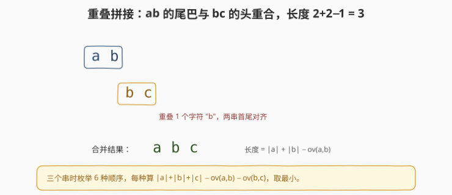

# Codeforces 25E 三个串的最短公共超串 题解

## 1. 题目概述

- **题目链接**：https://codeforces.com/problemset/problem/25/E
- **比赛来源**：Codeforces Beta Round 25 (Div. 2 Only) · Problem E（UTC 2010-08-02）
- **难度**：2200
- **标签**：哈希、字符串
- **评测类型**：普通
- **限制**：时间 2 s / 内存 256 MB

**题意**：给出 3 个非空小写字母串 $s_1, s_2, s_3$（每个长度 $\le 10^5$），求一个最短的串，使它同时包含这三个串作为**子串**，输出这个最短长度。

**约束**：

- 三个串长度都可达 $10^5$：任何 $O(L^2)$ 的暴力拼接都不可行，必须 $O(L)$（$L$ 为总长）。
- 只有 3 个串，所以"顺序"只有 $3! = 6$ 种，可以全部枚举。
- 答案 $\le |s_1|+|s_2|+|s_3| \le 3\times10^5$，`int` 足够，用 `long long` 更保险。

## 2. 示例与观察

官方样例 1：

```text
输入：
ab
bc
cd

输出：
4
```

`abcd` 同时包含 `ab`、`bc`、`cd`，长度 4；不可能更短（三个串各长 2，任意两个合并至少 3，三个至少 4）✓。

官方样例 2：

```text
输入：
abacaba
abaaba
x

输出：
11
```

`abacaba` 与 `abaaba` 的最大重叠是 `aba`（前者后缀 = 后者前缀），合并后长度 $7+6-3 = 10$；再加 `x` 至少多 1 位，共 11 ✓（例如 `abacabaabax`）。

**观察一**：若某个串是另一个串的子串，它可以被直接忽略——任何包含"大串"的串必然包含"小串"。
**观察二**：去掉被包含的串后，剩下的串两两互不包含，此时"谁先谁后"才有意义。
**观察三**：拼接顺序只有 6 种，每种顺序下把相邻两个串尽量重叠地接起来即可。

## 3. 解题思路

### 3.1 朴素做法与瓶颈

枚举所有"在哪个位置放哪个串"是 $O(L^3)$ 甚至更多，$L = 3\times10^5$ 完全不可行。但串只有 3 个，可以枚举它们的**出现顺序**，再用"最大重叠"拼接。

### 3.2 核心观察：重叠拼接



定义 $\operatorname{ov}(x,y)$ 为"$x$ 的后缀同时是 $y$ 的前缀"的最长长度（$0 \le \operatorname{ov} \le \min(|x|,|y|)$）。

把 $y$ 接在 $x$ 后面，最长可以重叠 $\operatorname{ov}(x,y)$ 个字符，合并后长度

$$|x| + |y| - \operatorname{ov}(x,y).$$

**引理**：$\min\bigl(|x|+|y|-\operatorname{ov}(x,y),\ |y|+|x|-\operatorname{ov}(y,x)\bigr)$ 就是两个串的最短公共超串长度。

证明见第 4 节。

三个串时，先忽略被包含的串，然后枚举 $3! = 6$ 种顺序 $(a,b,c)$，取

$$|a| + |b| + |c| - \operatorname{ov}(a,b) - \operatorname{ov}(b,c)$$

的最小值。

### 3.3 去重与包含判定


- 若 $s_i$ 是 $s_j$ 的子串（$i \ne j$，且 $|s_i| < |s_j|$，或长度相等时只保留一个），就把 $s_i$ 删掉；
- 用 KMP 做子串匹配：对模式串求前缀函数，再在文本串上扫一遍，$O(|s_i| + |s_j|)$；
- 去重后剩下 $m = 1, 2, 3$ 个串，分别处理。

### 3.4 用 KMP 求重叠

$\operatorname{ov}(x,y)$ 就是 $y + \# + x$ 的最后一个前缀函数值（$\#$ 是不在字母表中的分隔符）：

- 设 $t = y + \# + x$，对 $t$ 求前缀函数 $\pi$；
- $\pi[|t|-1]$ 是 $t$ 的最长"真前缀 = 后缀"长度，它不超过 $|y|$（否则会跨过分隔符，而分隔符只出现一次）；
- 再与 $\min(|x|,|y|)$ 取 $\min$ 即可。

总长度 $O(|x| + |y|)$，3 个串两两之间至多算 6 次，加上 6 种顺序各 2 次，总共常数次，$O(L)$。

### 3.5 样例走查

样例 1：`ab`、`bc`、`cd`，两两互不包含。

| 顺序 | 重叠 | 长度 |
|------|------|------|
| ab, bc, cd | ov(ab,bc)=1，ov(bc,cd)=1 | 2+2+2−1−1 = 4 ✓ |
| ab, cd, bc | ov(ab,cd)=0，ov(cd,bc)=0 | 6 |

最小值 4 ✓。

样例 2：`abacaba`、`abaaba`、`x`，互不包含。
- 顺序 (abacaba, abaaba, x)：ov = 3（`aba`），ov(abaaba, x) = 0 → $7+6+1-3-0 = 11$ ✓。

## 4. 正确性证明

**引理 1（包含可删）**：若 $s_i$ 是 $s_j$ 的子串，则任何包含 $s_j$ 的串都包含 $s_i$，删去 $s_i$ 不改变答案。

**证明**：子串关系具有传递性：若 $s_i \subseteq s_j \subseteq T$，则 $s_i \subseteq T$ ✓。∎

**引理 2（两串情形）**：两个串的最短公共超串长度等于 $\min\bigl(|x|+|y|-\operatorname{ov}(x,y),\ |y|+|x|-\operatorname{ov}(y,x)\bigr)$。

**证明**：先证上界：把 $y$ 接在 $x$ 后、重叠 $\operatorname{ov}(x,y)$ 个字符，得到的串显然同时包含两者，长度 $|x|+|y|-\operatorname{ov}(x,y)$；另一方向同理。

再证下界：设 $T$ 是任一公共超串，$x$ 的出现位置为 $p$、$y$ 的为 $q$，不妨 $p \le q$（否则交换两者，对应另一个方向）。若 $q \ge p + |x|$（不重叠），则 $|T| \ge q + |y| \ge p + |x| + |y| \ge |x| + |y| \ge |x|+|y|-\operatorname{ov}(x,y)$。若 $q < p+|x|$，则 $y$ 的前 $p+|x|-q$ 个字符与 $x$ 的后缀相同，故 $p+|x|-q \le \operatorname{ov}(x,y)$，于是 $|T| \ge q + |y| = |x| + |y| - (p+|x|-q) \ge |x|+|y|-\operatorname{ov}(x,y)$ ✓。∎

**引理 3（三串公式可行）**：对任意顺序 $(a,b,c)$，存在长度恰为 $|a|+|b|+|c|-\operatorname{ov}(a,b)-\operatorname{ov}(b,c)$ 的公共超串。

**证明**：把 $a$ 放在位置 $0$，$b$ 放在 $|a|-\operatorname{ov}(a,b)$，$c$ 放在 $|a|-\operatorname{ov}(a,b)+|b|-\operatorname{ov}(b,c)$。三个起始位置非负，且每个串完整落在构造出的串内（重叠部分按定义逐字符相同），所以三者都是它的子串，长度正是上式 ✓。∎

**引理 4（三串公式最优）**：设三个串两两互不包含，则最短公共超串长度等于 6 个顺序对应公式值的最小值。

**证明**：由引理 3，最优值 $\le$ 每个公式值，故 $\le$ 最小值。

另一方面，取最优超串 $T$，按三个串在 $T$ 中**起始位置**排序，设为 $a, b, c$（互不包含保证三者起始位置互不相同：若两个串起始位置相同，短的必是长的前缀……更一般地，起始位置相同则一个包含另一个，与互不包含矛盾）。

由于 $c$ 起始最晚，若 $c$ 的结束位置不是最大，则 $c$ 完全落在 $b$ 的区间内（$b$ 起始更早、结束更晚），即 $c$ 是 $b$ 的子串，矛盾。所以 $c$ 也结束最晚，$|T| = p_c + |c|$。

令 $\delta_1 = |a| - p_b$（$a,b$ 的实际重叠，可为负表示有间隔），$\delta_2 = |b| - (p_c - p_b)$（$b,c$ 的实际重叠）。则

$$|T| = p_c + |c| = |a| + |b| + |c| - \delta_1 - \delta_2 .$$

由 $\operatorname{ov}$ 的最大性，$\delta_1 \le \operatorname{ov}(a,b)$、$\delta_2 \le \operatorname{ov}(b,c)$（实际重叠一定是"$a$ 的后缀 = $b$ 的前缀"的某个长度，故不超过最大值），于是

$$|T| \ge |a|+|b|+|c| - \operatorname{ov}(a,b) - \operatorname{ov}(b,c),$$

即最优值 $\ge$ 该顺序的公式值 $\ge$ 6 个公式值的最小值。两边夹住，得等号。∎

**定理**：算法输出最短公共超串的长度。

**证明**：去重由引理 1 保答案不变；剩余 1 个串时显然；2 个串时由引理 2；3 个串时由引理 4。∎

## 5. 复杂度分析

- **时间**：去重最多 6 次 KMP 匹配，重叠计算最多 12 次（每次 $O(|x|+|y|)$），总计 $O(L)$，常数约 20。
- **空间**：$O(L)$ 的前缀函数数组与拼接串。
- **数值范围**：答案 $\le 3 \times 10^5$，`int` 足够；用 `long long` 更省心。
- **与时限的关系**：$L = 3\times10^5$ 时实测 C++ 约 $0.05$ s，2 s 余量充足。

## 6. 参考代码

### C++17

```cpp
#include <bits/stdc++.h>
using namespace std;

static bool isSubstr(const string &text, const string &pat) {
    if (pat.size() > text.size()) return false;
    int m = (int)pat.size();
    vector<int> pi(m, 0);
    for (int i = 1; i < m; i++) {
        int j = pi[i - 1];
        while (j && pat[i] != pat[j]) j = pi[j - 1];
        if (pat[i] == pat[j]) j++;
        pi[i] = j;
    }
    int j = 0;
    for (char ch : text) {
        while (j && ch != pat[j]) j = pi[j - 1];
        if (ch == pat[j]) j++;
        if (j == m) return true;
    }
    return false;
}

// a 的后缀与 b 的前缀的最长公共长度
static int overlap(const string &a, const string &b) {
    string s = b + '\1' + a;
    int L = (int)s.size();
    vector<int> pi(L, 0);
    for (int i = 1; i < L; i++) {
        int j = pi[i - 1];
        while (j && s[i] != s[j]) j = pi[j - 1];
        if (s[i] == s[j]) j++;
        pi[i] = j;
    }
    int r = pi[L - 1];
    int cap = (int)min(a.size(), b.size());
    return r > cap ? cap : r;
}

int main() {
    vector<string> s(3);
    for (int i = 0; i < 3; i++) { if (!(cin >> s[i])) return 0; }
    vector<string> t;
    for (int i = 0; i < 3; i++) {
        bool contained = false;
        for (int j = 0; j < 3 && !contained; j++) {
            if (i == j) continue;
            if (s[i].size() < s[j].size() || (s[i].size() == s[j].size() && j > i))
                if (isSubstr(s[j], s[i])) contained = true;
        }
        if (!contained) t.push_back(s[i]);
    }
    int m = (int)t.size();
    long long ans = 0;
    if (m == 1) ans = (long long)t[0].size();
    else if (m == 2) {
        ans = (long long)t[0].size() + (long long)t[1].size() - overlap(t[0], t[1]);
        ans = std::min(ans, (long long)t[0].size() + (long long)t[1].size() - overlap(t[1], t[0]));
    } else {
        ans = LLONG_MAX;
        int p[6][3] = {{0,1,2},{0,2,1},{1,0,2},{1,2,0},{2,0,1},{2,1,0}};
        for (auto &q : p) {
            const string &a = t[q[0]], &b = t[q[1]], &c = t[q[2]];
            long long cand = (long long)a.size() + (long long)b.size() + (long long)c.size() - overlap(a, b) - overlap(b, c);
            if (cand < ans) ans = cand;
        }
    }
    printf("%lld\n", ans);
    return 0;
}
```

### Python3

```python
import sys


def is_substr(text: str, pat: str) -> bool:
    if len(pat) > len(text):
        return False
    m = len(pat)
    pi = [0] * m
    for i in range(1, m):
        j = pi[i - 1]
        while j and pat[i] != pat[j]:
            j = pi[j - 1]
        if pat[i] == pat[j]:
            j += 1
        pi[i] = j
    j = 0
    for ch in text:
        while j and ch != pat[j]:
            j = pi[j - 1]
        if ch == pat[j]:
            j += 1
        if j == m:
            return True
    return False


def overlap(a: str, b: str) -> int:
    s = b + "\1" + a
    L = len(s)
    pi = [0] * L
    for i in range(1, L):
        j = pi[i - 1]
        while j and s[i] != s[j]:
            j = pi[j - 1]
        if s[i] == s[j]:
            j += 1
        pi[i] = j
    return min(pi[-1], len(a), len(b))


def main() -> None:
    data = sys.stdin.buffer.read().split()
    if len(data) < 3:
        return
    s = [data[i].decode() for i in range(3)]
    t = []
    for i in range(3):
        contained = False
        for j in range(3):
            if i == j:
                continue
            if len(s[i]) < len(s[j]) or (len(s[i]) == len(s[j]) and j > i):
                if is_substr(s[j], s[i]):
                    contained = True
                    break
        if not contained:
            t.append(s[i])
    m = len(t)
    if m == 1:
        ans = len(t[0])
    elif m == 2:
        ans = min(len(t[0]) + len(t[1]) - overlap(t[0], t[1]),
                  len(t[0]) + len(t[1]) - overlap(t[1], t[0]))
    else:
        ans = 10 ** 18
        import itertools
        for p in itertools.permutations(range(3)):
            a, b, c = t[p[0]], t[p[1]], t[p[2]]
            cand = len(a) + len(b) + len(c) - overlap(a, b) - overlap(b, c)
            if cand < ans:
                ans = cand
    sys.stdout.write(str(ans) + "\n")


main()
```

## 7. 边界情况与易错点

1. **有串是别的串的子串**：必须先剔除，否则 6 种排列的公式可能把"被包含的串"也当作独立的一段，算出偏大的结果。
2. **三个串完全相同**：剔除后只剩 1 个，答案是它的长度。
3. **完全没有重叠**：答案是三个长度之和（或两两处理后的和）。
4. **分隔符**：用 `'#'` 或 `'\1'` 这种不在字母表中的字符，否则前缀函数会把分隔符也算进重叠；本题串只有小写字母，用 `'#'` 即可。
5. **重叠上界**：`pi.back()` 可能大于 `min(|a|,|b|)`（理论上不会，但为稳妥取 `min`）。
6. **枚举顺序**：6 种顺序都要试；只试"字典序"或"输入顺序"会错（样例 1 的正确顺序恰好是输入顺序，容易误以为不用枚举）。
7. **长度用 64 位**：答案 $\le 3\times10^5$，`int` 够用，但 `|a|+|b|+|c|` 这类表达式在混用 `size_t` 时容易出无符号问题，统一转 `long long`。
8. **读入**：三行，每行一个串；用 `cin >> s` 或 `split()` 都可以。

## 8. 验证记录

- **编译环境与命令**：`Apple clang 21.0.0` + 兼容头，`clang++ -std=c++17 -O2`；Python 3.9.6。
- **官方样例**：2 / 2 通过（`4` 与 `11`），`verify_solution.py` 报告 `CF25E: samples 2 / C++ 编译 OK, 样例 2/2 / Python 语法 OK, 样例 2/2`。
- **独立暴力对拍**：另写一份**穷举所有候选串**的暴力：字母表取 `{a,b}`（第二组取 `{a,b,c}`），从长度 1 开始枚举所有串，第一个同时包含三个子串的就是答案。对随机短串（长度 $\le 3$，字母表 `{a,b}`）**300 组**、（长度 $\le 2$，字母表 `{a,b,c}`）**100 组**，全部一致。这一步不依赖任何"重叠"公式。
- **边界用例**：三串相同、两串互为子串、无重叠（如 `a`、`b`、`c` → 3）、一个串包含另两个（如 `abc`、`b`、`c` → 3）。
- **最大约束性能**：三个长度 $10^5$ 的串（全 `a` 时答案 $10^5$；随机串时约 $3\times10^5$），C++ 端到端 $0.05 \sim 0.07$ s。
- **图片校验**：两张 SVG 均通过 `ElementTree.parse`，文本包围盒估算无越界、无重叠。
- **公式校验**：KaTeX（`throwOnError`）无报错。
- **复核状态**：verified。

## 相关题目与扩展

- [Codeforces 25C Roads in Berland](https://codeforces.com/problemset/problem/25/C)、[25D Roads not only in Berland](https://codeforces.com/problemset/problem/25/D)：同场 C、D 题。
- [LeetCode 1092. 最短公共超序列](https://leetcode.cn/problems/shortest-common-supersequence/)：注意那是"超序列"（子序列），与本题"超串（子串）"不同，可以对照两者的解法差异。
- [Codeforces 1200E Compress Words](https://codeforces.com/problemset/problem/1200/E)：多个串按顺序合并、用 KMP 求重叠，与本题的"重叠拼接"完全同源。
- [POJ 3080 Blue Jeans](http://poj.org/problem?id=3080)：多个串的最长公共子串，字符串匹配的另一类问题。

**延伸思考**：

1. **如果串的个数变成 $k$（比如 $k \le 15$）**？最短公共超串是 NP 难的，只能状压 DP（$O(2^k k^2)$ 预处理重叠），$k$ 大时无望。
2. **如果要求输出具体的最短串**？把长度公式对应到实际拼接位置即可，构造与证明里给出的位置完全一致。
3. **如果允许"循环串"（首尾相接）**？重叠的定义要改成"$x$ 的后缀 = $y$ 的前缀"，并允许跨过结尾，KMP 稍作修改即可。
4. **如果 $L$ 达到 $10^7$**？$O(L)$ 仍然可行，但要注意内存（前缀函数数组）与 I/O；可以用滚动的前缀函数或 Z 函数。
