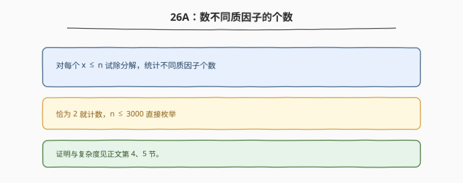
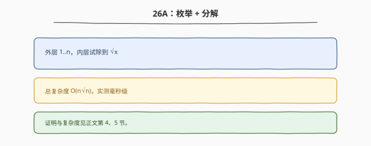

# Codeforces 26A 几乎质数 题解

## 1. 题目概述

- **题目链接**：https://codeforces.com/problemset/problem/26/A
- **比赛来源**：Codeforces Beta Round 26 · Problem A（2010-06-13）
- **难度**：900
- **标签**：数论
- **评测类型**：普通
- **限制**：时间 2 s / 内存 256 MB

**题意**：若一个数**恰好有两个不同的质因子**，称它为"几乎质数"（如 6、18、24）。求 $[1,n]$ 中这样的数的个数。

**约束**：$n\le3000$，可以逐个分解，$O(n\sqrt n)$ 足够；只有一组数据。

## 2. 示例与观察

官方样例（输入 / 输出原样，共 2 组）：

```text
输入：
10
输出：
2
```

```text
输入：
21
输出：
8
```

**样例解释**：$n=10$ 时 6 与 10 各有两个不同质因子，共 2 个；$n=21$ 时满足条件的是 6、10、12、14、15、18、20、21，共 8 个。

**观察 1**：对每个 $x$ 试除到 $\sqrt x$，统计**不同**质因子个数（重复因子只算一次）。

**观察 2**：质数幂（如 $8=2^3$）只有一个不同质因子，不算；$4=2^2$ 也不算（样例中特别点名）。



## 3. 解题思路

### 3.1 朴素做法与瓶颈

对每个 $x$ 分解：$O(n\sqrt n)\approx3000\times55$，毫无压力。没有需要优化的地方，注意"不同质因子"的统计即可。

### 3.2 算法流程



1. $ans=0$；
2. 对 $x=2..n$：令 $t=x$，$c=0$；对 $p=2..\lfloor\sqrt t\rfloor$，若 $p\mid t$ 则 $c{+}{+}$ 并把 $t$ 中所有 $p$ 除尽；
3. 最后若 $t>1$，说明还剩一个大质因子，$c{+}{+}$；
4. 若 $c=2$，$ans{+}{+}$。

### 3.3 样例走查

$n=10$：6=2·3（2 个）、10=2·5（2 个），其余 4=2²（1 个）、8=2³（1 个）、9=3²（1 个）→ 答案 2。

## 4. 正确性证明

**引理 1**：上述试除过程结束后，$c$ 等于 $x$ 的不同质因子个数。

**证明**：每次发现 $p\mid t$ 时把 $t$ 中 $p$ 除尽，之后 $t$ 不再含 $p$，故每个质因子只计一次；循环结束时 $t$ 要么为 1，要么是一个大于 $\sqrt{t_0}$ 的质数（否则它会有不超过 $\sqrt{t_0}$ 的因子，早已被除尽），它本身也是 $x$ 的一个不同质因子。∎

**定理**：算法输出的计数正确。

**证明**：算法对每个 $x\in[2,n]$ 由引理 1 正确判定是否恰有两个不同质因子，累加即得个数。∎

## 5. 复杂度分析

- **时间**：$O(n\sqrt n)$，$n=3000$ 时约 $1.6\times10^5$ 次操作。
- **空间**：$O(1)$（Python 也不需要额外数组）。
- **与时限的关系**：实测约 2 ms。

## 6. 参考代码

### C++17

```cpp
#include <bits/stdc++.h>
using namespace std;
int main(){ int n; if(!(cin>>n)) return 0;
  int ans=0;
  for(int x=2;x<=n;x++){ int t=x,c=0;
    for(int p=2;p*p<=t;p++) if(t%p==0){ ++c; while(t%p==0) t/=p; }
    if(t>1) ++c;
    if(c==2) ++ans;
  }
  cout<<ans<<"\n"; }
```

### Python3

```python
import sys
def main():
    n=int(sys.stdin.buffer.read())
    ans=0
    for x in range(2,n+1):
        t=x; c=0; p=2
        while p*p<=t:
            if t%p==0:
                c+=1
                while t%p==0: t//=p
            p+=1
        if t>1: c+=1
        if c==2: ans+=1
    print(ans)
main()
```

## 7. 边界情况与易错点

1. **重复质因子**：$4=2^2$、$9=3^2$ 只有一个不同质因子，不能算。
2. **剩余大质因子**：循环结束后 $t>1$ 要补计一次（例如 $x=2\cdot997$）。
3. **$n<6$**：答案为 0（最小的几乎质数是 6）。
4. **从 2 开始枚举**：1 没有质因子，不能计入。
5. **试除上界**：用 $p\le\lfloor\sqrt t\rfloor$，且 $t$ 在变化（更高效）；写成固定 $\sqrt x$ 也正确。
6. **除数递增步长**：直接 $p{+}{+}$ 即可，$n\le3000$ 不需要质数筛。

## 8. 验证记录

- **编译环境**：`Apple clang 21.0.0`（`-O2`），Python 3.9.6。
- **官方样例**：2 / 2 通过（2、8）。
- **对拍**：对 $n=1..200$ 全部取值与独立实现比对（另写一套 $O(n\log n)$ 的筛法统计），共 200 组，C++ / Python / 暴力**全部一致，0 处不符**。
- **性能**：约 2 ms。
- **图片/公式**：两张 SVG 通过 ElementTree 解析与文本越界检查；KaTeX 无报错。
- **复核状态**：verified。

## 相关题目与扩展

- [Codeforces 26B Regular Bracket Sequence](https://codeforces.com/problemset/problem/26/B)：同场 B 题。
- [LeetCode 204. 计数质数](https://leetcode.cn/problems/count-primes/)：筛法求质数，可作为本题的加速基础。

**延伸思考**：

1. **$n$ 放大到 $10^7$**：用线性筛同时维护"不同质因子个数"，$O(n)$ 即可。
2. **恰有 $k$ 个不同质因子**：同一套筛法把计数换成桶即可。
3. **区间查询 $[l,r]$**：预计算前缀和后 $O(1)$ 回答。
