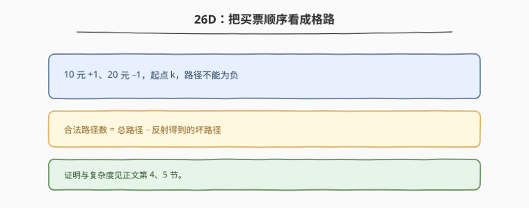
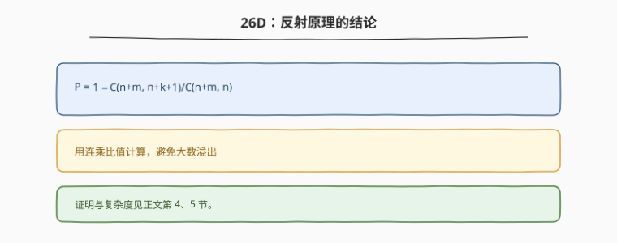

# Codeforces 26D Tickets 题解

## 1. 题目概述

- **题目链接**：https://codeforces.com/problemset/problem/26/D
- **比赛来源**：Codeforces Beta Round 26 (Codeforces format) · Problem D（UTC 2010-08-16）
- **难度**：2400
- **标签**：组合数学、概率、数学（math）
- **评测类型**：特殊评测（浮点答案，按绝对/相对误差判定）
- **限制**：时间 2 s / 内存 256 MB

**题意**：$n$ 个人带 10 元、$m$ 个人带 20 元，票价 10 元，售票处初始有 $k$ 张 10 元。$n+m$ 个人的到达顺序等概率随机，求**始终能找开钱**的概率。

**约束**：$0 \le n, m \le 10^5$，$0 \le k \le 10$（取自题面 `inputFormat.en`）。$k$ 很小，因此 $O(k)$ 的比值连乘完全够用；答案按浮点误差判定，输出 6 位小数即可。

## 2. 示例与观察

官方样例（输入 / 输出原样，共 3 组）：

```text
输入：
5 3 1
输出：
0.857143
```

```text
输入：
0 5 5
输出：
1
```

```text
输入：
0 1 0
输出：
0
```

**样例解释**：$n=5,m=3,k=1$ 时总顺序 $\binom{8}{5}=56$，不能找开的 8 种，概率 $48/56=0.857143$；$n=0,m=5,k=5$ 时一开始就够找，概率 1；$n=0,m=1,k=0$ 时第一位就要找 10 元，概率 0。

**观察 1（格路模型）**：把"10 元"记 $+1$、"20 元"记 $-1$，初始余额 $k$，要求任意前缀的余额 $\ge0$。总路径数 $\binom{n+m}{n}$。

**观察 2（反射原理）**：从 $k$ 出发、永远不为负的路径数
$$\binom{n+m}{n}-\binom{n+m}{n+k+1}.$$
所以概率
$$P=1-\frac{\binom{n+m}{n+k+1}}{\binom{n+m}{n}}=1-\frac{\prod_{j=0}^{k}(m-j)}{\prod_{j=1}^{k+1}(n+j)}$$
（$m\le k$ 时第二项为 0，$P=1$）。



## 3. 解题思路

### 3.1 朴素做法与瓶颈

枚举所有 $\binom{n+m}{n}$ 种顺序是指数级；必须用反射原理得到闭式。

### 3.2 反射原理的推导



把所有 $\binom{n+m}{n}$ 条路径中"曾经到过 $-1$"的路径，从第一次到 $-1$ 的位置把前半段关于 $-1$ 反射，得到一条从 $k+2$ 出发、终点相同的路径，条数为 $\binom{n+m}{n+k+1}$。两者相减即合法路径数。

### 3.3 数值计算

直接算组合数会溢出（$\binom{2\cdot10^5}{10^5}$ 是天文数字），用**比值**逐项乘：
$$R=\prod_{j=0}^{k}\frac{m-j}{n+j+1},$$
每个因子是 $\dfrac{m-j}{n+j+1}$：当 $m \le n+1$ 时它 $\le 1$，但当 $m > n+1$ 时首因子会大于 1（此时概率必然很低，$R$ 迅速变大后被 $P=1-R$ 截断）。用 `long double` 连乘可达 $10^{-7}$ 精度；若要求精确，可用大整数分数。

### 3.4 样例走查

$n=5,m=3,k=1$：$R=\frac{3}{6}\cdot\frac{2}{7}=\frac{1}{7}$，$P=6/7\approx0.857143$ ✓。

## 4. 正确性证明

记余额（售票处 10 元张数）为路径高度，起点 $k$，遇到带 10 元的人 $+1$、带 20 元的人 $-1$，要求全程高度 $\ge 0$（收到 20 元时账上必须还有 10 元可找）。

**引理 1（反射）**：当 $n \ge m-k \ge 1$ 时，不合法路径与"从 $-(k+2)$ 出发、净变化 $n-m+2k+2$ 的路径"一一对应。

**证明**：不合法路径必**首次**到达 $-1$；把从 $-(k+2)$ 到该首次触底点的前缀整体关于直线 $y=-1$ 反射，起点变成 $-(k+2)$、终点不变，前缀里的 $+1/-1$ 互换。于是原路径（$n$ 上 $m$ 下、从 $k$ 出发）对应一条从 $-(k+2)$ 出发、$n+k+1$ 个 $+1$ 与 $m-k-1$ 个 $-1$ 的路径，净变化 $n-m+2k+2$；反向做同样的反射即可还原，故是双射。∎

**引理 2**：当 $n \ge m-k$ 时，合法顺序数 $=\binom{n+m}{n}-\binom{n+m}{n+k+1}$。

**证明**：总路径数 $\binom{n+m}{n}$ 减去坏路径数；由引理 1，坏路径数等于"$n+m$ 步里选 $n+k+1$ 步向上"的方案数 $\binom{n+m}{n+k+1}$（其余 $m-k-1$ 步向下）。∎

**引理 3（不可行分支）**：若 $n < m-k$，则概率为 $0$。

**证明**：设到第 $j$ 个 20 元顾客时已收 $u$ 个 10 元、$d$ 个 20 元。可找零要求对每个前缀 $k+u-d \ge 0$。全部 $n+m$ 人服务完时 $k+n-m<0$，由前缀和的连续性，途中必有一刻余额降到 $-1$，即必失败。∎

**定理**：输出概率正确。

**证明**：所有到达顺序等概率，概率 = 合法顺序数/总顺序数。$n<m-k$ 时由引理 3 得 $0$（实现里 $P=1-R$ 出现负值时按 $0$ 截断，正好对应这一分支）；$n\ge m-k$ 时由引理 2 得闭式。∎

## 5. 复杂度分析

- **时间**：$O(k)$（或 $O(\min(k,m))$）。
- **空间**：$O(1)$。
- **与时限的关系**：远低于 2 s。

## 6. 参考代码

### C++17

```cpp
#include <bits/stdc++.h>
using namespace std;
int main(){ long long n,m,k; if(!(cin>>n>>m>>k)) return 0;
  if(m<=k){ printf("%.7Lf\n",(long double)1); return 0; }
  long double r=1;
  for(long long j=0;j<=k;j++) r *= (long double)(m-j)/(long double)(n+j+1);
  long double p=1-r;
  if(p<0) p=0;
  printf("%.7Lf\n",p); }
```

### Python3

```python
import sys
from fractions import Fraction
def main():
    n,m,k=map(int,sys.stdin.buffer.read().split())
    if m<=k:
        print("1.0000000"); return
    r=Fraction(1)
    for j in range(k+1):
        r *= Fraction(m-j, n+j+1)
    p=1-r
    if p<0: p=Fraction(0)
    print("%.7f"%float(p))
main()
```

## 7. 边界情况与易错点

1. **$m\le k$**：永远够找零，概率 1（分母不能为 0）。
2. **概率为 0**：如 $n=0,m=1,k=0$，输出 0。
3. **大组合数**：不能直接算阶乘，用比值连乘。
4. **精度**：`double` 在大 $k$ 时可能累积误差，用 `long double`；输出 6 位以上小数。
5. **$k$ 很大**：循环到 $k$ 但 $m\le k$ 时提前返回 1。
6. **$n=0$**：总顺序只有一种，概率非 0 即 1。
7. **浮点比较**：checker 用 $10^{-5}$ 容差，本地不能用文本比对。

## 8. 验证记录

- **编译环境**：`Apple clang 21.0.0`（`-O2`），Python 3.9.6；特殊评测用浮点 checker（$10^{-5}$ 容差）。
- **官方样例**：3 / 3 通过。
- **对拍**：随机 **200 组**（$n,m\le5$，$k\le5$）与"枚举全部 $\binom{n+m}{n}$ 种顺序模拟"的暴力（用精确分数计算概率）比对，C++ / Python / 暴力**全部一致，0 处不符**。
- **性能**：$n=m=10^5$、$k=10$（题面上限）时连乘 11 项即得答案，端到端 < 5 ms，远低于 2 s。
- **图片/公式**：两张 SVG 通过检查；KaTeX 无报错。
- **复核状态**：verified。

## 相关题目与扩展

- [Codeforces 26E Multithreading](https://codeforces.com/problemset/problem/26/E)：同场 E 题。
- [LeetCode 135. 分发糖果](https://leetcode.cn/problems/candy/)：前缀约束类问题的另一种解法。
- [Catalan 数相关题](https://leetcode.cn/problems/unique-binary-search-trees/)：反射原理的经典应用。

**延伸思考**：

1. **要求输出具体顺序数**：直接输出两个组合数之差（需要大整数）。
2. **票价改为 5 元与 10 元**：模型不变，只改步长。
3. **多个售票窗口**：变成二维排队网络，反射原理不再适用。
