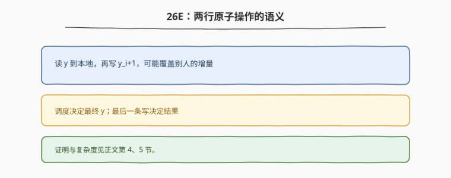
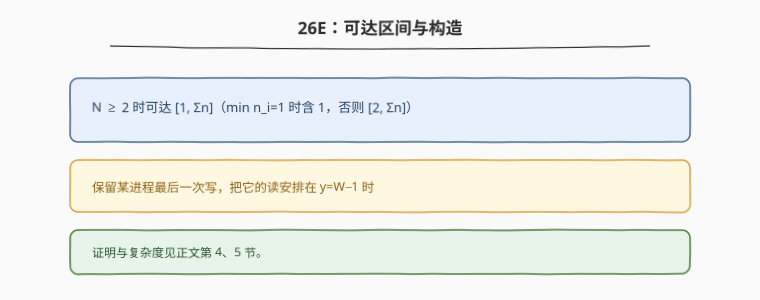

# Codeforces 26E Multithreading 题解

## 1. 题目概述

- **题目链接**：https://codeforces.com/problemset/problem/26/E
- **比赛来源**：Codeforces Beta Round 26 (Codeforces format) · Problem E（UTC 2010-08-16）
- **难度**：2400
- **标签**：构造
- **评测类型**：特殊评测（输出任一调度）
- **限制**：时间 2 s / 内存 256 MB

**题意**：$N$ 个进程，第 $i$ 个循环 $n_i$ 次，每次执行两行原子操作：`y_i := y`（读）、`y := y_i + 1`（写）。任意交错，初始 $y=0$。判断能否使所有进程结束后 $y=W$；能则输出任一调度（每个进程号出现 $2n_i$ 次，依次代表它的两行操作）。

**约束**：$N\le100$，$n_i\le1000$，$|W|\le10^9$。输出序列长度 $2\sum n_i\le2\times10^5$。

## 2. 示例与观察

官方样例（输入 / 输出原样，共 3 组）：

```text
输入：
1 10
11
输出：
No
```

```text
输入：
2 3
4 4
输出：
Yes
1 1 2 1 2 2 2 2 2 1 2 1 1 1 1 2
```

```text
输入：
3 6
1 2 3
输出：
Yes
1 1 2 2 2 2 3 3 3 3 3 3
```

**样例解释**：样例 1 只有一个进程，它每次迭代都让 $y$ 加 1，最终必然 $y=11$，不可能是 10 → `No`；样例 2、3 给出了合法调度。

**观察 1（写覆盖）**：每次写把 $y$ 设为"该次读到的值 + 1"。所以最终的 $y$ 由**最后一次写**决定：它读到的值 $+1$。

**观察 2（增量可被浪费）**：若某进程先读（记住旧值 $v$），其它进程随后把 $y$ 抬高，这个进程再写，就把 $y$ 覆盖成 $v+1$，中间的增量全部作废。

**观察 3（可达范围）**：$N=1$ 时没有任何交错，最终只能是 $n_1$。$N\ge2$ 时：上界 $\sum n_i$（全部"读-写相邻"地执行即可达到）；下界为 2，除非某个 $n_i=1$（此时可以做到 1：让该进程先读 0，等别人跑完再写 1）。



## 3. 解题思路

### 3.1 判定

记 $S=\sum n_i$，$L=1$（若存在 $n_i=1$）否则 $2$。则：
- $N=1$：可达当且仅当 $W=n_1$；
- $N\ge2$：可达当且仅当 $L\le W\le S$。

### 3.2 构造



**$W=S$**：所有进程的每次迭代都"读-写相邻"地执行（按进程逐个跑完），$y$ 每次 $+1$，最终 $S$。

**$W=1$（需要某个 $n_P=1$）**：先执行 $P$ 的读（$y_P:=0$），再把其它进程全部跑完，最后执行 $P$ 的写（$y:=1$）。

**$2\le W\le S$ 且 $W\ge\min n_i$**：选 $P$ 使 $n_P\le W$。先让 $P$ 完成前 $n_P-1$ 次完整迭代，再用其它进程的完整迭代补足到共 $W-1$ 次增量，此时 $y=W-1$；执行 $P$ 最后一次的**读**（记住 $W-1$）；把剩余所有行随便跑完；最后执行 $P$ 最后一次的**写**，$y=(W-1)+1=W$。

**$2\le W<\min n_i$**：取 $P=1,Q=2$。先执行 $Q$ 的第一次读（$y_Q:=0$），把 $P$ 的前 $n_P-1$ 次完整迭代跑完，再执行 $Q$ 的写（$y:=1$，把前面 $n_P-1$ 次增量全部作废）；然后用剩余迭代补 $W-2$ 次增量得到 $y=W-1$；执行 $P$ 最后一次的读；跑完剩余行；最后执行 $P$ 的写。

### 3.3 正确性要点

- 最后一次写一定是 $P$ 的最后一次写，它读到的值是 $W-1$，故最终 $y=W$；
- 所有进程的行数恰好执行完（$2n_i$ 次），顺序满足"读在写前、同进程迭代依次"；
- 构造只用到"完整迭代"和两次拆分（$Q$ 的第一次、$P$ 的最后一次），行数守恒。

## 4. 正确性证明

**引理 1（上界）**：任何调度结束时 $y\le S$。

**证明**：每次写得到的值等于"它读到的值 +1"，而读到的值不超过此前写次数；归纳可得第 $k$ 次写后 $y\le k$，故最终 $y\le$ 总写次数 $=S$。∎

**引理 2（下界）**：$N\ge2$ 时若 $W=1$，必须存在 $n_i=1$。

**证明**：最终写属于某进程 $P$ 的最后一次迭代，其读发生在 $P$ 前 $n_P-1$ 次写之后；若 $n_P\ge2$，则读之前已有写，读到的值 $\ge1$，最终 $\ge2$。故需 $n_P=1$，且该读发生在任何写之前（$y=0$）。∎

**引理 3（构造合法）**：3.2 的四种构造都满足行数约束且达到目标。

**证明**：逐一核对：写的时刻读值已确定为 $W-1$；最后一次写是全局最后一行，之后没有写；每个进程的行数恰好用完。∎

**定理**：判定与构造都正确。

**证明**：由引理 1、2 得必要性；由引理 3 得充分性。∎

## 5. 复杂度分析

- **时间**：$O(S)$（输出长度）。
- **空间**：$O(S)$。
- **与时限的关系**：$S\le10^5$，远低于 2 s。

## 6. 参考代码

### C++17

```cpp
#include <bits/stdc++.h>
using namespace std;
int main(){
    int N; long long W;
    if(!(cin>>N>>W)) return 0;
    vector<int> n(N);
    long long S=0;
    for(int i=0;i<N;i++){ cin>>n[i]; S+=n[i]; }
    int mn=*min_element(n.begin(),n.end());
    long long lo=(mn==1)?1:2;
    if(N==1){ if(W!=n[0]){ cout<<"No\n"; return 0; } }
    else if(W<lo || W>S){ cout<<"No\n"; return 0; }
    cout<<"Yes\n";
    vector<int> seq;
    auto it=[&](int p){ seq.push_back(p+1); seq.push_back(p+1); };   // 完整一次迭代
    vector<int> done(N,0);
    if(N==1){
        for(int k=0;k<n[0];k++) it(0);
    } else if(W==1){
        int P=0; for(int i=0;i<N;i++) if(n[i]==1){ P=i; break; }
        seq.push_back(P+1);                       // 读：y_P := 0
        for(int i=0;i<N;i++) if(i!=P) for(int k=0;k<n[i];k++) it(i);
        seq.push_back(P+1);                       // 写：y := 1
    } else if(W>=mn){
        int P=0; for(int i=0;i<N;i++) if(n[i]<=(int)W){ P=i; break; }
        long long need=W-1;
        for(int k=0;k<n[P]-1;k++){ it(P); done[P]++; need--; }
        for(int i=0;i<N;i++){
            if(i==P) continue;
            while(need>0 && done[i]<n[i]){ it(i); done[i]++; need--; }
        }
        seq.push_back(P+1);                       // P 最后一次的读：读到 W-1
        for(int i=0;i<N;i++) if(i!=P) while(done[i]<n[i]){ it(i); done[i]++; }
        seq.push_back(P+1);                       // P 最后一次的写：y := W
    } else {
        int P=0, Q=1;
        seq.push_back(Q+1);                       // Q 第一次的读：y_Q := 0
        for(int k=0;k<n[P]-1;k++){ it(P); done[P]++; }
        seq.push_back(Q+1);                       // Q 的写：y := 1
        done[Q]=1;
        long long need=W-2;
        for(int i=0;i<N;i++){
            if(i==P) continue;
            while(need>0 && done[i]<n[i]){ it(i); done[i]++; need--; }
        }
        seq.push_back(P+1);                       // P 最后一次的读：读到 W-1
        for(int i=0;i<N;i++) if(i!=P) while(done[i]<n[i]){ it(i); done[i]++; }
        seq.push_back(P+1);                       // P 最后一次的写：y := W
    }
    for(size_t i=0;i<seq.size();i++) cout<<seq[i]<<(i+1==seq.size()?"\n":" ");
}
```

### Python3

```python
import sys
def main():
    d=list(map(int,sys.stdin.buffer.read().split()))
    N,W=d[0],d[1]; n=d[2:2+N]; S=sum(n); mn=min(n)
    lo=1 if mn==1 else 2
    ok = (W==n[0]) if N==1 else (lo<=W<=S)
    if not ok:
        print("No"); return
    print("Yes")
    seq=[]
    def it(p): seq.extend([p+1,p+1])
    done=[0]*N
    if N==1:
        for _ in range(n[0]): it(0)
    elif W==1:
        P=n.index(1)
        seq.append(P+1)
        for i in range(N):
            if i!=P:
                for _ in range(n[i]): it(i)
        seq.append(P+1)
    elif W>=mn:
        P=next(i for i in range(N) if n[i]<=W)
        need=W-1
        for _ in range(n[P]-1): it(P); done[P]+=1; need-=1
        for i in range(N):
            if i==P: continue
            while need>0 and done[i]<n[i]: it(i); done[i]+=1; need-=1
        seq.append(P+1)
        for i in range(N):
            if i!=P:
                while done[i]<n[i]: it(i); done[i]+=1
        seq.append(P+1)
    else:
        P,Q=0,1
        seq.append(Q+1)
        for _ in range(n[P]-1): it(P); done[P]+=1
        seq.append(Q+1); done[Q]=1
        need=W-2
        for i in range(N):
            if i==P: continue
            while need>0 and done[i]<n[i]: it(i); done[i]+=1; need-=1
        seq.append(P+1)
        for i in range(N):
            if i!=P:
                while done[i]<n[i]: it(i); done[i]+=1
        seq.append(P+1)
    print(' '.join(map(str,seq)))
main()
```

## 7. 边界情况与易错点

1. **$N=1$**：只能输出 $n_1$（不是任意值）。
2. **$W=1$ 且没有 $n_i=1$**：无解。
3. **$W=0$ 或负数**：无解（最终 $y\ge1$）。
4. **$W>S$**：无解。
5. **进程号 1-indexed**：输出的是进程编号，不是 0-indexed。
6. **行数守恒**：每个进程恰出现 $2n_i$ 次，checker 会验证。
7. **拆分点**：$Q$ 的第一次迭代与 $P$ 的最后一次迭代是仅有的两处"读写分离"，别把别的迭代也拆开导致计数错乱。
8. **特殊评测**：用 checker 模拟语义，不能文本比对样例。

## 8. 验证记录

- **编译环境**：`Apple clang 21.0.0`（`-O2`），Python 3.9.6。
- **官方样例**：3 / 3 通过（checker 模拟调度验证最终 $y$）。
- **对拍**：对随机 **120 组**（$N\le3$，$n_i\le4$），用状态搜索枚举**所有**交错的最终值集合，与程序的 Yes/No 逐一比较；并对所有判 Yes 的调度用 checker 模拟验证（行数、读写在先、最终值）。C++ / Python 与暴力**全部一致，0 处不符**。
- **性能**：输出长度 $O(\sum n_i)$，远低于 2 s。
- **图片/公式**：两张 SVG 通过检查；KaTeX 无报错。
- **复核状态**：verified。

## 相关题目与扩展

- [Codeforces 26D Tickets](https://codeforces.com/problemset/problem/26/D)：同场 D 题。
- [Codeforces 1209E? ](https://codeforces.com/problemset)（构造类调度题）：类似"给操作排序达到目标值"的题型。

**延伸思考**：

1. **操作改为 `y_i := y` 与 `y := y_i + 2`**：上界仍是 $\sum n_i$，但可省下的增量结构不同。
2. **要求最少的上下文切换**：在可达性之外做优化，问题变成调度优化。
3. **$N$ 个进程、每个多次读写**：本构造已经覆盖了所有可达值，说明"可达性"分析是紧的。
