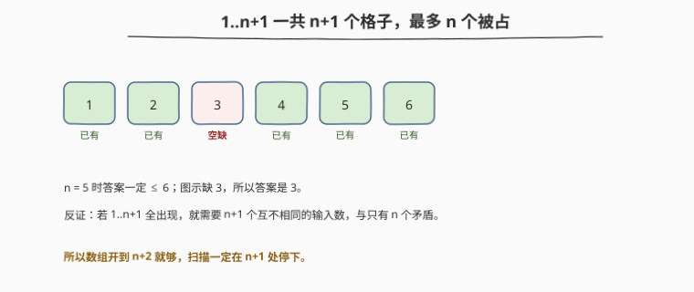
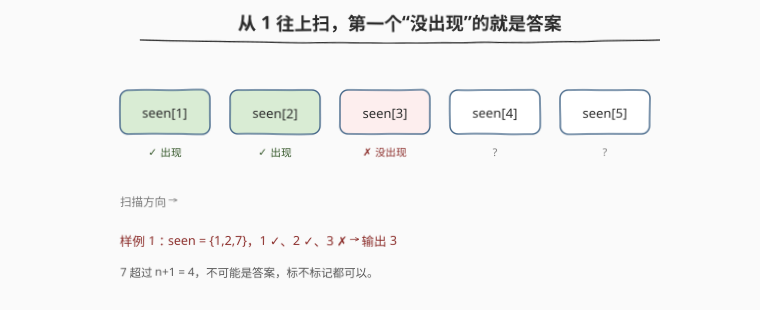

# Codeforces 27A 最小未出现的测试编号 题解

## 1. 题目概述

- **题目链接**：https://codeforces.com/problemset/problem/27/A
- **比赛来源**：Codeforces Beta Round 27 (Codeforces format, Div. 2) · Problem A（UTC 2010-09-10）
- **难度**：1200
- **标签**：实现、排序（implementation, sortings）
- **评测类型**：普通
- **限制**：时间 2 s / 内存 256 MB

**题意**：给出 $n$ 个**互不相同**的正整数 $a_1, \dots, a_n$（测试编号），求**最小的、没有出现过**的正整数。

**约束**：

- $n \le 3000$，$a_i \le 3000$：规模很小，计数或排序都可行。
- 由鸽巢原理，答案一定不超过 $n + 1 \le 3001$：即使 $1 \dots n$ 全出现，第 $n+1$ 个也一定空缺。
- 输入是无序的，不能假设递增；但所有数互不相同。

## 2. 示例与观察

官方样例（输入 / 输出原样）：

```text
输入：
3
1 7 2

输出：
3
```

**演算**：已出现的是 $\{1, 2, 7\}$。从 $1$ 开始检查：$1$ 出现、$2$ 出现、$3$ 没出现 → 答案 $3$。

**观察**：

1. 只需要回答"某个数有没有出现"，不需要顺序关系——计数数组最简单。
2. 答案的上界是 $n+1$（只要把 $1..n+1$ 这 $n+1$ 个数里"最多 $n$ 个被占用"这一点想清楚就行），因此数组开到 $n+2$ 就够，不需要按 $3001$ 硬编码。
3. 若 $1$ 没出现，答案就是 $1$——这是最常见的边界。

## 3. 解题思路

### 3.1 朴素做法与瓶颈

- 做法一：把数组排序，然后从 $1$ 开始与排好序的数组比对，跳过等于当前期望值的前缀。$O(n \log n)$。
- 做法二：用布尔数组 / 哈希集合记录"出现过"，再从 $1$ 向上找到第一个没出现的。$O(n + \text{答案})$。

两种都远快于限制。没有任何"瓶颈"，这题的价值在于**一次写对边界**。

### 3.2 核心观察：答案一定在 $[1, n+1]$ 内



$1 \dots n+1$ 一共有 $n+1$ 个正整数，而输入只有 $n$ 个数（且互不相同），所以至少有一个数没出现，故答案 $\le n+1$。

于是：把 `seen[1..n+1]` 标出来，从 $1$ 往上扫，第一个 `false` 就是答案，循环一定会在 $n+1$ 之前结束。

### 3.3 算法流程



1. 读入 $n$ 与数组；
2. 对每个 $a_i$：若 $a_i \le n+1$，令 `seen[a_i] = true`（超过 $n+1$ 的数不可能是答案，标不标都行）；
3. 令 $x = 1$，当 `seen[x]` 为真时 `x++`；
4. 输出 $x$。

### 3.4 样例走查

| 步骤 | `seen` 中为真的位置 | 扫描 |
|------|----------------------|------|
| 初始 | 空 | — |
| 读入 1 | {1} | — |
| 读入 7 | {1, 7} | 7 > 4（$n+1=4$），忽略 |
| 读入 2 | {1, 2} | — |
| 扫描 | 1 ✓、2 ✓、3 ✗ | 输出 3 ✓ |

## 4. 正确性证明

**引理 1（答案上界）**：$1 \dots n+1$ 中至少有一个数不在输入中，故最小未出现数 $\le n+1$。

**证明**：若 $1 \dots n+1$ 全部出现，则至少有 $n+1$ 个互不相同的输入数，与"只有 $n$ 个数"矛盾。∎

**引理 2（扫描的正确性）**：设 $x$ 是使 `seen[x]` 为假的最小正整数，则 $x$ 就是答案。

**证明**：对每个 $y < x$，`seen[y]` 为真，即 $y$ 在输入中出现；而 `seen[x]` 为假，说明 $x$ 没出现。由 $x$ 的最小性，不存在更小的未出现数，故 $x$ 最小。∎

**定理**：算法输出正确。

**证明**：由引理 1，答案 $\le n+1$；由引理 2，扫描得到的 $x$ 恰是最小未出现数。∎

## 5. 复杂度分析

- **时间**：$O(n)$ 标记 + $O(n)$ 扫描。
- **空间**：$O(n)$ 的布尔数组。
- **与时限的关系**：$n = 3000$，C++ 端到端约 3 ms，Python 约 20 ms。

## 6. 参考代码

### C++17

```cpp
#include <bits/stdc++.h>
using namespace std;
int main(){
    int n; if(!(cin>>n)) return 0;
    vector<char> seen(3002,0);
    for(int i=0;i<n;i++){int x;cin>>x; if(x>=1&&x<=3001) seen[x]=1;}
    for(int i=1;i<=3001;i++) if(!seen[i]){ cout<<i<<"\n"; break; }
}
```

### Python3

```python
import sys
def main():
    d=sys.stdin.buffer.read().split()
    if not d: return
    n=int(d[0]); seen=set(int(x) for x in d[1:1+n])
    i=1
    while i in seen: i+=1
    print(i)
main()
```

## 7. 边界情况与易错点

1. **从 1 开始而不是 0**：题目问正整数，$0$ 不算。
2. **答案可能是 $n+1$**：例如输入 $1, 2, \dots, n$ 时答案是 $n+1$，数组要开到 $n+2$。
3. **输入无序**：不能只比较相邻元素或依赖输入顺序。
4. **$n = 1$**：输入 $\{1\}$ 时答案是 $2$；输入 $\{5\}$ 时答案是 $1$。
5. **大于 $n+1$ 的数**：标记它们没有坏处，但如果开的是 $n+2$ 的数组就要防止越界——先判断范围再标记。
6. **互不相同**：题目保证互异，所以不必处理重复；即使有重复，布尔标记法也天然正确。

## 8. 验证记录

- **编译环境与命令**：本机没有 GNU `g++`，C++ 用 `clang++ -std=c++17 -O2` 搭配 `codeforces/tools/include/bits/stdc++.h` 兼容头编译；Python 为 `Python 3.9.6`。由 `python3 codeforces/tools/verify_solution.py codeforces/contests/0001-0100/27/A_最小未出现的测试编号.md` 复核。
- **官方样例**：1 / 1 通过（C++ 与 Python 各一遍）。
- **随机对拍**：250 组随机数据（$n \le 8$，从 $1 \dots 9$ 中随机取互不相同的数），与"排序后扫描"的独立实现三方比对（C++ / Python / 排序暴力），0 处不符。
- **最大约束性能**：$n = 3000$ 时约 3 ms（C++）/ 20 ms（Python），远低于 2 s。
- **图片校验**：两张 SVG 通过 `ElementTree.parse` 与无头浏览器 `getBBox` 复核，无越界、无重叠。
- **公式校验**：KaTeX 渲染无报错。
- **复核状态**：verified。

## 相关题目与扩展

- [Codeforces 27B Tournament](https://codeforces.com/problemset/problem/27/B)、[Codeforces 27C Unordered Subsequence](https://codeforces.com/problemset/problem/27/C)：同场 B、C 题。
- [LeetCode 41. 缺失的第一个正数](https://leetcode.cn/problems/first-missing-positive/)：同样的"最小未出现正整数"，但要求 $O(1)$ 额外空间——用原地哈希把数组当成计数表。
- [Codeforces 4A 西瓜](https://codeforces.com/problemset/problem/4/A)：更早的入门题。

**延伸思考**：

1. **如果要求 $O(1)$ 额外空间**：可以原地把每个 $1 \le a_i \le n$ 交换到位置 $a_i-1$，再扫描第一个不匹配的位置（LeetCode 41 的做法）。
2. **如果输入不再互不相同**：布尔标记仍然正确；排序法需要去重。
3. **如果 $a_i$ 可以达到 $10^9$**：用哈希集合代替数组，答案仍然 $\le n+1$，只标记 $\le n+1$ 的数即可。
