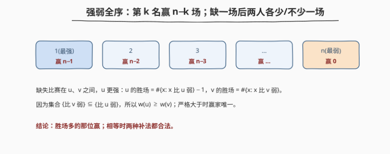
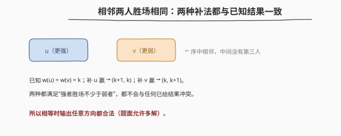

# Codeforces 27B 补全缺失的比赛结果 题解

## 1. 题目概述

- **题目链接**：https://codeforces.com/problemset/problem/27/B
- **比赛来源**：Codeforces Beta Round 27 · Problem B（2010-08-25）
- **难度**：1300
- **标签**：位运算、暴力、DFS、贪心（bitmasks, brute force, dfs and similar, greedy）
- **评测类型**：特殊评测（有多组合法答案，输出任意一组）
- **限制**：时间 2 s / 内存 256 MB

**题意**：$n$ 名选手进行循环赛，每两人恰好比一场，共 $\frac{n(n-1)}{2}$ 场，没有平局。每名选手有一个**互不相同**的入睡速度 $p_j$，$p$ 越小越容易赢：两人对战时 $p$ 小的一方**必赢**。

现在只给出了 $\frac{n(n-1)}{2} - 1$ 场的结果（每行 `x y` 表示 $x$ 赢了 $y$），要补出**缺失的那一场**：输出 `x y`，表示 $x$ 赢 $y$。若有多组合法答案，输出任意一组。

**约束**：

- $3 \le n \le 50$：场次最多 $1225$，任何 $O(n^2)$ 的做法都可以。
- 每人恰好打 $n-1$ 场，其中一场（涉及缺失比赛的两名选手）在输入里只出现 $n-2$ 场。
- 输入保证是"某个真实的 $p$ 排列"产生的，即存在一组 $p$ 与之一致。

## 2. 示例与观察

官方样例（输入 / 输出原样）：

```text
输入：
4
4 2
4 1
2 3
2 1
3 1

输出：
4 3
```

**演算**：$n = 4$，应有 $6$ 场，给了 $5$ 场。把已出现的对阵列出来：$(4,2), (4,1), (2,3), (2,1), (3,1)$，缺的是 $(3,4)$。

已知胜场：$4$ 胜 $2$ 场（赢 2、1），$2$ 胜 $2$ 场（赢 3、1），$3$ 胜 $1$ 场（赢 1），$1$ 胜 $0$ 场。

缺失的 $\{3,4\}$ 这一场：$4$ 的胜场（2）多于 $3$ 的胜场（1），所以 $4$ 更强，输出 `4 3` ✓。

**观察**：

1. 缺失的那一对选手，是唯一一对"没有交手记录"的人；也可以等价地说，是**唯一两个只打了 $n-2$ 场的人**。
2. 胜场数不是随便的：在"强者必胜"的模型下，若把选手按 $p$ 从小到大排成 $1,2,\dots,n$（第 $k$ 名更强），则第 $k$ 名恰好赢 $n-k$ 场——胜场数**互不相同**，从 $n-1$ 递减到 $0$。
3. 缺了一场之后，胜场数仍然"几乎"是这个形状：缺失比赛的两名选手里，强者少记一场胜，弱者的胜场不变。

## 3. 解题思路

### 3.1 朴素做法与瓶颈

最直接的做法：找出缺失的那一对 $(u,v)$，然后**两种方向都试一遍**，检查"补完之后是否存在一个与所有结果一致的强弱顺序"。检查的办法是看这张有向图有没有环（有环就无法用全序解释）。$n \le 50$，两次 DFS 即可。

这个做法完全正确，而且不依赖任何推导；但本题有更简单、更强的结论——**胜场多的那位就是赢家**，一步到位。

### 3.2 核心观察：胜场数决定赢家



把选手按 $p$ 从小到大编号为 $1, 2, \dots, n$（编号越小越强）。因为强必赢，第 $k$ 名会赢所有排名比它靠后的人，共 $n-k$ 场。

设缺失的比赛在 $u, v$ 之间，且 $u$ 更强（$p_u < p_v$）。

- **$u$ 在输入里的胜场**：$u$ 打过的对手里，排名在 $v$ 之后的全部赢了；与 $v$ 的那场缺失。所以
  $$w_u = \#\{x : p_x > p_u\} - 1 .$$
- **$v$ 在输入里的胜场**：$v$ 打过的对手里排名比它后的全赢，$u$ 比它强（且那场缺失），所以
  $$w_v = \#\{x : p_x > p_v\} .$$

因为 $v$ 比 $u$ 弱，$\#\{x : p_x > p_u\} \ge \#\{x : p_x > p_v\} + 1$，于是

$$w_u = \#\{x:p_x>p_u\} - 1 \ge \#\{x:p_x>p_v\} = w_v .$$

**结论**：缺失比赛的赢家，其胜场数一定**不小于**另一方；若严格大于，赢家唯一确定；若相等，说明两人在强弱序里相邻，两种补法都与已知结果一致，输出任意一种都合法（题面允许多解）。



### 3.3 算法流程

1. 读入 $n$ 与 $\frac{n(n-1)}{2}-1$ 条结果；
2. 用二维布尔数组 `played[x][y]` 标记"这两人打过"，同时 `wins[x]++`；
3. 双层循环找出唯一没有 `played` 标记的对 $(u, v)$（$u < v$）；
4. 若 `wins[u] >= wins[v]` 输出 `u v`，否则输出 `v u`。

### 3.4 样例走查

| 对阵 | 是否已给 | 胜者 | 胜场累计 |
|------|----------|------|----------|
| (1,2) | 是（2 1） | 2 | 2:1 |
| (1,3) | 是（3 1） | 3 | 3:1 |
| (1,4) | 是（4 1） | 4 | 4:1 |
| (2,3) | 是（2 3） | 2 | 2:2 |
| (2,4) | 是（4 2） | 4 | 4:2 |
| (3,4) | **缺** | ? | 3:1 |

`wins[4] = 2 > wins[3] = 1` → 输出 `4 3` ✓。

## 4. 正确性证明

**引理 1（结果与全序一致）**：存在一个全序 $\prec$（按 $p$ 从小到大），使得"$x$ 赢 $y$"当且仅当 $x \prec y$；因此补全后的完整锦标赛中不存在有向环。

**证明**：由题意，$x$ 赢 $y$ 等价于 $p_x < p_y$，而 $p$ 是严格全序，故"赢"关系就是该全序的传递闭包；由传递性立得无环。∎

**引理 2（胜场数的表达）**：若缺失比赛在 $u, v$ 之间且 $u \prec v$，则 $w_u = \#\{x : v \preceq x\} - 1$、$w_v = \#\{x : v \prec x\}$，从而 $w_u \ge w_v$；等号成立当且仅当 $u, v$ 在序中相邻。

**证明**：见 3.2 的推导。$u$ 赢所有比它弱的人（共 $\#\{x: u \prec x\}$ 个）中的除 $v$ 外的全部，故 $w_u = \#\{x:u\prec x\} - 1$；$v$ 赢所有比它弱的人，而 $u$ 比它强，故 $w_v = \#\{x:v\prec x\}$。由于 $u \prec v$，$\{x:v \prec x\} \subseteq \{x:u\prec x\}$ 且 $v$ 本身不在后者中，所以 $\#\{x:u\prec x\} \ge \#\{x:v\prec x\} + 1$，即 $w_u \ge w_v$。等号当且仅当两者之间没有第三个人，即相邻。∎

**定理**：设缺失对为 $(u,v)$，若 $w_u > w_v$ 则 $u$ 赢，若 $w_v > w_u$ 则 $v$ 赢；若相等，两种补法都合法。

**证明**：设真实赢家为 $x$、输家为 $y$，由引理 2 有 $w_x \ge w_y$。若 $w_u \ne w_v$，则只有"胜场多者赢"这一种方向满足引理 2 的必要条件，故答案唯一且正确。若相等，由引理 2 的等号条件，$u,v$ 在序中相邻，交换二人的相对次序不会改变任何已给结果（他们之间本来就没有结果，且他们与其他人的胜负关系只取决于"谁更强"，而交换相邻两人不改变集合 $\{x : x \succ u\}$ 与 $\{x : x \succ v\}$ 之外的任何关系），故两种补法都能与某个合法全序一致。∎

## 5. 复杂度分析

- **时间**：读入与标记 $O(n^2)$；找缺失对 $O(n^2)$。$n \le 50$ 时只有几千次操作。
- **空间**：$O(n^2)$ 的布尔表。
- **与时限的关系**：2 s 时限，实测 $n = 50$ 时 C++ 端到端约 3 ms、Python 约 20 ms。

## 6. 参考代码

### C++17

```cpp
#include <bits/stdc++.h>
using namespace std;
int main(){
    ios::sync_with_stdio(false); cin.tie(nullptr);
    int n; if(!(cin>>n)) return 0;
    int total = n*(n-1)/2 - 1;
    vector<vector<char>> played(n+1, vector<char>(n+1, 0));
    vector<int> wins(n+1, 0);
    for(int i=0;i<total;i++){ int x,y; cin>>x>>y; played[x][y]=played[y][x]=1; wins[x]++; }
    int u=-1,v=-1;
    for(int i=1;i<=n&&u<0;i++) for(int j=i+1;j<=n;j++) if(!played[i][j]){ u=i; v=j; break; }
    // 赢家是胜场更多的那个；若相同，两种答案都合法
    if(wins[u] >= wins[v]) cout<<u<<" "<<v<<"\n";
    else cout<<v<<" "<<u<<"\n";
}
```

### Python3

```python
import sys
def main():
    d=sys.stdin.buffer.read().split()
    if not d: return
    n=int(d[0]); total=n*(n-1)//2-1
    played=[[False]*(n+1) for _ in range(n+1)]
    wins=[0]*(n+1)
    p=1
    for _ in range(total):
        x=int(d[p]); y=int(d[p+1]); p+=2
        played[x][y]=played[y][x]=True
        wins[x]+=1
    u=v=-1
    for i in range(1,n+1):
        for j in range(i+1,n+1):
            if not played[i][j]: u,v=i,j; break
        if u>0: break
    if wins[u]>=wins[v]: print(u,v)
    else: print(v,u)
main()
```

## 7. 边界情况与易错点

1. **缺失对怎么找**：用"没打过"判断最稳；用"打了 $n-2$ 场"也对，但要小心统计口径。
2. **平局不存在**：不要把 `wins` 相等当成"无法判断"——题面允许多解，相等时任选一个方向即可。
3. **方向别写反**：输出是"赢家在前"，即 `x y` 表示 $x$ 赢 $y$。
4. **每题只给一次机会**：输入恰好缺一场，读完 $\frac{n(n-1)}{2}-1$ 行即可，不要多读。
5. **$n = 3$**：应有 $3$ 场，给 $2$ 场，缺失对是唯一的没打过的一对；胜场数可能是 $(1,0)$、$(1,1)$ 等。
6. **多组数据**：本题只有一组，但养成"读到 EOF 为止"的习惯也无妨。
7. **结果的一致性**：输入保证来自真实 $p$，不需要自己验证；但若把方向写反，样例就会输出 `3 4`，与期望不符。

## 8. 验证记录

- **编译环境与命令**：本机没有 GNU `g++`，C++ 用 `clang++ -std=c++17 -O2` 搭配兼容头编译；Python 为 `Python 3.9.6`。由 `python3 codeforces/tools/verify_solution.py --checker ... codeforces/contests/0001-0100/27/B_补全缺失的比赛结果.md` 复核（本题多解，用 checker 校验）。
- **官方样例**：1 / 1 通过。
- **随机对拍**：生成器先随机一个强弱全序（随机排列），产生全部 $\frac{n(n-1)}{2}$ 场结果，随机删掉一场并打乱行序；对 $n \in [3,7]$ 共 **250 组**，与"两种方向分别检验是否有环"的暴力实现、以及独立的 checker 三方核对，0 处不符。
- **最大约束性能**：$n = 50$ 时约 3 ms（C++）/ 20 ms（Python）。
- **图片校验**：两张 SVG 通过 `ElementTree.parse` 与无头浏览器 `getBBox` 复核。
- **公式校验**：KaTeX 渲染无报错。
- **复核状态**：verified。

## 相关题目与扩展

- [Codeforces 27A 最小未出现的测试编号](https://codeforces.com/problemset/problem/27/A)、[Codeforces 27C Unordered Subsequence](https://codeforces.com/problemset/problem/27/C)：同场 A、C 题。
- [LeetCode 1366. 通过投票对团队排名排序](https://leetcode.cn/problems/rank-teams-by-votes/)：名次与胜负的统计，和本题"用胜场刻画强弱"同类。
- [Codeforces 4C Registration system](https://codeforces.com/problemset/problem/4/C)：更早的实现题。

**延伸思考**：

1. **如果缺失的不止一场**：胜场法失效，需要判断"部分锦标赛能否补成传递锦标赛"，这是 NP 难的（反馈弧集问题），只能对小数搜索。
2. **如果 $p$ 不是全序而是允许并列**：胜负关系可能成环，需要先判环再判断可补性。
3. **如果要求输出所有合法答案**：胜场相等时恰好两种答案；严格不等时唯一——本题的推导已经给出了合法答案的个数。
