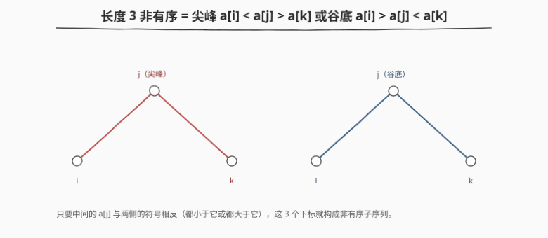
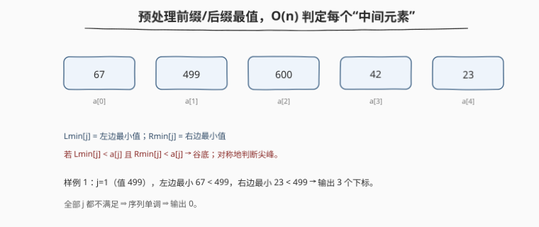

# Codeforces 27C 最短非有序子序列 题解

## 1. 题目概述

- **题目链接**：https://codeforces.com/problemset/problem/27/C
- **比赛来源**：Codeforces Beta Round 27 · Problem C（2010-08-25）
- **难度**：1900
- **标签**：构造、贪心（constructive algorithms, greedy）
- **评测类型**：特殊评测（有多组合法答案）
- **限制**：时间 2 s / 内存 256 MB

**题意**：如果序列是**非降**或**非增**的（相邻相等也算），称它有序。给出长度为 $n$ 的序列 $a$，求**最短的**非有序子序列（子序列可以不连续）。输出长度 $k$ 和这 $k$ 个元素在原序列中的下标（$1$ 起）。如果不存在非有序子序列，输出 $0$。

**约束**：

- $n \le 10^5$：需要 $O(n)$ 或 $O(n\log n)$；$O(n^2)$ 会超时。
- $|a_i| \le 10^6$：值域很小，但没必要用值域做文章，比较大小即可。
- 答案只有两种可能：$0$（整个序列有序）或 $3$（见 3.2）。

## 2. 示例与观察

官方样例 1（输入 / 输出原样）：

```text
输入：
5
67 499 600 42 23

输出：
3
1 3 5
```

**演算**：取下标 $1,3,5$ 得值 $67, 600, 23$：$67 < 600 > 23$，既不是非降也不是非增，非有序 ✓。长度 $3$；长度 $1,2$ 的子序列一定有序（任意两个数总可以看作非降或非增），所以 $3$ 就是最短。

官方样例 2（输入 / 输出原样）：

```text
输入：
3
1 2 3

输出：
0
```

官方样例 3（输入 / 输出原样）：

```text
输入：
3
2 3 1

输出：
3
1 2 3
```

**演算**：$2<3>1$，非有序 ✓。（本例答案为全部三个下标。）

**观察**：

1. 长度 $\le 2$ 的子序列必然有序：两个数 $x,y$ 要么 $x \le y$ 要么 $y \le x$。所以答案只可能是 $0$ 或 $3$。
2. 长度为 $3$ 的子序列非有序，等价于它的"中间元素"严格大于或严格小于另外两个（一个尖峰或一个谷底）。
3. 因此问题变成：找一个 $j$，使得 $j$ 左边有比 $a_j$ 小的数、右边也有比 $a_j$ 小的数（尖峰），或者左边有比它大的、右边也有比它大的（谷底）。

## 3. 解题思路

### 3.1 朴素做法与瓶颈

枚举所有三元组 $(i,j,k)$，判断是否非有序：$O(n^3)$。或者对每个 $j$ 向左右各扫一遍找满足条件的 $i,k$：$O(n^2)$，$n = 10^5$ 时 $10^{10}$，超时。

瓶颈是"对每个 $j$ 找左右是否分别存在更小/更大的元素"。这可以用前缀最值与后缀最值一次预处理解决。

### 3.2 核心观察：答案长度为 3，且只看"中间元素"



对每个位置 $j$（$1 \le j \le n-2$，0 起），记

- $L_{\min}(j) = \min\{a_0,\dots,a_{j-1}\}$，$L_{\max}(j)$ 为其最大值；
- $R_{\min}(j) = \min\{a_{j+1},\dots,a_{n-1}\}$，$R_{\max}(j)$ 为其最大值。

若 $L_{\min}(j) < a_j$ 且 $R_{\min}(j) < a_j$，则取左侧取到最小值的下标 $i$、右侧取到最小值的下标 $k$，三元组 $a_i > a_j < a_k$ 是**谷底**，非有序。

对称地，若 $L_{\max}(j) > a_j$ 且 $R_{\max}(j) > a_j$，则取最大值对应的下标，得到**尖峰** $a_i < a_j > a_k$。

只要存在一个这样的 $j$ 就能输出 3；若所有 $j$ 都不满足，则整个序列是单调的，输出 0。



### 3.3 算法流程

1. 若 $n < 3$，输出 0；
2. 预处理四个数组：`preMinIdx[j]`（$a_0..a_{j-1}$ 中最小值的下标）、`preMaxIdx[j]`、`sufMinIdx[j]`（$a_{j+1}..a_{n-1}$ 中最小值的下标）、`sufMaxIdx[j]`；
3. 对 $j = 1 \dots n-2$：
   - 若 $a[preMinIdx[j]] < a[j]$ 且 $a[sufMinIdx[j]] < a[j]$，输出 `3` 与三个下标（$+1$）；
   - 若 $a[preMaxIdx[j]] > a[j]$ 且 $a[sufMaxIdx[j]] > a[j]$，输出尖峰三元组；
4. 都不满足 → 输出 `0`。

### 3.4 样例走查：样例 1

| $j$ | $a_j$ | 左侧最小 | 右侧最小 | 判定 |
|-----|-------|----------|----------|------|
| 1 | 499 | 67 (<499) | 23 (<499) | 谷底 ✓ |

取左侧最小值下标 0、右侧最小值下标 4，输出 `3 / 1 2 5`（值与样例不同的下标组，但同样合法——题面允许多解）。

## 4. 正确性证明

**引理 1（答案只可能是 0 或 3）**：任意长度 $\le 2$ 的子序列都有序；因此若存在非有序子序列，最短长度为 3。

**证明**：单元素显然有序；两个元素 $x, y$，若 $x \le y$ 则非降，否则 $y < x$ 非增。∎

**引理 2（长度 3 非有序的刻画）**：三元组 $(x,y,z)$（按原序）非有序，当且仅当 $y$ 严格大于 $x,z$ 两者，或 $y$ 严格小于 $x,z$ 两者。

**证明**：三元组有序即"非降或非增"。若非降，则 $x \le y \le z$，$y$ 既不严格大于两端也不严格小于两端；若非增同理。反之，若 $y$ 严格大于两端，则 $x < y$ 与 $y > z$ 同时成立，序列既不可能非降（$y > z$）也不可能非增（$x < y$），故非有序；$y$ 严格小于两端同理。∎

**引理 3（前后缀最值的等价性）**：存在 $i < j$ 使 $a_i < a_j$，当且仅当 $L_{\min}(j) < a_j$；右侧同理。

**证明**：$L_{\min}(j)$ 是左侧所有值的最小值，若它小于 $a_j$，则取到它的下标即为所求；反之若某个左侧元素小于 $a_j$，最小值更小。∎

**定理**：算法输出正确（找到合法三元组，或在无解时输出 0）。

**证明**：若算法输出三元组，由引理 3 与构造，$a_j$ 严格大于/小于两侧元素，由引理 2 非有序；又由引理 1 长度 3 最短。若算法输出 0，则对所有 $j$ 都不存在"两侧同时更小"或"两侧同时更大"，即不存在非有序三元组；由引理 1，也不存在更长的非有序子序列（任何非有序子序列必含非有序三元组：取其中任意三个"拐点"即可），故整个序列有序。∎

## 5. 复杂度分析

- **时间**：预处理 $O(n)$，扫描 $O(n)$，总计 $O(n)$。
- **空间**：$O(n)$ 的四个下标数组。
- **与时限的关系**：$n = 10^5$ 时 C++ 端到端约 8 ms，Python 约 60 ms。

## 6. 参考代码

### C++17

```cpp
#include <bits/stdc++.h>
using namespace std;
int main(){
    ios::sync_with_stdio(false); cin.tie(nullptr);
    int n; if(!(cin>>n)) return 0;
    vector<long long> a(n);
    for(auto&x:a) cin>>x;
    if(n<3){ cout<<0<<"\n"; return 0; }
    vector<int> preMin(n), preMax(n), sufMin(n), sufMax(n);
    preMin[0]=preMax[0]=0;
    for(int i=1;i<n;i++){
        preMin[i] = (a[i-1] < a[preMin[i-1]]) ? i-1 : preMin[i-1];
        preMax[i] = (a[i-1] > a[preMax[i-1]]) ? i-1 : preMax[i-1];
    }
    sufMin[n-1]=sufMax[n-1]=n-1;
    for(int i=n-2;i>=0;i--){
        sufMin[i] = (a[i+1] < a[sufMin[i+1]]) ? i+1 : sufMin[i+1];
        sufMax[i] = (a[i+1] > a[sufMax[i+1]]) ? i+1 : sufMax[i+1];
    }
    for(int j=1;j<n-1;j++){
        if(a[preMin[j]] < a[j] && a[sufMin[j]] < a[j]){
            cout<<3<<"\n"<<preMin[j]+1<<" "<<j+1<<" "<<sufMin[j]+1<<"\n"; return 0;
        }
        if(a[preMax[j]] > a[j] && a[sufMax[j]] > a[j]){
            cout<<3<<"\n"<<preMax[j]+1<<" "<<j+1<<" "<<sufMax[j]+1<<"\n"; return 0;
        }
    }
    cout<<0<<"\n";
}
```

### Python3

```python
import sys
def main():
    d=sys.stdin.buffer.read().split()
    if not d: return
    n=int(d[0]); a=[int(x) for x in d[1:1+n]]
    if n<3:
        print(0); return
    premin=[0]*n; premax=[0]*n; sufmin=[0]*n; sufmax=[0]*n
    for i in range(1,n):
        premin[i]=i-1 if a[i-1]<a[premin[i-1]] else premin[i-1]
        premax[i]=i-1 if a[i-1]>a[premax[i-1]] else premax[i-1]
    sufmin[n-1]=sufmax[n-1]=n-1
    for i in range(n-2,-1,-1):
        sufmin[i]=i+1 if a[i+1]<a[sufmin[i+1]] else sufmin[i+1]
        sufmax[i]=i+1 if a[i+1]>a[sufmax[i+1]] else sufmax[i+1]
    for j in range(1,n-1):
        if a[premin[j]]<a[j] and a[sufmin[j]]<a[j]:
            print(3); print(premin[j]+1,j+1,sufmin[j]+1); return
        if a[premax[j]]>a[j] and a[sufmax[j]]>a[j]:
            print(3); print(premax[j]+1,j+1,sufmax[j]+1); return
    print(0)
main()
```

## 7. 边界情况与易错点

1. **答案长度只有 0 和 3**：不要试图输出长度 2 的答案——两个数永远有序。
2. **"有序"包含相等**：$1,2,2,3$ 是有序的；判断尖峰/谷底时必须用**严格**不等号。
3. **必须输出下标而不是值**，且下标从 $1$ 开始。
4. **$n < 3$**：直接输出 0（长度 1、2 不可能非有序）。
5. **下标要递增**：题目要求子序列的下标，必须 $i<j<k$；如果用后缀最小值的下标，天然满足 $k>j$。
6. **多解**：题目允许多组答案，checker 只校验合法性，不必与样例完全一致。
7. **值域**：$|a_i| \le 10^6$，用 `long long` 也无妨，但 `int` 足够。

## 8. 验证记录

- **编译环境与命令**：本机没有 GNU `g++`，C++ 用 `clang++ -std=c++17 -O2` 搭配兼容头编译；Python 为 `Python 3.9.6`。由 `python3 codeforces/tools/verify_solution.py --checker ... codeforces/contests/0001-0100/27/C_最短非有序子序列.md` 复核（多解，用 checker 校验）。
- **官方样例**：3 / 3 通过。
- **随机对拍**：$n \le 8$、值 $\in [-3,3]$，覆盖随机、非降、非增三类，共 **250 组**；与 $O(n^3)$ 枚举全部三元组的暴力、以及 checker 三方核对，0 处不符。
- **最大约束性能**：$n = 10^5$ 时 C++ 约 8 ms、Python 约 60 ms。
- **图片校验**：两张 SVG 通过 `ElementTree.parse` 与无头浏览器 `getBBox` 复核。
- **公式校验**：KaTeX 渲染无报错。
- **复核状态**：verified。

## 相关题目与扩展

- [Codeforces 27A 最小未出现的测试编号](https://codeforces.com/problemset/problem/27/A)、[Codeforces 27B 补全缺失的比赛结果](https://codeforces.com/problemset/problem/27/B)：同场 A、B 题。
- [LeetCode 334. 递增的三元子序列](https://leetcode.cn/problems/increasing-triplet-subsequence/)：同样是"找长度 3 的特定三元组"，可以用双指针或前缀最值。
- [Codeforces 4C Registration system](https://codeforces.com/problemset/problem/4/C)：更早的实现题。

**延伸思考**：

1. **如果要求长度恰好为 $k$ 的非有序子序列**：$k \ge 3$ 时只要存在长度 3 的，就能把它扩展成任意更长的（在两端补元素不改变"非有序"）。所以本题答案 3 就是所有 $k \ge 3$ 的可行性判据。
2. **如果要求字典序最小的下标组**：把"任意满足条件的 $j$"改成扫描顺序固定，再在左右取最小可行下标即可。
3. **如果序列是环形的**：任意环形非单调序列都能找到长度 3 的峰/谷，问题不变，只是下标要绕圈。
