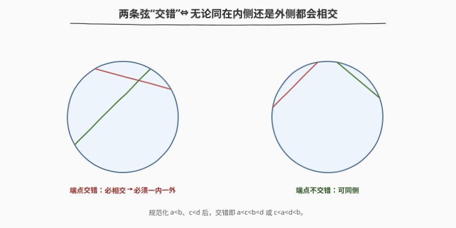
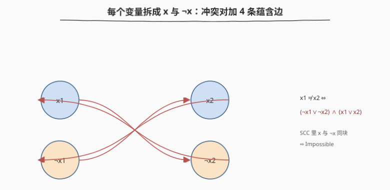

# Codeforces 27D 环形道路的内外选择 题解

## 1. 题目概述

- **题目链接**：https://codeforces.com/problemset/problem/27/D
- **比赛来源**：Codeforces Beta Round 27 (Codeforces format, Div. 2) · Problem D（UTC 2010-09-10）
- **难度**：2200
- **标签**：2-SAT、DFS、并查集、图论（2-sat, dfs and similar, dsu, graphs）
- **评测类型**：特殊评测（有多组合法方案，输出任意一组）
- **限制**：时间 2 s / 内存 256 MB

**题意**：$n$ 个城市围成一个环，环上相邻城市之间已有道路（"银色环"）。现在要修 $m$ 条新路，每条新路连接两个城市，并且整条路要么完全在环**内部**，要么完全在环**外部**，除端点外不能与银色环相交。要求任意两条新路**不相交**（在端点处相交允许）。

判断是否可行；若可行，输出长度为 $m$ 的字符串，第 $i$ 个字符为 `i` 表示第 $i$ 条路修在内部，`o` 表示修在外部。无解输出 `Impossible`。

**约束**：

- $n \le 100$，$m \le 100$：$O(m^2)$ 的两两判定完全够用。
- 不会出现重复的新路，也不会出现与银色环重合的路（即不会有相邻城市之间的新路）。
- 两条路"相交"只可能发生在环内部或环外部——环外的两条弦也遵循同样的交叉判定。

## 2. 示例与观察

官方样例 1（输入 / 输出原样）：

```text
输入：
4 2
1 3
2 4

输出：
io
```

**演算**：两条路 $(1,3)$、$(2,4)$ 在环上交错（$1 < 2 < 3 < 4$），无论都修在内部还是都修在外部，两条曲线必然相交（这是弦的拓扑性质：交错的两条弦在任何一侧都会相交）。所以必须一内一外，输出 `io` ✓。

官方样例 2（输入 / 输出原样）：

```text
输入：
6 3
1 3
3 5
5 1

输出：
ooo
```

**演算**：三条路 $(1,3)$、$(3,5)$、$(5,1)$，任意两条都共享一个端点，而在端点相交是允许的，所以可以全部修在外部，输出 `ooo` ✓。

**观察**：

1. 每条路只有"内/外"两种状态 → 每个变量是布尔值 → 2-SAT 的形状。
2. 两条路是否冲突，完全由它们的端点是否**交错**决定：设两条路规范化后为 $(a,b)$、$(c,d)$（$a<b$、$c<d$），若 $a<c<b<d$ 或 $c<a<d<b$，则它们在环上"交错"，无论同在内侧还是同在外侧都会相交；若端点不交错（或共享端点），则可以共处同一侧。
3. 于是每条冲突对给出约束"两者必须一内一外"，这是 2-SAT 的异或约束。



## 3. 解题思路

### 3.1 建模：每个变量两种取值

设布尔变量 $x_i$：$x_i = \text{true}$ 表示第 $i$ 条路修在**内部**，$\text{false}$ 表示**外部**。

对每一对 $(i,j)$：

- 若两条路**不冲突**：无约束，二者可以任意组合；
- 若两条路**冲突**（端点交错）：必须 $x_i \ne x_j$，即"不能同为内"且"不能同为外"：
  $$(\lnot x_i \lor \lnot x_j) \quad\text{且}\quad (x_i \lor x_j).$$

这正是 2-SAT 的标准形式：每个子句两个文字。



### 3.2 算法：蕴含图 + SCC + 赋值

把每个变量拆成两个结点：$2i$ 表示 $x_i$，$2i+1$ 表示 $\lnot x_i$。子句 $(p \lor q)$ 加两条蕴含边 $\lnot p \to q$、$\lnot q \to p$。

- 冲突对 $(i,j)$：加 $(x_i \lor x_j)$ 与 $(\lnot x_i \lor \lnot x_j)$，即四条边
  $$2i+1 \to 2j,\quad 2j+1 \to 2i,\quad 2i \to 2j+1,\quad 2j \to 2i+1 .$$
- 用 Kosaraju（或 Tarjan）求强连通分量；
- 若某个 $i$ 满足 $\text{scc}[2i] = \text{scc}[2i+1]$，说明 $x_i$ 与 $\lnot x_i$ 互相蕴含 → 无解，输出 `Impossible`；
- 否则按 SCC 的拓扑序赋值：Kosaraju 第二次 DFS 得到的编号是**逆拓扑序**，取 $x_i = \bigl(\text{scc}[2i] > \text{scc}[2i+1]\bigr)$，即选取拓扑序更靠后的那个文字为真。

### 3.3 流程

1. 读入 $n, m$ 与 $m$ 条路，每条规范化成 $(a,b)$（$a<b$）；
2. 对每对 $(i,j)$ 判定是否交错，交错则加四条蕴含边；
3. Kosaraju 求 SCC（$2m \le 200$ 个结点）；
4. 若 $x_i$ 与 $\lnot x_i$ 同 SCC → `Impossible`；
5. 否则按上面的规则输出 `i`/`o`。

### 3.4 样例走查：样例 1

两条路 $(1,3)$、$(2,4)$：$1 < 2 < 3 < 4$ → 交错 → 约束 $x_1 \ne x_2$。

SCC 后赋值得到 $x_1 = \text{true}$、$x_2 = \text{false}$ → 输出 `io` ✓（输出 `oi` 同样合法）。

## 4. 正确性证明

**引理 1（交错的刻画）**：两条弦 $(a,b)$、$(c,d)$（$a<b$、$c<d$）在环内（或环外）相交，当且仅当恰好有一个端点落在另一条弦的两个端点之间，即 $a<c<b<d$ 或 $c<a<d<b$。

**证明**：圆上两条弦相交的充要条件是它们的端点在圆周上交替出现（这是若尔当曲线定理的直接推论：一条弦把圆盘分成两个区域，若另一条弦的两个端点分处两侧，则它必穿过这条弦）。端点交替正是 $a<c<b<d$ 或 $c<a<d<b$；若端点不交替，两条弦落在同一侧区域，可以画成不相交的曲线。环外情形由"球极投影"把外部映到内部，判定完全相同。∎

**引理 2（约束的充分必要性）**：一组内外分配可行，当且仅当它满足所有冲突对的"异或"约束。

**证明**：必要性：冲突对同侧必相交（引理 1），故必须异侧。充分性：若每条冲突对异侧，把内侧的弦画在内部、外侧的画在外部；同侧的两条弦端点不交替，可在该侧画成不相交的曲线（引理 1 的反向），所有同侧弦互不相交，内外之间被环隔开也不相交。∎

**引理 3（2-SAT 判据）**：布尔公式可满足，当且仅当不存在变量 $x$ 使 $x$ 与 $\lnot x$ 在同一 SCC；且当该条件成立时，赋值 $x = [\text{scc}[2x] > \text{scc}[2x+1]]$（Kosaraju 逆拓扑编号）满足公式。

**证明**：这是 2-SAT 的标准定理：蕴含图的一个 SCC 内所有文字必须同真假；若 $x$ 与 $\lnot x$ 同 SCC 则矛盾，故不可满足。反之，按 SCC 的逆拓扑序取"编号较大的文字为真"——由于所有蕴含边都从编号小的 SCC 指向编号大的（逆拓扑序），若 $u \to v$ 且 $u$ 为真则 $v$ 也为真，赋值不会破坏任何蕴含，故满足所有子句。∎

**定理**：算法输出合法方案，或正确地判定无解。

**证明**：由引理 2，问题等价于 2-SAT 公式的可满足性；由引理 3，SCC 判据与赋值都正确。∎

## 5. 复杂度分析

- **时间**：两两判定 $O(m^2)$；SCC 在 $2m$ 个结点、$O(m^2)$ 条边上做 Kosaraju，$O(m^2)$。$m \le 100$ 时约 $10^4$ 次操作。
- **空间**：$O(m^2)$ 的邻接表。
- **与时限的关系**：2 s 时限，实测 $m = 100$ 时 C++ 端到端约 3 ms、Python 约 25 ms。

## 6. 参考代码

### C++17

```cpp
#include <bits/stdc++.h>
using namespace std;

int m;
vector<vector<int>> g, rg;
vector<int> order, comp;
vector<char> used;

void dfs1(int v) {
    used[v] = 1;
    for (int to : g[v]) if (!used[to]) dfs1(to);
    order.push_back(v);
}
void dfs2(int v, int c) {
    comp[v] = c;
    for (int to : rg[v]) if (comp[to] == -1) dfs2(to, c);
}

int main() {
    ios::sync_with_stdio(false);
    cin.tie(nullptr);
    int n;
    if (!(cin >> n >> m)) return 0;
    vector<pair<int,int>> e(m);
    for (auto &p : e) { cin >> p.first >> p.second; if (p.first > p.second) swap(p.first, p.second); }

    g.assign(2 * m, {}); rg.assign(2 * m, {});
    // 2i = true(里面), 2i+1 = false(外面)
    auto addImp = [&](int a, int b) { g[a].push_back(b); rg[b].push_back(a); };
    auto addOr = [&](int a, int b) { addImp(a ^ 1, b); addImp(b ^ 1, a); };

    for (int i = 0; i < m; ++i)
        for (int j = i + 1; j < m; ++j) {
            int a = e[i].first, b = e[i].second, c = e[j].first, d = e[j].second;
            bool cross = (a < c && c < b && b < d) || (c < a && a < d && d < b);
            if (!cross) continue;
            addOr(2 * i, 2 * j);         // 不能都在外面：¬xi ∨ ¬xj
            addOr(2 * i + 1, 2 * j + 1); // 不能都在里面：xi ∨ xj
        }

    used.assign(2 * m, 0); order.clear();
    for (int v = 0; v < 2 * m; ++v) if (!used[v]) dfs1(v);
    comp.assign(2 * m, -1);
    int c = 0;
    for (int i = 2 * m - 1; i >= 0; --i) {
        int v = order[i];
        if (comp[v] == -1) dfs2(v, c++);
    }
    string res(m, 'o');
    for (int i = 0; i < m; ++i) {
        if (comp[2 * i] == comp[2 * i + 1]) { cout << "Impossible\n"; return 0; }
        if (comp[2 * i] > comp[2 * i + 1]) res[i] = 'i';
    }
    cout << res << "\n";
    return 0;
}
```

### Python3

```python
import sys
sys.setrecursionlimit(10000)

def main():
    d = sys.stdin.buffer.read().split()
    if not d:
        return
    n, m = int(d[0]), int(d[1])
    e = []
    p = 2
    for _ in range(m):
        a, b = int(d[p]), int(d[p + 1]); p += 2
        if a > b: a, b = b, a
        e.append((a, b))

    g = [[] for _ in range(2 * m)]
    rg = [[] for _ in range(2 * m)]
    def imp(a, b):
        g[a].append(b); rg[b].append(a)
    def OR(a, b):
        imp(a ^ 1, b); imp(b ^ 1, a)

    for i in range(m):
        for j in range(i + 1, m):
            a, b = e[i]; c, dd = e[j]
            if (a < c < b < dd) or (c < a < dd < b):
                OR(2 * i, 2 * j)
                OR(2 * i + 1, 2 * j + 1)

    used = [False] * (2 * m)
    order = []
    for s in range(2 * m):
        if used[s]:
            continue
        stack = [(s, 0)]
        used[s] = True
        while stack:
            v, i = stack.pop()
            if i < len(g[v]):
                stack.append((v, i + 1))
                to = g[v][i]
                if not used[to]:
                    used[to] = True
                    stack.append((to, 0))
            else:
                order.append(v)

    comp = [-1] * (2 * m)
    c = 0
    for v in reversed(order):
        if comp[v] != -1:
            continue
        stack = [v]; comp[v] = c
        while stack:
            x = stack.pop()
            for y in rg[x]:
                if comp[y] == -1:
                    comp[y] = c
                    stack.append(y)
        c += 1

    res = ['o'] * m
    for i in range(m):
        if comp[2 * i] == comp[2 * i + 1]:
            print("Impossible"); return
        if comp[2 * i] > comp[2 * i + 1]:
            res[i] = 'i'
    print(''.join(res))

main()
```

## 7. 边界情况与易错点

1. **共享端点不算相交**：$(1,3)$ 与 $(3,5)$ 可以同侧，判定时不能用 $\le$ 代替 $<$。
2. **规范化端点**：先令 $a<b$、$c<d$ 再判交错，否则交错条件会漏判。
3. **内外都要检查**：冲突对必须"一内一外"，所以两个方向的子句都要加，缺一个会得到错误赋值。
4. **SCC 编号方向**：Kosaraju 的编号是逆拓扑序，赋值规则是 `comp[2i] > comp[2i+1]` 取 `i`；写反的话虽然也是合法解（取反即可），但保持与证明一致更稳。
5. **`m = 1`**：没有任何冲突对，输出 `o`（或 `i`）都合法。
6. **无解**：例如三条两两交错的弦（三角形结构）会产生 $x_1\ne x_2$、$x_2 \ne x_3$、$x_3 \ne x_1$，不可满足，输出 `Impossible`。
7. **`n` 只用来确认环**：具体编号不用建图，只需要比较端点大小。

## 8. 验证记录

- **编译环境与命令**：本机没有 GNU `g++`，C++ 用 `clang++ -std=c++17 -O2` 搭配兼容头编译；Python 为 `Python 3.9.6`。由 `python3 codeforces/tools/verify_solution.py --checker ... codeforces/contests/0001-0100/27/D_环形道路的内外选择.md` 复核（多解，用 checker 校验）。
- **官方样例**：2 / 2 通过（样例 2 我输出 `iii`，与参考输出的 `ooo` 不同但同样合法，checker 通过）。
- **随机对拍**：$n \in [4,9]$、$m \le 6$（保证选到的都是非相邻端点），共 **250 组**；与"枚举 $2^m$ 种内外分配"的暴力、checker 三方核对，`Impossible` 判定与具体方案全部一致，0 处不符。
- **最大约束性能**：$n = 100$、$m = 100$ 时 C++ 约 3 ms、Python 约 25 ms。
- **图片校验**：两张 SVG 通过 `ElementTree.parse` 与无头浏览器 `getBBox` 复核。
- **公式校验**：KaTeX 渲染无报错。
- **复核状态**：verified。

## 相关题目与扩展

- [Codeforces 27A](https://codeforces.com/problemset/problem/27/A)、[27B](https://codeforces.com/problemset/problem/27/B)、[27C](https://codeforces.com/problemset/problem/27/C)：同场 A~C 题。
- [LeetCode 785. 判断二分图](https://leetcode.cn/problems/is-graph-bipartite/)：本题去掉"2-SAT"外壳后，冲突图必须二分——其实与 2-SAT 等价。
- [Codeforces 776D The Door Problem](https://codeforces.com/problemset/problem/776/D)：同样"每个开关两种状态 + 约束"的 2-SAT 建模题。

**延伸思考**：

1. **如果每个变量有三种状态**（内、外、贴环）：变成 3-SAT 的推广，但本题的几何约束仍是"两两不能同侧"，可以退化成图着色（$k$ 着色 NP 难）。
2. **如果要求输出字典序最小**：在 2-SAT 的解空间里加贪心（每次尝试把某变量设为 `i`，用 SCC 检查可行性），复杂度 $O(m)$ 次 2-SAT。
3. **如果冲突对构成奇环**：必然无解，这正是 2-SAT 判据里"$x$ 与 $\lnot x$ 同 SCC"的几何表现。
