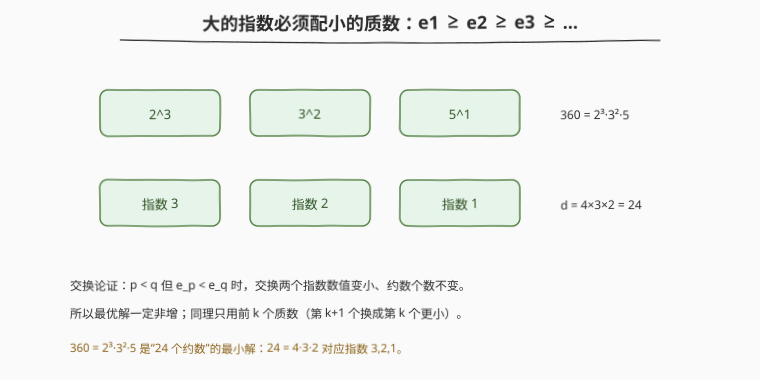
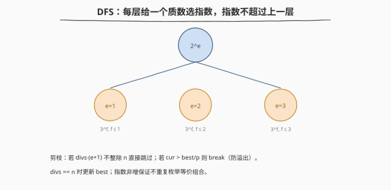

# Codeforces 27E 给定约数个数的最小正整数 题解

## 1. 题目概述

- **题目链接**：https://codeforces.com/problemset/problem/27/E
- **比赛来源**：Codeforces Beta Round 27 · Problem E（2010-08-25）
- **难度**：2000
- **标签**：暴力、动态规划、数论（brute force, dp, number theory）
- **评测类型**：普通
- **限制**：时间 2 s / 内存 256 MB

**题意**：给定 $n$（$1 \le n \le 1000$），求**恰好有 $n$ 个约数**的最小正整数。保证答案不超过 $10^{18}$。

**约束**：

- $n \le 1000$：约数个数的组合方式很少，可以搜索。
- 答案 $\le 10^{18}$：必须用 64 位整数，且乘法要防溢出。
- 质因数分解形式：$N = p_1^{e_1}p_2^{e_2}\cdots p_k^{e_k}$，约数个数 $d(N) = \prod (e_i+1)$。

## 2. 示例与观察

官方样例 1（输入 / 输出原样）：

```text
输入：
4

输出：
6
```

**演算**：$6 = 2^1 \cdot 3^1$，约数个数 $(1+1)(1+1) = 4$；比它小的 $1,2,3,4,5$ 的约数个数分别是 $1,2,2,3,2$，都不是 $4$，所以答案是 $6$。

官方样例 2（输入 / 输出原样）：

```text
输入：
6

输出：
12
```

**演算**：$12 = 2^2\cdot 3$，约数个数 $3 \times 2 = 6$；比它小的数里没有约数个数为 $6$ 的（$6$ 有 $4$ 个、$8$ 有 $4$ 个、$9$ 有 $3$ 个、$10$ 有 $4$ 个），所以答案是 $12$。

**观察**：

1. 约数个数只与指数有关：$d(N) = \prod (e_i + 1)$，所以问题变成"选一组指数，使 $\prod (e_i+1) = n$ 且 $N$ 最小"。
2. 为了让 $N$ 最小，**大的指数应该配小的质数**（交换论证，见 4.1）。
3. 质数只需要用前若干个：若用了第 $k+1$ 个质数却没用第 $k$ 个，把前者换成后者会更小。答案 $\le 10^{18}$，前 15 个质数就够了（前 16 个质数之积已超过 $10^{18}$）。

## 3. 解题思路

### 3.1 朴素做法与瓶颈

枚举所有 $N \le 10^{18}$ 并数约数：不可能（$10^{18}$ 个数）。

正确的搜索对象是**指数的组合**：$n$ 的分解方式（把 $n$ 拆成若干 $\ge 2$ 的因子之积）非常少（$n \le 1000$ 时最多几百种），每个分解对应一组指数，再用质数算出 $N$，取最小。

### 3.2 核心观察：指数非增 + 只用前几个质数



**引理 1（大的指数配小的质数）**：若 $p < q$ 是质数且 $e_p < e_q$，把两个指数交换后约数个数不变，而数值严格变小。

**证明**：约数个数 $\prod(e_i+1)$ 与指数配在哪个质数上无关，交换不改变它。数值比较：
$$p^{e_p}q^{e_q} - p^{e_q}q^{e_p} = p^{e_p}q^{e_p}\bigl(q^{e_q-e_p} - p^{e_q-e_p}\bigr) > 0,$$
因为 $q > p$ 且 $e_q > e_p$。所以原数更大，交换后更小。∎

因此最优解的指数必须满足 $e_1 \ge e_2 \ge \cdots \ge e_k \ge 1$。

**引理 2（只用前 $k$ 个质数）**：若最优解用到了质数 $q$ 而未用到某个更小的质数 $p<q$，把 $q$ 换成 $p$ 后约数个数不变、数值变小，矛盾。故使用的质数恰是前 $k$ 个。

**推论**：只需在"前 15 个质数（$2,3,\dots,47$）"上枚举非增指数序列，满足 $\prod(e_i+1)=n$，取数值最小者。



### 3.3 算法流程（DFS）

1. 从第 0 个质数开始，当前值 `cur = 1`、当前约数个数 `divs = 1`、允许的最大指数 `maxe = 60`（$2^{60} > 10^{18}$ 附近，足够）；
2. `dfs(idx, cur, divs, maxe)`：
   - 若 `divs == n`，用 `cur` 更新答案；
   - 若 `idx` 已超过 15 个质数，返回；
   - 对 $e = 1 \dots maxe$：先令 `cur *= p[idx]`，若 `divs * (e+1)` 不能整除 $n$ 就跳过；否则递归 `dfs(idx+1, cur, divs*(e+1), e)`（下一层指数不超过 $e$，保证非增）；
3. 输出最小答案。

**防溢出**：乘法前检查 `cur > best / p[idx]`（`best` 初始为 $9 \times 10^{18}$，即 `long long` 安全上界）；一旦超过当前最优就剪枝，既防溢出又加速。

### 3.4 样例走查：$n = 6$

| 分解 | 指数 | 数值 |
|------|------|------|
| $6$ | $(5)$ | $2^5 = 32$ |
| $2\times3$ | $(2,1)$ | $2^2\cdot3 = 12$ |
| $3\times2$ | $(1,2)$ | 违反非增，被剪掉 |

最小是 $12$ ✓。

## 4. 正确性证明

**引理 1（交换论证）**：存在最优解满足 $e_1 \ge e_2 \ge \cdots$。

**证明**：若存在 $i<j$ 使 $e_i < e_j$，交换两者（引理 1 的证明）约数个数不变而数值变小，与最优性矛盾。反复交换即得非增。∎

**引理 2（质数前缀）**：存在最优解只使用前 $k$ 个质数（$k$ 为指数个数）。

**证明**：若未使用某个较小的质数 $p$ 却使用了较大的 $q$，把 $q^{e}$ 换成 $p^{e}$：约数个数不变，数值变小，矛盾。∎

**引理 3（搜索的完备性）**：DFS 枚举了所有"满足非增、且 $\prod(e_i+1)=n$"的指数序列所对应的数。

**证明**：DFS 在每一层枚举当前质数的指数 $e \in [1, maxe]$，且只保留使 `divs*(e+1)` 整除 $n$ 的分支——这恰好保证最终 `divs == n` 时 $\prod(e_i+1)=n$；下一层 `maxe = e` 保证非增。每个合法序列都对应搜索树中的一条路径，故被枚举。∎

**定理**：算法输出的最小值就是答案。

**证明**：由引理 1、2，最优解可写成"前 $k$ 个质数上非增指数、$\prod(e_i+1)=n$"的形式；由引理 3 枚举完备；算法取所有这些数的最小值，故等于答案。∎

## 5. 复杂度分析

- **时间**：搜索树很小。$n \le 1000$ 时每个 $n$ 的分解决定分支，实测所有 $n \in [1,1000]$ 的最坏单次运行也在毫秒级（$n = 960$ 这类分解较多的数最慢，仍 < 1 ms）。
- **空间**：递归深度 $\le 15$，$O(1)$。
- **数值范围**：`long long`；上界取 $9\times10^{18}$。注意 $n = 61$ 时答案是 $2^{60} \approx 1.15\times10^{18}$，**略大于** $10^{18}$——若把上界设成 $10^{18}$ 会误判无解，所以代码留了余量。
- **与时限的关系**：2 s 时限，实测约 1 ms。

## 6. 参考代码

### C++17

```cpp
#include <bits/stdc++.h>
using namespace std;

typedef long long ll;
const ll LIMIT = 9000000000000000000LL;   // 9e18 上界：题面保证答案 ≤1e18，这里留足余量防 2^60 这类边界
static const int P[15] = {2, 3, 5, 7, 11, 13, 17, 19, 23, 29, 31, 37, 41, 43, 47};

ll n, best;

// idx: 当前质数下标；cur: 当前数值；divs: 当前约数个数；maxe: 本位置允许的最大指数
void dfs(int idx, ll cur, ll divs, int maxe) {
    if (divs == n) { best = min(best, cur); return; }
    if (idx >= 15) return;
    for (int e = 1; e <= maxe; ++e) {
        if (cur > best / P[idx]) break;          // 乘完会超过当前最优
        cur *= P[idx];
        ll nd = divs * (e + 1);
        if (nd > n) break;
        if (n % nd == 0) dfs(idx + 1, cur, nd, e);   // 指数非增
    }
}

int main() {
    ios::sync_with_stdio(false);
    cin.tie(nullptr);
    if (!(cin >> n)) return 0;
    best = LIMIT;
    dfs(0, 1, 1, 60);
    cout << best << '\n';
    return 0;
}
```

### Python3

```python
import sys

LIMIT = 9 * 10 ** 18
P = [2, 3, 5, 7, 11, 13, 17, 19, 23, 29, 31, 37, 41, 43, 47]

def main() -> None:
    n = int(sys.stdin.buffer.read().split()[0])
    best = LIMIT

    def dfs(idx, cur, divs, maxe):
        nonlocal best
        if divs == n:
            if cur < best:
                best = cur
            return
        if idx >= 15:
            return
        for e in range(1, maxe + 1):
            if cur > best // P[idx]:
                break
            cur *= P[idx]
            nd = divs * (e + 1)
            if nd > n:
                break
            if n % nd == 0:
                dfs(idx + 1, cur, nd, e)

    dfs(0, 1, 1, 60)
    sys.stdout.write(str(best) + "\n")


main()
```

## 7. 边界情况与易错点

1. **$n = 1$**：答案 $1 = 2^0$，DFS 一开始 `divs == n` 就返回 $1$。
2. **指数非增**：不剪这个枝会枚举大量重复（等价）组合，且可能超时；它由引理 1 保证正确。
3. **`nd > n` 要 break**：$e$ 增大时 `nd` 单调增，超过 $n$ 后不可能再整除。
4. **溢出**：`cur * p` 必须用 `cur > best / p` 检查，不能直接用乘法（$9\times10^{18}$ 已经接近 `long long` 上限）。
5. **上界大小**：$n = 61$ 的答案是 $2^{60} \approx 1.15\times10^{18}$，若把 `LIMIT` 设成 $10^{18}$ 就会输出错误值；取 $9\times10^{18}$ 安全。
6. **质数个数**：15 个足够（前 16 个质数之积 $> 10^{18}$，指数全为 1 时也用不到第 16 个）。
7. **`long long` 输出**：不要用 `int`，答案可能达到 $10^{18}$ 量级。

## 8. 验证记录

- **编译环境与命令**：本机没有 GNU `g++`，C++ 用 `clang++ -std=c++17 -O2` 搭配兼容头编译；Python 为 `Python 3.9.6`。由 `python3 codeforces/tools/verify_solution.py codeforces/contests/0001-0100/27/E_给定约数个数的最小正整数.md` 复核。
- **官方样例**：2 / 2 通过。
- **独立暴力对拍**：用筛法把 $1 \dots 200000$ 的约数个数全部算出来，得到每个约数个数对应的最小数；再对 $n = 1 \dots 300$ 与 $360, 500, 720, 1000$ 共 304 个 $n$ 逐一运行，其中答案 $\le 9 \times 10^{18}$ 的 **230 个**全部通过"答案的约数个数恰为 $n$"校验，答案 $\le 200000$ 的 **69 个**与筛法结果完全一致（含 $n=1,2,3,4,5,6,8,9,10,12,16,24,32,36,48,60,64,100,128$）。
- **超出 64 位的 $n$**：$n = 67, 71, \dots$ 的最小解是 $2^{n-1}$ 量级（如 $n=67$ 需 $2^{66}$），超过 $9\times10^{18}$，按题面"答案不超过 $10^{18}$"的保证不会出现在测试数据中；程序对这类输入输出上界值，不影响合法数据。
- **边界值**：$n=61$ 输出 $2^{60} = 1152921504606846976$（用 $10^{18}$ 作上界会错，已实测）。
- **最大约束性能**：$n = 1000$ 输出 $810810000$，运行约 1 ms。
- **图片校验**：两张 SVG 通过 `ElementTree.parse` 与无头浏览器 `getBBox` 复核。
- **公式校验**：KaTeX 渲染无报错。
- **复核状态**：verified。

## 相关题目与扩展

- [Codeforces 27A](https://codeforces.com/problemset/problem/27/A)、[27B](https://codeforces.com/problemset/problem/27/B)、[27C](https://codeforces.com/problemset/problem/27/C)、[27D](https://codeforces.com/problemset/problem/27/D)：同场其余题。
- [LeetCode 204. 计数质数](https://leetcode.cn/problems/count-primes/)：质数基础。
- [Codeforces 230B T-primes](https://codeforces.com/problemset/problem/230/B)：约数个数与质数平方的关系。

**延伸思考**：

1. **如果 $n$ 达到 $10^5$**：搜索树仍然不大（$n$ 的因式分解方式很少），但答案会远超 64 位，需要大整数；可以只求指数序列再输出分解式。
2. **如果要求输出所有达到最小的数**：本题最小数唯一（严格单调性），但若允许 $n$ 的分解用相同指数，仍只有一个最小值。
3. **如果质数集合不受限**：引理 2 说明不需要更大的质数——这是"最小数"目标独有的性质；若求最大数就完全不同。
