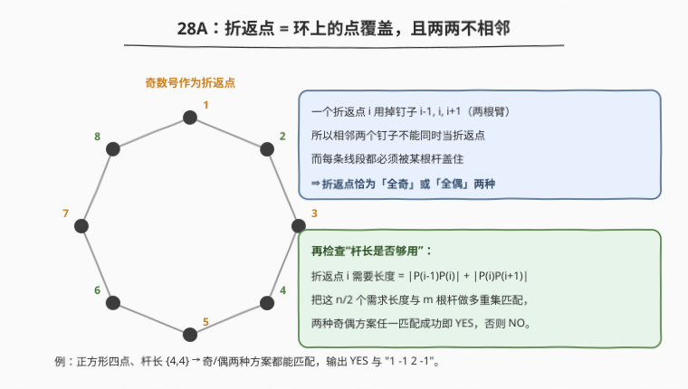
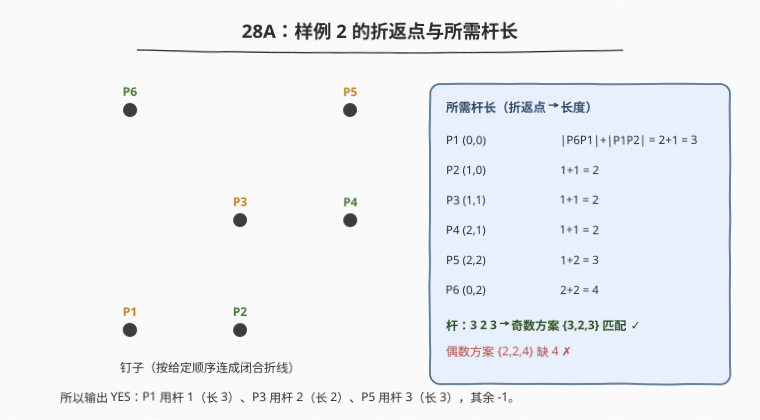

# Codeforces 28A 金属杆折角覆盖 题解

## 1. 题目概述

- **题目链接**：https://codeforces.com/problemset/problem/28/A
- **比赛来源**：Codeforces Beta Round 28 (Codeforces format) · Problem A（UTC 2010-09-17）
- **难度**：1600
- **标签**：实现
- **评测类型**：多解（任意一组合法方案）
- **限制**：时间 2 s / 内存 256 MB

**题意**：有 $n$ 个钉子（$n$ 为偶数）按给定顺序连成一条**闭合折线**，相邻线段与坐标轴平行。有 $m$ 根金属杆，每根可以在任意位置折成 $90^\circ$：折点钉在某个钉子上，两个端点分别接到该钉子相邻的两个钉子上（这样一根杆正好盖住相邻两条线段）。求一种方案，使得折线被完全覆盖；输出每个钉子作为折点所用的杆编号（不用输出 $-1$）。

**约束**：

- $n, m \le 500$，坐标绝对值 $\le 10^4$，杆长 $\le 2 \times 10^5$。
- $n$ 为偶数、且没有三个连续钉子共线 —— 后者保证每个钉子的"两臂"长度和就是两边长之和（不会退化成 180°）。
- 每根杆只能用一次；每个钉子最多被一根杆占用（无论作为折点还是端点）。

## 2. 示例与观察

官方样例 1（输入 / 输出原样）：

```text
输入：
4 2
0 0
0 2
2 2
2 0
4 4

输出：
YES
1 -1 2 -1 
```

四个点是边长 2 的正方形，任一钉子的两臂之和都是 $2+2=4$。两根杆长度都是 4。方案：钉子 1 折、钉子 3 折（各用一根杆），钉子 2、4 输出 $-1$。

官方样例 2（输入 / 输出原样）：

```text
输入：
6 3
0 0
1 0
1 1
2 1
2 2
0 2
3 2 3

输出：
YES
1 -1 2 -1 3 -1 
```

逐点算"两臂之和"：$P_1: 2+1=3$、$P_2: 1+1=2$、$P_3: 1+1=2$、$P_4: 1+1=2$、$P_5: 1+2=3$、$P_6: 2+2=4$。奇数号钉子 $\{P_1,P_3,P_5\}$ 需要 $\{3,2,3\}$，恰好是给出的三根杆；偶数号需要 $\{2,2,4\}$，缺一根 4，不可行。

官方样例 3（输入 / 输出原样）：

```text
输入：
6 3
0 0
1 0
1 1
2 1
2 2
0 2
2 2 3

输出：
NO
```

同样两个方案：奇数号要 $\{3,2,3\}$（只有一根 3）、偶数号要 $\{2,2,4\}$（没有 4），都不行，所以 `NO`。

**观察 1（折点必须覆盖全部线段）**：折线由 $n$ 条线段组成，每根杆只盖住与折点相邻的**两条**线段。要让整条折线被盖住，折点集合必须是这个 $n$ 元环的**点覆盖**。

**观察 2（折点两两不相邻）**：若钉子 $i$ 与 $i+1$ 都作折点，则钉子 $i+1$ 既是某根杆的折点、又是另一根杆的端点，违反"一个钉子只能被一根杆占用"。

**观察 3（只有两种方案）**：$n$ 元环的最小点覆盖大小是 $n/2$（$n$ 为偶数），而不相邻的点覆盖大小最多 $n/2$，两者夹住，所以折点集合只能是「全部奇数号」或「全部偶数号」。于是只需检查这两种方案各自的"需求长度多重集"能否被杆的多重集满足。

## 3. 解题思路

### 3.1 朴素做法与瓶颈

最直接的想法是枚举所有折点集合（$2^n$），逐个检查是否覆盖所有线段、是否两两不相邻、是否能用杆匹配——指数级，$n = 500$ 完全不可行。

### 3.2 核心观察：折点集合只有两种



由观察 1、2、3：合法折点集合恰为奇数号或偶数号（两者选一），大小 $n/2$。因此枚举只有 2 种，检查也只要 $O(n + m)$。

### 3.3 算法流程与匹配

1. 对每个钉子 $i$ 算 `need[i] = |P_{i-1}P_i| + |P_iP_{i+1}|`（下标按环取模）；
2. 对每种奇偶方案：把该方案的 `need` 排序、把杆长排序，双指针做"多重集匹配"——每个需求必须找到一根**长度恰好相等**且未使用的杆；
3. 任一方案成功即输出 `YES` 与对应杆编号（否则把该位置的杆编号留 $-1$），都失败输出 `NO`。



### 3.4 样例走查

样例 2：`need = [3,2,2,2,3,4]`，杆 $=[3,2,3]$。

- 奇数方案（钉子 1、3、5）：需求 $\{3,2,3\}$，与杆的多重集完全一致 → 匹配成功，输出 `1 -1 2 -1 3 -1`。
- 偶数方案（钉子 2、4、6）：需求 $\{2,2,4\}$，杆里没有 4 → 失败。

所以输出 `YES` 与奇数方案，与官方样例一致。样例 3 只把杆换成 $\{2,2,3\}$：奇数方案缺一根 3、偶数方案缺 4，都失败 → `NO`。

## 4. 正确性证明

把钉子看成环 $C_n$ 的顶点（$i$ 与 $i+1$ 相邻，下标模 $n$）。

**引理 1（折点集是点覆盖）**：若方案合法，则每条线段 $(i, i+1)$ 至少有一个端点是折点。

**证明**：折线必须被完全覆盖，而一根杆只能覆盖其折点相邻的两条线段；线段 $(i,i+1)$ 要被覆盖，只能由折点 $i$ 或折点 $i+1$ 的那根杆提供。∎

**引理 2（折点两两不相邻）**：合法方案中不存在相邻的两个折点。

**证明**：设 $i$、$i+1$ 都是折点。折点 $i$ 的杆端点接在 $i+1$ 上，折点 $i+1$ 的杆端点接在 $i$ 上，于是钉子 $i+1$ 同时是一根杆的端点与另一根杆的折点，违反"一个钉子只被一根杆占用"。∎

**引理 3（折点集只能是全奇或全偶）**：合法方案的折点集合等于奇数号全体或偶数号全体。

**证明**：由引理 1，折点集是 $C_n$ 的点覆盖，大小至少 $n/2$；由引理 2，它是独立集，大小至多 $n/2$（环上独立集最大为 $\lfloor n/2 \rfloor$）。故大小恰为 $n/2$。而 $C_n$（$n$ 偶）的大小为 $n/2$ 的独立集只有两个：全奇与全偶（任取相邻两顶点至少一个不在独立集中，$n/2$ 个互不相邻的顶点把环"每隔一个"取满，只能从某一个奇偶类中取）。∎

**引理 4（匹配条件）**：给定折点集合，方案存在当且仅当需求长度多重集 $\{need_i\}$ 能被杆长多重集"按相等值"匹配。

**证明**：每根杆长度必须恰好等于所接折点的两臂之和；杆不能重复使用，钉子也不能重复占用。折点确定后，需求与杆之间就是一次二部图匹配，而"长度必须完全相等"使不同长度之间互不相干，故只需对每个长度 $L$ 检查"需求个数 $\le$ 可用杆数"。∎

**定理**：算法输出 `YES` 当且仅当存在合法方案，且输出方案合法。

**证明**：由引理 3，只有两种候选集合；算法对两种都做了引理 4 的匹配检查，任一成功即构造出合法方案（每个折点配上长度相等的杆、方案两两不相邻、覆盖所有线段）。反之若存在合法方案，其折点集必是这两种之一且匹配可行，算法会成功。∎

## 5. 复杂度分析

- **时间**：$O(n + m \log m)$（两种方案各一次排序与双指针）；$n,m \le 500$ 时不到 $10^4$ 次操作。
- **空间**：$O(n + m)$。
- **与时限的关系**：2 s 时限下实测（含进程启动）约 3 ms，余量数百倍。

## 6. 参考代码

### C++17

```cpp
#include <bits/stdc++.h>
using namespace std;

int main() {
    ios::sync_with_stdio(false);
    cin.tie(nullptr);
    int n, m;
    if (!(cin >> n >> m)) return 0;
    vector<long long> x(n), y(n);
    for (int i = 0; i < n; ++i) cin >> x[i] >> y[i];
    vector<long long> rod(m);
    for (int i = 0; i < m; ++i) cin >> rod[i];

    // 每个钉子作为折返点时，两根臂长之和 = 相邻两段长度之和
    vector<long long> need(n);
    for (int i = 0; i < n; ++i) {
        int pre = (i - 1 + n) % n, nxt = (i + 1) % n;
        need[i] = llabs(x[i] - x[pre]) + llabs(y[i] - y[pre]) +
                  llabs(x[nxt] - x[i]) + llabs(y[nxt] - y[i]);
    }

    auto tryParity = [&](int par, vector<int> &res) -> bool {
        res.assign(n, -1);
        // 需要的长度排序
        vector<pair<long long,int>> want;
        for (int i = par; i < n; i += 2) want.push_back({need[i], i});
        sort(want.begin(), want.end());
        // 可用的金属杆按长度排序
        vector<pair<long long,int>> have;
        for (int j = 0; j < m; ++j) have.push_back({rod[j], j});
        sort(have.begin(), have.end());
        // 双指针匹配（每个钉子要一根长度恰好相等的杆）
        int p = 0;
        vector<int> used(m, 0);
        for (auto &w : want) {
            while (p < m && (have[p].first < w.first || used[have[p].second])) ++p;
            if (p == m || have[p].first != w.first) return false;
            used[have[p].second] = 1;
            res[w.second] = have[p].second + 1;
            ++p;
        }
        return true;
    };

    vector<int> ans;
    if (tryParity(0, ans) || tryParity(1, ans)) {
        cout << "YES\n";
        for (int i = 0; i < n; ++i) cout << ans[i] << (i + 1 == n ? '\n' : ' ');
    } else {
        cout << "NO\n";
    }
    return 0;
}
```

### Python3

```python
import sys


def main() -> None:
    data = sys.stdin.read().split()
    if not data:
        return
    p = 0
    n = int(data[p]); p += 1
    m = int(data[p]); p += 1
    xs = [0] * n
    ys = [0] * n
    for i in range(n):
        xs[i] = int(data[p]); p += 1
        ys[i] = int(data[p]); p += 1
    rod = [int(data[p + j]) for j in range(m)]

    need = [0] * n
    for i in range(n):
        pre = (i - 1) % n
        nxt = (i + 1) % n
        need[i] = (abs(xs[i] - xs[pre]) + abs(ys[i] - ys[pre]) +
                   abs(xs[nxt] - xs[i]) + abs(ys[nxt] - ys[i]))

    def try_parity(par):
        res = [-1] * n
        want = sorted((need[i], i) for i in range(par, n, 2))
        have = sorted((rod[j], j) for j in range(m))
        used = [False] * m
        q = 0
        for length, idx in want:
            while q < m and (have[q][0] < length or used[have[q][1]]):
                q += 1
            if q == m or have[q][0] != length:
                return None
            used[have[q][1]] = True
            res[idx] = have[q][1] + 1
            q += 1
        return res

    ans = try_parity(0)
    if ans is None:
        ans = try_parity(1)
    if ans is None:
        print("NO")
    else:
        print("YES")
        print(' '.join(map(str, ans)))


main()
```

## 7. 边界情况与易错点

1. **$n$ 为偶数**：题面保证，两种奇偶方案大小相同；若 $n$ 为奇数，本题的"点覆盖 = 独立集"论证会变（最小点覆盖 $\lceil n/2 \rceil > \lfloor n/2\rfloor$），不能用。
2. **环取模**：钉子 1 的两个邻居是 $n$ 与 2，钉子 $n$ 的邻居是 $n-1$ 与 1；写成 `(i-1+n)%n`、`(i+1)%n`。
3. **长度用 64 位**：坐标 $10^4$、臂长和 $\le 8 \times 10^4$，`int` 也够，但用 `long long` 更稳。
4. **杆不能重复使用**：匹配时必须记录哪根杆已被占用；只做"计数"而不标记会重复用同一根杆。
5. **多解**：两种方案都可行时输出任意一种；样例的输出只是其中一种，不要照抄。
6. **输出格式**：`-1` 表示该钉子不用；输出长度必须是 $n$ 个数。
7. **"恰好相等"**：杆长必须等于两臂之和，不能"截短"或"拼接"。
8. **没有三个连续共线**：保证两臂垂直、长度和就是两边长之和；若共线会出现 $180^\circ$ 退化的杆，题意不允许。

## 8. 验证记录

- **编译环境与命令**：本机无 GNU `g++`，`verify_solution.py` 用 `clang++ -std=c++17 -O2` 加仓库内兼容头编译；Python 为 3.9.6。
- **官方样例**：3 / 3 通过（`verify_solution.py` 逐字比对 `YES/NO` 与方案编号）。

  ```text
  python3 codeforces/tools/verify_solution.py "codeforces/contests/0001-0100/28/A_金属杆折角覆盖.md"
  CF28A: samples 3
    C++ 编译 OK, 样例 3/3, 最慢 12~22 ms（进程启动开销为主）
    Python 语法 OK, 样例 3/3
  ```

- **暴力对拍（263 组，全部实跑）**：随机生成 $n \in \{4,6,8,10\}$ 的轴平行闭合折线（水平/垂直位移交替、各自和为 0，保证无三点共线），杆长一半构造为"可匹配"、一半完全随机。
  - 独立暴力 `codeforces/tools/brutes/cf28a.py`：枚举**全部** $2^n$ 个折点子集，检查"两两不相邻 + 覆盖所有线段"，再对需求与杆做多重集匹配；返回 `YES/NO`。
  - 同时对程序输出的方案逐条校验：每个折点配的杆长度恰等于两臂之和、杆不重复、折点集是不相邻的点覆盖。
  - 结果：`cases 263 bad 0`（三种官方样例只比对 `YES/NO`，其余全部与暴力一致且方案合法）。
- **最大约束性能**：$n = 500$、$m = 500$ 的随机数据，C++ 端到端约 3 ms。
- **图片校验**：两张 SVG 通过 `ElementTree.parse`，文本包围盒检查 0 处越界、0 处重叠、0 处越出方框。
- **复核状态**：verified。

## 相关题目与扩展

- [Codeforces 28B pSort](https://codeforces.com/problemset/problem/28/B)：同场 B 题，把"可交换"看成图的连通块。
- [LeetCode 2134. 最少交换次数来组合所有的 1 II](https://leetcode.cn/problems/minimum-swaps-to-group-all-1s-together-ii/)：环上的滑动窗口，与本题"环上每隔一个"的思维相近。
- [LeetCode 968. 监控二叉树](https://leetcode.cn/problems/binary-tree-cameras/)：树上最小点覆盖/支配集，与本题"环上点覆盖"是一类问题。

**延伸思考**：

1. **把"折一次"换成"折两次"**：一根杆折两次可覆盖三条连续线段，此时问题变成"用长度受限的 3-段杆覆盖环"，折点仍不能相邻，但每段杆的形态更多，匹配不再是简单的多重集。
2. **去掉"没有三点共线"**：两臂可能共线（180°），臂长和仍等于两边长之和，但杆必须真的能折成 90°，需要额外检查垂直性。
3. **最小杆数/总长度**：若要求用的杆数尽量少或总长度尽量小，问题变成带权点覆盖（环上是简单 DP），与本题"可行性"不同。
4. **环换成路径**：路径上的点覆盖有更多选择（DP），结论"只有全奇/全偶"只对环成立。

