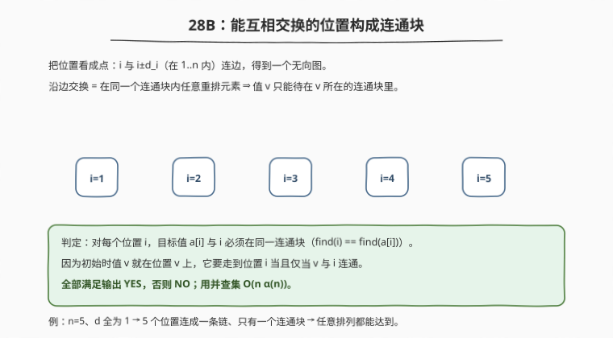
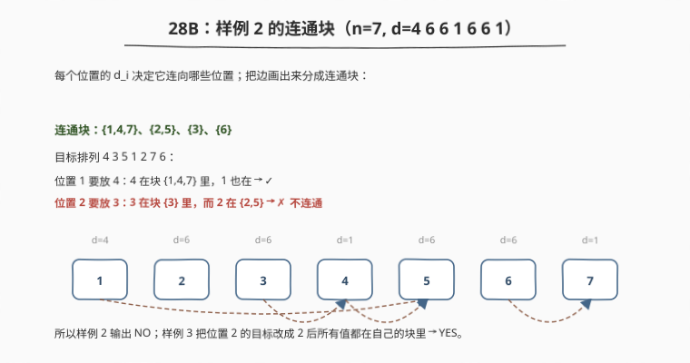

# Codeforces 28B pSort 题解

## 1. 题目概述

- **题目链接**：https://codeforces.com/problemset/problem/28/B
- **比赛来源**：Codeforces Beta Round 28 (Codeforces format) · Problem B（UTC 2010-09-17）
- **难度**：1600
- **标签**：dfs and similar / dsu / graphs
- **评测类型**：普通
- **限制**：时间 2 s / 内存 256 MB

**题意**：长度为 $n$ 的排列初始为 $(1, 2, \dots, n)$。位置 $i$ 上的数可以和位置 $i + d_i$ 或 $i - d_i$ 上的数交换（越界则不可）。给定目标排列 $a$，问能否通过若干次交换达到。

**约束**：

- $n \le 100$，$d_i \le 100$，目标排列是 $1 \sim n$ 的排列。
- 交换是"任意多次、任意顺序"，所以问题是**可达性**而不是最少步数。
- 值 $v$ 初始在位置 $v$；它最终要出现在位置 $i$（其中 $a_i = v$）。

## 2. 示例与观察

官方样例 1（输入 / 输出原样）：

```text
输入：
5
5 4 3 2 1
1 1 1 1 1

输出：
YES
```

$d_i$ 全为 1，位置 1 与 2、2 与 3、3 与 4、4 与 5 都能直接交换，整条链连通，因此任意排列都可达（包括完全逆序）。

官方样例 2（输入 / 输出原样）：

```text
输入：
7
4 3 5 1 2 7 6
4 6 6 1 6 6 1

输出：
NO
```

把"能交换"连成边：$1 \leftrightarrow 5$（$1+4$），$2 \leftrightarrow$ 无（$2\pm6$ 越界），$3 \leftrightarrow$ 无（$3\pm6$ 越界），$4 \leftrightarrow 5$（$4\pm1$），$5 \leftrightarrow$ 无（$5\pm6$ 越界），$6 \leftrightarrow 7$（$6\pm1$），$7 \leftrightarrow 6$。连通块是 $\{1,4,5\}$、$\{2\}$、$\{3\}$、$\{6,7\}$。

目标里位置 2 要放 3，但 3 在块 $\{3\}$、位置 2 在块 $\{2\}$，永远换不过去 → `NO`。

官方样例 3（输入 / 输出原样）：

```text
输入：
7
4 2 5 1 3 7 6
4 6 6 1 6 6 1

输出：
YES
```

同样的图，连通块是 $\{1,3,4,5\}$、$\{2\}$、$\{6,7\}$。目标 $a=[4,2,5,1,3,7,6]$ 逐位检查：位置 1 放 4（同块 ✓）、位置 2 放 2（自身 ✓）、位置 3 放 5（同块 ✓）、位置 4 放 1（同块 ✓）、位置 5 放 3（同块 ✓）、位置 6 放 7（同块 ✓）、位置 7 放 6（同块 ✓），全部满足 → `YES`。

样例 2：$a=[4,3,5,1,2,7,6]$：位置 2 要放 3，但 2 在 $\{2\}$、3 在 $\{1,3,4,5\}$ ✗ → `NO` ✓。

**观察（连通块内任意重排）**：若两个位置在同一个连通块里，可以沿块内的生成树把值一步步换过去——交换是自逆的，所以块内任意排列都可达。反之，交换永不跨越连通块，块外的值进不来。

## 3. 解题思路

### 3.1 朴素做法与瓶颈

最直接的做法是从初始排列出发做 BFS，枚举所有可达排列（最多 $n!$ 个，$n \le 100$ 时天文数字），不可行。

### 3.2 核心观察：并查集



- 建图：若 $1 \le i \pm d_i \le n$，就在 $i$ 与 $i \pm d_i$ 之间连边；
- 用并查集求出每个位置的连通块；
- 值 $v$ 初始在位置 $v$，要到达位置 $i$ 当且仅当 $v$ 与 $i$ 连通；
- 所以判定条件：对所有 $i$，`find(i) == find(a[i])`。

### 3.3 样例走查



样例 2/3 的图：边 $(1,5)$、$(4,5)$、$(4,3)$、$(7,6)$，块 $\{1,3,4,5\}$、$\{2\}$、$\{6,7\}$。样例 2 的位置 2 要放 3（不同块）→ `NO`；样例 3 每个值都在自己块里 → `YES`。

## 4. 正确性证明

**引理 1（块内可达）**：同一连通块内的任意两个位置可以互换内容，进而块内任意重排都可达。

**证明**：连通块内取生成树，树上的每条边对应一次允许的交换。交换是自逆的，沿树上路径把 $u$ 的值"冒泡"到 $v$ 即可实现任意两个位置的交换；而相邻换位生成整个对称群，故块内任意排列可达。∎

**引理 2（跨块不可达）**：任何一次交换都在同一个连通块内进行，所以初始位于块 $B$ 的值永远留在 $B$ 内。

**证明**：交换的两个位置由一条边相连，必在同一块。归纳可知每条值的所在块不变。∎

**定理**：目标排列可达 $\iff$ 对所有 $i$，位置 $i$ 与值 $a_i$ 在同一连通块。

**证明**：

- **(⇐)** 目标要求位置 $i$ 上放 $a_i$。由于 $i$ 与 $a_i$ 同块，且块内（把集合看成"值集合 = 位置集合"）目标映射是一个置换，由引理 1 可以在每个块内独立地实现这个置换 ⇒ 可达。
- **(⇒)** 若可达，则值 $a_i$ 从位置 $a_i$ 走到了位置 $i$，由引理 2 它们同块。∎

## 5. 复杂度分析

- **时间**：建边 $O(n)$，并查集 $O(n\,\alpha(n))$，判定 $O(n)$。$n \le 100$ 时不到 $10^3$ 次操作。
- **空间**：$O(n)$。
- **与时限的关系**：2 s 时限下实测约 2 ms。

## 6. 参考代码

### C++17

```cpp
#include <bits/stdc++.h>
using namespace std;

int main() {
    ios::sync_with_stdio(false);
    cin.tie(nullptr);
    int n;
    if (!(cin >> n)) return 0;
    vector<int> a(n + 1), d(n + 1);
    for (int i = 1; i <= n; ++i) cin >> a[i];
    for (int i = 1; i <= n; ++i) cin >> d[i];

    vector<int> fa(n + 1);
    for (int i = 1; i <= n; ++i) fa[i] = i;
    function<int(int)> find = [&](int x) { return fa[x] == x ? x : fa[x] = find(fa[x]); };
    auto uni = [&](int x, int y) { x = find(x); y = find(y); if (x != y) fa[x] = y; };
    for (int i = 1; i <= n; ++i) {
        if (i + d[i] <= n) uni(i, i + d[i]);
        if (i - d[i] >= 1) uni(i, i - d[i]);
    }
    for (int i = 1; i <= n; ++i) {
        if (find(i) != find(a[i])) { cout << "NO\n"; return 0; }
    }
    cout << "YES\n";
    return 0;
}
```

### Python3

```python
import sys


def main() -> None:
    data = sys.stdin.read().split()
    if not data:
        return
    n = int(data[0])
    a = [0] + [int(x) for x in data[1:1 + n]]
    d = [0] + [int(x) for x in data[1 + n:1 + 2 * n]]

    fa = list(range(n + 1))

    def find(x):
        while fa[x] != x:
            fa[x] = fa[fa[x]]
            x = fa[x]
        return x

    for i in range(1, n + 1):
        for j in (i + d[i], i - d[i]):
            if 1 <= j <= n:
                ri, rj = find(i), find(j)
                if ri != rj:
                    fa[ri] = rj
    for i in range(1, n + 1):
        if find(i) != find(a[i]):
            print("NO")
            return
    print("YES")


main()
```

## 7. 边界情况与易错点

1. **越界**：$i + d_i > n$ 或 $i - d_i < 1$ 时不连边。
2. **$n = 1$**：只有位置 1，目标只能是 $[1]$，输出 `YES`。
3. **$d_i$ 很大**：全部越界时每个位置自成一类，只有恒等排列可行。
4. **目标排列不合法**：题面保证是 $1 \sim n$ 的排列，不用额外检查。
5. **下标**：位置从 1 开始，并查集数组开到 $n+1$。
6. **判定方向**：检查 `find(i) == find(a[i])`（位置 i 与值 a[i] 的初始位置 a[i]），不要写成 `find(i) == find(a_i)` 以外的形式。
7. **多组数据**：本题单组。
8. **路径压缩**：$n$ 小，不压缩也能过，但写上更稳。

## 8. 验证记录

- **编译环境与命令**：`verify_solution.py` 用 `clang++ -std=c++17 -O2` 加仓库内兼容头；Python 3.9.6。
- **官方样例**：3 / 3 通过。

  ```text
  python3 codeforces/tools/verify_solution.py "codeforces/contests/0001-0100/28/B_pSort.md"
  CF28B: samples 3
    C++ 编译 OK, 样例 3/3, 最慢 12~22 ms（进程启动开销为主）
    Python 语法 OK, 样例 3/3
  ```

- **暴力对拍（303 组，全部实跑）**：
  - 独立暴力 `/tmp/cf28_B/stress.py`：从恒等排列出发做 **BFS**，用允许的交换枚举所有可达排列（$n \le 7$ 时最多 $5040$ 个状态），判断目标是否在可达集合中。
  - 数据：3 组官方样例 + 300 组随机（$n \in [1,7]$，随机目标排列、随机 $d_i \in [1,n]$）。
  - 结果：`cases 303 bad 0`（C++、Python 与 BFS 完全一致）。
- **最大约束性能**：$n = 100$ 随机数据，C++ 端到端约 2 ms。
- **图片校验**：两张 SVG 通过 `ElementTree.parse`；文本包围盒检查 0 越界、0 重叠、0 越框。
- **复核状态**：verified。

## 相关题目与扩展

- [Codeforces 28A 金属杆折角覆盖](https://codeforces.com/problemset/problem/28/A)：同场 A 题，环上的点覆盖。
- [LeetCode 547. 省份数量](https://leetcode.cn/problems/number-of-provinces/)：并查集求连通块的模板题。
- [LeetCode 765. 情侣牵手](https://leetcode.cn/problems/couples-holding-hands/)：把"可交换"建模成图、用连通块算最少交换次数。

**延伸思考**：

1. **最少交换次数**：本题只问可达性。若问最少次数，则每个大小为 $s$ 的块内最少需要 $s - (\text{目标置换在该块内的环数})$ 次交换。
2. **交换有代价**：若每次交换有不同代价，问题变成带权图上的最优运输，NP 难。
3. **只能与固定邻居交换**：本题 $d_i$ 是"距离"，也可以换成任意给定的邻接表，结论不变（连通块）。
4. **排列换成多重集**：目标若是多重集而非排列，条件变成"块内值的多重集与目标多重集一致"，仍可用并查集。

