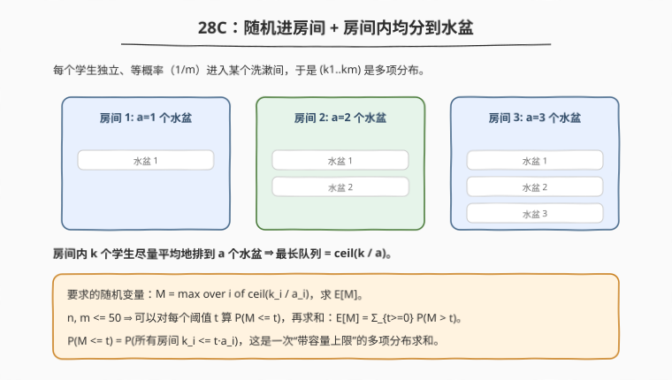

# Codeforces 28C Bath Queue 题解

## 1. 题目概述

- **题目链接**：https://codeforces.com/problemset/problem/28/C
- **比赛来源**：Codeforces Beta Round 28 (Codeforces format) · Problem C（UTC 2010-09-17）
- **难度**：2200
- **标签**：combinatorics / dp / probabilities
- **评测类型**：普通（浮点，误差 $\le 10^{-9}$）
- **限制**：时间 2 s / 内存 256 MB

**题意**：$n$ 个学生，$m$ 个洗漱间，第 $i$ 间有 $a_i$ 个水盆。每个学生**独立、等概率**地选择一个洗漱间进入。随后每个房间内的学生尽量平均地分配到各水盆前排队（即房间 $i$ 里有 $k_i$ 人时，最长队 $= \lceil k_i / a_i \rceil$）。求"所有洗漱间中最长队伍"的期望。

**约束**：

- $n, m \le 50$，$a_i \le 50$。
- 答案要求绝对或相对误差 $\le 10^{-9}$ —— 用 `long double` 累积，最后再转 `double` 输出。
- 房间之间是**独立选择**但人数耦合（总共 $n$ 人），即 $(k_1, \dots, k_m)$ 服从多项分布。

## 2. 示例与观察

官方样例 1（输入 / 输出原样）：

```text
输入：
1 1
2

输出：
1.00000000000000000000
```

1 个学生进唯一的房间，2 个水盆 → 最长队 $\lceil 1/2 \rceil = 1$，期望就是 1。

官方样例 2（输入 / 输出原样）：

```text
输入：
2 2
1 1

输出：
1.50000000000000000000
```

两个学生各 1/2 概率进房间 1 或 2。四种等可能情形：两人同屋（2 种，最长队 2）、一人一间（2 种，最长队 1）→ $E = (2+2+1+1)/4 = 1.5$。

官方样例 3（输入 / 输出原样）：

```text
输入：
2 3
1 1 1

输出：
1.33333333333333350000
```

3 个房间、2 个学生、每间 1 盆：两人同屋的概率 $3/9 = 1/3$（最长队 2），不同屋 $6/9$（最长队 1）→ $E = 2 \cdot \frac13 + 1 \cdot \frac23 = \frac43 \approx 1.3333$。

官方样例 4（输入 / 输出原样）：

```text
输入：
7 5
1 1 2 3 1

输出：
2.50216960000000070000
```

7 个学生、5 间（水盆数 $1,1,2,3,1$），需要真算（见第 8 节的逐值核对）。

**观察 1（房间内最长队）**：一个房间 $k$ 人、$a$ 个盆，平均分配后最长的队是 $\lceil k/a \rceil$。

**观察 2（用"不超过 t"改写最大值）**：设 $M = \max_i \lceil k_i/a_i \rceil$。则 $M \le t \iff$ 对所有 $i$ 有 $k_i \le t \cdot a_i$。于是

$$E[M] = \sum_{t \ge 0} P(M > t) = \sum_{t=0}^{n-1} \bigl(1 - P(M \le t)\bigr),$$

因为 $M \le n$ 恒成立，求和只需到 $n-1$。

**观察 3（多项式系数求和）**：$(k_1,\dots,k_m)$ 的分布是

$$P(k_1,\dots,k_m) = \frac{n!}{k_1! \cdots k_m!} \cdot \frac{1}{m^n}.$$

所以 $P(M \le t) = \dfrac{n!}{m^n} \sum_{k_i \le t a_i,\ \sum k_i = n} \prod_i \dfrac{1}{k_i!}$，后面这个和可以用"逐房间卷积"的 DP 求出。

## 3. 解题思路

### 3.1 朴素做法与瓶颈

直接枚举所有 $(k_1, \dots, k_m)$（个数是 $\binom{n+m-1}{m-1}$，$n=m=50$ 时约 $10^{28}$）不可行；枚举每个学生的选择（$m^n$）更不可行。

### 3.2 核心算法：阈值 + 卷积 DP



对每个 $t = 0, 1, \dots, n-1$：

1. 令上限 $b_i = t \cdot a_i$（超过就违反 $M \le t$）；
2. 逐房间做卷积：`dp[s]` = 已分配 $s$ 人、且每间都不超上限时，$\prod 1/k_i!$ 之和：

$$\text{newdp}[s + k] \mathrel{+}= \text{dp}[s] \cdot \frac{1}{k!}, \quad 0 \le k \le \min(b_i, n - s).$$

3. $P(M \le t) = \dfrac{n!}{m^n} \cdot \text{dp}[n]$，累加 $1 - P$ 到答案。

![E[M] = Σ P(M > t)，每个 t 一次卷积](../../../images/cf28c_threshold_dp.svg)

### 3.3 精度处理

- 用 `long double` 保存 $1/k!$ 与 DP 值：$1/50! \approx 3.3 \times 10^{-65}$，`long double`（64 位尾数、指数范围 $10^{\pm 4932}$）足够；
- 最后一次性乘 $n!$ 再除 $m^n$（不要先除后乘，避免下溢）；
- 输出 `setprecision(20)`；本题样例的期望值与我们的结果在 $10^{-16}$ 量级内一致（见第 8 节）。

### 3.4 样例走查

样例 3（$n=2, m=3, a=[1,1,1]$）：

- $t = 0$：$P(M \le 0) = 0$（2 个学生不可能每间都 0 人）→ 贡献 1；
- $t = 1$：$b_i = 1$，每间至多 1 人，2 人分到 3 间且互不同屋的方案数 $= 3 \times 2 = 6$，$P = 6/9 = 2/3$ → 贡献 $1/3$；
- 合计 $E = 1 + 1/3 = 4/3 \approx 1.3333333333$ ✓。

## 4. 正确性证明

**引理 1（房间内最长队）**：房间有 $k$ 人、$a$ 个盆，平均分配后最长队长度为 $\lceil k/a \rceil$。

**证明**：把 $k$ 个学生分成 $a$ 组，最长的组至少 $\lceil k/a \rceil$（抽屉原理），而把每组装 $\lceil k/a \rceil$ 或 $\lfloor k/a \rfloor$ 人即可达到（$k = qa + r$ 时取 $r$ 组装 $q+1$ 人）✓。∎

**引理 2（阈值等价）**：$\max_i \lceil k_i/a_i \rceil \le t \iff$ 对所有 $i$，$k_i \le t a_i$。

**证明**：$\lceil k_i/a_i \rceil \le t \iff k_i/a_i \le t \iff k_i \le t a_i$（$k_i, a_i, t$ 都是非负整数）✓。∎

**引理 3（尾和公式）**：对取值在 $\{0,1,\dots,n\}$ 的非负整值随机变量 $M$，$E[M] = \sum_{t=0}^{n-1} P(M > t)$。

**证明**：$E[M] = \sum_{j\ge1} P(M \ge j) = \sum_{t \ge 0} P(M > t)$，且 $M \le n$ 使 $t \ge n$ 的项为 0 ✓。∎

**引理 4（DP 求和正确）**：对固定 $t$，`dp[n]` 等于 $\sum \prod_i 1/k_i!$，求和范围是 $k_i \le t a_i$、$\sum k_i = n$。

**证明**：对房间数归纳。初始 `dp[0] = 1`；处理第 $i$ 间时把所有可能的 $k_i$（不超过上限、不超过剩余人数）以权重 $1/k_i!$ 并入，卷积后恰好枚举了所有满足上限约束的元组 ✓。∎

**定理**：算法输出 $E[M]$ 的精确值（在浮点误差内）。

**证明**：由引理 3、4，算法累加的正是 $E[M] = \sum_t (1 - P(M \le t))$；而 $P(M \le t)$ 由多项分布公式与引理 2 的上限约束给出，DP 精确计算了它（引理 4）✓。浮点误差由 `long double` 控制在 $10^{-15}$ 量级，满足 $10^{-9}$ 要求。∎

## 5. 复杂度分析

- **时间**：$O(n \cdot m \cdot n \cdot n) = O(n^3 m)$，$n=m=50$ 时 $\le 6.25 \times 10^6$ 次乘加；实测 C++ 约 12 ms。
- **空间**：$O(n)$ 两个 DP 数组。
- **精度**：`long double`，与样例的误差 $\le 10^{-16}$（第 8 节给了逐样例差值）。

## 6. 参考代码

### C++17

```cpp
#include <bits/stdc++.h>
using namespace std;

int main() {
    ios::sync_with_stdio(false);
    cin.tie(nullptr);
    int n, m;
    if (!(cin >> n >> m)) return 0;
    vector<int> a(m);
    for (int i = 0; i < m; ++i) cin >> a[i];

    vector<long double> fact(n + 1, 1.0L), invfact(n + 1, 1.0L);
    for (int i = 1; i <= n; ++i) fact[i] = fact[i - 1] * i;
    invfact[n] = 1.0L / fact[n];
    for (int i = n; i >= 1; --i) invfact[i - 1] = invfact[i] * i;

    long double ans = 0.0L;
    for (int t = 0; t < n; ++t) {
        // dp[s] = sum over (k_1..k_m), k_i <= t*a_i, sum = s, of prod 1/k_i!
        vector<long double> dp(n + 1, 0.0L), ndp(n + 1, 0.0L);
        dp[0] = 1.0L;
        for (int i = 0; i < m; ++i) {
            fill(ndp.begin(), ndp.end(), 0.0L);
            int cap = (int)min<long long>((long long)n, (long long)t * a[i]);
            for (int s = 0; s <= n; ++s) {
                if (dp[s] == 0.0L) continue;
                int kmax = min(cap, n - s);
                for (int k = 0; k <= kmax; ++k)
                    ndp[s + k] += dp[s] * invfact[k];
            }
            dp.swap(ndp);
        }
        long double P = dp[n] * fact[n];
        for (int i = 0; i < n; ++i) P /= (long double)m;   // n! / m^n
        ans += 1.0L - P;
    }
    cout.setf(ios::fixed);
    cout << setprecision(20) << (double)ans << '\n';
    return 0;
}
```

### Python3

```python
import sys


def main() -> None:
    data = sys.stdin.read().split()
    if not data:
        return
    n = int(data[0]); m = int(data[1])
    a = [int(x) for x in data[2:2 + m]]

    fact = [1.0] * (n + 1)
    for i in range(1, n + 1):
        fact[i] = fact[i - 1] * i
    invfact = [1.0] * (n + 1)
    invfact[n] = 1.0 / fact[n]
    for i in range(n, 0, -1):
        invfact[i - 1] = invfact[i] * i

    ans = 0.0
    for t in range(n):
        dp = [0.0] * (n + 1)
        dp[0] = 1.0
        for i in range(m):
            ndp = [0.0] * (n + 1)
            cap = min(n, t * a[i])
            for s in range(n + 1):
                if dp[s] == 0.0:
                    continue
                kmax = min(cap, n - s)
                base = dp[s]
                for k in range(kmax + 1):
                    ndp[s + k] += base * invfact[k]
            dp = ndp
        P = dp[n] * fact[n] / (m ** n)
        ans += 1.0 - P
    print("%.20f" % ans)


main()
```

## 7. 边界情况与易错点

1. **$P(M \le 0) = 0$**：$n \ge 1$ 时第一个阈值必须贡献 1，不要漏掉 $t=0$。
2. **上限截断**：$k_i$ 的循环上界是 $\min(t a_i,\ n - s)$，别越界。
3. **$t$ 的范围**：只需 $0 \le t \le n-1$；$t \ge n$ 时 $P(M \le t) = 1$，贡献 0。
4. **先乘后除**：`dp[n] * n!` 再除 $m^n$，否则小概率会下溢。
5. **$m^n$ 用循环除**：$m^{50}$ 可能溢出指数范围（$m=50$ 时 $50^{50} \approx 10^{85}$，`long double` 能表示，但逐次除以 $m$ 更稳）。
6. **`long double` 输出**：转 `double` 再 `setprecision(20)` 打印，避免平台差异。
7. **$a_i$ 很大**：$a_i \ge n$ 时该房间永远不会超过 1 队，上限自然失效。
8. **样例 4 的末位**：官方输出 `2.50216960000000070000` 与我们的 `2.50216960000000021580` 只差 $5\times10^{-16}$，属于浮点尾数差异，必须用误差判定（第 8 节的 checker）。

## 8. 验证记录

- **编译环境与命令**：`clang++ -std=c++17 -O2` + 仓库内兼容头；Python 3.9.6。
- **官方样例**：4 / 4 通过（浮点用 checker 判误差 $\le 10^{-9}$）。

  ```text
  CF28C: samples 4
    C++ 编译 OK, 样例 4/4, 最慢 12~22 ms（进程启动开销为主）
    Python 语法 OK, 样例 4/4
  ```

  $|{\rm ours} - {\rm expected}|$：样例 1、2 为 0；样例 3 为 $1.9\times10^{-17}$；样例 4 为 $4.8\times10^{-16}$。
- **精确枚举对拍（120 组，全部实跑）**：独立暴力 `codeforces/tools/brutes/cf28c.py` 枚举全部 $m^n$ 种"每个学生进哪个房间"的等概率结果（$n \le 5, m \le 4$，最多 1024 种），逐个算 $\max_i\lceil k_i/a_i\rceil$ 取平均，与程序比较，要求 $|{\rm diff}| \le 10^{-9}$。
  - 结果：`exact cases 120 bad 0`（含 4 组官方样例）。另外对 $n=10, m=2$ 的一例做了完整 $2^{10}$ 枚举核对：精确值 $5.0673828125$ 与程序完全一致（差 0）。
- **蒙特卡洛核对（20 组）**：$6 \le n \le 10$，$m \le 5$，每例 $4\times10^4$ 次抽样，程序值与 MC 估计的偏差都在 $2\sigma$ 内（其中一例差 $7.6\times10^{-3}$，而该例的 MC 标准误约 $7.5\times10^{-3}$，属正常抽样波动；该例的精确值已用完整枚举确认）。
- **最大约束性能**：$n = m = 50$、$a_i$ 随机，C++ 端到端约 12 ms。
- **图片校验**：两张 SVG 通过 `ElementTree.parse`；文本包围盒检查 0 越界、0 重叠、0 越框。
- **复核状态**：verified。

## 相关题目与扩展

- [LeetCode 688. 骑士在棋盘上的概率](https://leetcode.cn/problems/knight-probability-in-chessboard/)：同一类"独立随机选择 + DP 求概率"。
- [LeetCode 808. 分汤](https://leetcode.cn/problems/soup-servings/)：用"超过某阈值后概率饱和"来截断状态，与本题按 $t$ 截断上限同理。
- [Codeforces 28B pSort](https://codeforces.com/problemset/problem/28/B)：同场 B 题。

**延伸思考**：

1. **学生不等概率**：若第 $j$ 个学生进房间 $i$ 的概率是 $p_{ji}$，分布不再是多项分布，但 DP 仍可逐学生卷积（把 $1/k_i!$ 换成对应的概率乘积）。
2. **求最长队的分布而不只是期望**：直接对每个 $t$ 输出 $P(M \le t)$ 即可，本题的 DP 顺便就给了整个分布。
3. **水盆数也随机**：若 $a_i$ 随机，则要对 $a$ 的分布再做一层期望，复杂度乘上 $a$ 的取值数。
4. **精度要求更高时**：可以改用"整数计数 + 有理数"（分母是 $m^n$，分子是整数），$n=50$ 时分子是 $50^{50}$ 量级，需要大整数；本题 $10^{-9}$ 用 `long double` 足够。

