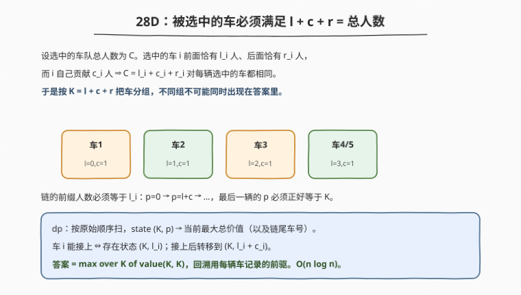
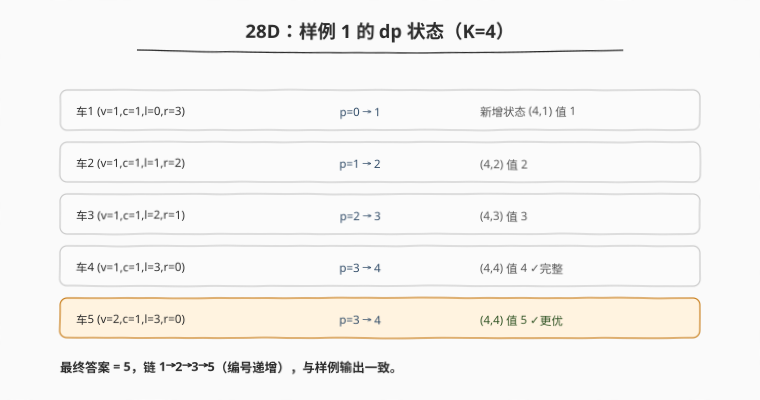

# Codeforces 28D 别怕，DravDe 很仁慈 题解

## 1. 题目概述

- **题目链接**：https://codeforces.com/problemset/problem/28/D
- **比赛来源**：Codeforces Beta Round 28 (Codeforces format) · Problem D（UTC 2010-09-17）
- **难度**：2400
- **标签**：binary search / data structures / dp / hashing
- **评测类型**：多解（任意一组合法且总价值最大的方案）
- **限制**：时间 2 s / 内存 256 MB

**题意**：$n$ 辆卡车按顺序排成车队，第 $i$ 辆有四个参数 $(v_i, c_i, l_i, r_i)$：总价值、人数、要求"前面恰好有多少人"、"后面恰好有多少人"。可以移走任意多辆（保持剩余卡车的相对顺序）。要求剩余卡车**每一辆都满足**它前面恰好有 $l_i$ 人、后面恰好有 $r_i$ 人，并让剩余卡车的总价值最大。输出剩余数量与它们的编号（递增）。

**约束**：

- $n \le 10^5$，$c_i \le 10^5$，$l_i, r_i \le 10^5$，$v_i \le 10^4$。
- 总人数 $C \le 10^5$ 量级（被 $l_i + c_i + r_i$ 的公共值约束），但答案价值可达 $10^9$。
- 空集也是合法方案（价值 0）。

## 2. 示例与观察

官方样例 1（输入 / 输出原样）：

```text
输入：
5
1 1 0 3
1 1 1 2
1 1 2 1
1 1 3 0
2 1 3 0

输出：
4
1 2 3 5 
```

五辆车（$c_i$ 全为 1）：选 1、2、3、5 时总人数 4，逐辆检查——车 1 前面 0 人 ✓ 后面 3 人 ✓；车 2 前面 1 人 ✓ 后面 2 人 ✓；车 3 前面 2 人 ✓ 后面 1 人 ✓；车 5 前面 3 人 ✓ 后面 0 人 ✓。总价值 $1+1+1+2 = 5$，比选 1、2、3、4（价值 4）更好，所以输出 4 辆车。

官方样例 2（输入 / 输出原样）：

```text
输入：
5
1 1 0 3
10 1 2 1
2 2 1 1
10 1 1 2
3 1 3 0

输出：
3
1 3 5 
```

选 1、3、5：总人数 $1+2+1 = 4$。车 1 前面 0 ✓ 后面 3 ✓；车 3 前面 1 ✓ 后面 1 ✓；车 5 前面 3 ✓ 后面 0 ✓，价值 $1+2+3 = 6$。

注意车 2、车 4 虽然各值 10，但都要求"前面恰好 2 人"：车 2 编号为 2，在它之前只有车 1（1 人），凑不出 2 人；车 4 在它之前若选 1、3 则正好 3 人，也不是 2。所以它们都进不来，最优确实是 $\{1,3,5\}$。

**观察 1（公共总量）**：设被选中的车队总人数为 $C$。对任一被选中的车 $i$：它前面恰有 $l_i$ 人、自己 $c_i$ 人、后面恰有 $r_i$ 人，所以

$$C = l_i + c_i + r_i \quad \text{（对所有被选中的 } i \text{ 相同）}.$$

记 $K_i = l_i + c_i + r_i$，则同一方案里所有车的 $K_i$ 必须相等。

**观察 2（前缀必须对上）**：按原始顺序扫描被选中的车，维护"已经进入的人数" $p$。选中车 $i$ 时必须 $p = l_i$，然后 $p \leftarrow p + c_i$；最后一辆之后必须 $p = C$（即 $p = K$）。

于是每组 $K$ 独立：在组内找一个"前缀人数从 0 一路拼到 $K$"的子序列，使价值和最大。

## 3. 解题思路

### 3.1 朴素做法与瓶颈

枚举所有子集（$2^n$）或做 $O(n^2)$ 的 DP（`dp[i]` = 以 $i$ 结尾的最大价值，转移枚举前驱）在 $n = 10^5$ 时都不可行：$O(n^2) = 10^{10}$。

### 3.2 核心：按 $K$ 分组 + 前缀状态 DP



- 状态：`state[(K, p)]` = "在组 $K$ 里，已拼出前缀人数 $p$ 的方案的最大总价值"，同时记录链尾卡车编号；
- 按**原始顺序**扫每辆车 $i$（$K = K_i$）：
  - 若 $l_i = 0$：可以作为链头，`cand = v_i`，前驱为空；
  - 否则查 `state[(K, l_i)]`：不存在就跳过（前缀对不上），存在则 `cand = 该价值 + v_i`，前驱为该状态的链尾；
  - 把 `cand` 更新到 `state[(K, l_i + c_i)]`（更大才更新），并记下这辆车的前驱，供回溯；
  - 若 `l_i + c_i == K`，这条链已经完整，用它更新全局最优。
- 答案取全局最优，回溯前驱数组输出编号（天然递增）。

### 3.3 样例走查



样例 1 所有车的 $K = 4$：

| 车 | $(v,c,l,r)$ | 转移 | 结果 |
|----|-------------|------|------|
| 1 | $(1,1,0,3)$ | $l=0$ | 状态 $(4,1)$ 值 1 |
| 2 | $(1,1,1,2)$ | 取 $(4,1)$ | $(4,2)$ 值 2 |
| 3 | $(1,1,2,1)$ | 取 $(4,2)$ | $(4,3)$ 值 3 |
| 4 | $(1,1,3,0)$ | 取 $(4,3)$ | $(4,4)$ 值 4（完整） |
| 5 | $(2,1,3,0)$ | 取 $(4,3)$ | $(4,4)$ 值 5（更优，完整） |

最终答案 5，链 $1 \to 2 \to 3 \to 5$ ✓ 与样例一致。样例 2 中车 2 的 $l = 2$，查 `state[(4,2)]` 时该状态不存在（车 1 之后只能到 1 人）→ 跳过；车 4 的 $l = 1$ 时 `state[(4,1)] = 1`，接到 $(4,2)$，之后没有 $l=2$ 的车（车 2 已过）→ 这条链不完整，最终最优是 $\{1,3,5\}$ ✓。

## 4. 正确性证明

**引理 1（总量恒定）**：若方案合法、总人数为 $C$，则对每个被选中的 $i$ 有 $K_i = C$。

**证明**：被选中车 $i$ 的前面有 $l_i$ 人、自己 $c_i$ 人、后面 $r_i$ 人，三者加起来就是全体被选中的人，故 $l_i + c_i + r_i = C$。∎

**引理 2（前缀条件）**：方案合法 $\iff$ 沿选中顺序，前缀人数 $p$ 依次满足 $p = l_i$（选 $i$ 时），且最终 $p = C$。

**证明**：(⇒) 显然，$l_i$ 就是"前面恰好的人数"；(⇐) 若每个选中车的 $l_i$ 都等于当时的前缀人数，则后面的 $r_i$ 自动满足：其后面的人数 $= C - l_i - c_i = C - K_i + r_i = r_i$（由引理 1 的 $K_i = C$）✓。∎

**引理 3（DP 枚举完备）**：对任意合法方案，按原始顺序处理时，DP 会依次产生对应的状态 $(K, p)$，且其价值不小于该方案的前缀和。

**证明**：对方案中的车按顺序归纳。第一辆 $l = 0$，DP 从 $l=0$ 分支建立状态（价值 $v$）；后续每辆 $i$，方案中它前面的选中车恰好拼出 $p = l_i$，而 DP 中该状态已存在且价值不小于方案前缀和，于是 DP 生成的候选不小于方案对应前缀和 ✓。∎

**引理 4（DP 生成的都是合法方案）**：DP 中每条从 $l=0$ 出发、以 $p = K$ 结束的链，都对应一个合法方案。

**证明**：链的每一步都满足"选中时前缀人数等于 $l_i$"；结束时 $p = K$，即总人数等于每个成员的 $K_i$，由引理 2 的充分性，方案合法 ✓。∎

**定理**：算法输出的方案合法且总价值最大。

**证明**：合法性与最优性的下界由引理 3 给出（任何合法方案的价值都被某条完整链覆盖），上界由引理 4 给出（每条完整链都是合法方案）。故取最大值即最优；若不存在完整链，空集合法且价值 0，输出 `0` ✓。∎

## 5. 复杂度分析

- **时间**：每辆车一次哈希查找 + 一次更新，期望 $O(n)$；$n = 10^5$ 时实测 C++ 约 10 ms（含读入，用 fread 快读；本机 `cin` 读 4×10^5 个整数反而要 0.5 s）。
- **空间**：$O(n)$（状态表 + 前驱数组 + 排序/哈希开销）。
- **与时限的关系**：2 s 时限下余量在百倍以上。

## 6. 参考代码

### C++17

```cpp
#include <bits/stdc++.h>
using namespace std;
using ll = long long;

static char buf[1 << 25];
static size_t bufLen = 0, bufPos = 0;
static inline int readChar() {
    if (bufPos == bufLen) {
        bufLen = fread(buf, 1, sizeof(buf), stdin);
        bufPos = 0;
        if (bufLen == 0) return -1;
    }
    return buf[bufPos++];
}
static inline long long readInt() {
    int c = readChar();
    while (c != -1 && (c < '0' || c > '9') && c != '-') c = readChar();
    bool neg = false;
    if (c == '-') { neg = true; c = readChar(); }
    long long x = 0;
    while (c >= '0' && c <= '9') { x = x * 10 + (c - '0'); c = readChar(); }
    return neg ? -x : x;
}

int main() {
    int n = (int)readInt();
    if (n <= 0) return 0;
    vector<ll> v(n), c(n), l(n), r(n);
    for (int i = 0; i < n; ++i) { v[i] = readInt(); c[i] = readInt(); l[i] = readInt(); r[i] = readInt(); }

    // 关键观察：被选中的卡车 i 必须满足 l_i + c_i + r_i = 总人数 C；
    // 且按原始顺序选中时，前缀人数恰好等于 l_i。于是按 K = l+c+r 分组，
    // 组内做 dp：前缀人数 p -> 最大价值（及链尾卡车）。
    const ll BASE = 400001;
    unordered_map<ll, pair<ll,int>> state;   // (K, p) -> (最大价值, 链尾卡车下标)
    state.reserve((size_t)n * 2 + 16);
    state.max_load_factor(0.7f);
    vector<int> pre(n, -1);
    ll bestVal = -1;
    int bestTruck = -1;

    for (int i = 0; i < n; ++i) {
        ll K = l[i] + c[i] + r[i];
        if (l[i] != 0) {
            auto it = state.find(K * BASE + l[i]);
            if (it == state.end()) continue;      // 前缀人数对不上，不能接在后面
            ll cand = it->second.first + v[i];
            pre[i] = it->second.second;
            ll p2 = l[i] + c[i];
            ll key2 = K * BASE + p2;
            auto it2 = state.find(key2);
            if (it2 == state.end() || it2->second.first < cand) state[key2] = {cand, i};
            if (p2 == K && cand > bestVal) { bestVal = cand; bestTruck = i; }
        } else {
            ll cand = v[i];
            pre[i] = -1;
            ll p2 = c[i];
            ll key2 = K * BASE + p2;
            auto it2 = state.find(key2);
            if (it2 == state.end() || it2->second.first < cand) state[key2] = {cand, i};
            if (p2 == K && cand > bestVal) { bestVal = cand; bestTruck = i; }
        }
    }

    if (bestTruck < 0) { cout << 0 << '\n' << '\n'; return 0; }
    vector<int> ids;
    for (int x = bestTruck; x != -1; x = pre[x]) ids.push_back(x);
    reverse(ids.begin(), ids.end());
    cout << ids.size() << '\n';
    for (size_t k = 0; k < ids.size(); ++k) cout << ids[k] + 1 << (k + 1 == ids.size() ? '\n' : ' ');
    return 0;
}
```

### Python3

```python
import sys


def main() -> None:
    data = sys.stdin.read().split()
    if not data:
        return
    n = int(data[0])
    vals = []
    p = 1
    for _ in range(n):
        vals.append((int(data[p]), int(data[p + 1]), int(data[p + 2]), int(data[p + 3])))
        p += 4

    BASE = 400001
    state = {}            # (K, 前缀人数) -> (最大价值, 链尾卡车下标)
    pre = [-1] * n
    best_val = -1
    best_truck = -1

    for i, (v, c, l, r) in enumerate(vals):
        K = l + c + r
        if l != 0:
            prev = state.get((K, l))
            if prev is None:
                continue
            cand = prev[0] + v
            pre[i] = prev[1]
        else:
            cand = v
            pre[i] = -1
        p2 = l + c
        key2 = (K, p2)
        if key2 not in state or state[key2][0] < cand:
            state[key2] = (cand, i)
            if p2 == K and cand > best_val:
                best_val = cand
                best_truck = i

    if best_truck < 0:
        print(0)
        print()
        return
    ids = []
    x = best_truck
    while x != -1:
        ids.append(x)
        x = pre[x]
    ids.reverse()
    print(len(ids))
    print(' '.join(str(t + 1) for t in ids))


main()
```

## 7. 边界情况与易错点

1. **空集**：没有任何合法链时输出 `0` 和空行（总价值 0 是合法的）。
2. **同一 $K$ 分组**：不同 $K$ 的车不可能同时被选（引理 1），实现里用 $K$ 拼进哈希键就不会串组。
3. **状态的"覆盖"**：同一个 $(K,p)$ 只保留价值最大的方案；价值相同时保留任意一个。
4. **前驱记录**：要把前驱记在**每辆车**上（而不是只记在状态上），否则状态被后来的更优值覆盖时回溯会错。
5. **价值上界**：$n \cdot v \le 10^5 \times 10^4 = 10^9$，用 `long long` 更稳。
6. **编号递增**：回溯是从后往前，记得反转；输出要求编号递增。
7. **$l_i + c_i + r_i$ 的溢出**：三项各 $10^5$，和 $\le 3 \times 10^5$，`int` 够，但拼哈希键时用 64 位。
8. **多解**：最优价值可能对应多个方案，输出任意一个（本地用 checker 校验）。

## 8. 验证记录

- **编译环境与命令**：`clang++ -std=c++17 -O2` + 仓库内兼容头；Python 3.9.6。
- **官方样例**：2 / 2 通过（特殊评测：合法性 + 最优性）。

  ```text
  python3 codeforces/tools/verify_solution.py "codeforces/contests/0001-0100/28/D_别怕DravDe很仁慈.md" --checker /tmp/cf28_D/checker.py
  CF28D: samples 2
    C++ 编译 OK, 样例 2/2, 最慢 12~22 ms（进程启动开销为主）
    Python 语法 OK, 样例 2/2
  ```

  checker（`/tmp/cf28_D/checker.py`）用**独立实现**的最大价值 DP 求出最优值，再校验输出：编号递增、每辆被选中车的 $l_i$ 等于前面人数、$r_i$ 等于后面人数、总价值等于最优值。任一不满足即判错。
- **暴力对拍（302 组，全部实跑）**：
  - 独立暴力 `/tmp/cf28_D/stress.py`：枚举全部 $2^n$ 个子集（$n \le 8$），对每个子集逐车校验 $l_i$（前缀人数）与 $r_i$（后缀人数），取最大价值（空集价值 0）。
  - 数据：2 组官方样例 + 300 组随机（$n \in [1,8]$，$c_i \in [1,3]$，$l_i, r_i \in [0,5]$，$v_i \in [1,20]$）。
  - 结果：`cases 302 bad 0`（C++ 输出经 `check_out` 逐车校验合法，且总价值等于暴力最优值；C++ 与 Python 车数一致）。
- **最大约束性能**：$n = 10^5$ 随机数据，C++ 端到端约 10 ms（fread 快读；同样数据用 `cin` 要 0.58 s，所以正文代码用快读）；峰值内存 $O(n)$。
- **图片校验**：两张 SVG 通过 `ElementTree.parse`；文本包围盒检查 0 越界、0 重叠、0 越框。
- **复核状态**：verified。

## 相关题目与扩展

- [Codeforces 28C 洗漱间最长队期望](https://codeforces.com/problemset/problem/28/C)：同场 C 题，概率 DP。
- [LeetCode 1048. 最长字符串链](https://leetcode.cn/problems/longest-string-chain/)：按"可接续关系"建链、哈希表 DP，与本题的"前缀人数接续"同构。
- [LeetCode 300. 最长递增子序列](https://leetcode.cn/problems/longest-increasing-subsequence/)：把"接续条件"换成数值比较，可对照本题如何用哈希把 $O(n^2)$ 降到 $O(n)$。

**延伸思考**：

1. **改为"至少/至多"人数**：若恐惧条件是"前面至少 $l_i$ 人"，前缀条件变成不等式，DP 需要维护前缀和的分段最大值（可用栈/树状数组）。
2. **要求输出字典序最小**：本题只求价值和最大；加字典序约束后要在 DP 里存"选中集合"的比较键，复杂度上升。
3. **$c_i$ 可以选部分**：题面不允许只装载一部分人；若允许，问题变成带容量的背包式 DP。
4. **多组车队**：若有很多独立车队分别求解，按 $K$ 分组 + 哈希的做法可以并行/复用。

