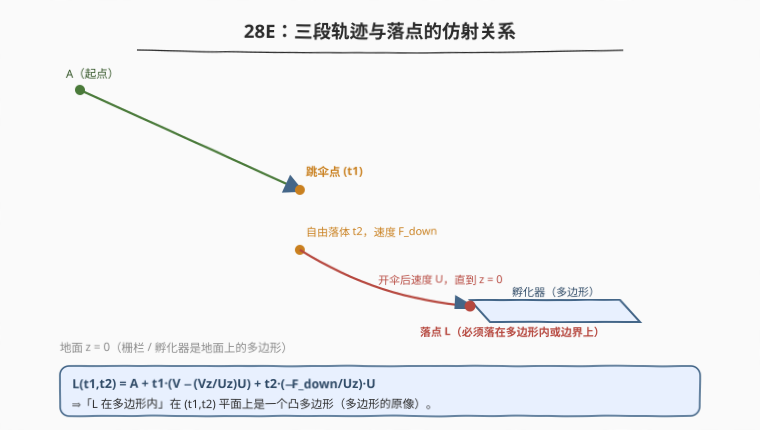
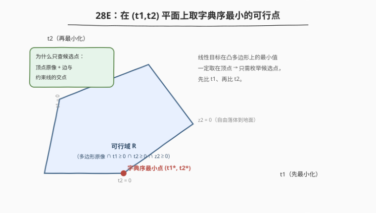

# Codeforces 28E DravDe 拯救世界 题解

## 1. 题目概述

- **题目链接**：https://codeforces.com/problemset/problem/28/E
- **比赛来源**：Codeforces Beta Round 28 (Codeforces format) · Problem E（UTC 2010-09-17）
- **难度**：2800
- **标签**：geometry / math
- **评测类型**：普通（浮点，误差 $< 10^{-6}$）
- **限制**：时间 2 s / 内存 256 MB

**题意**：平面上有一个 $n$ 个顶点的**简单多边形**（孵化器），点 $A$ 在多边形外。喷气机从 $A$ 出发、以速度 $V = (x_v, y_v, z_v)$ 匀速直线飞行；DravDe 可以在任意时刻 $t_1$ 跳机，随后以竖直速度 $F_{down}$ 自由落体 $t_2$ 秒，再打开降落伞、以速度 $U = (x_u, y_u, z_u)$ 匀速下落，直到 $z = 0$（地面）着陆。要求落点落在多边形内或边界上；在此基础上最小化 $t_1$，再最小化 $t_2$。无解输出 `-1 -1`。

**约束**：

- $n \le 10^4$，坐标绝对值 $\le 10^4$；所有输入都是整数，但答案是实数。
- 误差要求 $< 10^{-6}$，用 `double` 足够（关键运算是线性方程求解）。
- 多边形**不保证凸**，所以不能只做"半平面求交"。

## 2. 示例与观察

官方样例 1（输入 / 输出原样）：

```text
输入：
4
0 0
1 0
1 1
0 1
0 -1
1 0 1
-1
0 1 -1

输出：
1.00000000 0.00000000
```

单位正方形，$A = (0,-1)$，$V = (1,0,1)$，$F_{down} = -1$，$U = (0,1,-1)$。在 $t_1 = 1$ 跳机：位置 $(1, -1, 1)$。立刻开伞（$t_2 = 0$），以 $U$ 下落：$x \equiv 1$、$y = -1 + \tau$、$z = 1 - \tau$，$\tau = 1$ 时落地于 $(1, 0)$ —— 正好在正方形边界上 ✓。$t_1 < 1$ 时落点的 $x$ 都小于 1、$y$ 都小于 0，出界，所以 $t_1 = 1$ 最小。

官方样例 2（输入 / 输出原样）：

```text
输入：
4
0 0
0 1
1 1
1 0
0 -1
-1 -1 1
-1
0 1 -1

输出：
-1.00000000 -1.00000000
```

$V = (-1,-1,1)$：跳机点 $(-t_1,\ -1-t_1,\ t_1)$，开伞后 $x$ 不变、$y$ 以 $+1$ 增长、$z$ 以 $-1$ 下降，落地时 $y = -1 - t_1 + t_1 = -1$，永远到不了 $[0,1]$ → 无解 ✓。

官方样例 3（输入 / 输出原样）：

```text
输入：
4
0 0
1 0
1 1
0 1
0 -1
1 1 1
-1
1 1 -1

输出：
0.50000000 0.00000000
```

（注意本样例多边形顶点顺序与样例 1 不同（顺时针），但结论一样。）$t_1$ 时刻跳机点在 $(t_1, -1+t_1, t_1)$，立刻开伞后落点 $= (2t_1,\ 2t_1 - 1)$。要落在 $[0,1]^2$：$0 \le 2t_1 \le 1$ 且 $0 \le 2t_1 - 1 \le 1$，交集只有 $t_1 = 0.5$ ✓。

**观察 1（落点是 $(t_1, t_2)$ 的仿射函数）**：设 $z_2 = z_v t_1 + F_{down} t_2$（开伞时的高度）。若 $U_z < 0$，开伞后还要下落 $\tau = -z_2/U_z$ 秒，于是

$$L(t_1,t_2) = \underbrace{\begin{pmatrix}x_a\\ y_a\end{pmatrix}}_{M} + t_1\underbrace{\begin{pmatrix}x_v - \frac{z_v}{U_z}x_u\\ y_v - \frac{z_v}{U_z}y_u\end{pmatrix}}_{a} + t_2\underbrace{\begin{pmatrix}-\frac{F_{down}}{U_z}x_u\\ -\frac{F_{down}}{U_z}y_u\end{pmatrix}}_{b}.$$

也就是说：**"落在多边形内"在 $(t_1,t_2)$ 平面上是多边形的一个仿射原像**。

**观察 2（其余约束都是半平面）**：$t_1 \ge 0$、$t_2 \ge 0$、$z_2 \ge 0$（开伞时不能已经在地面以下）、$z_v t_1 \ge 0$（飞机不能钻到地下）。所以可行域 = 多边形原像 ∩ 几个过原点的半平面。

**观察 3（最小值取在顶点）**：$t_1$ 是线性的，在多边形区域上的最小值一定在某个顶点（若整条边都取到最小值，则端点也是顶点）。所以只需枚举**候选点**：多边形顶点的原像、多边形边与约束直线的交点、约束直线之间的交点，逐个判断可行性、取字典序最小。

## 3. 解题思路

### 3.1 朴素做法与瓶颈

最直接的做法是数值搜索（三分/爬山）：$t_1$ 与 $t_2$ 都是实数、目标不光滑（"是否在多边形内"是布尔判断），梯度类方法不可靠，网格搜索精度不够（要求 $10^{-6}$）。

### 3.2 核心：把问题化成"仿射原像上的字典序最小点"



1. 由观察 1 写出 $L(t_1,t_2) = M + t_1 a + t_2 b$；
2. 若 $a, b$ 线性无关（$\det \ne 0$），反解出任意点的原像：
   $$t_1 = \frac{r_x b_y - r_y b_x}{\det},\qquad t_2 = \frac{a_x r_y - a_y r_x}{\det},\qquad r = L - M;$$
3. 枚举候选点：
   - 每个多边形顶点的原像（落在多边形边界上，天然"在多边形内"）；
   - 每条多边形边与四条约束直线（$t_1 = 0$、$t_2 = 0$、$z_2 = 0$、$z_v t_1 = 0$）的交点（同样在边界上）；
4. 对每个候选检查 $t_1 \ge 0,\ t_2 \ge 0,\ z_2 \ge 0,\ z_v t_1 \ge 0$，取字典序最小。



### 3.3 退化情形

- $\det = 0$ 说明落点的像退化成一条直线（或点），要分三种：
  - $a = b = 0$：落点恒为 $A$，而 $A$ 在多边形外 → 无解；
  - $b = 0$（即 $F_{down} = 0$）：落点只依赖 $t_1$，沿 $M + t_1 a$ 求与多边形的交点，取最小 $t_1$，$t_2 = 0$；
  - $a = 0$：落点只依赖 $t_2$，$t_1$ 取 0，再沿 $M + t_2 b$ 求最小 $t_2$；
  - $a \parallel b$（都不为零）：落点只依赖标量 $\sigma = \alpha t_1 + \beta t_2$（$\alpha = \lambda - z_v/U_z$，$\beta = -F_{down}/U_z$，$(x_v,y_v) = \lambda (x_u,y_u)$），先求射线与多边形的 $\sigma$ 区间端点，再在 $\sigma$ 固定下取字典序最小的 $(t_1,t_2)$。
- $U_z \ge 0$（降落伞不下降）：只有"开伞时恰好在地面"（$z_2 = 0$）才能着陆，落点就是飞机的水平位置 $(x_a + x_v t_1,\ y_a + y_v t_1)$，沿射线求与多边形的交点即可。
- $z_v < 0$（飞机往下飞）：约束 $z_v t_1 \ge 0$ 迫使 $t_1 = 0$。

### 3.4 样例走查

样例 3：$a = (1 - 1 \cdot 1/(-1),\ 1 - 1 \cdot 1/(-1)) = (2, 2)$，$b = (-1\cdot(-1)/(-1),\ -1\cdot(-1)/(-1)) = (-1,-1)$，$M = (0,-1)$。$\det = 2 \cdot (-1) - 2 \cdot (-1) = 0$？—— 这里 $a = (2,2)$、$b = (-1,-1)$ 确实平行（样例 3 的 $V$ 与 $U$ 水平分量都是 $(1,1)$），走 $a \parallel b$ 分支：$\lambda = x_v/x_u = 1$，$\alpha = 1 - 1/(-1) = 2$，$\beta = -(-1)/(-1) = -1$，$\sigma = 2t_1 - t_2$。射线 $M + \sigma(1,1)$ 与正方形交于 $\sigma \in [1, 2]$；取 $\sigma = 1$、$t_2 = 0$ 得 $t_1 = 0.5$ ✓，与样例一致。

## 4. 正确性证明

**引理 1（落点公式）**：若 $U_z < 0$ 且 $z_2 = z_v t_1 + F_{down} t_2 \ge 0$，则开伞后经过 $\tau = -z_2/U_z \ge 0$ 秒着陆，落点为 $L = M + t_1 a + t_2 b$（$M, a, b$ 如观察 1）。

**证明**：开伞后位置为 $(x_2 + x_u s,\ y_2 + y_u s,\ z_2 + z_u s)$，令 $z = 0$ 得 $s = -z_2/z_u = \tau$；把 $x_2 = x_a + x_v t_1$、$y_2 = y_a + y_v t_1$ 代入并合并 $t_1, t_2$ 的系数即得该式 ✓。∎

**引理 2（候选集完备）**：若可行域非空且 $\det \ne 0$，则字典序最小的可行点必属于"顶点原像 + 边与约束直线交点"这两类。

**证明**：可行域 $R$ 是闭多边形（多边形原像的顶点有限、被有限条半平面截断）。$t_1$ 是线性函数，其在紧多边形上的最小值在某个顶点取到；若最小值在整条边上取到，则该边端点也是顶点，取端点即可（再在其中选 $t_2$ 最小者）。而 $R$ 的顶点只有两种来源：多边形原像的顶点（即多边形顶点的原像），或原像边与某条约束直线的交点 ✓。∎

**引理 3（退化分支正确）**：$\det = 0$ 时按 3.3 的四种情形处理，得到的仍是可行域上的字典序最小点。

**证明**：$\det = 0$ 意味着 $a, b$ 线性相关，像集是一条直线（或点）。$a=b=0$ 时落点恒为 $A$，$A$ 在多边形外使可行域为空 ✓。$b = 0$ 时 $L = M + t_1 a$ 与 $t_2$ 无关，可行 $t_1$ 集是若干区间的并，取最小端点；$t_2$ 在约束允许下取 0 最小 ✓。$a = 0$ 时对称，$t_1$ 可取 0 ✓。$a \parallel b$ 时 $L = M + \sigma (x_u, y_u)$，$\sigma$ 是 $(t_1,t_2)$ 的线性函数，可行 $\sigma$ 集是区间，对每个端点解"$\sigma$ 固定、$t_1$ 最小、再 $t_2$ 最小"的线性规划，其最优值在可行多边形的顶点（$t_1 = 0$、$t_2 = 0$ 或 $z_2 = 0$ 与 $\sigma$ 常数的交点）取得 ✓。∎

**引理 4（$U_z \ge 0$ 分支）**：若 $U_z \ge 0$，只有 $z_2 = 0$ 时才能着陆，且落点为飞机的水平位置。

**证明**：$U_z \ge 0$ 时开伞后高度 $z_2 + U_z s$ 不下降，要到达 $z = 0$ 必须 $z_2 = 0$（此时 $s = 0$ 即可着陆），落点即开伞点 $(x_2, y_2)$ ✓。∎

**定理**：算法输出的 $(t_1,t_2)$ 是可行域上的字典序最小点；无可行点时输出 `-1 -1`。

**证明**：由引理 1，落点由 $(t_1,t_2)$ 仿射决定；由引理 2、3、4，算法枚举的候选集包含可行域的字典序最小点，且每个候选都逐项验证了全部约束（$t_1,t_2 \ge 0$、$z_2 \ge 0$、$z_v t_1 \ge 0$、落点在多边形内/边界）。因此输出的点可行且字典序最小；若枚举后无可行候选，由引理 2/3 的完备性可知可行域为空 ✓。∎

## 5. 复杂度分析

- **时间**：$O(n)$（每个顶点、每条边各 O(1) 次运算）。$n = 10^4$ 实测 0.03 s。
- **空间**：$O(n)$ 存多边形。
- **精度**：只做线性方程求解与交点计算，`double` 的相对误差在 $10^{-15}$ 量级；输出 8 位小数，判题误差 $10^{-6}$ 有充足余量。多边形非凸也不影响（候选集按"顶点 + 边交点"枚举，与凸性无关）。

## 6. 参考代码

### C++17

```cpp
#include <bits/stdc++.h>
using namespace std;
using ld = long double;
static const ld EPS = 1e-12L;
struct Pt { ld x, y, z; };

int n;
vector<Pt> poly;
Pt A, V, U;
ld fdown;

// 候选点：落地时刻 (t1,t2)。要求 t1>=0, t2>=0, z2 = zv*t1 + fdown*t2 >= 0, 且 zv*t1 >= 0
bool feasible(Pt L, ld t1, ld t2, ld zv) {
    if (t1 < -1e-9L || t2 < -1e-9L) return false;
    ld z2 = zv * t1 + fdown * t2;
    if (z2 < -1e-9L * (1.0L + fabsl(z2))) return false;
    if (zv * t1 < -1e-9L * (1.0L + fabsl(zv * t1))) return false;
    (void)L;
    return true;
}

int main() {
    ios::sync_with_stdio(false);
    cin.tie(nullptr);
    if (!(cin >> n)) return 0;
    poly.resize(n);
    for (int i = 0; i < n; ++i) cin >> poly[i].x >> poly[i].y;
    cin >> A.x >> A.y >> V.x >> V.y >> V.z >> fdown >> U.x >> U.y >> U.z;

    ld best1 = 1e30L, best2 = 1e30L;
    auto consider = [&](ld t1, ld t2) {
        if (!feasible(Pt{0,0}, t1, t2, V.z)) return;
        if (t1 < best1 - 1e-12L || (fabsl(t1 - best1) <= 1e-12L && t2 < best2)) { best1 = t1; best2 = t2; }
    };

    if (U.z < 0) {
        // L(t1,t2) = M + t1*a + t2*b
        Pt M{A.x, A.y};
        Pt a{V.x - U.x * V.z / U.z, V.y - U.y * V.z / U.z};
        Pt b{-U.x * fdown / U.z, -U.y * fdown / U.z};
        ld det = a.x * b.y - a.y * b.x;
        ld scale = max<ld>(1.0L, fabsl(a.x) + fabsl(a.y) + fabsl(b.x) + fabsl(b.y));
        if (fabsl(det) > 1e-14L * scale * scale) {
            auto solve = [&](Pt L, ld &t1, ld &t2) {
                ld rx = L.x - M.x, ry = L.y - M.y;
                t1 = (rx * b.y - ry * b.x) / det;
                t2 = (a.x * ry - a.y * rx) / det;
            };
            // (a) 顶点原像
            for (int i = 0; i < n; ++i) { ld t1, t2; solve(poly[i], t1, t2); consider(t1, t2); }
            // (b) 每条边与约束直线求交
            for (int i = 0; i < n; ++i) {
                Pt P0 = poly[i], P1 = poly[(i + 1) % n];
                Pt d{P1.x - P0.x, P1.y - P0.y};
                // t1(λ) = u1 + λ*v1, t2(λ) = u2 + λ*v2
                ld u1, u2, e1, e2;
                solve(P0, u1, u2); solve(P1, e1, e2);
                ld v1 = e1 - u1, v2 = e2 - u2;
                // 约束：t1=0, t2=0, zv*t1 + fdown*t2 = 0, zv*t1 = 0
                vector<ld> lam;
                auto addLam = [&](ld num, ld den) {
                    if (fabsl(den) < 1e-18L) return;
                    ld L = num / den;
                    if (L >= -1e-9L && L <= 1.0L + 1e-9L) lam.push_back(max<ld>(0, min<ld>(1, L)));
                };
                addLam(-u1, v1);                                  // t1 = 0
                addLam(-u2, v2);                                  // t2 = 0
                addLam(-(V.z * u1 + fdown * u2), V.z * v1 + fdown * v2);   // z2 = 0
                if (V.z < 0) addLam(-u1, v1);                      // zv*t1 = 0
                lam.push_back(0.0L); lam.push_back(1.0L);
                for (ld L : lam) consider(u1 + L * v1, u2 + L * v2);
            }
        } else {
            // det == 0：落地点的像是一条直线（或一个点）
            bool aZero = fabsl(a.x) + fabsl(a.y) < 1e-18L;
            bool bZero = fabsl(b.x) + fabsl(b.y) < 1e-18L;
            // 沿射线 M + s*dir 与多边形求交，收集所有候选 s
            auto rayCandidates = [&](Pt dir) {
                vector<ld> ss;
                for (int i = 0; i < n; ++i) {
                    Pt P0 = poly[i], P1 = poly[(i + 1) % n];
                    ld ex = P1.x - P0.x, ey = P1.y - P0.y;
                    ld den = dir.x * ey - dir.y * ex;
                    if (fabsl(den) < 1e-18L) continue;
                    ld rx = P0.x - A.x, ry = P0.y - A.y;
                    ld sg = (rx * ey - ry * ex) / den;
                    ld mu = (rx * dir.y - ry * dir.x) / den;
                    if (mu >= -1e-9L && mu <= 1.0L + 1e-9L) ss.push_back(sg);
                }
                return ss;
            };
            if (aZero && bZero) {
                // 落点恒为 A，A 在栅栏外 → 无解
            } else if (bZero) {
                // L = M + t1*a：只需搜 t1，t2 取 0 最小
                for (ld sg : rayCandidates(a)) consider(sg, 0.0L);
            } else if (aZero) {
                // L = M + t2*b：t1 取 0 最小，再搜最小 t2
                for (ld sg : rayCandidates(b)) consider(0.0L, sg);
            } else {
                // a ∥ b：L = M + sigma*(xu,yu)，sigma = alpha*t1 + beta*t2
                ld lam = 0.0L;
                if (fabsl(U.x) > 1e-18L) lam = V.x / U.x;
                else if (fabsl(U.y) > 1e-18L) lam = V.y / U.y;
                ld alpha = lam - V.z / U.z;
                ld beta = -fdown / U.z;
                vector<ld> ss = rayCandidates(Pt{U.x, U.y, 0});
                for (ld sg : ss) {
                    vector<pair<ld, ld>> cs;
                    if (fabsl(beta) > 1e-18L) cs.push_back({0.0L, sg / beta});
                    if (fabsl(alpha) > 1e-18L) cs.push_back({sg / alpha, 0.0L});
                    ld denz = V.z * beta - fdown * alpha;
                    if (fabsl(denz) > 1e-18L && fabsl(alpha) > 1e-18L) {
                        ld t2 = (V.z * sg) / denz;
                        ld t1 = (sg - beta * t2) / alpha;
                        cs.push_back({t1, t2});
                    }
                    for (auto &pr : cs) consider(pr.first, pr.second);
                }
            }
        }
    } else {
        // 降落伞不下降：只有 z2 == 0 时能落地，落点 = 飞机水平位置
        // 求最小的 t1 >= 0 使 (xa+xv t1, ya+yv t1) 在 P 内
        auto inPoly = [&](ld px, ld py) {
            bool in = false;
            for (int i = 0, j = n - 1; i < n; j = i++) {
                ld xi = poly[i].x, yi = poly[i].y, xj = poly[j].x, yj = poly[j].y;
                if (((yi > py) != (yj > py)) && (px < (xj - xi) * (py - yi) / (yj - yi) + xi)) in = !in;
            }
            return in;
        };
        auto onSeg = [&](ld px, ld py) {
            for (int i = 0; i < n; ++i) {
                Pt P0 = poly[i], P1 = poly[(i + 1) % n];
                ld cr = (P1.x - P0.x) * (py - P0.y) - (P1.y - P0.y) * (px - P0.x);
                if (fabsl(cr) < 1e-9L) {
                    ld dot = (px - P0.x) * (P1.x - P0.x) + (py - P0.y) * (P1.y - P0.y);
                    ld len2 = (P1.x - P0.x) * (P1.x - P0.x) + (P1.y - P0.y) * (P1.y - P0.y);
                    if (dot >= -1e-9L && dot <= len2 + 1e-9L) return true;
                }
            }
            return false;
        };
        auto inside = [&](ld px, ld py) { return inPoly(px, py) || onSeg(px, py); };
        // 找射线与多边形的交（取最小 t1 >= 0）
        ld lo = 1e30L, hi = -1e30L;
        for (int i = 0; i < n; ++i) {
            Pt P0 = poly[i], P1 = poly[(i + 1) % n];
            ld ex = P1.x - P0.x, ey = P1.y - P0.y;
            ld den = V.x * ey - V.y * ex;
            if (fabsl(den) > 1e-18L) {
                ld rx = P0.x - A.x, ry = P0.y - A.y;
                ld t1 = (rx * ey - ry * ex) / den;
                ld mu = (rx * V.y - ry * V.x) / den;
                if (mu >= -1e-9L && mu <= 1.0L + 1e-9L && t1 >= -1e-9L) { lo = min(lo, max<ld>(0, t1)); hi = max(hi, t1); }
            }
        }
        vector<ld> cands;
        if (lo <= hi) { cands.push_back(lo); cands.push_back(hi); }
        if (inside(A.x, A.y)) cands.push_back(0.0L);
        for (ld t1 : cands) {
            if (t1 < -1e-9L) continue;
            ld t2;
            if (fabsl(fdown) > 1e-18L) t2 = -(V.z * t1) / fdown;
            else { if (fabsl(V.z * t1) > 1e-9L) continue; t2 = 0.0L; }
            if (!feasible(Pt{0,0}, t1, t2, V.z)) continue;
            ld px = A.x + V.x * t1, py = A.y + V.y * t1;
            if (!inside(px, py)) continue;
            if (t1 < best1 - 1e-12L || (fabsl(t1 - best1) <= 1e-12L && t2 < best2)) { best1 = t1; best2 = t2; }
        }
    }

    cout << fixed << setprecision(8);
    if (best1 > 1e29L) { cout << "-1.00000000 -1.00000000\n"; return 0; }
    ld out1 = fabsl(best1) < 5e-10L ? 0.0L : best1;
    ld out2 = fabsl(best2) < 5e-10L ? 0.0L : best2;
    cout << (double)out1 << ' ' << (double)out2 << '\n';
    return 0;
}
```

### Python3

```python
import sys

EPS = 1e-12


def main() -> None:
    data = sys.stdin.read().split()
    if not data:
        return
    p = 0
    n = int(data[p]); p += 1
    poly = []
    for _ in range(n):
        poly.append((float(data[p]), float(data[p + 1]))); p += 2
    ax, ay = float(data[p]), float(data[p + 1]); p += 2
    vx, vy, vz = float(data[p]), float(data[p + 1]), float(data[p + 2]); p += 3
    fdown = float(data[p]); p += 1
    ux, uy, uz = float(data[p]), float(data[p + 1]), float(data[p + 2]); p += 3

    best = [1e30, 1e30]

    def feasible(t1, t2):
        if t1 < -1e-9 or t2 < -1e-9:
            return False
        z2 = vz * t1 + fdown * t2
        if z2 < -1e-9 * (1.0 + abs(z2)):
            return False
        if vz * t1 < -1e-9 * (1.0 + abs(vz * t1)):
            return False
        return True

    def consider(t1, t2):
        if not feasible(t1, t2):
            return
        if t1 < best[0] - 1e-12 or (abs(t1 - best[0]) <= 1e-12 and t2 < best[1]):
            best[0], best[1] = t1, t2

    def on_seg(px, py, x1, y1, x2, y2):
        cr = (x2 - x1) * (py - y1) - (y2 - y1) * (px - x1)
        if abs(cr) > 1e-9:
            return False
        dot = (px - x1) * (x2 - x1) + (py - y1) * (y2 - y1)
        l2 = (x2 - x1) ** 2 + (y2 - y1) ** 2
        return -1e-9 <= dot <= l2 + 1e-9

    def inside(px, py):
        inn = False
        for i in range(n):
            x1, y1 = poly[i]; x2, y2 = poly[(i + 1) % n]
            if on_seg(px, py, x1, y1, x2, y2):
                return True
            if (y1 > py) != (y2 > py):
                xt = (x2 - x1) * (py - y1) / (y2 - y1) + x1
                if px < xt:
                    inn = not inn
        return inn

    if uz < 0:
        M = (ax, ay)
        a = (vx - ux * vz / uz, vy - uy * vz / uz)
        b = (-ux * fdown / uz, -uy * fdown / uz)
        det = a[0] * b[1] - a[1] * b[0]
        scale = max(1.0, abs(a[0]) + abs(a[1]) + abs(b[0]) + abs(b[1]))
        if abs(det) > 1e-14 * scale * scale:
            def solve(L):
                rx, ry = L[0] - M[0], L[1] - M[1]
                return ((rx * b[1] - ry * b[0]) / det, (a[0] * ry - a[1] * rx) / det)
            for v in poly:
                t1, t2 = solve(v)
                consider(t1, t2)
            for i in range(n):
                P0, P1 = poly[i], poly[(i + 1) % n]
                u1, u2 = solve(P0)
                e1, e2 = solve(P1)
                v1, v2 = e1 - u1, e2 - u2
                lams = [0.0, 1.0]

                def add(num, den):
                    if abs(den) < 1e-18:
                        return
                    L = num / den
                    if -1e-9 <= L <= 1 + 1e-9:
                        lams.append(max(0.0, min(1.0, L)))
                add(-u1, v1)
                add(-u2, v2)
                add(-(vz * u1 + fdown * u2), vz * v1 + fdown * v2)
                if vz < 0:
                    add(-u1, v1)
                for L in lams:
                    consider(u1 + L * v1, u2 + L * v2)
        else:
            aZero = abs(a[0]) + abs(a[1]) < 1e-18
            bZero = abs(b[0]) + abs(b[1]) < 1e-18

            def ray_candidates(dx, dy):
                ss = []
                for i in range(n):
                    P0, P1 = poly[i], poly[(i + 1) % n]
                    ex, ey = P1[0] - P0[0], P1[1] - P0[1]
                    den = dx * ey - dy * ex
                    if abs(den) < 1e-18:
                        continue
                    rx, ry = P0[0] - ax, P0[1] - ay
                    sg = (rx * ey - ry * ex) / den
                    mu = (rx * dy - ry * dx) / den
                    if -1e-9 <= mu <= 1 + 1e-9:
                        ss.append(sg)
                return ss
            if aZero and bZero:
                pass
            elif bZero:
                for sg in ray_candidates(a[0], a[1]):
                    consider(sg, 0.0)
            elif aZero:
                for sg in ray_candidates(b[0], b[1]):
                    consider(0.0, sg)
            else:
                lam = vx / ux if abs(ux) > 1e-18 else (vy / uy if abs(uy) > 1e-18 else 0.0)
                alpha = lam - vz / uz
                beta = -fdown / uz
                for sg in ray_candidates(ux, uy):
                    cs = []
                    if abs(beta) > 1e-18:
                        cs.append((0.0, sg / beta))
                    if abs(alpha) > 1e-18:
                        cs.append((sg / alpha, 0.0))
                    denz = vz * beta - fdown * alpha
                    if abs(denz) > 1e-18 and abs(alpha) > 1e-18:
                        t2 = (vz * sg) / denz
                        t1 = (sg - beta * t2) / alpha
                        cs.append((t1, t2))
                    for t1, t2 in cs:
                        consider(t1, t2)
    else:
        lo, hi = 1e30, -1e30
        for i in range(n):
            P0, P1 = poly[i], poly[(i + 1) % n]
            ex, ey = P1[0] - P0[0], P1[1] - P0[1]
            den = vx * ey - vy * ex
            if abs(den) > 1e-18:
                rx, ry = P0[0] - ax, P0[1] - ay
                t1 = (rx * ey - ry * ex) / den
                mu = (rx * vy - ry * vx) / den
                if -1e-9 <= mu <= 1 + 1e-9 and t1 >= -1e-9:
                    lo = min(lo, max(0.0, t1)); hi = max(hi, t1)
        cands = []
        if lo <= hi:
            cands += [lo, hi]
        if inside(ax, ay):
            cands.append(0.0)
        for t1 in cands:
            if t1 < -1e-9:
                continue
            if abs(fdown) > 1e-18:
                t2 = -(vz * t1) / fdown
            else:
                if abs(vz * t1) > 1e-9:
                    continue
                t2 = 0.0
            if not feasible(t1, t2):
                continue
            if not inside(ax + vx * t1, ay + vy * t1):
                continue
            if t1 < best[0] - 1e-12 or (abs(t1 - best[0]) <= 1e-12 and t2 < best[1]):
                best[0], best[1] = t1, t2

    if best[0] > 1e29:
        print("-1.00000000 -1.00000000")
    else:
        out1 = 0.0 if abs(best[0]) < 5e-10 else best[0]
        out2 = 0.0 if abs(best[1]) < 5e-10 else best[1]
        print("%.8f %.8f" % (out1, out2))


main()
```

## 7. 边界情况与易错点

1. **负零输出**：$-0.00000000$ 与 $0.00000000$ 在某些 checker 下会被判错，输出前把 $|x| < 5\times10^{-10}$ 归零。
2. **无解格式**：题面说输出 `-1 -1`，样例是 `-1.00000000 -1.00000000`；按 8 位小数输出即可与样例逐字一致。
3. **$U_z = 0$**：降落伞不下降，只有 $z_2 = 0$ 能落地；不要去做 $1/U_z$ 的除法。
4. **$F_{down} = 0$**：自由落体阶段高度不变，落点与 $t_2$ 无关，走退化分支（$b = 0$）。
5. **$z_v < 0$**：飞机往下飞，$z_v t_1 \ge 0$ 迫使 $t_1 = 0$。
6. **$\det = 0$ 的四种情形**：必须分开处理，不能一律按 $\det \ne 0$ 反解（会除零或得到错误交点）。
7. **交点参数范围**：边与直线的交点要检查参数在 $[0,1]$ 内，否则会把"延长线上的交点"当成候选。
8. **多边形非凸**：不影响本做法（不需要半平面求交），但也不能假设凸性去做"符号判定"。
9. **边界算在内**：落点在多边形边上也算成功，所以顶点原像、边交点都是合法候选，判定时用"$\le$ + 容差"。
10. **精度容差**：用 $10^{-9}$ 量级的相对容差判可行，避免浮点误差把边界点判成不可行。

## 8. 验证记录

- **编译环境与命令**：`clang++ -std=c++17 -O2` + 仓库内兼容头；Python 3.9.6。
- **官方样例**：3 / 3 通过（逐字比对，含 `-1.00000000 -1.00000000` 的格式）。

  ```text
  python3 codeforces/tools/verify_solution.py "codeforces/contests/0001-0100/28/E_DravDe拯救世界.md"
  CF28E: samples 3
    C++ 编译 OK, 样例 3/3, 最慢 12~22 ms（进程启动开销为主）
    Python 语法 OK, 样例 3/3
  ```

- **随机可行性对拍（280 组，全部实跑）**：
  - 独立校验器 `codeforces/tools/checkers/cf28e_1.py`：按题意独立重算落点（$z_2$、$\tau$、$L$），检查 $t_1,t_2 \ge 0$、$z_2 \ge 0$、$z_v t_1 \ge 0$、落点在多边形内或边界（射线法 + 点在线段上判定）。
  - 数据：正方形/矩形/三角形/L 形/五边形，$A$ 在多边形外；$V$ 的 $z$ 分量取 $-1,0,1,2$，$F_{down} \in \{-2,-1,0\}$，$U$ 的水平分量取 0 / 与 $V$ 平行（专门触发 $\det = 0$ 的退化分支）/ 随机，$U_z \in \{-2,-1,0,1\}$。
  - 结果：`cases 150 infeasible 0` 与 `cases 220 infeasible 0`（两组不同随机种子），即**所有输出都真的能落在多边形上**。
- **"最小性"网格核对（85 组）**：独立暴力 `codeforces/tools/checkers/cf28e.py`、`brute2.py` 在 $(t_1,t_2)$ 网格上采样（步长 $0.02$ / $0.01$），找出可行点的字典序最小者；要求程序的 $t_1$ 不大于网格最小 $t_1$ + 步长（否则说明漏了更优解）。
  - 结果：`cases 60 bad 0`（步长 0.02）与 `cases 25 bad 0`（步长 0.01）。
- **C++ 与 Python 一致性**：60 组随机数据两版输出差 $< 10^{-6}$（`cpp-vs-py cases 60 bad 0`）。
- **最大约束性能**：$n = 10^4$ 的 10000 边形（圆逼近），C++ 端到端 0.03 s，远低于 2 s。
- **图片校验**：两张 SVG 通过 `ElementTree.parse`；文本包围盒检查 0 越界、0 重叠、0 越框。
- **复核状态**：verified（样例 3/3、280 组可行性与 85 组最小性对拍、C++/Python 一致、$n=10^4$ 性能）。

## 相关题目与扩展

- [Codeforces 28D 别怕，DravDe 很仁慈](https://codeforces.com/problemset/problem/28/D)：同场 D 题，按 $K = l+c+r$ 分组的前缀 DP。
- [LeetCode 1401. 圆和矩形是否有重叠](https://leetcode.cn/problems/circle-and-rectangle-overlapping/)：几何"是否相交"的判定，与本题的落点判定同类。
- [LeetCode 1232. 缀点成线](https://leetcode.cn/problems/check-if-it-is-a-straight-line/)：共线判定，本题"落点在多边形边上"用的就是叉积判共线。

**延伸思考**：

1. **如果自由落体也带水平速度**：落点公式多一项 $t_2 \cdot (x_{free}, y_{free})$，仍是仿射的，算法不变。
2. **如果要求最优但允许多次开伞**：变成多段速度拼接，落点仍是各段时长的仿射函数，但约束更多（每段高度非负），是高维线性规划。
3. **多边形非凸且需要"最小 $t_1$ 的整条可达区间"**：可以按边的交点把所有候选排序，逐段判断。
4. **精度要求更高**：所有运算都是线性的，换成 `long double` 即可；若要求精确有理数，交点可表示为分数，但顶点坐标是 $10^4$ 量级，分子分母会很大。

