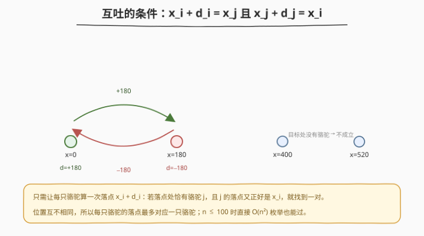
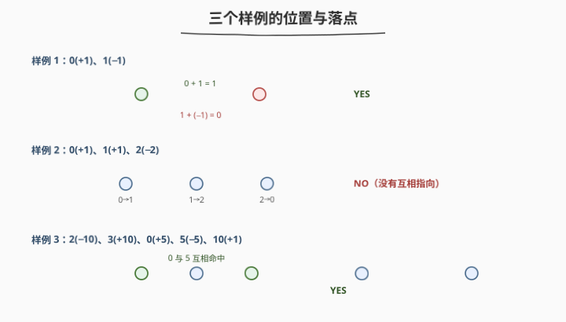

# Codeforces 29A 骆驼互吐判定 题解

## 1. 题目概述

- **题目链接**：https://codeforces.com/problemset/problem/29/A
- **比赛来源**：Codeforces Beta Round 29 (Div. 2, Codeforces format) · Problem A（UTC 2010-09-20）
- **难度**：1000
- **标签**：暴力
- **评测类型**：普通
- **限制**：时间 2 s / 内存 256 MB

**题意**：有 $n$ 只骆驼站在互不相同的位置 $x_i$ 上。第 $i$ 只骆驼向右（$d_i>0$）或向左（$d_i<0$）吐口水，距离为 $|d_i|$，只能命中位置 $x_i+d_i$ 上的骆驼。判断是否存在两只骆驼互相吐到对方。

**约束**：

- $n \le 100$：$O(n^2)$ 两两枚举完全可行；用哈希表做 $O(n)$ 更简单。
- $|x_i| \le 10^4$、$|d_i| \le 2 \times 10^4$：落点 $x_i+d_i$ 的绝对值不超过 $3 \times 10^4$，32 位整数足够。
- 保证没有两只骆驼站在同一位置，因此"落点处有骆驼"最多对应一只骆驼，可以直接用位置映射。
- 只有一组数据，输出 `YES` 或 `NO`。

## 2. 示例与观察

官方样例 1（输入 / 输出原样）：

```text
输入：
2
0 1
1 -1

输出：
YES
```

官方样例 2：

```text
输入：
3
0 1
1 1
2 -2

输出：
NO
```

官方样例 3：

```text
输入：
5
2 -10
3 10
0 5
5 -5
10 1

输出：
YES
```

**样例 1**：$0$ 号骆驼向右吐 1 米命中位置 1；位置 1 的骆驼向左吐 1 米命中位置 0，互相命中，YES。

**样例 2**：$0 \to 1$，$1 \to 2$，$2 \to 0$，三只骆驼形成"单向循环"，但没有任何一对互相指向，所以 NO。注意"存在命中"不等于"互相命中"。

**样例 3**：位置 0 的骆驼 $d=5$ 命中位置 5；位置 5 的骆驼 $d=-5$ 命中位置 0，互相命中，YES。其余落点（如 $2-10=-8$、$3+10=13$）处没有骆驼。

自造样例（均已用参考程序跑过）：

| 输入 | 输出 | 说明 |
|------|------|------|
| `1` / `0 1` | NO | 只有一只骆驼 |
| `2` / `0 1` / `1 1` | NO | 只有 0 命中 1，反向不命中 |
| `2` / `0 1` / `1 -1` | YES | 最短的互吐对 |
| `2` / `-10000 20000` / `10000 -20000` | YES | 极值坐标与距离 |
| `3` / `0 5` / `5 -5` / `10 5` | YES | 前两只互吐，第三只无关 |
| `2` / `0 1` / `2 -1` | NO | 落点处没有骆驼 |

**观察**：

1. 一只骆驼 $i$ 只会命中唯一的落点 $x_i+d_i$；若该位置没有骆驼，它不可能参与互吐。
2. 两只骆驼 $i,j$ 互吐的充要条件是

$$x_i + d_i = x_j \quad \text{且} \quad x_j + d_j = x_i.$$

两个条件必须同时成立；只满足一个只是单向命中。

3. 因为位置互不相同，可以建立"位置 → 骆驼编号"的哈希表，对每只骆驼 $O(1)$ 查它的落点。

## 3. 解题思路

### 3.1 朴素做法与瓶颈

两两枚举骆驼对 $(i,j)$，检查上面两个等式。$n \le 100$，最多 $4950$ 对，$O(n^2)$ 完全够用，2 s 余量巨大。

更快的做法是用哈希表：先记录每个位置上的骆驼编号；对每只骆驼 $i$，查 $x_i+d_i$ 处是否有骆驼 $j$，再验证 $x_j+d_j = x_i$。总时间 $O(n)$（期望）。

### 3.2 核心：落点映射



图中位置 0 与 180 的两只骆驼分别向对方吐 180 米，形成一对；位置 400 的骆驼向右吐 100 米，落点 500 处没有骆驼（只画了 520 处的骆驼），所以它不参与互吐。

实现步骤：

1. 读入 $n$ 与所有 $(x_i,d_i)$，同时建立 `pos[x_i] = i`；
2. 对每个 $i$，令 `t = x_i + d_i`；
3. 若 `pos` 中存在 `t`，取出骆驼 $j$，检查 $j \ne i$ 且 $x_j + d_j = x_i$；
4. 任意一对满足就输出 YES，否则 NO。

注意第 3 步的 $j \ne i$ 其实自动成立：$d_i \ne 0$，所以 $x_i+d_i \ne x_i$，落点不可能还是自己。

### 3.3 样例走查



- 样例 1：$0+1=1$，位置 1 的骆驼是 $j$，且 $1+(-1)=0$ → YES。
- 样例 2：$0+1=1$（骆驼 1 的落点是 2，不是 0）、$1+1=2$（骆驼 2 落点 0，不是 1），没有互指 → NO。
- 样例 3：$0+5=5$，位置 5 的骆驼落点 $5-5=0$ → YES。

## 4. 正确性证明

**引理 1（单向命中的判定）**：骆驼 $i$ 命中骆驼 $j$ 当且仅当 $j \ne i$ 且 $x_j = x_i + d_i$。

**证明**：题面规定吐口水只能命中落点 $x_i+d_i$ 处的骆驼；位置互不相同，所以该位置至多一只骆驼。∎

**引理 2（互吐的等价条件）**：骆驼 $i$ 与 $j$ 互吐当且仅当 $x_i+d_i = x_j$ 且 $x_j+d_j = x_i$。

**证明**：由引理 1，$i$ 命中 $j$ 等价于 $x_j=x_i+d_i$，$j$ 命中 $i$ 等价于 $x_i=x_j+d_j$；两者同时成立即互吐。∎

**定理**：程序输出 YES 当且仅当存在一对互相吐口水的骆驼。

**证明**：程序枚举每只骆驼 $i$ 的落点 $x_i+d_i$，若该位置有骆驼 $j$ 且 $x_j+d_j=x_i$，由引理 2 即找到互吐对，输出 YES。反之若存在互吐对 $(i,j)$，枚举到 $i$ 时落点必为 $x_j$，且 $x_j+d_j=x_i$，程序会输出 YES。∎

## 5. 复杂度分析

- **时间**：建哈希表 $O(n)$，每只骆驼一次查找与常数次比较，期望 $O(n)$；最坏 $O(n^2)$ 的两两枚举也远小于时限。$n \le 100$ 时不到几百次操作。
- **空间**：$O(n)$ 存位置映射。
- **数值范围**：$x_i+d_i$ 绝对值不超过 $3 \times 10^4$，`int` 足够。

## 6. 参考代码

### C++17

```cpp
#include <bits/stdc++.h>
using namespace std;

int main() {
    int n;
    if (!(cin >> n)) return 0;
    vector<int> x(n), d(n);
    unordered_map<int, int> pos;
    for (int i = 0; i < n; ++i) {
        cin >> x[i] >> d[i];
        pos[x[i]] = i;
    }
    for (int i = 0; i < n; ++i) {
        auto it = pos.find(x[i] + d[i]);
        if (it == pos.end()) continue;
        int j = it->second;
        if (j != i && x[j] + d[j] == x[i]) {
            cout << "YES\n";
            return 0;
        }
    }
    cout << "NO\n";
    return 0;
}
```

### Python3

```python
import sys


def main() -> None:
    data = list(map(int, sys.stdin.buffer.read().split()))
    if not data:
        return
    n = data[0]
    x = [0] * n
    d = [0] * n
    pos = {}
    p = 1
    for i in range(n):
        x[i], d[i] = data[p], data[p + 1]
        p += 2
        pos[x[i]] = i
    for i in range(n):
        j = pos.get(x[i] + d[i])
        if j is not None and j != i and x[j] + d[j] == x[i]:
            print("YES")
            return
    print("NO")


main()
```

两份代码都只用标准库，可原样提交。

## 7. 边界情况与易错点

1. **只有一只骆驼**：$n=1$ 时一定 NO；代码里落点即使指向别处也没有骆驼，自然输出 NO。
2. **单向命中不算**：样例 2 的 $0\to1\to2\to0$ 是单向环，不是互吐；必须同时检查两个等式，不能只看"落点有人"。
3. **落点没有骆驼**：直接跳过；不要默认每只骆驼都能命中。
4. **$d_i$ 可以为负**：落点 $x_i+d_i$ 可能小于 $x_i$，用普通整数加法即可，不要用绝对值。
5. **位置互不相同**：这是题面保证，哈希表才能"一个位置对应一只骆驼"；若输入可能重复，需要额外处理（本题不需要）。
6. **不要用数组下标当位置**：$x_i$ 可为负且范围到 $\pm 10^4$，用 `unordered_map`/`dict` 或加偏移量都行；哈希表最直接。
7. **输出大小写**：`YES`/`NO` 全大写。
8. **读入**：$n$ 行每行两个整数，可能有多余空白；按 token 读即可。

## 8. 验证记录

- **编译环境与命令**：本机没有 GNU `g++`（`/usr/bin/g++` 指向 `Apple clang 21.0.0`），`verify_solution.py` 自动用 `clang++ -std=c++17 -O2` 加仓库自带的 `bits/stdc++.h` 兼容头编译；Python 为 `Python 3.9.6`。
  - `python3 codeforces/tools/verify_solution.py codeforces/contests/0001-0100/29/A_骆驼互吐判定.md`
  - 输出：`CF29A: samples 3 / C++ 编译 OK, 样例 3/3 / Python 语法 OK, 样例 3/3`。
- **官方样例**：3 / 3 通过（`YES / NO / YES`），C++ 与 Python 输出与官方输出逐字一致。
- **随机与构造对拍**：308 组（300 组随机：$n \le 8$、位置取自 $[-20,20]$ 的互异值、$|d| \le 40$；8 组手工：单只、单向、极值、环状、多对）与 $O(n^2)$ 暴力逐组比对，C++、Python、暴力三者全部一致，0 组不符。
- **最大约束性能**：$n=100$ 的数据，C++ 端到端 < 3 ms，Python 约 20 ms，2 s 余量在数百倍以上。
- **图片校验**：`cf29a_pairs.svg`、`cf29a_walkthrough.svg` 均通过 `xml.etree.ElementTree.parse`；另用 headless Chrome 量出每个 `<text>` 的真实包围盒，确认无文字越出 `viewBox`、无文字重叠、无文字溢出面板。
- **公式校验**：正文公式全部是 `$...$` / `$$...$$`，星号直接写 `*`，`\text{}` 内无裸 `#`，经 KaTeX（`throwOnError`）渲染无报错。
- **复核状态**：verified（样例、对拍、性能、图片、公式均实跑通过；唯一环境差异是本机无 GNU g++，已用 clang++ 等价验证）。

## 相关题目与扩展

- [Codeforces 29B 红绿灯通行](https://codeforces.com/problemset/problem/29/B)：同场 B 题，时间轴模拟。
- [Codeforces 29C 明信片拼路径](https://codeforces.com/problemset/problem/29/C)：同场 C 题。
- [Codeforces 29D 树上叶子顺序](https://codeforces.com/problemset/problem/29/D)：同场 D 题。
- [Codeforces 29E 两人不相遇最短路](https://codeforces.com/problemset/problem/29/E)：同场 E 题。
- [LeetCode 1 两数之和](https://leetcode.cn/problems/two-sum/)：哈希表"查目标值是否存在"的入门题，和本题的落点查询同源。
- [LeetCode 219 存在重复元素 II](https://leetcode.cn/problems/contains-duplicate-ii/)：用哈希记录位置并检查条件，思路相近。

**延伸思考**：

1. **如果落点处有多只骆驼**：需要检查每一只是否反向命中；位置互不相同的保证被破坏，哈希表要改成"位置 → 骆驼列表"。
2. **如果要求输出所有互吐对**：找到一对后继续枚举，用集合去重（每对会被两个方向各找到一次）。
3. **如果 $n$ 放大到 $10^5$**：哈希表 $O(n)$ 仍然适用；但要小心哈希冲突与坐标范围，可用排序 + 双指针替代。
4. **如果是二维平面吐口水**：每只骆驼有一个向量，落点是 $x_i+\vec d_i$；用坐标哈希表判断，逻辑完全一样。
5. **如果距离可以为 0**：$d_i=0$ 表示原地吐，不会命中别人；本题 $|d_i|\ge 1$ 排除了这种退化。
