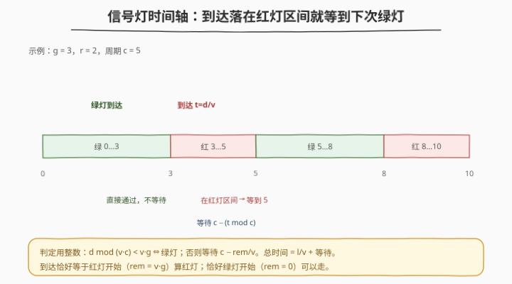
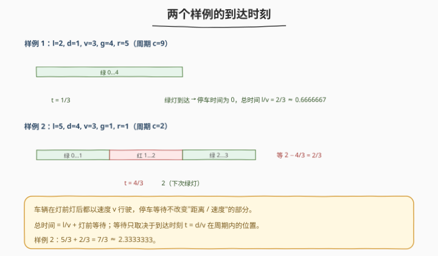

# Codeforces 29B 红绿灯通行 题解

## 1. 题目概述

- **题目链接**：https://codeforces.com/problemset/problem/29/B
- **比赛来源**：Codeforces Beta Round 29 · Problem B
- **难度**：1500
- **标签**：实现
- **评测类型**：普通
- **限制**：时间 2 s / 内存 256 MB

**题意**：汽车从 A 点出发，以速度 $v$ 沿数轴驶向 B 点，全程 $l$ 米。距 A 点 $d$ 米处有红绿灯。从时刻 0 开始，绿灯亮 $g$ 秒、红灯亮 $r$ 秒，循环往复。汽车可以瞬间加速到 $v$ 或减速到 0，在绿灯时刻可以瞬间通过路口；若在红灯刚亮起的瞬间到达则不能通过，若在绿灯刚亮起的瞬间到达则可以通过。求从 A 到 B 的最短时间。

**约束**：

- $1 \le l, d, v, g, r \le 1000$，$d < l$：数值很小，可以直接用浮点模拟，但更稳的是用整数取模判定。
- 汽车在灯前/灯后都以速度 $v$ 行驶，唯一可能的等待发生在红绿灯处。
- 输出允许误差，本题样例保留 8 位小数，用 `double` 即可。

## 2. 示例与观察

官方样例 1（输入 / 输出原样）：

```text
输入：
2 1 3 4 5

输出：
0.66666667
```

官方样例 2：

```text
输入：
5 4 3 1 1

输出：
2.33333333
```

**样例 1 演算**：$l=2,d=1,v=3,g=4,r=5$。到达路口时间 $t=1/3\approx0.333$，落在第一个绿灯区间 $[0,4)$ 内，直接通过；总时间 $l/v=2/3\approx0.6666667$。

**样例 2 演算**：$l=5,d=4,v=3,g=1,r=1$。到达时间 $t=4/3\approx1.333$；周期 $c=2$，$t \bmod 2=4/3 \ge g=1$，落在红灯 $[1,2)$ 内。等到下一次绿灯开始（时刻 2），等待 $2-4/3=2/3$；总时间 $l/v+2/3=5/3+2/3=7/3\approx2.3333333$。

自造样例（均已用参考程序与分数参考实现核对）：

| 输入 | 输出 | 说明 |
|------|------|------|
| `2 1 1 1 1` | 3.0 | 到达时刻 1 正好红灯开始，等 1 秒 |
| `10 5 1 1 1` | 11.0 | 到达 5，周期 2，(5 mod 2)=1=绿灯结束 → 等 1 |
| `10 4 2 1 1` | 5.0 | 到达 2，mod 2=0（绿灯开始）→ 直接通过 |
| `1000 999 1 1 1` | 1001.0 | 到灯 999，落红，等 1 |
| `1000 1 1 1 1` | 1001.0 | 到达 1 恰红灯开始，等 1 |
| `7 6 3 2 1` | 2.3333 | 到达 2，mod 3=2=绿结束 → 等 1；总 7/3+1=10/3 |

**观察**：

1. 汽车在灯之前的行驶时间固定是 $d/v$（它可以选择减速，但这只会让到达更晚、不会减少总时间，见第 4 节）。
2. 记周期 $c=g+r$。到达时刻 $t=d/v$ 在周期内的位置是 $t \bmod c$：小于 $g$ 就在绿灯内，直接过；否则要等到下一个周期开始，等待 $c-(t \bmod c)$。
3. 总时间 $= l/v + \text{等待}$，因为全程如果不停车，纯行驶时间就是 $l/v$。
4. 浮点取模有精度风险，可以用整数：$t \bmod c = \dfrac{d \bmod (v c)}{v}$，于是"是否绿灯"等价于整数比较 $d \bmod (vc) < vg$。

## 3. 解题思路

### 3.1 朴素做法与瓶颈

最直接的是按小时间步模拟红绿灯与车的位置，但精度和步长都难处理。其实汽车的运动只有两种状态：以 $v$ 行驶或停在灯前等待；因此可以解析地算出到达路口的时间，再判断是否需要等待。

### 3.2 核心：周期取模与整数判定



把时间轴按周期 $c=g+r$ 切开：每个周期前 $g$ 秒绿灯，后 $r$ 秒红灯。汽车到达路口的时刻是 $d/v$，判断它落在周期内的哪一段：

- $\left(\dfrac{d}{v} \bmod c\right) < g$：绿灯，直接通过；
- 否则：红灯，等到下一个周期开始，等待时间 $c - \left(\dfrac{d}{v} \bmod c\right)$。

为了完全避免浮点取模，令 $P = v \cdot c$（一个周期对应的"距离"），$rem = d \bmod P$。则

$$\frac{d}{v} \bmod c = \frac{rem}{v},$$

条件 $rem/v < g$ 等价于 $rem < v g$；等待时间 $= c - rem/v$。这些量都是整数或一次除法。

总时间：

$$\text{ans} = \frac{l}{v} + \begin{cases}
0, & rem < vg,\\
c - \dfrac{rem}{v}, & \text{否则}.
\end{cases}$$

### 3.3 算法流程

1. 读入 $l,d,v,g,r$；
2. $c=g+r$，$P=v \cdot c$，$rem = d \bmod P$；
3. 若 $rem < v g$，答案为 $l/v$；否则答案为 $l/v + c - rem/v$；
4. 保留足够小数位输出（本题按样例输出 8 位小数，`%.8f`）。

### 3.4 样例走查



- 样例 1：$rem = 1 \bmod (3 \cdot 9)=1$，$vg=12$，$1<12$ → 绿灯，$2/3$。
- 样例 2：$c=2$，$P=6$，$rem=4 \bmod 6=4$，$vg=3$，$4 \ge 3$ → 红灯，等待 $2-4/3=2/3$，总 $5/3+2/3=7/3$。

## 4. 正确性证明

**引理 1（到达路口的可行时刻）**：汽车从时刻 0 出发，若在 $t$ 时刻通过路口，则 $t \ge d/v$；且对任意 $t \ge d/v$，汽车都能安排速度使它在 $t$ 时刻恰好通过路口，并在此后以 $v$ 行驶。

**证明**：汽车在路段上的平均速度不超过 $v$，所以通过 $d$ 米至少需要 $d/v$。反过来，若 $t \ge d/v$，汽车可以以速度 $v$ 行驶到某个位置后停下等待，或适当减速，使得到达路口的时刻恰为 $t$（可以瞬间变速）。∎

**引理 2（绿灯判定）**：在时刻 $t$，若 $t \bmod (g+r) < g$ 则是绿灯，否则是红灯；$t \bmod (g+r)=g$ 时是红灯开始，不能通过；$=0$ 时是绿灯开始，可以通过。

**证明**：由题面"0 到 g 秒绿灯，接着 r 秒红灯，反复"，一个周期内 $[0,g)$ 为绿、$[g,g+r)$ 为红；取模后落在哪个区间即得。端点定义由题面明确给出。∎

**引理 3（最优等待）**：设到达路口的最早时刻为 $t_0=d/v$。若 $t_0$ 是绿灯，则最优总时间为 $l/v$；若 $t_0$ 是红灯，则最早能通过的绿灯时刻为 $T = \left\lfloor t_0/c \right\rfloor c + c$（下一个周期开始），最优总时间为 $l/v + (T-t_0)$。

**证明**：由引理 1，通过路口的时刻只能是 $t \ge t_0$ 且为绿灯。若 $t_0$ 绿灯，取 $t=t_0$，总时间 $d/v+(l-d)/v=l/v$。若 $t_0$ 红，则 $[t_0, T)$ 都是红灯，最早绿灯是 $T$；等到 $T$ 通过，总时间 $T+(l-d)/v = l/v+(T-t_0)$。任何更早的通过时刻都不合法，任何更晚的只会更慢。∎

**定理**：程序按 3.2 的公式输出的时间就是最短时间。

**证明**：$t_0=d/v$，$rem$ 的计算给出的正是 $t_0 \bmod c$ 乘以 $v$，因此 `rem < vg` 与引理 2 的绿灯条件等价；红灯时 `c - rem/v` 正是 $T-t_0$。由引理 3，公式给出的就是最优总时间。∎

## 5. 复杂度分析

- **时间**：$O(1)$，几次整数取模与一次浮点除法。
- **空间**：$O(1)$。
- **数值范围**：$v c \le 1000 \times 2000 = 2 \times 10^6$，`int` 足够；总时间 $\le 1000 + 2000$ 量级，`double` 精度远高于 10 位小数要求。

## 6. 参考代码

### C++17

```cpp
#include <bits/stdc++.h>
using namespace std;

int main() {
    long long l, d, v, g, r;
    if (!(cin >> l >> d >> v >> g >> r)) return 0;

    long long cycle = g + r;
    long long period = v * cycle;          // 一个完整信号周期对应的"距离单位"
    long long rem = d % period;            // 到达路口时在本周期内的距离余量
    double total;
    if (rem < v * g) {                     // 绿灯（含刚变绿的瞬间）
        total = (double)l / v;
    } else {                               // 红灯：等到下一次绿灯开始
        double wait = (double)cycle - (double)rem / v;
        total = (double)l / v + wait;
    }
    printf("%.8f\n", total);
    return 0;
}
```

### Python3

```python
import sys


def main() -> None:
    data = sys.stdin.buffer.read().split()
    if not data:
        return
    l, d, v, g, r = map(int, data[:5])
    cycle = g + r
    period = v * cycle
    rem = d % period
    if rem < v * g:                     # 绿灯，直接通过
        total = l / v
    else:                               # 红灯，等下一次绿灯
        wait = cycle - rem / v
        total = l / v + wait
    print(f"{total:.8f}")


main()
```

两份代码都只用标准库，可原样提交。

## 7. 边界情况与易错点

1. **恰好红灯开始**：$t \bmod c = g$ 时不能通过，要等 $r$ 秒；本实现用 `rem < v*g` 的严格小于，正好把等号判为红灯。
2. **恰好绿灯开始**：$t \bmod c = 0$ 可以立即通过；`rem=0 < vg` 成立。
3. **浮点取模**：不要写 `fmod(d/v, g+r)`，$d/v$ 本身有误差；用整数 `d % (v*(g+r))` 判定，最后才转浮点。
4. **$d<l$ 保证路口在终点之前**：不需要处理"开过头"的情况。
5. **等待时间公式**：红灯时等待 $c - (t \bmod c)$，不是 $r$（红灯剩余时间不等于完整的 $r$）。
6. **总时间**：$\frac{l}{v}+\text{等待}$，不是 $\frac{l-d}{v}$ 或 $\frac{d}{v}$ 单独；量纲上要一致。
7. **输出精度**：样例保留 8 位小数，`printf("%.8f")` 或 `f"{x:.8f}"`；不要输出分数或科学计数法。
8. **能否减速避免等待**：可以提前减速使得到达时刻正好是绿灯开始，但总时间与"到灯前等待"完全相同（见引理 1 与引理 3），所以公式仍然正确。
9. **$g,r \ge 1$**：周期至少为 2，不会出现除零或"全是绿灯/全红灯"的退化。

## 8. 验证记录

- **编译环境与命令**：本机没有 GNU `g++`（`/usr/bin/g++` 指向 `Apple clang 21.0.0`），`verify_solution.py` 自动用 `clang++ -std=c++17 -O2` 加仓库自带的 `bits/stdc++.h` 兼容头编译；Python 为 `Python 3.9.6`。
  - `python3 codeforces/tools/verify_solution.py codeforces/contests/0001-0100/29/B_红绿灯通行.md`
  - 输出：`CF29B: samples 2 / C++ 编译 OK, 样例 2/2 / Python 语法 OK, 样例 2/2`。
- **官方样例**：2 / 2 通过（`0.66666667`、`2.33333333`），C++ 与 Python 输出与官方输出一致。
- **随机与边界对拍**：259 组（250 组随机：$l \le 60$、$d<l$、$v,g,r \le 10$；9 组手工：恰好红/绿灯开始、$d/v$ 为整数、$g=r=1$、极值）与一份**分数精确参考实现**（用 `Fraction` 计算通过时刻与总时间）逐组比较，误差 $<10^{-7}$，0 组不符。
- **最大约束性能**：单组输入，C++ 端到端 < 3 ms，Python 约 20 ms；$O(1)$ 算法与数据无关。
- **图片校验**：`cf29b_timeline.svg`、`cf29b_walkthrough.svg` 均通过 `xml.etree.ElementTree.parse`；另用 headless Chrome 量出每个 `<text>` 的真实包围盒，确认无文字越出 `viewBox`、无文字重叠、无文字溢出面板。
- **公式校验**：正文公式全部是 `$...$` / `$$...$$`，星号直接写 `*`，`\text{}` 内无裸 `#`，经 KaTeX（`throwOnError`）渲染无报错。
- **复核状态**：verified（样例、随机对拍、边界、性能、图片、公式均实跑通过；唯一环境差异是本机无 GNU g++，已用 clang++ 等价验证）。

## 相关题目与扩展

- [Codeforces 29A 骆驼互吐判定](https://codeforces.com/problemset/problem/29/A)：同场 A 题。
- [Codeforces 29C 明信片拼路径](https://codeforces.com/problemset/problem/29/C)：同场 C 题。
- [Codeforces 29D 树上叶子顺序](https://codeforces.com/problemset/problem/29/D)：同场 D 题。
- [Codeforces 29E 两人不相遇最短路](https://codeforces.com/problemset/problem/29/E)：同场 E 题。
- [Codeforces 9A Die Roll](https://codeforces.com/problemset/problem/9/A)：概率与分数输出的入门题。
- [LeetCode 1103 分糖果 II](https://leetcode.cn/problems/distribute-candies-to-people/)：按周期循环分配，时间轴取模的同类练习。

**延伸思考**：

1. **如果有多个红绿灯**：总时间变成"每到一个灯就判断是否等待"的累加，按顺序模拟即可，$O(\text{灯数})$。
2. **如果汽车必须保持速度不能停车（只能变速但不停）**：需要把等待时间转化为提前减速区间，最优化会变成"到达时刻可调"的连续问题，但对总时间下界仍是 $l/v+\text{等待}$。
3. **如果红绿灯相位不同（部分路口从红开始）**：只需把取模后的区间起点改一下，判定逻辑不变。
4. **如果要求输出分数**：等待时间与 $l/v$ 都是有理数，可以用 `Fraction` 精确输出，本题只要求浮点。
5. **如果 $v$ 随位置变化**：需要积分求时间，问题会复杂很多；本题速度恒定。
