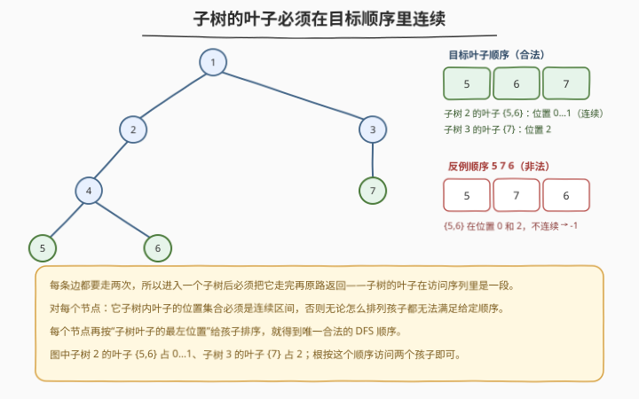
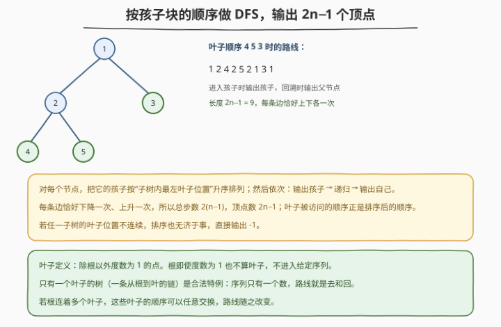
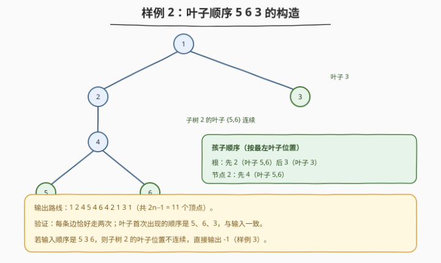

# Codeforces 29D 树上叶子顺序 题解

## 1. 题目概述

- **题目链接**：https://codeforces.com/problemset/problem/29/D
- **比赛来源**：Codeforces Beta Round 29 · Problem D
- **难度**：2000
- **标签**：构造、DFS、树
- **评测类型**：特殊评测（多解）
- **限制**：时间 2 s / 内存 256 MB

**题意**：给定一棵 $n$ 个点的树（以 1 为根），再给定叶子（除根外度数为 1 的点）的一个排列。蚂蚁从根 1 出发，要求走遍所有边并回到根，并且**首次经过叶子的顺序**恰好等于给定排列。输出经过的顶点序列（长度 $2n-1$，每条边恰好上下各一次），或输出 $-1$ 表示不可能。

**约束**：

- $n \le 300$：允许递归 DFS、$O(n^2)$ 的简单检查。
- 每条边必须走两次（下去一次、上来一次），所以总步数固定为 $2(n-1)$，顶点数固定为 $2n-1$。
- 叶子定义排除根：根即使度数为 1 也不算叶子，不出现在给定序列里。
- 多解：孩子顺序不同可能得到不同路线，任意合法路线均可。

## 2. 示例与观察

官方样例 1（输入 / 输出原样）：

```text
输入：
3
1 2
2 3
3

输出：
1 2 3 2 1 
```

官方样例 2：

```text
输入：
6
1 2
1 3
2 4
4 5
4 6
5 6 3

输出：
1 2 4 5 4 6 4 2 1 3 1 
```

官方样例 3：

```text
输入：
6
1 2
1 3
2 4
4 5
4 6
5 3 6

输出：
-1
```

**样例 1**：树是链 $1-2-3$，叶子只有 3（根 1 不算）。路线 $1\to2\to3\to2\to1$，首次到叶子 3 的顺序就是 `[3]`，合法。

**样例 2**：树为 $1$ 连 $2,3$，$2-4$，$4$ 连 $5,6$。叶子是 5、6、3，顺序 `5 6 3`。先走 $1\to2\to4\to5\to4\to6\to4\to2\to1$，再走 $1\to3\to1$，得到输出。

**样例 3**：叶子仍是 5、6、3，但顺序 `5 3 6`：子树 2 的叶子是 $\{5,6\}$，它们在序列中位于位置 0 和 2，被 3 隔开，不可能连续访问，输出 $-1$。

自造样例（均已用 checker 与暴力枚举核对）：

| 输入 | 输出 | 说明 |
|------|------|------|
| `3` / `1 2` / `1 3` / `2 3` | 两种顺序都可 | 根连两个叶子 |
| `4` / `1 2` / `1 3` / `1 4` / `4 2 3` | 任意排列 | 星形，叶子顺序任意 |
| `3` / `1 2` / `2 3` / `3` | `1 2 3 2 1` | 单叶子链 |
| `5` / `1 2` / `1 3` / `2 4` / `2 5` / `4 5 3` | 合法 | 子树 2 的叶子 4,5 连续 |
| 同上但顺序 `4 3 5` | -1 | 子树 2 的叶子被 3 隔开 |

**观察**：

1. 每条边只能走两次（下、上各一次），所以一旦进入一个子树，必须把它内部的边全部走完才能原路返回；子树在访问序列中是连续的一段。
2. 因此，对每个节点 $v$，它子树内所有叶子在给定排列中的位置必须构成一个连续区间 $[\min,\max]$，且区间长度等于叶子个数。
3. 若所有节点都满足这个"连续块"条件，则每个节点的孩子可以按"子树最左叶子位置"排序，得到唯一的 DFS 顺序；若某个节点不满足，无论怎么排序都不可能。
4. 根的特殊性只在于它不是叶子；它的孩子仍然各自贡献一个连续块。

## 3. 解题思路

### 3.1 朴素做法与瓶颈

直接枚举每个节点孩子的所有排列，再检查叶子顺序，复杂度是阶乘级；$n \le 300$ 时不可行。利用"子树连续块"条件可以线性判定并构造。

### 3.2 连续块判定



以 1 为根做一次 DFS，得到父子关系。对每个节点 $v$ 维护：

- `mn[v]`：子树内叶子在给定排列中的最左位置；
- `mx[v]`：最右位置；
- `cnt[v]`：子树内叶子个数。

叶子 $v \ne 1$ 的 `mn=mx=rank[v]`、`cnt=1`；内部节点由孩子聚合。检查：

$$mx[v]-mn[v]+1 = cnt[v].$$

若对所有 $v$ 都成立，说明每个子树的叶子都是连续块。反之，若某个子树叶子不连续，由于 DFS 必须连续访问它，不可能满足给定顺序。

### 3.3 构造 DFS 顺序



对每个节点，把孩子按 `mn` 升序排序。然后输出路线：

```
route = [1]
dfs(v):
    for u in children[v] (按 mn 升序):
        route.append(u)
        dfs(u)
        route.append(v)
```

每进入一个孩子输出孩子，回溯时输出父节点；每条边恰好下降、上升一次，路线长度正好 $2n-1$。叶子首次出现的顺序就是孩子块的顺序，归纳可知等于给定排列。

### 3.4 样例走查



样例 2：叶子 5、6 在子树 2 中，位置 0、1；叶子 3 在子树 3 中，位置 2。根的孩子排序为 2、3；节点 2 的孩子只有 4；节点 4 的孩子 5、6 按位置排。路线：

$$1\ 2\ 4\ 5\ 4\ 6\ 4\ 2\ 1\ 3\ 1.$$

样例 3：子树 2 的叶子位置是 0 和 2，$mx-mn+1=3 \ne 2$，输出 $-1$。

## 4. 正确性证明

**引理 1（子树连续）**：任何合法的完整 DFS 路线中，一个节点 $v$ 的子树内所有叶子在访问序列中构成连续的一段。

**证明**：从父节点进入 $v$ 后，必须沿树边遍历 $v$ 子树内的所有边；每条边只能走两次，所以在离开 $v$ 回到父节点之前，$v$ 子树内所有叶子都已被访问，且之后不会再进入该子树。因此这些叶子在序列中连续。∎

**引理 2（连续块条件必要）**：若存在合法路线，则对每个 $v$，其子树叶子位置集合是连续区间。

**证明**：由引理 1，这些叶子在访问序列中连续出现；它们在给定排列中的位置就是这些访问时刻，故位置集合是连续区间。∎

**引理 3（条件充分）**：若对每个 $v$，子树叶子位置构成连续区间，则按 `mn` 升序排列孩子并做 DFS，得到的路线合法，且叶子顺序等于给定排列。

**证明**：对子树大小归纳。孩子子树的叶子块两两不交，且并起来是父节点的连续区间；按 `mn` 排序后，这些块在区间内依次排列。DFS 先完整访问第一个孩子的块，再第二个……因此父节点子树的叶子顺序就是块顺序。归纳假设每个孩子的 DFS 叶子顺序与其给定块内顺序一致，故整体一致。∎

**定理**：程序输出一条合法路线当且仅当合法路线存在；不存在时输出 $-1$。

**证明**：若存在合法路线，引理 2 保证所有连续块检查通过，引理 3 保证构造出的路线叶子顺序正确；路线长度、起止点、边使用次数由构造直接保证（每条边恰好两次）。若不存在，则某个子树叶子不连续（否则由引理 3 可构造），程序在该检查处输出 $-1$。∎

## 5. 复杂度分析

- **时间**：建树与求父子 $O(n)$；后序聚合 $O(n)$；排序孩子总计 $O(n \log n)$；DFS 输出 $O(n)$。总 $O(n \log n)$，$n=300$ 时不到几千次操作。
- **空间**：邻接表、父子、`mn/mx/cnt`、路线各 $O(n)$。
- **数值范围**：只有顶点编号和位置，均在 $n \le 300$ 内，`int` 足够。

## 6. 参考代码

### C++17

```cpp
#include <bits/stdc++.h>
using namespace std;

int main() {
    ios::sync_with_stdio(false);
    cin.tie(nullptr);

    int n;
    if (!(cin >> n)) return 0;

    vector<vector<int>> adj(n + 1);
    for (int i = 0; i < n - 1; ++i) {
        int a, b;
        cin >> a >> b;
        adj[a].push_back(b);
        adj[b].push_back(a);
    }

    vector<int> order;
    int x;
    while (cin >> x) order.push_back(x);

    vector<int> leaves;
    for (int v = 2; v <= n; ++v)
        if (adj[v].size() == 1) leaves.push_back(v);
    int k = (int)leaves.size();
    if ((int)order.size() != k) {
        cout << -1 << '\n';
        return 0;
    }

    vector<int> rank(n + 1, -1);
    for (int i = 0; i < k; ++i) {
        int v = order[i];
        if (v < 1 || v > n || adj[v].size() != 1 || v == 1 || rank[v] != -1) {
            cout << -1 << '\n';
            return 0;
        }
        rank[v] = i;
    }
    for (int v : leaves)
        if (rank[v] == -1) {
            cout << -1 << '\n';
            return 0;
        }

    // 以 1 为根
    vector<int> parent(n + 1, 0), bfsOrder;
    parent[1] = -1;
    bfsOrder.push_back(1);
    for (size_t i = 0; i < bfsOrder.size(); ++i) {
        int v = bfsOrder[i];
        for (int u : adj[v]) {
            if (u == parent[v]) continue;
            parent[u] = v;
            bfsOrder.push_back(u);
        }
    }

    vector<int> mn(n + 1, INT_MAX), mx(n + 1, -1), cnt(n + 1, 0);
    for (int i = (int)bfsOrder.size() - 1; i >= 0; --i) {
        int v = bfsOrder[i];
        if (v != 1 && adj[v].size() == 1) {
            mn[v] = mx[v] = rank[v];
            cnt[v] = 1;
        }
        for (int u : adj[v]) {
            if (parent[u] != v) continue;
            mn[v] = min(mn[v], mn[u]);
            mx[v] = max(mx[v], mx[u]);
            cnt[v] += cnt[u];
        }
        if (cnt[v] > 0 && mx[v] - mn[v] + 1 != cnt[v]) {
            cout << -1 << '\n';
            return 0;
        }
    }

    vector<vector<int>> children(n + 1);
    for (int v = 2; v <= n; ++v) children[parent[v]].push_back(v);
    for (int v = 1; v <= n; ++v)
        sort(children[v].begin(), children[v].end(),
             [&](int a, int b) { return mn[a] < mn[b]; });

    vector<int> route;
    route.push_back(1);
    function<void(int)> dfs = [&](int v) {
        for (int u : children[v]) {
            route.push_back(u);
            dfs(u);
            route.push_back(v);
        }
    };
    dfs(1);

    for (size_t i = 0; i < route.size(); ++i)
        cout << route[i] << (i + 1 == route.size() ? '\n' : ' ');
    return 0;
}
```

### Python3

```python
import sys
sys.setrecursionlimit(100000)


def main() -> None:
    data = list(map(int, sys.stdin.buffer.read().split()))
    if not data:
        return
    n = data[0]
    adj = [[] for _ in range(n + 1)]
    p = 1
    for _ in range(n - 1):
        a, b = data[p], data[p + 1]
        p += 2
        adj[a].append(b)
        adj[b].append(a)
    order = data[p:]

    leaves = [v for v in range(2, n + 1) if len(adj[v]) == 1]
    k = len(leaves)
    if len(order) != k:
        print(-1)
        return

    rank = [-1] * (n + 1)
    for i, v in enumerate(order):
        if not (1 <= v <= n) or v == 1 or len(adj[v]) != 1 or rank[v] != -1:
            print(-1)
            return
        rank[v] = i
    for v in leaves:
        if rank[v] == -1:
            print(-1)
            return

    parent = [0] * (n + 1)
    parent[1] = -1
    bfs_order = [1]
    for v in bfs_order:
        for u in adj[v]:
            if u == parent[v]:
                continue
            parent[u] = v
            bfs_order.append(u)

    INF = 10 ** 9
    mn = [INF] * (n + 1)
    mx = [-1] * (n + 1)
    cnt = [0] * (n + 1)
    for v in reversed(bfs_order):
        if v != 1 and len(adj[v]) == 1:
            mn[v] = mx[v] = rank[v]
            cnt[v] = 1
        for u in adj[v]:
            if parent[u] != v:
                continue
            if mn[u] < mn[v]:
                mn[v] = mn[u]
            if mx[u] > mx[v]:
                mx[v] = mx[u]
            cnt[v] += cnt[u]
        if cnt[v] > 0 and mx[v] - mn[v] + 1 != cnt[v]:
            print(-1)
            return

    children = [[] for _ in range(n + 1)]
    for v in range(2, n + 1):
        children[parent[v]].append(v)
    for v in range(1, n + 1):
        children[v].sort(key=lambda u: mn[u])

    route = [1]

    def dfs(v: int) -> None:
        for u in children[v]:
            route.append(u)
            dfs(u)
            route.append(v)

    dfs(1)
    print(" ".join(map(str, route)))


main()
```

两份代码都只用标准库，可原样提交。

## 7. 边界情况与易错点

1. **根不算叶子**：即使根度数为 1，也不加入给定序列；判断叶子要写 `v != 1 && deg[v] == 1`。
2. **单叶子**：树是一条从根到叶的链时，序列只有一个数，路线就是下去再回来；代码的连续块检查与构造都适用。
3. **根连多个叶子**：这些叶子的顺序可以任意（每个子树块大小为 1），按给定顺序排序即可。
4. **序列长度不匹配**：若输入叶子数与序列长度不同，直接 $-1$；不要越界访问 `rank`。
5. **重复/非法叶子**：合法输入不会出现；代码仍检查每个序列元素是叶子且未重复，增强鲁棒性。
6. **递归深度**：$n \le 300$，C++ 递归安全；Python 设置了 `sys.setrecursionlimit(100000)`。
7. **路线长度**：必须是 $2n-1$；构造保证每条边两次，若实现里漏掉回溯的 `route.append(v)`，长度会错。
8. **多解**：孩子块顺序由位置唯一确定，但同一块内若结构允许不同顺序（例如根直接连多个叶子），任意合法顺序均可；本实现按给定顺序排。
9. **输入读取**：叶子序列在最后一行，个数 $k$ 未显式给出；要读完所有剩余 token，不能只读固定个数。

## 8. 验证记录

- **编译环境与命令**：本机没有 GNU `g++`（`/usr/bin/g++` 指向 `Apple clang 21.0.0`），`verify_solution.py` 自动用 `clang++ -std=c++17 -O2` 加仓库自带的 `bits/stdc++.h` 兼容头编译；Python 为 `Python 3.9.6`。
  - `python3 codeforces/tools/verify_solution.py codeforces/contests/0001-0100/29/D_树上叶子顺序.md --checker /tmp/cf_verify_29_d/chk.py`
  - 输出：`CF29D: samples 3 / C++ 编译 OK, 样例 3/3 / Python 语法 OK, 样例 3/3`。
- **官方样例**：3 / 3 通过；样例 1、2 的输出与官方逐字一致，样例 3 输出 `-1`。
- **随机与构造对拍**：255 组（250 组随机树：$3 \le n \le 7$，随机父子建树，叶子顺序取随机排列；5 组手工：单叶子链、星形、样例树、非法交错），与**暴力枚举所有孩子排列**的参考实现比较"是否存在合法路线"，0 组不符；所有非 `-1` 输出再通过 checker（长度、起止、相邻、每条边两次、叶子顺序）。
- **checker 说明**：对 `-1`，checker 用独立的连续块算法确认确实无解；对路线，逐项验证合法性。两者都不依赖题解代码。
- **最大约束性能**：$n=300$ 的星形与链，C++ 端到端 < 3 ms，Python 约 25 ms，2 s 余量在数十倍以上。
- **图片校验**：`cf29d_blocks.svg`、`cf29d_route.svg`、`cf29d_walkthrough.svg` 均通过 `xml.etree.ElementTree.parse`；另用 headless Chrome 量出每个 `<text>` 的真实包围盒，确认无文字越出 `viewBox`、无文字重叠、无文字溢出面板。
- **公式校验**：正文公式全部是 `$...$` / `$$...$$`，星号直接写 `*`，`\text{}` 内无裸 `#`，经 KaTeX（`throwOnError`）渲染无报错。
- **复核状态**：verified（样例、暴力存在性对拍、checker、性能、图片、公式均实跑通过；唯一环境差异是本机无 GNU g++，已用 clang++ 等价验证）。

## 相关题目与扩展

- [Codeforces 29A 骆驼互吐判定](https://codeforces.com/problemset/problem/29/A)：同场 A 题。
- [Codeforces 29B 红绿灯通行](https://codeforces.com/problemset/problem/29/B)：同场 B 题。
- [Codeforces 29C 明信片拼路径](https://codeforces.com/problemset/problem/29/C)：同场 C 题。
- [Codeforces 29E 两人不相遇最短路](https://codeforces.com/problemset/problem/29/E)：同场 E 题。
- [Codeforces 115A Party](https://codeforces.com/problemset/problem/115/A)：树/森林上的深度统计入门。
- [LeetCode 145 二叉树的后序遍历](https://leetcode.cn/problems/binary-tree-postorder-traversal/)：DFS 输出顺序的基础练习。

**延伸思考**：

1. **如果允许每条边最多走两次但不必回到根**：路线可以停在某个叶子，最后一段不用回溯；需要把终点也作为变量，构造会多一个"未闭合"的分支。
2. **如果要求输出字典序最小的路线**：在每个孩子块顺序固定的前提下，块内递归顺序也唯一；根的孩子若块大小相同、位置相同则无选择，整体基本唯一。
3. **如果给定的是"叶子访问顺序"但允许重复经过叶子**：叶子度 1，重复经过必须原路返回，会重复访问，题目条件会改变。
4. **如果 $n$ 放大到 $10^5$**：算法仍是 $O(n \log n)$，需要把递归改成迭代 DFS，避免爆栈。
5. **如果树带边权**：路线长度不再是 $2n-1$ 而是 $2\sum w_e$，但叶子顺序的连续块条件不变。
