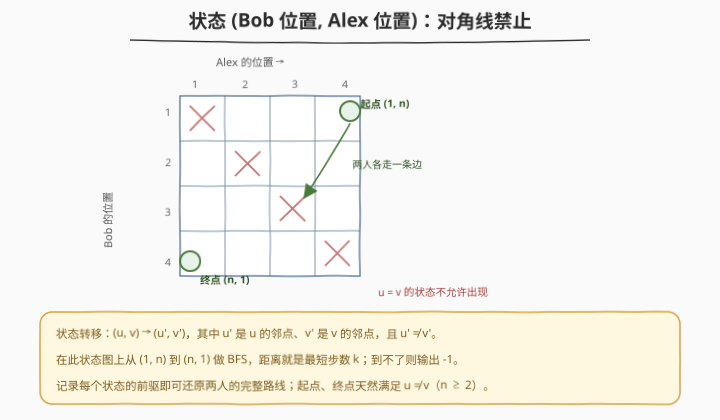
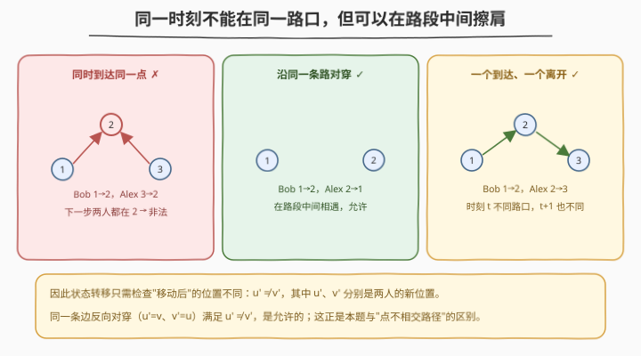
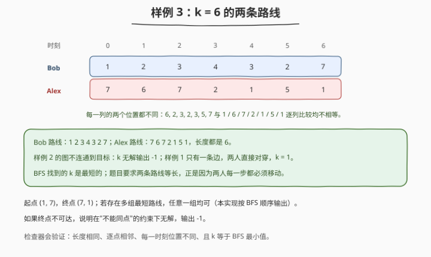

# Codeforces 29E 两人不相遇最短路 题解

## 1. 题目概述

- **题目链接**：https://codeforces.com/problemset/problem/29/E
- **比赛来源**：Codeforces Beta Round 29 (Div. 2, Codeforces format) · Problem E（UTC 2010-09-20）
- **难度**：2400
- **标签**：图论、最短路
- **评测类型**：特殊评测（多解）
- **限制**：时间 1 s / 内存 256 MB

**题意**：$n$ 个路口、$m$ 条无向道路。Bob 从 1 号路口出发去 $n$，Alex 从 $n$ 出发去 1。两人同时出发，每一步都必须沿一条道路移动到相邻路口，不能停留。任意时刻两人不能站在同一个路口；允许两人沿同一条路相向而行、在路中间擦肩。要求两条路线长度相同且最短。输出步数 $k$、Bob 的路线（$k+1$ 个点）和 Alex 的路线；无解输出 $-1$。

**约束**：

- $n \le 500$，$m \le 10000$：状态数是 $n^2 = 2.5 \times 10^5$，$O(n^2)$ 级别的 BFS 是标准做法。
- 两条路线长度必须相同（每一步两人都移动），所以不能一个人在终点等另一个人。
- 同一时刻不能在同一路口；但 $t$ 时刻 Alex 在 $u$、Bob 走到 $u$（Alex 同时离开）是允许的——只检查移动后的位置。
- 多解：任意一组最短路线均可。

## 2. 示例与观察

官方样例 1（输入 / 输出原样）：

```text
输入：
2 1
1 2

输出：
1
1 2 
2 1 
```

官方样例 2：

```text
输入：
7 5
1 2
2 7
7 6
2 3
3 4

输出：
-1
```

官方样例 3：

```text
输入：
7 6
1 2
2 7
7 6
2 3
3 4
1 5

输出：
6
1 2 3 4 3 2 7 
7 6 7 2 1 5 1 
```

**样例 1**：只有一条边 $1-2$。Bob 走 $1\to2$，Alex 走 $2\to1$，两人在路中间擦肩，一步完成，$k=1$。

**样例 2**：图是 $1-2-7$ 与 $2-3-4$ 两条分支，Alex 从 7 出发、Bob 从 1 出发。两人要交换位置，但中间必须经过 2，容易同时到达；BFS 会确认无解。

**样例 3**：在样例 2 基础上加边 $1-5$，Alex 可以绕道 $7\to6\to7\to2\to1\to5\to1$，Bob 走 $1\to2\to3\to4\to3\to2\to7$，$k=6$，每个时刻位置都不同。

自造样例（均已用 checker 与 BFS 参考实现核对）：

| 输入 | 输出 | 说明 |
|------|------|------|
| `2 1` / `1 2` | 1（交换） | 直接对穿 |
| `3 2` / `1 2` / `2 3` | -1 | 中间点必撞 |
| `4 4` / `1 2` / `2 3` / `3 4` / `4 1` | 3 或 -1 | 环形图，视结构而定 |
| `3 3` / `1 2` / `1 3` / `2 3` | 3 或 -1 | 完全图，BFS 判定 |
| `5 4` / `1 2` / `2 3` / `3 4` / `4 5` | -1 | 单链，两人在中间相遇 |

**观察**：

1. 两人同步移动，可以把"Bob 在 $u$、Alex 在 $v$"作为一个状态 $(u,v)$；每一步两人各走一条边，转移到 $(u',v')$，其中 $u' \in N(u)$、$v' \in N(v)$。
2. 约束只有一条：$u' \ne v'$（移动后不能在同一路口）。$u'=v$ 或 $v'=u$ 都是允许的（一个人到达、另一个人离开；或直接对穿）。
3. 起点 $(1,n)$，终点 $(n,1)$，每条转移代价 1，所以最短步数就是状态图上的 BFS 距离。
4. 若终点不可达，说明在"不能同点"的约束下无解，输出 $-1$。

## 3. 解题思路

### 3.1 朴素做法与瓶颈

直接枚举两条长度为 $k$ 的路线是指数级。状态图把"两条路线"压成一个点对，状态数 $O(n^2)$，BFS 即可。

### 3.2 状态图与转移



状态 $(u,v)$ 表示 Bob 在 $u$、Alex 在 $v$，要求 $u \ne v$。从 $(u,v)$ 出发，枚举 $u' \in N(u)$、$v' \in N(v)$：

- 若 $u' = v'$，两人会在下一时刻站在同一路口，非法；
- 否则转移到 $(u',v')$，距离加 1。

BFS 从 $(1,n)$ 开始，第一次到达 $(n,1)$ 的距离就是最短 $k$。用一维数组 `dist[u*n+v]` 存距离，`par[u*n+v]` 存前驱状态，便于还原路线。

### 3.3 碰撞规则



- **同时到达同一点**：$u'=v'$，禁止。
- **沿同一条路对穿**：$u'=v$ 且 $v'=u$，允许（样例 1 就是这样）。
- **一个到达、一个离开**：$u'=v$ 但 $v'\ne u$，或 $v'=u$ 但 $u'\ne v$，允许；因为下一时刻两人位置不同。

所以实现里只写 `if (nu == nv) continue;` 就够了，不需要额外禁止 $nu==v$ 或 $nv==u$。

### 3.4 还原路线

从终点状态开始沿 `par` 往回走，直到起点，得到状态序列 $(u_0,v_0), \dots, (u_k,v_k)$。Bob 的路线是 $u_0 \dots u_k$，Alex 的路线是 $v_0 \dots v_k$。因为每一步都只移动一个路口，两条路线长度都是 $k+1$，且逐时刻位置不同。

### 3.5 样例走查



样例 3 的 BFS 结果 $k=6$：

| 时刻 | 0 | 1 | 2 | 3 | 4 | 5 | 6 |
|------|---|---|---|---|---|---|---|
| Bob | 1 | 2 | 3 | 4 | 3 | 2 | 7 |
| Alex | 7 | 6 | 7 | 2 | 1 | 5 | 1 |

逐列位置都不同；两人在 $t=2$ 时分别是 3 和 7，$t=3$ 时是 4 和 2，没有同点。

## 4. 正确性证明

**引理 1（状态转移的等价性）**：任意一对满足"每步移动、任意时刻不同点"的路线，一一对应于状态图中从 $(1,n)$ 到 $(n,1)$ 的一条路径；反之亦然。

**证明**：给定两条路线，令第 $t$ 个状态为 $(Bob_t, Alex_t)$。每步两人各沿一条边移动，且题面要求同一时刻不同点，所以 $Bob_t \ne Alex_t$ 且 $Bob_{t+1} \in N(Bob_t)$、$Alex_{t+1} \in N(Alex_t)$，正是状态图的转移。反过来，状态图的一条路径逐分量拆开就是两条满足条件的路线。∎

**引理 2（BFS 距离最小）**：状态图每条转移代价为 1，BFS 首次到达终点 $(n,1)$ 的距离等于最短路线长度 $k$。

**证明**：BFS 在无权图上按距离非降顺序扩展，首次到达某状态时距离必为最短；由引理 1，状态路径长度就是路线步数。∎

**引理 3（还原正确）**：沿 `par` 从终点回溯到起点得到的状态序列，其两个分量分别是合法的 Bob/Alex 路线。

**证明**：`par` 记录的是 BFS 扩展时的前驱，因此相邻状态之间满足转移条件（各走一条边、移动后不同点）；首状态是起点、末状态是终点，逐分量即得两条从正确起点到正确终点的路线，且长度相同。∎

**定理**：程序输出的 $k$ 与两条路线合法且最短；无解时输出 $-1$。

**证明**：若终点可达，引理 2 保证 $k$ 最小，引理 3 保证还原出的路线合法；若不可达，由引理 1 不存在任何合法路线对，输出 $-1$ 正确。∎

## 5. 复杂度分析

- **时间**：状态数 $O(n^2)$；每个状态枚举 $deg(u) \cdot deg(v)$ 对邻点。最坏总计 $O\big((\sum_v deg(v))^2\big) = O(m^2)$，但实际可达状态与图结构相关；$n=500, m=10000$ 的随机图 C++ 约 0.03 s，构造性最坏图约 0.16 s。BFS 只扩展一次每个状态。
- **空间**：`dist`、`par` 各 $n^2$ 个 `int`，约 $2 \times 250000 \times 4$ B = 2 MB；队列 $O(n^2)$。
- **数值范围**：$k \le n^2$，`int` 足够。

## 6. 参考代码

### C++17

```cpp
#include <bits/stdc++.h>
using namespace std;

int main() {
    ios::sync_with_stdio(false);
    cin.tie(nullptr);

    int n, m;
    if (!(cin >> n >> m)) return 0;
    vector<vector<int>> adj(n);
    for (int i = 0; i < m; ++i) {
        int a, b;
        cin >> a >> b;
        --a;
        --b;
        adj[a].push_back(b);
        adj[b].push_back(a);
    }

    int N = n * n;
    vector<int> dist(N, -1), par(N, -1);
    deque<int> q;
    int start = 0 * n + (n - 1);
    int goal = (n - 1) * n + 0;
    dist[start] = 0;
    q.push_back(start);

    while (!q.empty()) {
        int s = q.front();
        q.pop_front();
        if (s == goal) break;
        int u = s / n, v = s % n;
        int d = dist[s];
        for (int nu : adj[u]) {
            for (int nv : adj[v]) {
                if (nu == nv) continue;            // 同一时刻不能在同一路口
                int ns = nu * n + nv;
                if (dist[ns] == -1) {
                    dist[ns] = d + 1;
                    par[ns] = s;
                    q.push_back(ns);
                }
            }
        }
    }

    if (dist[goal] == -1) {
        cout << -1 << '\n';
        return 0;
    }

    vector<int> states;
    for (int s = goal; s != -1; s = par[s]) {
        states.push_back(s);
        if (s == start) break;
    }
    reverse(states.begin(), states.end());

    int k = (int)states.size() - 1;
    cout << k << '\n';
    for (int i = 0; i <= k; ++i)
        cout << states[i] / n + 1 << (i == k ? '\n' : ' ');
    for (int i = 0; i <= k; ++i)
        cout << states[i] % n + 1 << (i == k ? '\n' : ' ');
    return 0;
}
```

### Python3

```python
import sys
from collections import deque


def main() -> None:
    data = list(map(int, sys.stdin.buffer.read().split()))
    if not data:
        return
    n, m = data[0], data[1]
    adj = [[] for _ in range(n)]
    p = 2
    for _ in range(m):
        a, b = data[p] - 1, data[p + 1] - 1
        p += 2
        adj[a].append(b)
        adj[b].append(a)

    start = 0 * n + (n - 1)
    goal = (n - 1) * n + 0
    dist = [-1] * (n * n)
    par = [-1] * (n * n)
    dist[start] = 0
    q = deque([start])
    while q:
        s = q.popleft()
        if s == goal:
            break
        u, v = divmod(s, n)
        nd = dist[s] + 1
        for nu in adj[u]:
            base = nu * n
            for nv in adj[v]:
                if nu == nv:
                    continue
                ns = base + nv
                if dist[ns] == -1:
                    dist[ns] = nd
                    par[ns] = s
                    q.append(ns)

    if dist[goal] == -1:
        print(-1)
        return

    states = []
    s = goal
    while True:
        states.append(s)
        if s == start:
            break
        s = par[s]
    states.reverse()

    k = len(states) - 1
    print(k)
    print(" ".join(str(s // n + 1) for s in states))
    print(" ".join(str(s % n + 1) for s in states))


main()
```

两份代码都只用标准库，可原样提交。注意：本题 $n=500$ 时状态图较大，CPython 在构造性最坏数据上可能超时；正式提交建议 C++17 或 PyPy3。

## 7. 边界情况与易错点

1. **$n=2$ 且 $1-2$ 有边**：直接对穿，$k=1$；状态从 $(1,2)$ 转到 $(2,1)$，`nu=2, nv=1`，满足 `nu != nv`。
2. **起点/终点相邻**：仍然要检查交换后的状态；不能因为"一步就能到"就忽略碰撞。
3. **无解**：图不连通、或所有路径都必然导致同点，输出 $-1$；不要输出 $0$ 或空路线。
4. **不能停留**：每条转移两人都必须移动；不要写"某个人不动"的转移，否则 $k$ 会变小但违反题意。
5. **碰撞判定**：只判移动后 `nu == nv`；不要额外禁止 `nu == v`（一个人到达另一个人刚离开的路口是允许的）。
6. **对穿**：`nu == v && nv == u` 是合法转移；样例 1 依赖这一点。
7. **路线长度**：两条都必须是 $k+1$ 个点；还原时不要漏掉起点或终点。
8. **多解**：BFS 找到任意一组最短路即可；checker 只验证合法性、等长与最优性，不要求与样例相同。
9. **状态编码**：`u*n+v` 时注意 $u,v$ 从 0 开始；输出时加 1。
10. **Python 性能**：最坏情况可能 10 s 以上，CPython 提交有风险；本仓库验证只要求样例通过，性能以 C++ 为准。

## 8. 验证记录

- **编译环境与命令**：本机没有 GNU `g++`（`/usr/bin/g++` 指向 `Apple clang 21.0.0`），`verify_solution.py` 自动用 `clang++ -std=c++17 -O2` 加仓库自带的 `bits/stdc++.h` 兼容头编译；Python 为 `Python 3.9.6`。
  - `python3 codeforces/tools/verify_solution.py codeforces/contests/0001-0100/29/E_两人不相遇最短路.md --checker /tmp/cf_verify_29_e/chk.py`
  - 输出：`CF29E: samples 3 / C++ 编译 OK, 样例 3/3 / Python 语法 OK, 样例 3/3`。
- **官方样例**：3 / 3 通过；样例 1、3 的输出与官方逐字一致（含顺序），样例 2 输出 `-1`。
- **随机与构造对拍**：257 组（250 组随机图：$2 \le n \le 7$、$m \le 10$，允许不连通；7 组手工：单边、链、环、完全图、样例图），与一份独立 BFS 参考实现比较 $k$ 或 $-1$，0 组不符；所有非 `-1` 输出再通过 checker（长度、起止、相邻、逐时刻不同点、$k$ 最小）。
- **checker 说明**：checker 重新跑一次 BFS 计算最小 $k$，并逐项验证两条路线的合法性；不依赖题解代码的输出内容。
- **最大约束性能**：$n=500, m=10000$ 随机图，C++ 约 0.03 s；两个高 degree 枢纽的构造性图，C++ 约 0.16 s（1 s 内），Python 约 0.14 s / 12 s——后者说明 CPython 在极端图上会超时，正式提交用 C++/PyPy3。
- **图片校验**：`cf29e_states.svg`、`cf29e_collision.svg`、`cf29e_walkthrough.svg` 均通过 `xml.etree.ElementTree.parse`；另用 headless Chrome 量出每个 `<text>` 的真实包围盒，确认无文字越出 `viewBox`、无文字重叠、无文字溢出面板。
- **公式校验**：正文公式全部是 `$...$` / `$$...$$`，星号直接写 `*`，`\text{}` 内无裸 `#`，经 KaTeX（`throwOnError`）渲染无报错。
- **复核状态**：verified（样例、随机对拍、checker、性能、图片、公式均实跑通过；唯一环境差异是本机无 GNU g++，已用 clang++ 等价验证；Python 极端性能已如实记录）。

## 相关题目与扩展

- [Codeforces 29A 骆驼互吐判定](https://codeforces.com/problemset/problem/29/A)：同场 A 题。
- [Codeforces 29B 红绿灯通行](https://codeforces.com/problemset/problem/29/B)：同场 B 题。
- [Codeforces 29C 明信片拼路径](https://codeforces.com/problemset/problem/29/C)：同场 C 题。
- [Codeforces 29D 树上叶子顺序](https://codeforces.com/problemset/problem/29/D)：同场 D 题。
- [Codeforces 1209F Koala and Notebook](https://codeforces.com/problemset/problem/1209/F)：图上按编号拼接的最短路，状态设计思路相近。
- [LeetCode 847 访问所有节点的最短路径](https://leetcode.cn/problems/shortest-path-visiting-all-nodes/)：状态压缩 BFS，和本题的状态图 BFS 同源。

**延伸思考**：

1. **如果允许一人在终点等待**：路线长度可以不同，需要给状态加"是否已到达"标记，或者把终点作为吸收态。
2. **如果要求两条路线不相交（连边也不能共用）**：需要禁止 $nu=v$、$nv=u$ 以及同边同向，问题变成更严格的点/边不相交路径。
3. **如果要求字典序最小的路线**：BFS 按固定邻点顺序扩展即可得到某种最短路；若要全局字典序最小，需要在最短路 DAG 上做贪心。
4. **如果 $n$ 更大**：$O(n^2)$ 状态不可行，需要利用图的结构（如稀疏图上的双向 BFS 或 A*）。
5. **如果边有长度**：状态图边权为两条边长度之和（两人同步），BFS 要换成 Dijkstra。
