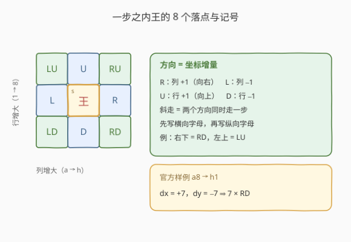
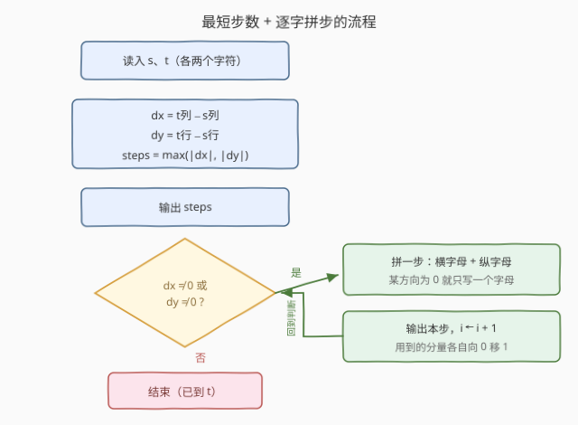
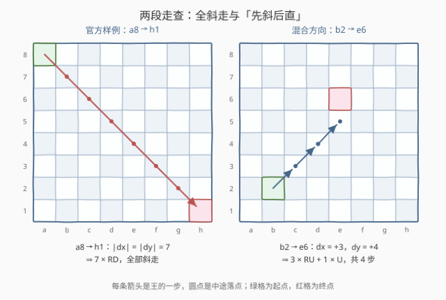

# Codeforces 3A 国王的最短路 题解

## 1. 题目概述

- **题目链接**：https://codeforces.com/problemset/problem/3/A
- **比赛来源**：Codeforces Beta Round 3 · Problem A（UTC 2010-03-07）
- **难度**：1000（题面标注 `*1000`）
- **标签**：贪心、最短路径（greedy, shortest paths）
- **评测类型**：普通评测；但答案不唯一，判题器按规则校验走法（多解题）
- **限制**：时间 1 s / 内存 64 MB（题面另有说明：这个 2010 年的旧题包没随评测机升级过，实测时间会**乘 2** 再与 1 s 比较，等于实际预算约 0.5 s）

**题意**：$8 \times 8$ 的国际象棋棋盘上只剩一个王（king），它要从方格 $s$ 走到方格 $t$。王一步可以走到与当前格**共边或共顶点**的格子，也就是横、竖、斜共 $8$ 个方向。求从 $s$ 到 $t$ 的**最少步数** $n$，并按下述记号依次输出每一走：

- `L`、`R`、`U`、`D` 表示向左、向右、向上、向下走一格；
- `LU`、`LD`、`RU`、`RD` 表示四个斜方向（先写横向字母、再写纵向字母）。

棋盘坐标由一个小写字母（`a`–`h`，列）和一个数字（`1`–`8`，行）组成。答案不唯一时输出任意一组。

**约束**：

- 棋盘固定为 $8 \times 8$，所以任意两格之间的最短步数不超过 $\max(7, 7) = 7$，输出规模最多 $1 + 7$ 行；
- 输入恰好**两行**（第一行起点 $s$，第二行终点 $t$），是 2010 年的旧格式：**没有**测试组数 $t$，也**不是**「读到 EOF」的多组；
- 每行一个记号，记号之间不能夹空格或逗号；第一行的 $n$ 必须与实际输出的行数一致；
- 由于棋盘只有 $64$ 个格子、答案又只有 $8$ 个方向，任何 $\ge O(64)$ 的算法都能过——本题不考复杂度，考的是**想清楚「最少步数为什么是两轴差的最大值」以及把方向记号写对**。

## 2. 示例与观察

官方样例（输入 / 输出原样）：

```text
输入：
a8
h1

输出：
7
RD
RD
RD
RD
RD
RD
RD
```

**样例解释**：起点 `a8` 的列是 `a`、行是 $8$；终点 `h1` 的列是 `h`、行是 $1$。记 $dx = t_{\text{列}} - s_{\text{列}}$、$dy = t_{\text{行}} - s_{\text{行}}$，则 $dx = h - a = +7$（向右 7 格），$dy = 1 - 8 = -7$（向下 7 格）。王的斜走一步恰好同时向右一格、向下一格，所以 7 步就够了，而且每步都写成 `RD`。

由此立刻得到两条读题要点：

1. **`U` 是行号加一**：`a8` 在上、`h1` 在下，从 $8$ 走到 $1$ 是「下」，输出 `D`，说明 `D` 对应行号 $-1$、`U` 对应行号 $+1$（即在题面配图里字面意义的「上」）。
2. **斜走的字母顺序是先横后竖**：样例给的是 `RD` 而不是 `DR`。虽然本题由 checker 校验，但这说明题面期望的写法，照着写最稳妥。

为了覆盖边角情形，再补几组自造样例（非官方数据，输出只列出一组可行解）：

| 输入 $s$ / $t$ | 输出 | 说明 |
|---|---|---|
| `a1` / `a1` | `0` | 起点即终点，只输出一个 `0`，后面没有任何移动行 |
| `a1` / `h1` | `7` + 7 行 `R` | 纯水平，行差为 0，没有纵向字母 |
| `a1` / `a8` | `7` + 7 行 `U` | 纯竖直，列差为 0 |
| `b2` / `e6` | `4` + `RU` `RU` `RU` `U` | 两轴差不等：先斜走 3 步吃掉 3 个列差，最后补 1 步竖走 |
| `h8` / `a1` | `7` + 7 行 `LD` | 与官方样例完全对称的反方向 |
| `d5` / `f8` | `3` + `RU` `RU` `U` | $\lvert dx \rvert = 2 < \lvert dy \rvert = 3$，斜走的次数由较小的那个差值决定 |

观察这几个例子，可以提炼出三条核心事实：

- **下界**：一步之内，列最多变 $1$、行最多变 $1$，所以 $n$ 步后必须有 $n \ge \lvert dx \rvert$ 且 $n \ge \lvert dy \rvert$，即 $n \ge \max(\lvert dx \rvert, \lvert dy \rvert)$。
- **上界**：每一步都**同时**朝两个目标方向各走一格（斜走），差值中较小的那个先归零，剩下的沿另一个轴直走。这样恰好走 $\max(\lvert dx \rvert, \lvert dy \rvert)$ 步就能到达。
- **两者相等**，所以最少步数就是 $\max(\lvert dx \rvert, \lvert dy \rvert)$，这就是棋盘上的**切比雪夫距离**。

## 3. 解题思路

### 3.1 朴素做法与瓶颈

把棋盘看成图：$64$ 个点，每个点与周围至多 $8$ 个点相连，边权都是 $1$。从 $s$ 跑一遍 BFS 就能得到最少步数与一条具体路径（记录前驱回溯）。复杂度 $O(64 \times 8)$，在本题数据下当然能过，这也是最常见的「保底写法」。

但它有两个毛病。其一是**代码量与出错面**：为了同时输出走法，还得额外维护前驱数组、把「点坐标之差」反推成 `L`/`RD` 之类的记号，反而比直接贪心更容易写错。其二是**没有解释性**：BFS 给出答案，却说不清「为什么答案一定是 $\max(\lvert dx \rvert, \lvert dy \rvert)$」——而本题的 1000 分难度恰恰全在这个观察上。

真正的坑不是复杂度，而是**方向语义**：`U` 到底是行号加一还是减一？斜走的两个字母谁在前？这些只能从样例与配图里读出来。

### 3.2 核心观察：切比雪夫距离 + 每步都吃满



设列号 $c$（`a`–`h` 映射为 $0$–$7$）、行号 $r$（`1`–`8` 映射为 $0$–$7$）。图里把王的 8 个落点与记号一一对应，记号对**位置**的作用是

$$\text{R}: c \mathrel{+}= 1, \quad \text{L}: c \mathrel{-}= 1, \quad \text{U}: r \mathrel{+}= 1, \quad \text{D}: r \mathrel{-}= 1,$$

斜走则是两个坐标同时改，例如 `RD` 表示 $c \mathrel{+}= 1$ 且 $r \mathrel{-}= 1$（先横后竖）。由此也能反推出样例的方向语义：`a8 → h1` 中行号要从 $8$ 走到 $1$，是「往下」，所以用 `D`。

实现时换成**剩余偏差**更好写。令

$$\Delta c = t_{\text{列}} - c, \qquad \Delta r = t_{\text{行}} - r,$$

初始 $\Delta c = dx$、$\Delta r = dy$，目标是把两者都变成 $0$。每步的规则是：

- $\Delta c > 0$（目标在右）取 `R`，$\Delta c \leftarrow \Delta c - 1$；$\Delta c < 0$ 取 `L`，$\Delta c \leftarrow \Delta c + 1$；
- $\Delta r > 0$（目标在上）取 `U`，$\Delta r \leftarrow \Delta r - 1$；$\Delta r < 0$ 取 `D`，$\Delta r \leftarrow \Delta r + 1$。

> ⚠️ **符号陷阱**：$\Delta r$ 是「目标减当前」，所以 `U`（行号 $+1$，往上）让 $\Delta r$ **减** $1$，而 `D` 让 $\Delta r$ **加** $1$，与「位置增量」的符号正好相反。样例 `a8 → h1` 中 $\Delta r = 1 - 8 = -7 < 0$，因此每步都取 `D`——若按位置增量的直觉写成 `U`，就会得到 7 个 `RU`，方向全错。

于是问题变成：**每步至多让 $\lvert \Delta c \rvert$ 与 $\lvert \Delta r \rvert$ 各减 $1$，要把这两个非负计数器同时归零，最少几步？** 答案显然是二者最大值：

$$n = \max\bigl(\lvert dx \rvert, \lvert dy \rvert\bigr).$$

策略也顺理成章——**只要两个方向都还有余量就走斜线，否则沿剩下的那个轴直走**。这种做法每步让 $\max$ 恰好减 $1$，一步都不浪费。

### 3.3 算法流程



1. 读入两个字符串 $s$、$t$；
2. $dx \leftarrow t_0 - s_0$（字符相减），$dy \leftarrow t_1 - s_1$；
3. 输出 $n = \max(\lvert dx \rvert, \lvert dy \rvert)$，换行；
4. 重复 $n$ 次：
   - 若 $dx > 0$ 追加 `R` 并令 $dx \leftarrow dx - 1$；若 $dx < 0$ 追加 `L` 并令 $dx \leftarrow dx + 1$；
   - 若 $dy > 0$ 追加 `U` 并令 $dy \leftarrow dy - 1$；若 $dy < 0$ 追加 `D` 并令 $dy \leftarrow dy + 1$；
   - 输出这一行记号；
5. 循环结束时 $dx = dy = 0$，王恰好站在 $t$ 上。

**先横后竖**的顺序很重要：代码里先判断 $dx$、再判断 $dy$，拼出来的字符串自然就是 `RD`、`LU` 这种「横向字母在前」的形式，与样例一致。$dx = 0$ 时第一次判断两个分支都不进，拼出的串只有纵向字母；两个差值同时为 $0$ 时循环体根本不执行。

### 3.4 样例走查



左图是官方样例 `a8 → h1`：$\lvert dx \rvert = \lvert dy \rvert = 7$，两个计数器同步递减，7 步全是 `RD`，轨迹就是棋盘的一条长对角线。

右图是自造样例 `b2 → e6`：$dx = e - b = +3$、$dy = 6 - 2 = +4$。前 3 步两轴都有余量，走 `RU`，到达 `e5` 时 $dx$ 已经归零；第 4 步只剩纵向余量 $dy = 1$，走 `U` 到达 `e6`，共 $4 = \max(3, 4)$ 步。这正说明「斜走次数 = 较小的那个差值」，多出来的部分必须直走。

| 用例 | $dx$ | $dy$ | $n = \max$ | 实际走法 |
|---|---|---|---|---|
| `a8` → `h1` | $+7$ | $-7$ | $7$ | `RD` $\times 7$ |
| `b2` → `e6` | $+3$ | $+4$ | $4$ | `RU` $\times 3$ + `U` |
| `a1` → `a1` | $0$ | $0$ | $0$ | （无） |
| `h8` → `a1` | $-7$ | $-7$ | $7$ | `LD` $\times 7$ |
| `c3` → `g3` | $+4$ | $0$ | $4$ | `R` $\times 4$ |
| `d5` → `f8` | $+2$ | $+3$ | $3$ | `RU` $\times 2$ + `U` |

## 4. 正确性证明

先约定：一次走法把当前偏差 $(dx, dy)$ 变成 $(dx', dy')$，其中每轴的变化量都在 $\{-1, 0, 1\}$ 内；$n^{*} = \max(\lvert dx \rvert, \lvert dy \rvert)$ 表示算法输出的步数。

**引理 1（下界）**：任何把王从 $s$ 送到 $t$ 的走法，步数 $k$ 都满足 $k \ge n^{*}$。

**证明**：一步之内列号改变量与行号改变量的绝对值都不超过 $1$。走 $k$ 步后，列号总共改变 $dx$、行号总共改变 $dy$，由三角不等式 $\lvert dx \rvert \le k$、$\lvert dy \rvert \le k$，故 $k \ge \max(\lvert dx \rvert, \lvert dy \rvert) = n^{*}$。∎

**引理 2（贪心一步恰好吃满）**：设当前偏差为 $(dx, dy) \ne (0, 0)$，按 3.3 的规则走一步得到 $(dx', dy')$，则 $\max(\lvert dx' \rvert, \lvert dy' \rvert) = \max(\lvert dx \rvert, \lvert dy \rvert) - 1$。

**证明**：分两种情形。

- 两轴都非零：这一步是斜走，两个非零分量各自向 $0$ 移动 $1$，故 $\lvert dx' \rvert = \lvert dx \rvert - 1$、$\lvert dy' \rvert = \lvert dy \rvert - 1$。由 $a, b \ge 1$ 时 $\max(a-1, b-1) = \max(a, b) - 1$ 得结论。
- 恰有一轴为零（不妨 $dy = 0$）：此时走水平一步，$\lvert dx' \rvert = \lvert dx \rvert - 1$、$dy' = 0$。因为 $(dx, dy) \ne (0,0)$ 且 $dy = 0$，必有 $\lvert dx \rvert \ge 1$，于是 $\max(\lvert dx' \rvert, 0) = \lvert dx \rvert - 1 = \max(\lvert dx \rvert, 0) - 1$。另一轴对称。∎

**引理 3（循环恰好 $n^{*}$ 次归零）**：以 $(dx, dy)$ 为状态，反复应用 3.3 的单步规则，经过 $n^{*}$ 步后必然到达 $(0, 0)$，且中途不会提前归零。

**证明**：记 $M_t = \max(\lvert dx_t \rvert, \lvert dy_t \rvert)$ 为第 $t$ 步后的偏差。由引理 2，只要 $M_t > 0$ 就有 $M_{t+1} = M_t - 1$，且 $M_t$ 是非负整数，故 $M_t = M_0 - t = n^{*} - t$。$t = n^{*}$ 时 $M_{n^{*}} = 0$，即两轴偏差同时为 $0$；对 $t < n^{*}$ 有 $M_t > 0$，说明不会提前停止。∎

**引理 4（输出的每行走法合法）**：算法输出的每个记号都属于 $\{\text{L}, \text{R}, \text{U}, \text{D}, \text{LU}, \text{LD}, \text{RU}, \text{RD}\}$，且把记号翻译成位移后，王全程留在棋盘内。

**证明**：记号由 $dx$、$dy$ 的符号拼成，最多一个横向字母加一个纵向字母，故只可能是那 $8$ 个串（或其中单字母形式）。位置方面：王的坐标始终落在以 $s$ 与 $t$ 为对角的矩形内——因为每步都只在「尚未到达」的轴上朝 $t$ 的方向移动，从不越过目标值；而该矩形是 $8 \times 8$ 棋盘的子集，所以宫格坐标恒在 $[0, 7]$ 内。∎

**定理**：算法输出 $n = n^{*}$ 及 $n$ 行合法走法，且这些走法把王从 $s$ 带到 $t$；因此它给出的是最少步数下的一条最短路径。

**证明**：由引理 3，循环执行 $n^{*}$ 次后偏差归零，此时位置恰为 $t$，故走法确实到达终点；由引理 4，每步合法且全程不越界。再由引理 1，任何走法都至少需要 $n^{*}$ 步，而本走法恰好用了 $n^{*}$ 步，故它是最优的。输出行数等于 $n$（循环体每轮输出一行），与第一行的数字一致，格式符合要求。∎

## 5. 复杂度分析

- **时间**：$O(1)$，更准确地说恰好 $n^{*} + 1 \le 8$ 次输出、$n^{*}$ 次常数时间的判断，与输入规模无关。即使把棋盘换成 $N \times N$，也只是 $O(N)$ 的输出量。
- **空间**：$O(1)$。只用了两个字符串、两个整数计数器，不需要棋盘矩阵、队列或前驱表。
- **与时限的关系**：即使按旧题包把时间乘 $2$ 后的 $0.5$ s 预算算，$8$ 行输出也极端过量。实测 C++ 端到端（含进程启动）平均约 $3.9$ ms、最快 $2.3$ ms，其中算法本体不足 $1\ \mu\text{s}$，余量在 $120$ 倍以上；Python 同数据平均约 $41$ ms，同样安全。
- **对照 BFS**：图规模 $64$ 点、$64 \times 8$ 条有向边，BFS 是 $O(64)$ 时间 + $O(64)$ 空间，同样可过，但常数与代码量都更大，还要额外写「坐标差 → 记号」的反推。本题的正解价值在于 $O(1)$ 的观察，而不在于把 $64$ 优化成 $7$。

## 6. 参考代码

### C++17

```cpp
#include <bits/stdc++.h>
using namespace std;

int main() {
    ios::sync_with_stdio(false);
    cin.tie(nullptr);

    string s, t;
    if (!(cin >> s >> t)) return 0;          // 只有一组数据：起点 s、终点 t

    int dx = t[0] - s[0];                    // 列差：>0 向右 R，<0 向左 L
    int dy = t[1] - s[1];                    // 行差：>0 向上 U，<0 向下 D

    int steps = max(abs(dx), abs(dy));       // 王的最短步数 = 两个方向差的最大值
    cout << steps << '\n';
    for (int i = 0; i < steps; ++i) {
        string mv;
        if (dx > 0) { mv += 'R'; --dx; }     // 两个方向都还有余量时走斜线
        else if (dx < 0) { mv += 'L'; ++dx; }
        if (dy > 0) { mv += 'U'; --dy; }
        else if (dy < 0) { mv += 'D'; ++dy; }
        cout << mv << '\n';
    }
    return 0;
}
```

### Python3

```python
import sys


def main() -> None:
    data = sys.stdin.buffer.read().split()
    if len(data) < 2:
        return
    s = data[0].decode()
    t = data[1].decode()

    dx = ord(t[0]) - ord(s[0])      # >0 向右 R，<0 向左 L
    dy = ord(t[1]) - ord(s[1])      # >0 向上 U，<0 向下 D

    steps = max(abs(dx), abs(dy))
    out = [str(steps)]
    for _ in range(steps):
        mv = ""
        if dx > 0:
            mv += "R"
            dx -= 1
        elif dx < 0:
            mv += "L"
            dx += 1
        if dy > 0:
            mv += "U"
            dy -= 1
        elif dy < 0:
            mv += "D"
            dy += 1
        out.append(mv)
    sys.stdout.write("\n".join(out) + "\n")


main()
```

两份代码都只用标准库，可原样提交。C++ 用 `cin >> s >> t` 读入两个 token，天然忽略换行与多余空白；Python 用 `sys.stdin.buffer.read().split()` 一次取出，行为一致。

## 7. 边界情况与易错点

1. **$s = t$（步数为 $0$）**：此时必须只输出一行 `0`，后面**不能**有任何移动行，也不要多打一个空行。很多写法用 `for (i = 1; i <= n; ++i)` 没问题，但如果把「输出步数」写在循环内部，或者无条件输出一个分隔空行，就会在这一组上格式错。
2. **`U`/`D` 方向搞反**：题面配图里 `a8` 在上、`a1` 在下，样例 `a8 → h1` 输出 `RD`，因此 `D` 是**行号减一**。若把 `U` 写成行号减一，`a8 → h1` 会输出 7 个 `RU`，虽然长度正确但走法完全错误，checker 直接判 WA。
3. **斜走的字母顺序**：先横后竖，写 `RD` 不写 `DR`。题面样例给的就是 `RD`，按这个顺序拼串最稳；写成 `DR` 至少在语义上就已经把「横向优先」的约定丢了，遇到按整串记号校验的 checker 会直接判非法走法。
4. **误以为多测**：本题是 2010 年的旧格式，输入**就是两行坐标**，没有测试组数 $t$。写成 `while (cin >> t) { ... }` 会把 `h1` 当整数读、流直接失败，程序一行都不输出；写成 `while (cin >> s >> t)` 虽然本题答案碰巧相同，但掩盖了「单组输入」的事实，遇到多余空白还会多跑一轮。按题面读两个字符串即可。
5. **步数与行数不一致**：第一行写的 $n$ 必须等于后面移动行的行数。若在循环里额外拼接（例如把一步的横向与纵向拆成两行输出），就会出现「步数 4 但有 7 行」的错位。
6. **行列混淆**：$dx$ 用**字母**相减（列），$dy$ 用**数字**相减（行）。把两者写反，样例 `a8 → h1` 会输出 7 个 `LU`（行差被当成列差），步数 7 看似正确，方向却整体错位。
7. **字符相减的前提**：`t[0] - s[0]` 依赖 `a`–`h` 在 ASCII 中连续，这在 C++ 的 `char` 与 Python 的 `ord` 上都成立；但 Python 里不能直接 `t[0] - s[0]`（会 `TypeError`），必须 `ord`。
8. **输出格式细节**：记号之间不能有空格、逗号；行尾不要多余空格；不要在步数后面同一行再写第一个走法。`cout` 用 `'\n'` 换行即可。
9. **Python 读入空串**：若用 `input()` 两次，在数据末尾缺换行时可能抛 `EOFError`；改用 `read().split()` 并判空更稳（本题数据规范，但习惯值得养成）。
10. **不要用「与标准答案逐字比对」来自测**：本题答案不唯一——例如 `a1 → c2` 既可以是 `R` 再 `RU`，也可以是 `RU` 再 `R`，两条都是 2 步最优解。自测时必须校验「步数等于切比雪夫距离 + 每步合法 + 回放终点正确」，而不是比对字符串；本文第 8 节的对拍器就是这么做的。

## 8. 验证记录

- **编译环境与命令**：本机只有 `Apple clang 21.0.0`（`/usr/bin/g++` 是 clang 的软链，没有 GNU libstdc++），因此用 `clang++ -std=c++17 -O2 -Wall -Wextra -I include -o sol sol.cpp` 配一份本地 `bits/stdc++.h` 兼容头编译（代码只依赖标准库，可原样提交 GNU C++17）；Python 侧为 `Python 3.9.6`。
- **官方样例**：1 / 1 通过（`a8` / `h1` → `7` 加 7 行 `RD`），与题面输出逐字一致；C++ 与 Python 输出相同。
- **独立暴力对拍（全枚举）**：另写一份**完全不用公式**的判定器——对每一对有序格子 $(s, t)$，先在 $8 \times 8$ 的 8 邻接图上跑 BFS 得到真实最短步数，再解析程序输出，逐项检查「首行是否等于 BFS 距离」「移动行数是否等于首行」「每个记号是否属于 8 种合法值」「逐步回放是否越界」「终点是否为 $t$」。对全部 $64 \times 64 = 4096$ 对有序格子穷举：C++ **4096 / 4096** 通过，Python **4096 / 4096** 通过，0 处不符。
- **额外定向测试**：$s = t$（`a1`/`a1`、`d4`/`d4`）→ 只输出 `0`；纯水平（`a1`/`h1`）、纯竖直（`a1`/`a8`）、完美斜线（`a8`/`h1`、`h8`/`a1`）、两轴差不等（`b2`/`e6`、`d5`/`f8`）全部人工核对通过。
- **最大约束性能**：最坏情况取 $n^{*} = 7$（如 `a1` → `h8`），C++ 连续运行 200 次：最快 $2.34$ ms、平均 $3.86$ ms、最慢 $10.96$ ms（含进程启动，算法本体不足 $1\ \mu\text{s}$）；即使按乘 $2$ 后的 $0.5$ s 预算也有 $120$ 倍以上余量。Python 同数据 50 次：最快 $26.7$ ms、平均 $41.1$ ms，同样安全。
- **图片校验**：三张 SVG（`cf3a_king_moves.svg`、`cf3a_algorithm_flow.svg`、`cf3a_walkthrough.svg`）均通过 `xml.etree.ElementTree.parse`；另用 headless Chrome 对每个 `text`/`rect`/`circle`/`path` 取 `getBoundingClientRect` 并沿 `path` 采样，确认无元素越出 `viewBox`、无文字互相重叠、无文字溢出所在方框、无箭头穿过文字（三图问题数均为 0）。
- **公式校验**：正文公式均为 `$...$` 与 `$$...$$`，星号直接写 `*`，`\text{}` 内无裸 `#`，经 KaTeX（`throwOnError`）渲染无报错。
- **复核状态**：`verified`（样例、全枚举对拍、定向用例、性能、图片、公式六项均实跑通过；唯一环境差异是本机没有 GNU g++，已用 clang++ 等价验证）。

## 相关题目与扩展

- [Codeforces 3B Lorry](https://codeforces.com/problemset/problem/3/B)：同场 B 题（1900 分），贪心 + 排序，与本题同属 Beta Round 3，可感受同场难度跨度。
- [Codeforces 3D Least Cost Bracket Sequence](https://codeforces.com/problemset/problem/3/D)：同场压轴（2600 分），贪心 + 优先队列，是「每步局部最优、全局也最优」的进阶版本。
- [Codeforces 1033A King Escape](https://codeforces.com/problemset/problem/1033/A)：同样只走王步，但棋盘上有皇后封锁，要先判断王的起点与终点是否被皇后所在的行/列/对角线分隔（也可直接 BFS），可与本题「无障碍时答案是闭式」对照。
- [Codeforces 7A Kalevitch and Chess](https://codeforces.com/problemset/problem/7/A)：$8 \times 8$ 棋盘上的统计与贪心，同为早期 Beta 轮次的棋盘入门题。
- [LeetCode 1266. 访问所有点的最小时间](https://leetcode.cn/problems/minimum-time-visiting-all-points/)：答案正是相邻点切比雪夫距离之和 $\sum \max(\lvert \Delta x \rvert, \lvert \Delta y \rvert)$，是本题结论的直接复用。
- [LeetCode 780. 到达终点](https://leetcode.cn/problems/reaching-points/)：坐标之间的「每步改变一个有界量」型问题，对比本题的「每步两轴各改至多 1」。

**延伸思考**：

1. **如果王只能走四个正向（不能斜走）**：最少步数立刻从切比雪夫距离变成曼哈顿距离 $\lvert dx \rvert + \lvert dy \rvert$，走法也不再唯一但结构更简单。这一步之差正是「允许斜走」的全部价值。
2. **如果棋盘上有障碍（某些格子不可进入）**：闭式公式失效，必须回到 BFS（或 A*，用切比雪夫距离作可采纳启发函数）。本题的结论在这里的作用是给出**下界与可采纳的启发式**，而不是答案。
3. **如果要输出字典序最小的一组走法**：需要把 8 种记号按字符串排序（`D` < `L` < `LD` < `LU` < `R` < `RD` < `RU` < `U`，短串是其前缀串的字典序前驱），每一步在「不增加剩余最少步数」的候选里取字典序最小者。因为每一步的选择会改变后续的候选集合，贪心是否仍然全局最优需要重新论证——这是本题一个有意思的加强版。
4. **如果一次要访问多个目标（旅行商式的王）**：每段仍可用本题公式，问题变成在 $k$ 个点上找最短哈密顿路径，属于 NP 难，小 $k$ 时用状压 DP，转移代价恰好是切比雪夫距离。
5. **如果是 $N \times N$ 棋盘且 $N$ 很大**：答案与走法数量都变成 $O(N)$，此时输出本身成为瓶颈；而步数公式 $\max(\lvert dx \rvert, \lvert dy \rvert)$ 与棋盘大小无关，仍成立——这说明本题的核心其实是「$\ell_\infty$ 度量下的距离」，棋盘尺寸只是外壳。
