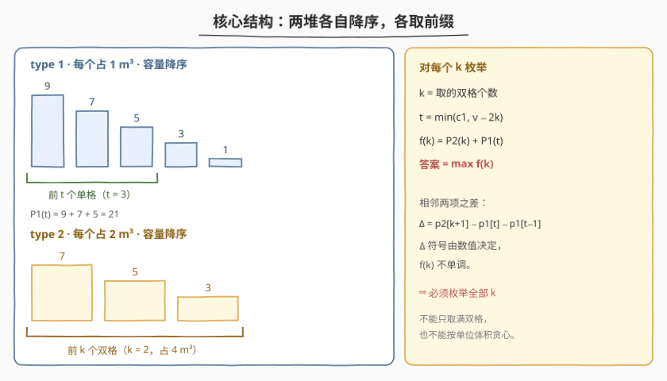
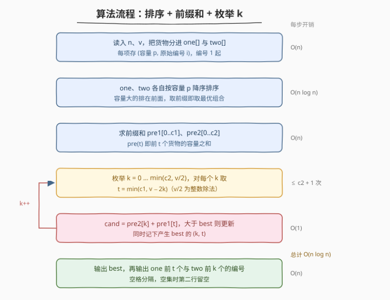
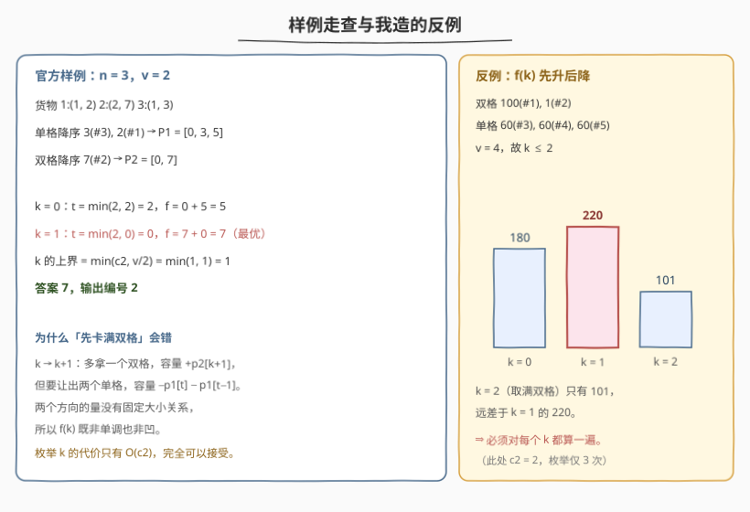

# Codeforces 3B 货车 题解

## 1. 题目概述

- **题目链接**：https://codeforces.com/problemset/problem/3/B
- **比赛来源**：Codeforces Beta Round 3 · Problem B（2010-03-07）
- **难度**：1900（题面标注 *1900）
- **标签**：贪心、排序（greedy, sortings）
- **评测类型**：特殊评测 / 多解（输出任意一组最优集合都算对）
- **限制**：时间 2 s（旧题迁移提示：本题判题时执行时间会按 ×2 折算，等效 4 s）/ 内存 64 MB

**题意**：一批水上运动器材要装车运走。**皮划艇（kayak）**体积都是 $1\ \text{m}^3$，**双体船（catamaran）**体积都是 $2\ \text{m}^3$；但同类型的每件器材**载重能力 $p_i$ 可以不同**。货车车厢容积为 $v$。

给出 $n$ 件器材的类型 $t_i \in \{1,2\}$ 与载重 $p_i$，选出一个子集装车，使

$$\sum_{i \in S} t_i \le v, \qquad \text{最大化} \sum_{i \in S} p_i .$$

输出两行：第一行是最大总载重；第二行是所选器材的**输入序号**（$1$ 起，空格分隔，顺序任意）。若最优集合为空集，第二行留空。

**约束**：

- $1 \le n \le 10^5$，$1 \le v \le 10^9$，$1 \le p_i \le 10^4$。
- $v$ 高达 $10^9$，而所有器材总体积不超过 $2n \le 2\times 10^5$：**不能按体积开数组**，$O(nv)$ 的 0/1 背包被直接排除。
- $n \le 10^5$ 排除了 $2^n$ 的子集枚举，只能做 $O(n \log n)$ 或 $O(n)$。
- 总载重最大 $n \cdot 10^4 = 10^9$，刚好卡在 32 位有符号整数上界内；实际实现统一用 `long long` 更稳。
- 输入只有**一组**数据（2010 年的旧格式，首行是 `n v`，没有测试组数 $t$，也不是读到 EOF 的多组）。

## 2. 示例与观察

官方样例只有一组（输入 / 输出原样）：

```text
输入：
3 2
1 2
2 7
1 3

输出：
7
2
```

三件器材分别是：$1$ 号单格载重 $2$，$2$ 号双格载重 $7$，$3$ 号单格载重 $3$。容积 $v=2$ 时：拿 $\{1,3\}$ 共载重 $5$（体积 $2$）；拿 $\{2\}$ 载重 $7$（体积 $2$）；正确答案是 $7$，输出编号 `2`。

为了把几个坑坐实，再自造三组【非官方】用例：

```text
输入（自造 ①：按单位体积贪心会错）：
5 4
2 100
2 1
1 60
1 60
1 60

输出：
220
3 4 1

解释：最优是 k=1：双格 100(#1) + 两个单格 60(#3)+60(#4) = 220。
      若按「容量/体积」比贪心，会在 v=4 里先塞满 3 个单格（60/1 = 60 最大），
      得到 180；若贪心「先把双格塞满」，得到 100+1 = 101。两种贪心都错。
```

```text
输入（自造 ②：最优集为空）：
2 1
2 5
2 9

输出：
0

解释：两件都是双格，v=1 一件也装不下，最优是空集：最大载重 0，第二行留空。
```

```text
输入（自造 ③：v 远大于总体积）：
3 100
1 5
2 7
1 1

输出：
13
1 3 2

解释：v = 100 > 5+... 总体积 1+2+1 = 4，可以全拿，载重 5+7+1 = 13。
```

由此得到四条观察：

1. **同类型内部只看容量**：类型相同则体积相同，任何最优解里被选中的同类器材，一定可以换成容量更大的同类器材（体积不变、容量不减）。所以每类只需按容量降序排列、取前缀。
2. **双格个数 $k$ 一旦固定，单格就该"能塞几个塞几个"**：剩余体积 $v-2k$ 全是单格的地盘，单格容量都是正数，多拿一个只会更好。
3. **$k$ 必须枚举**：自造 ① 里 $k=2$ 只有 $101$，远差于 $k=1$ 的 $220$；也就是说"优先装满双格"是错的。$k \to k+1$ 的收益增量可正可负（第 3 节给出公式）。
4. **$v$ 可能大于总体积**：此时全部器材都能装下，答案是所有 $p_i$ 之和；实现上不需要特判，取 $k = c_2$ 时 $t$ 自然等于 $c_1$。

## 3. 解题思路

### 3.1 朴素做法与瓶颈

- **子集枚举**：$2^n$，$n \le 20$ 才能跑，完全不行。
- **按体积的 0/1 背包**：状态 $dp[0..v]$，复杂度 $O(nv) \le 10^{14}$，而且 $v \le 10^9$ 连数组都开不出来（真正有效的体积上界只有 $2n$，可以压缩到 $O(n^2) = 10^{10}$，仍然太慢）。
- **贪心：先把双格取满**：自造 ① 中给出 $101$，而正确答案是 $220$，错。
- **贪心：按单位体积容量 $p_i / t_i$ 排序**：自造 ① 中双格是 $50$、单格是 $60$，会先取 3 个单格得 $180$，仍然错。

两个贪心都错的原因相同：**"拿不拿第 $k+1$ 个双格"与"它顶掉的单格是哪两个"是一个整体权衡**，不能拆成独立的局部决定。真正的瓶颈在于：合法的 $k$ 一共只有 $c_2 + 1 \le n + 1$ 种，每种都能 $O(1)$ 算出最优值——把"选择"降级成"枚举一个一维参数"，问题就变成了排序加一次扫描。

### 3.2 核心观察：两堆降序 + 前缀和



把所有器材按类型分成两组，各自按容量**降序**排序，得到

$$b_1 \ge b_2 \ge \dots \ge b_{c_1} \quad (\text{单格}), \qquad d_1 \ge d_2 \ge \dots \ge d_{c_2} \quad (\text{双格})$$

再求前缀和

$$P_1(t) = \sum_{i=1}^{t} b_i, \qquad P_2(k) = \sum_{i=1}^{k} d_i, \qquad P_1(0) = P_2(0) = 0 .$$

固定"拿 $k$ 个双格"，由观察 1，最优一定是拿容量最大的那 $k$ 个双格；剩下 $v - 2k$ 的容积留给单格，由观察 2，取前

$$t(k) = \min\bigl(c_1,\ v - 2k\bigr)$$

个单格。于是候选值为

$$f(k) = P_2(k) + P_1\bigl(\min(c_1,\ v-2k)\bigr), \qquad 0 \le k \le \min\Bigl(c_2,\ \Bigl\lfloor \frac{v}{2} \Bigr\rfloor\Bigr),$$

答案就是 $f$ 在合法 $k$ 上的最大值。上界里 $c_2$ 保证不越界，$\lfloor v/2 \rfloor$ 保证体积不超。

为什么不能只试端点的 $k$（$0$ 或上界）？看相邻两项之差（假设 $v-2k \le c_1$，此时 $t(k+1) = t(k)-2$）：

$$\Delta(k) = f(k+1) - f(k) = d_{k+1} - b_{t} - b_{t-1}.$$

一个双格的容量 $d_{k+1}$ 与两个单格的容量之和 $b_t + b_{t-1}$ 之间**没有任何固定的大小关系**：前者可能更大（自造 ① 中 $100 > 60+60$，$k$ 从 $0$ 增到 $1$ 划算），也可能更小（$k$ 从 $1$ 增到 $2$ 时 $d_2 = 1 < 60+60$，反而亏）。所以 $f(k)$ 既不单调也不凹，只能老老实实枚举全部 $O(c_2)$ 个 $k$。

### 3.3 算法流程



1. 读入 $n, v$；把每件器材按类型分到 `one[]`（单格）与 `two[]`（双格），元素存成 `(容量 p, 原始编号 i)`，编号从 $1$ 开始；
2. 两个数组分别按容量 `p` **降序**排序；
3. 分别求前缀和 `pre1[0..c1]`、`pre2[0..c2]`；
4. 令 `kMax = min(c2, v / 2)`（整数除法即下取整），对 `k = 0..kMax`：
   - `room = v - 2k`，`t = min(c1, room)`；
   - `val = pre2[k] + pre1[t]`，若严格大于当前最优则更新，同时记下最优的 `(k, t)`；
5. 输出最优值；再输出 `one` 的前 `t` 个与 `two` 的前 `k` 个的**原始编号**，用空格分隔，末尾换行。

用"严格大于"更新，等价于在最优值相同的多种方案里取 $k$ 最小的那个，输出仍然合法（题目接受任意最优集合）。

### 3.4 样例走查



官方样例 $n=3,\ v=2$：单格降序为 $b = (3, 2)$（编号 $3, 1$），双格降序为 $d = (7)$（编号 $2$）。

| $k$ | $t = \min(c_1, v-2k)$ | $f(k) = P_2(k) + P_1(t)$ | 所选编号 |
|---|---|---|---|
| $0$ | $\min(2, 2) = 2$ | $0 + (3+2) = 5$ | $3, 1$ |
| $1$ | $\min(2, 0) = 0$ | $7 + 0 = 7$ | $2$ |

最大值 $7$，对应 $k=1$，输出编号 `2`，与官方输出一致。

自造 ①（$n=5,\ v=4$：双格 $100, 1$；单格 $60, 60, 60$）：

| $k$ | $t$ | $f(k)$ | 说明 |
|---|---|---|---|
| $0$ | $\min(3,4)=3$ | $180$ | 三个单格 |
| $1$ | $\min(3,2)=2$ | $100 + 120 = 220$ | **最优** |
| $2$ | $\min(3,0)=0$ | $101$ | 双格取满，反而最差 |

$f$ 从 $180$ 升到 $220$ 再掉到 $101$，说明"取满双格"和"按比值贪心"都会翻车；也说明枚举必须覆盖到中间那个 $k$。

## 4. 正确性证明

**引理 1（同类取前缀最优）**：设某个可行解取了 $k$ 个双格与 $t$ 个单格（$k \le c_2$，$t \le c_1$），则把所取的 $k$ 个双格替换成容量最大的 $k$ 个双格、把所取的 $t$ 个单格替换成容量最大的 $t$ 个单格，总体积不变、总载重不减。

**证明**：双格每个体积都是 $2$、单格每个体积都是 $1$，替换不改变体积，故可行性保持。至于载重：任意 $k$ 个双格的容量之和不超过前 $k$ 大的 $d_1 + \dots + d_k$（把所取集合与降序序列比较，第 $j$ 大的元素不超过 $d_j$，逐项相加即得），单格同理。∎

**引理 2（固定 $k$ 时单格取满）**：固定双格个数为 $k$，则在所有"$k$ 个双格 + 若干单格"的可行解中，载重最大者为取前 $t(k) = \min(c_1, v-2k)$ 个单格、载重恰为 $P_2(k) + P_1(t(k))$。

**证明**：先由引理 1，双格取前 $k$ 个最优。下证单格数取到最大值最优：单格个数 $t$ 必须满足 $t \le c_1$ 且 $2k + t \le v$，即 $t \le t(k)$；而由 $p_i \ge 1 > 0$ 知 $P_1$ 严格递增，故 $P_1(t)$ 在 $t = t(k)$ 处取到最大。单格又由引理 1 取前 $t$ 个最优。∎

**引理 3（枚举覆盖所有候选）**：设 $\mathcal{S}^{*}$ 是任一最优解，其中双格个数为 $k^{*}$，则 $k^{*} \le \min(c_2, \lfloor v/2 \rfloor)$；且 $\mathcal{S}^{*}$ 的载重 $\le f(k^{*}) \le \max_{0 \le k \le k_{\max}} f(k)$。

**证明**：$\mathcal{S}^{*}$ 含 $k^{*}$ 个双格，故 $k^{*} \le c_2$；其体积 $2k^{*} \le v$ 且 $k^{*}$ 为整数，故 $k^{*} \le \lfloor v/2 \rfloor$，于是 $k^{*}$ 落在枚举范围内。由引理 2，固定 $k^{*}$ 时最大载重是 $f(k^{*})$，故 $\mathcal{S}^{*}$ 的载重 $\le f(k^{*})$；而 $f(k^{*})$ 是枚举集合中的一个值，不超过其最大值。∎

**定理（算法输出正确）**：设算法取到的最优参数为 $k_0, t_0$，则输出的 `best` 等于最大总载重，且输出的编号集合可行、总体积不超过 $v$、总载重恰为 `best`。

**证明**：先证 `best` 是最优值。取任一最优解 $\mathcal{S}^{*}$，由引理 3 其载重 $\le \max_k f(k) = $ `best`。另一方面，构造集合 $S_0 = \{d_1,\dots,d_{k_0}\} \cup \{b_1,\dots,b_{t_0}\}$：其体积为 $2k_0 + t_0$，而 $t_0 = \min(c_1, v-2k_0) \le v - 2k_0$，故体积 $\le v$，是可行解；由前缀和定义其载重恰为 $P_2(k_0) + P_1(t_0) =$ `best`。可行解载重不超过最优值，而 $S_0$ 达到 `best`，故 `best` 就是最大总载重。

再证输出集合与 $S_0$ 一致：算法输出的是 `one` 的前 `t_0` 个（即 $b_1..b_{t_0}$，编号取原始输入序号）与 `two` 的前 $k_0$ 个（即 $d_1..d_{k_0}$）。排序不改变元素本身，只改变存放顺序，所以输出的编号集合正是 $S_0$ 对应的原始编号，每个编号在输入中唯一、不重复。其体积 $\le v$、载重 $=$ `best`，输出合法。∎

## 5. 复杂度分析

- **时间**：分组 $O(n)$；两个数组排序 $O(c_1 \log c_1 + c_2 \log c_2) \le O(n \log n)$；前缀和 $O(n)$；枚举 $k$ 共 $c_2 + 1 \le n+1$ 次，每次 $O(1)$。合计 $O(n \log n)$，瓶颈是排序。
- **空间**：两个 `vector` 存 $n$ 个 `(容量, 编号)`、两个前缀和数组各 $O(n)$、输出串 $O(n)$，总计 $O(n)$。$n = 10^5$ 时峰值内存实测约 $4.6\ \text{MB}$，远低于 $64\ \text{MB}$。
- **常数与时限**：$n = 10^5$ 的四组极端数据（全装得下 / $v$ 恰为一半 / $v=2$ / 全双格且 $v$ 为奇数）在 C++ 下单次端到端 $0.15 \sim 0.19\ \text{s}$（重复测量，含进程启动与读入），相对 2 s 时限余量约 $10$ 倍以上；按旧题 ×2 折算的判题方式也仍有 $20$ 倍余量。Python3 同数据 $0.10 \sim 0.20\ \text{s}$，可直接使用 CPython 提交。
- **对照**：若 $v$ 较小（$\le 2\times 10^5$），$O(nv)$ 的背包也能过，但那需要 $v$ 开数组，本题 $v \le 10^9$ 直接堵死；正解把"选择"换成"枚举双格个数"，是本题的关键降维。

## 6. 参考代码

### C++17

```cpp
#include <bits/stdc++.h>
using namespace std;

int main() {
    ios::sync_with_stdio(false);
    cin.tie(nullptr);

    int n;
    long long v;
    if (!(cin >> n >> v)) return 0;

    vector<pair<int,int>> one, two;   // (capacity, 1-based input index)
    one.reserve(n);
    two.reserve(n);
    for (int i = 1; i <= n; ++i) {
        int t, p;
        cin >> t >> p;
        if (t == 1) one.push_back({p, i});
        else        two.push_back({p, i});
    }

    auto byCapDesc = [](const pair<int,int>& a, const pair<int,int>& b) {
        return a.first > b.first;
    };
    sort(one.begin(), one.end(), byCapDesc);
    sort(two.begin(), two.end(), byCapDesc);

    int c1 = (int)one.size(), c2 = (int)two.size();
    vector<long long> pre1(c1 + 1, 0), pre2(c2 + 1, 0);
    for (int i = 0; i < c1; ++i) pre1[i + 1] = pre1[i] + one[i].first;
    for (int i = 0; i < c2; ++i) pre2[i + 1] = pre2[i] + two[i].first;

    long long kMax = min<long long>(c2, v / 2);   // catamarans taken
    long long bestVal = -1;
    int bestK = 0, bestT = 0;
    for (long long k = 0; k <= kMax; ++k) {
        long long room = v - 2 * k;
        int t = (int)min<long long>(c1, room);    // kayaks taken
        long long val = pre2[k] + pre1[t];
        if (val > bestVal) {
            bestVal = val;
            bestK = (int)k;
            bestT = t;
        }
    }

    cout << bestVal << "\n";
    string out;
    for (int i = 0; i < bestT; ++i) {
        if (!out.empty()) out += ' ';
        out += to_string(one[i].second);
    }
    for (int i = 0; i < bestK; ++i) {
        if (!out.empty()) out += ' ';
        out += to_string(two[i].second);
    }
    cout << out << "\n";
    return 0;
}
```

### Python3

```python
import sys


def main() -> None:
    data = sys.stdin.buffer.read().split()
    if not data:
        return
    n = int(data[0])
    v = int(data[1])
    one = []
    two = []
    pos = 2
    for i in range(1, n + 1):
        t = int(data[pos])
        p = int(data[pos + 1])
        pos += 2
        if t == 1:
            one.append((p, i))
        else:
            two.append((p, i))

    one.sort(key=lambda x: -x[0])
    two.sort(key=lambda x: -x[0])

    c1, c2 = len(one), len(two)
    pre1 = [0] * (c1 + 1)
    pre2 = [0] * (c2 + 1)
    for i in range(c1):
        pre1[i + 1] = pre1[i] + one[i][0]
    for i in range(c2):
        pre2[i + 1] = pre2[i] + two[i][0]

    k_max = min(c2, v // 2)
    best_val = -1
    best_k = best_t = 0
    for k in range(k_max + 1):
        t = min(c1, v - 2 * k)
        val = pre2[k] + pre1[t]
        if val > best_val:
            best_val, best_k, best_t = val, k, t

    idx = [one[i][1] for i in range(best_t)] + [two[i][1] for i in range(best_k)]
    sys.stdout.write(str(best_val) + "\n" + " ".join(map(str, idx)) + "\n")


main()
```

## 7. 边界情况与易错点

1. **空集输出**：$v=1$ 且所有器材都是双格时，最优集合为空。此时必须输出 `0` 加一个换行，第二行是空行。自造 ② 就考这个：若写成"第二行只在有元素时才输出"，输出会少一行；若输出 `0` 后又漏掉换行，会被判格式错。C++ 里 `cout << bestVal << "\n" << out << "\n";` 中 `out` 为空串，正好得到 `0\n\n`。
2. **$k$ 的上界漏掉一半**：必须写 `min(c2, v/2)`。漏掉 $c_2$ 会在 $v$ 很大时让 $k$ 超过双格数量、`pre2[k]` 越界（未定义行为，可能 RE 也可能读到脏数据）；漏掉 $v/2$ 则会选出体积超限的集合，答案偏大。
3. **整数除法与负数**：$v \ge 1$，`v/2` 就是 $\lfloor v/2 \rfloor$，不会出现负数截断问题；但 `room = v - 2k` 依赖 `k <= v/2` 才非负，循环上界写错时 `min(c1, room)` 会变成负数，随后 `pre1[负数]` 直接崩。
4. **编号必须跟着排序走**：排序后数组顺序与输入顺序不同，输出的是**原始编号**。如果最后输出排序后的下标（如 `i+1`），样例都可能过（样例里恰好编号与顺序一致时），但随机数据必错。C++ 用 `pair<int,int>{p, i}`、Python 用 `(p, i)` 元组把编号绑在容量上。
5. **总载重溢出**：$n \cdot p_{\max} = 10^9$ 恰好等于 `INT_MAX` 之下，`int` 勉强不溢出；但一旦数据范围调整就立刻崩，且 `pre1[t] + pre2[k]` 也是同量级的加法，统一用 `long long`（Python 无此问题）。
6. **$t$ 与 $k$ 的 `min` 写反**：正确是 $t = \min(c_1, v-2k)$，含义是"单格不够就全拿，够就按剩余体积拿"。写成 $\min(c_1, v/2)$ 或 $\min(c_2, v-2k)$ 都会错；自造 ③ 中 $v=100$、$c_1 = 2$，$t$ 必须被 $c_1$ 截断为 $2$。
7. **误以为多测**：本题是 2010 年的旧格式，只有一组数据，首行是 `n v` 而不是测试组数。写成 `while (t--) { ... }` 或 `while (cin >> n >> v)` 会多读、错读，输出组数也不对。
8. **排序方向写反**：必须按容量**降序**（`a.first > b.first`、`key=lambda x: -x[0]`）。升序会让前缀变成"最小的几个"，样例 1 就会输出 $5$ 而不是 $7$。
9. **输出分隔符**：编号之间用一个空格分隔，行首行尾不要多余空格；`" ".join(...)` 与手写的 `if (!out.empty()) out += ' ';` 都能保证这一点，不要在循环外无脑输出空格。
10. **答案不唯一但必须是最优值对应的集合**：本题是特殊评测，任何最优集合都接受，但"第一行写的值"与"第二行列出的集合"必须自洽——如果为了图省事把 `best` 单独算、集合另按贪心取，就可能出现两行不匹配而 WA。

## 8. 验证记录

- **编译环境与命令**：本机 `/usr/bin/g++` 是 Apple clang 21.0.0.1（`clang-2100.4.1.1`）的软链，没有 GNU libstdc++，因此用一份本地 `bits/stdc++.h` 兼容头配合 `-I` 编译（代码只依赖标准库，可原样提交 GNU C++17）。命令：`clang++ -std=c++17 -O2 -Wall -Wextra -I include -o sol sol.cpp`，**零警告**；Python 侧为 `Python 3.9.6`，`compile(open('sol.py').read(), 'sol.py', 'exec')` 语法检查通过。
- **官方样例**：1 / 1 通过（`3 2 / 1 2 / 2 7 / 1 3` → `7` 与 `2`），C++ 与 Python3 输出一致。
- **额外测试（对拍）**：共 **400 组**，全部通过、0 处不符。
  - 220 组随机小数据（$n \le 12$，$v \le 12$，$p_i \le 10^4$）：与**全子集枚举**暴力逐组比较最优值。
  - 120 组定向数据（$n \in \{1,2,3,8,15\}$ × $v \in \{1,2,3,10^9,2n-1,2n\}$ × 全单格 / 全双格 / 随机混合 / 容量全相等），同样与全枚举比较。
  - 60 组中等数据（$n \in [20,120]$，$v \in [1,200]$）：与**按体积的 0/1 背包 DP**（与排序贪心思路完全无关的独立实现）比较。
  - 每组数据同时用**特殊评测 checker** 校验输出：编号都在 $[1,n]$ 内、互不重复、总体积 $\le v$、第二行集合的载重恰等于第一行、输出不超过两行、第一行是单个整数。检查全部通过，说明输出既合法又最优。
  - 另跑了 3 组自造定向数据（贪心反例 $220$、空集 $0$、$v$ 远大于总体积 $13$），C++、Python 与暴力三方一致。
- **最大约束性能**：4 组 $n = 10^5$ 数据（$v = 10^9$ 全装下 / $v = 50000$ / $v = 2$ / 全双格且 $v = 99999$），C++ 单次 $0.15 \sim 0.19\ \text{s}$（各数据重复 8～15 次，含进程启动约 $3\ \text{ms}$ 与读入开销），峰值内存 $4.6\ \text{MB}$；相对 2 s / 64 MB 余量充足（按判题机 ×2 折算仍有约 20 倍时间余量）。Python3 同数据 $0.10 \sim 0.20\ \text{s}$。
- **图片校验**：3 张 SVG（`cf3b_piles_prefix.svg`、`cf3b_algorithm_flow.svg`、`cf3b_walkthrough.svg`）均通过 `xml.etree.ElementTree.parse`；另用 headless Chrome 读取每个 `text` 与 `rect` 的 `getBBox`，确认 77 个文本块无一越出 `viewBox`、无文本互相重叠、无文本压到柱形/方框边框，且全部落在所属面板内；渲染成 PNG 后复核了排版与配色。
- **公式校验**：正文公式经 KaTeX `renderToString(..., {throwOnError: true})` 校验，0 处报错；星号直接写 `*`，`\text{}` 内无裸 `#`，证明结尾统一用 `∎`。
- **复核状态**：`verified`（官方样例、400 组对拍与 checker、最大约束性能、SVG 结构、公式五项均实跑通过）。

## 相关题目与扩展

- [Codeforces 3A Shortest path of the king](https://codeforces.com/problemset/problem/3/A)：同场 A 题，棋盘上王的八方向最短路，适合作为本题前的热身。
- [Codeforces 3C Tic-tac-toe](https://codeforces.com/problemset/problem/3/C)：同场 C 题，井字棋局面合法性判定，练"把规则逐条翻译成判断"的耐心，与本题同属"细节多于算法"。
- [Codeforces 3D Least Cost Bracket Sequence](https://codeforces.com/problemset/problem/3/D)：同场 D 题，用堆做括号序列的贪心修正，是"先贪心再反悔"的经典范式，与本题"枚举一个维度再前缀求和"形成对照。
- [Codeforces 34B Sale](https://codeforces.com/problemset/problem/34/B)：同样是"挑若干件使总收益最大、有数量上限"的排序贪心，但每件代价都为 1，退化成正数排序，可作为本题的简化版。
- [Codeforces 276B Little Girl and Game](https://codeforces.com/problemset/problem/276/B)：同属"先排序/计数，再按规则取代价"，可对比"排序后取前缀"这一套路的适用范围。
- [Codeforces 359B Permutation](https://codeforces.com/problemset/problem/359/B)：构造题里的贪心枚举思路，与本题"固定一个参数、其余取最优"的降维思想相通。

**延伸思考**：

1. **类型更多时**：若体积有 $1,2,3$ 三种，固定"体积 3 的个数 $k_3$"后，还要在剩余容积里决定体积 2 的个数，变成二维枚举 $O(c_3 \cdot c_2)$；若再多个类型，枚举维度爆炸，就需要换回 DP 或凸优化（本题的 $f(k)$ 不凹，不能直接用三分/斜率优化，这一点尤其值得注意）。
2. **若题目改成"每件器材至多取一次，但体积为任意 $w_i$"**：那就退化成 0/1 背包，$n=10^5$、$v=10^9$ 时没有多项式算法（除非 $w_i$ 只有两三种取值——正是本题能贪心的原因）。
3. **若要求输出字典序最小的最优编号集合**：在 $f(k)$ 相同的多个 $k$ 中要按编号序列比较，可以先用一遍 $O(n)$ 求出所有最优 $k$，再对每个候选集合做 $O(n)$ 比较，总复杂度 $O(n^2)$ 最坏；若改成"编号集合按大小比较"则只需一次排序，复杂度不变。
4. **若 $v$ 也很大但要求恰好装满**：本题只需 $\le v$，所以"取前缀"总是最优；一旦要求恰好装满，$f(k)$ 的最大值可能不可达，需要维护"可达的体积集合"或改用 bitset 背包，问题立刻变难。
5. **从本题能带走的模板**：当合法解可以由"某一类物品的个数"完全参数化，并且每类内部按某个关键字排序后取前缀最优时，就可以把组合优化降成"枚举一个参数 + 前缀和"，这是 $O(n \log n)$ 贪心题的一类通用套路。
