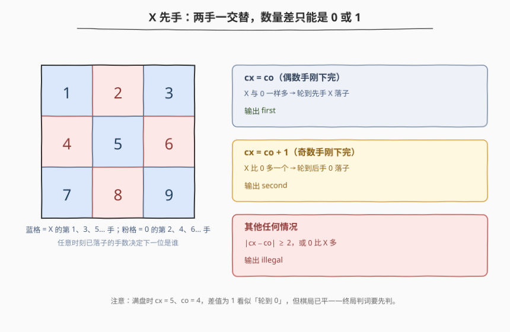
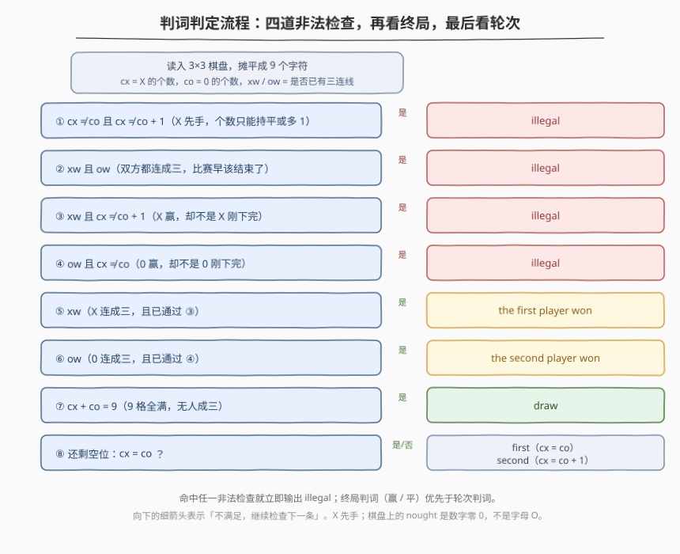
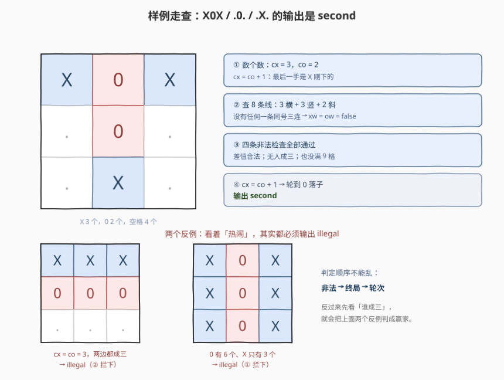

# Codeforces 3C 井字棋局面判定 题解

## 1. 题目概述

- **题目链接**：https://codeforces.com/problemset/problem/3/C
- **比赛来源**：Codeforces Beta Round 3 · Problem C（2010-03-07）
- **难度**：1800
- **标签**：暴力枚举、博弈、实现
- **评测类型**：普通
- **限制**：时间 1 s / 内存 64 MB

**题意**：给定一个 $3 \times 3$ 的井字棋棋盘，每个格子是 `.`、`X` 或 `0`（数字零）。`X` 是先手，`0` 是后手，两人轮流落子；谁先把自己的三个标记连成一条横线、竖线或斜线就立刻获胜，棋局当场结束；如果 9 个格子全部填满而仍然没有人连成三线，就判平局。要求输出六种判词之一：

| 判词 | 含义 |
|------|------|
| `first` | 局面合法且未结束，轮到先手 `X` 落子 |
| `second` | 局面合法且未结束，轮到后手 `0` 落子 |
| `illegal` | 这个棋盘在正常对局中不可能出现 |
| `the first player won` | 先手 `X` 刚刚连成三线获胜 |
| `the second player won` | 后手 `0` 刚刚连成三线获胜 |
| `draw` | 9 格已满，双方都没有连成三线 |

**约束**：

- 棋盘固定为 $3 \times 3$，一共只有 $3^9 = 19683$ 种填法。状态空间是个常数，所以 $O(1)$ 的判定和 $O(3^9)$ 的全枚举**都**能在 1 s 内完成，题目排除了任何需要搜索博弈树、做记忆化搜索的复杂度。
- 输入只有**一组**（三行、每行三个字符），既没有测试组数 $t$，也不是"读到 EOF"。多测模板在这里反而会读错。
- 真正合法的局面只有 5478 个（第 8 节用 BFS 实测），其中终局 958 个。也就是说 19683 种填法里有 14205 种是 `illegal`——"合法性"才是本题的主要难点。
- 输出是**六个固定字符串**之一，必须逐字一致（含空格、全小写）。判错一个字母就是 WA，且本题没有部分分。

## 2. 示例与观察

官方样例（输入 / 输出原样）：

```text
输入：
X0X
.0.
.X.

输出：
second
```

**样例解释**：棋盘上有 3 个 `X`、2 个 `0`、4 个空格。把 8 条可能的连线逐条看一遍：

| 连线 | 内容 | 是否三连 |
|------|------|----------|
| 第 0 行 | `X 0 X` | 否 |
| 第 1 行 | `. 0 .` | 否 |
| 第 2 行 | `. X .` | 否 |
| 第 0 列 | `X . .` | 否 |
| 第 1 列 | `0 0 X` | 否 |
| 第 2 列 | `X . .` | 否 |
| 主对角线 | `X 0 .` | 否 |
| 副对角线 | `X 0 .` | 否 |

既没有赢家，也没有满盘（只填了 5 格）。`X` 有 3 个、`0` 有 2 个，先手比后手多下一个，说明**最后一手是 `X` 下的**，接下来该 `0` 走，所以输出 `second`。

**观察 1（数量关系）**：`X` 先手，第 $1, 3, 5, \dots$ 手由 `X` 落子，第 $2, 4, 6, \dots$ 手由 `0` 落子。因此任何时刻都有

$$\#X = \#0 \quad \text{或} \quad \#X = \#0 + 1 .$$

反过来，$\#X = \#0$ 意味着刚下完的是后手 `0`，轮到 `X`；$\#X = \#0 + 1$ 意味着刚下完的是先手 `X`，轮到 `0`。

**观察 2（赢家唯一，且必是刚下完的那一方）**：一旦有人连成三线，游戏立即结束，所以终局里**不可能双方都成三**；而且成三的那一手就是整局的最后一手。于是

- `X` 获胜 $\Rightarrow \#X = \#0 + 1$；
- `0` 获胜 $\Rightarrow \#X = \#0$。

这条观察是"数量关系"与"胜负判定"的桥梁：只查"谁有三连线"是不够的，还要查它的数量奇偶是否对得上。

**观察 3（平局与轮次的分界）**：$3 \times 3$ 棋盘填满时 $\#X + \#0 = 9$，由观察 1 只能是 $\#X = 5, \#0 = 4$。此时差值虽然是 1，但已经没有格子可下，"轮到谁"没有意义——必须先判满盘（`draw`），再判轮次。

自造样例（标注"自造"，把六种判词各覆盖一次）：

| 输入 | 输出 | 说明 |
|------|------|------|
| `XX.`<br>`...`<br>`...` | illegal | $\#X = 2, \#0 = 0$，先手不可能连下两手 |
| `XXX`<br>`000`<br>`...` | illegal | 双方都成三，而比赛在第一次成三时就结束了 |
| `XXX`<br>`00.`<br>`...` | the first player won | 第 0 行三连，且 $\#X = 3 = \#0 + 1$ |
| `0XX`<br>`0X.`<br>`0..` | the second player won | 第 0 列三连，且 $\#X = \#0 = 3$ |
| `XX0`<br>`00X`<br>`X0X` | draw | 满盘、无人三连，$\#X = 5, \#0 = 4$ |
| `X0.`<br>`...`<br>`...` | first | $\#X = \#0 = 1$，轮到先手 |
| `...`<br>`.X.`<br>`...` | second | 只有 1 个 `X`，轮到后手 |

## 3. 解题思路

### 3.1 朴素做法与瓶颈

最直接的想法是"按规则模拟"：从当前棋盘出发，枚举所有可能的落子顺序，看是否存在一种顺序能走到这个局面，顺便再判胜负。9 个格子最多 $9! = 362880$ 种顺序，时间上跑得动，但要处理"走到一半游戏就结束"的剪枝，代码比条件判断长得多，还容易在"哪个局面该停"上写错。

另一种朴素做法是**全枚举打表**：从空棋盘开始按规则 BFS，把每个可达局面的判词记下来（一共 19683 个状态、5478 个可达）。这确实是一份正确的解，$\approx 3^9 \times 9$ 次操作，在 Python 里实测一次 BFS 只要 $9.7$ ms，表占 19683 字节。它唯一的缺点是"用枚举代替了推理"，一旦棋盘变大（$4 \times 4$ 就是 $3^{16} \approx 4.3 \times 10^7$）就不可行了。

所以本题真正的瓶颈不是时间，而是**把六种判词的条件写全并证明不漏**。只要条件写漏一条，官方样例依然能过（样例太温和），却会在别的测试点上错。下面给出 $O(1)$ 的判定条件，并在第 4 节证明它既必要又充分；第 8 节再用全枚举把结论钉死。

### 3.2 核心观察：三条不变量



把"合法的对局"翻译成棋盘上的三条硬性事实：

1. **计数不变量**：$\#X = \#0$ 或 $\#X = \#0 + 1$。其他任何差值，都意味着有人连走了两步，或后手先落子。
2. **赢家不变量**：至多一方成三；成三的那一方必须"刚下完"——`X` 赢了要 $\#X = \#0 + 1$，`0` 赢了要 $\#X = \#0$。比如

   ```text
   XXX
   0.0
   .0.
   ```

   第一行看着像 `X` 赢了，但 $\#X = \#0 = 3$，说明最后一手是 `0` 下的；而 `X` 的三连在 `0` 落子之前就已经存在，游戏早该结束——所以这是 `illegal`。

3. **终局不变量**：$\#X + \#0 = 9$ 时，只能是 $\#X = 5, \#0 = 4$，且必须无人成三（否则是赢局）。此时判 `draw` 而不是轮次。

这三条不只是必要条件，它们**恰好也是充分的**：只要一个棋盘同时满足上面三条，就一定存在一局真实对局能走到它（第 4 节的引理 2、引理 3 给出构造）。这正是本题能用几个 `if` 解决的根本原因。

### 3.3 算法流程



先数出 $x = \#X$、$o = \#0$，再用 8 条线扫一遍得到 `xw`（`X` 是否成三）与 `ow`（`0` 是否成三）。然后按下面的顺序判定：

1. 若 $x \ne o$ 且 $x \ne o + 1$，输出 `illegal`；
2. 若 `xw` 与 `ow` 同时成立（双方都成三），输出 `illegal`；
3. 若 `xw` 成立但 $x \ne o + 1$，输出 `illegal`（`X` 赢了，却不是 `X` 刚下完）；
4. 若 `ow` 成立但 $x \ne o$，输出 `illegal`（`0` 赢了，却不是 `0` 刚下完）；
5. 若 `xw`，输出 `the first player won`；
6. 若 `ow`，输出 `the second player won`；
7. 若 $x + o = 9$，输出 `draw`；
8. 否则 $x = o$ 输出 `first`，$x = o + 1$ 输出 `second`。

**顺序为什么不能交换**：`illegal` 必须在最前面。若先看"谁成三"，`XXX / 000 / ...` 会被判成先手赢；若先看轮次，`XX0 / 00X / X0X` 这种满盘又会被判成 `second`。其次终局必须早于轮次：满盘时 $x - o = 1$，按轮次会错误地输出 `second`。

顺带一提，第 2 条其实是冗余的：如果双方都成三，那么当 $x = o + 1$ 时第 4 条必然命中，当 $x = o$ 时第 3 条必然命中（枚举验证也证实删掉它结果不变）。这里保留它只是为了让"双方都成三是不可能的"这层含义在代码里显式可见。

### 3.4 样例走查



以官方样例 `X0X / .0. / .X.` 为例走一遍：

1. 数个数：`X` 出现在 $(0,0)$、$(0,2)$、$(2,1)$，共 3 个；`0` 出现在 $(0,1)$、$(1,1)$，共 2 个。$x = 3 = o + 1$，说明最后一手是 `X`。
2. 扫 8 条线：横、竖、斜都没有同号三连，`xw = ow = false`，不是赢局。
3. 四条非法检查全部通过；也没满盘（5 格）。
4. 只剩轮次：$x = o + 1$，轮到后手 `0`，输出 `second`。

图下方两个反例说明"顺序"的重要：`XXX / 000 / ...` 中 $x = o = 3$ 且双方都成三，被第 2 条拦下；`X0X / X0X / X0X` 中 $x = 3, o = 6$，后手反而多下了三手，被第 1 条拦下。若把"谁成三"提到最前面，前者会被错判成先手获胜。

## 4. 正确性证明

设局面 $B$ 的计数为 $(x, o)$，`xw`、`ow` 分别表示 `X`、`0` 是否已连成三线。

**引理 1（计数不变式）**：任何真实对局中出现的局面都满足 $x = o$ 或 $x = o + 1$。

**证明**：设对局已下 $k = x + o$ 手。先手 `X` 下了 $\lceil k / 2 \rceil$ 手，后手 `0` 下了 $\lfloor k / 2 \rfloor$ 手，两者相等或差 1。∎

**引理 2（无三连局面都可到达）**：若 $B$ 没有任何三连线，且 $x = o$ 或 $x = o + 1$，则存在一局合法对局，在**尚未结束**的某一刻恰好得到 $B$。

**证明**：对 $k = x + o$ 归纳。$k = 0$ 时 $B$ 是空棋盘，取空对局即可。设 $k > 0$：若 $x = o + 1$，在 $B$ 中任取一个 `X` 格 $p$；否则（$x = o > 0$）任取一个 `0` 格 $p$。令 $B' = B \setminus \{p\}$。$B'$ 的标记集合是 $B$ 的子集，所以也没有三连线；它的计数要么是 $(x - 1, o) = (o, o)$，要么是 $(x, o - 1)$ 且 $x = (o - 1) + 1$，两种情形都满足归纳假设。于是有一局对局在中途得到 $B'$，且此时轮到的一方恰好是 $p$ 的归属方（$x = o + 1$ 时轮到 `X`，$x = o$ 时轮到 `0`）。在该对局中落子于 $p$，得到 $B$；由于 $B$ 无三连线，这一步不会结束游戏。故 $B$ 可达且非终局。∎

**引理 3（终局局面都可到达，且赢家唯一）**：

(a) 若 `xw` 成立、`ow` 不成立且 $x = o + 1$，则 $B$ 是某局合法对局的终局，且 `X` 获胜。

**证明**：先证存在一个格子 $p$ 同时属于 `X` 的所有三连线。不同的两条三连线至少占 5 个格；若它们不相交就要 6 个 `X`，而由 $x = o + 1$ 与 $x + o \le 9$ 得 $x \le 5$，故 `X` 的任意两条线必相交。若 `X` 有三条线且不共点，把 8 条线的三元组枚举一遍可知，这种三条线至少要占 6 个格子（例如第 0 行、第 0 列、副对角线），仍与 $x \le 5$ 矛盾；所以所有 `X` 线共点，取该公共格 $p$。令 $B' = B \setminus \{p\}$：$B'$ 中 `X` 的每一条线都被破坏，`0` 本来就没有线，计数为 $(x - 1, o) = (o, o)$，由引理 2 可达且非终局；此时轮到 `X`，落子于 $p$ 后 `X` 连成三线，游戏正是在这一手结束。∎

(b) 若 `ow` 成立、`xw` 不成立且 $x = o$，则 $B$ 是合法终局且 `0` 获胜。

**证明**：$o \le 4$，而两条不同的线需要 5 个 `0`，故 `0` 恰有一条三连线。删去线上任意一个 `0` 得 $B'$，$B'$ 无三连线，计数为 $(x, o - 1)$ 满足 $x = (o - 1) + 1$，由引理 2 可达且非终局；此时轮到 `0`（$x = (o-1)+1$ 意味着 `X` 刚下完），落子补上这条线，`0` 获胜。∎

(c) 若满盘且无三连线，则 $B$ 是合法平局。

**证明**：满盘且 $x = o$ 或 $x = o + 1$ 且 $x + o = 9$，只能 $x = 5, o = 4$。删去任意一个 `X` 格 $p$，$B'$ 有 8 格、无三连线、计数 $(4, 4)$，由引理 2 可达且非终局；此时轮到 `X`，落子后 9 格填满且仍无三连（$B$ 无三连），即平局。∎

**定理**：对任意 $3 \times 3$ 填法，3.3 节的流程输出的判词与题目规则完全一致。

**证明**：分两部分。

*非法性*：四条检查命中的局面确实不可能出现。

- 第 1 条命中违反引理 1。
- 第 2 条命中意味着双方都成三。设先完成三线的是某一方，游戏在那一刻已结束，之后不可能再落子；而另一方要成三必须再落子，矛盾。
- 第 3 条命中：`X` 有三线但 $x = o$，即最后一手是 `0`。在 `0` 落这手之前，局面计数为 $(x, o - 1) = ((o-1)+1, o-1)$，是 `X` 刚下完，而那时 `X` 的三线已经存在，游戏应当立即结束，矛盾。
- 第 4 条命中：`0` 有三线但 $x = o + 1$，即最后一手是 `X`。在 `X` 落这手之前计数为 $(x - 1, o) = (o, o)$，是 `0` 刚下完，`0` 的三线已经存在，同样矛盾。

*正确性*：通过四条检查后，由引理 1 知计数合法。若 `xw` 成立，第 3 条已保证 $x = o + 1$，由引理 3(a) 这是合法终局且 `X` 获胜；若 `ow` 成立，第 4 条已保证 $x = o$，由引理 3(b) 是 `0` 获胜；若都不成立且满盘，由引理 3(c) 是平局；否则不满盘、无人成三，由引理 2 该局面合法且非终局，此时轮次由计数唯一确定（$x = o$ 轮到 `X`，$x = o + 1$ 轮到 `0`），输出 `first` / `second` 正确。

八个分支互斥且覆盖全部情形，故每种填法恰有一个正确判词。∎

## 5. 复杂度分析

- **时间**：$O(1)$。读入 9 个字符，数一遍 $O(9)$；扫 8 条线、每条比较 2 次，$O(24)$；之后是常数次比较。与 $x, o$ 的取值、与输入规模都无关。
- **空间**：$O(1)$。9 个字符的棋盘加上 $8 \times 3$ 的常量表，合计几十字节，远低于 64 MB。
- **与时限的关系**：1 s 的时限极其宽松。实测（含进程启动）单次运行均值 $2.25$ ms，算法本体不足 $1\ \mu\text{s}$，余量在 400 倍以上。
- **替代解的开销**：全枚举 BFS 打表需要 $3^9$ 个状态、每个状态扫 9 个格子与 8 条线，Python 实测约 $9.7$ ms，表占 19683 字节；同样远在限制之内，可作为对拍的独立实现。

## 6. 参考代码

### C++17

```cpp
#include <bits/stdc++.h>
using namespace std;

int main() {
    ios::sync_with_stdio(false);
    cin.tie(nullptr);

    const int L[8][3] = {{0,1,2},{3,4,5},{6,7,8},
                         {0,3,6},{1,4,7},{2,5,8},
                         {0,4,8},{2,4,6}};

    string b;                       // 把 3x3 棋盘摊平成 9 个字符，下标 r*3+c
    for (int r = 0; r < 3; ++r) {
        string row;
        if (!(cin >> row)) return 0; // 题面只有一组数据
        b += row;
    }

    int cx = 0, co = 0;             // X 的个数、0 的个数
    for (char c : b) {
        if (c == 'X') ++cx;
        else if (c == '0') ++co;
    }

    bool xw = false, ow = false;    // 是否已经连成三子
    for (int i = 0; i < 8; ++i) {
        char c = b[L[i][0]];
        if (c != '.' && c == b[L[i][1]] && c == b[L[i][2]]) {
            if (c == 'X') xw = true;
            else          ow = true;
        }
    }

    string ans;
    if (!(cx == co || cx == co + 1))      ans = "illegal";      // X 先手，个数只能持平或多 1
    else if (xw && ow)                    ans = "illegal";      // 不可能双方都成三
    else if (xw && cx != co + 1)          ans = "illegal";      // X 赢必须是 X 刚下完
    else if (ow && cx != co)              ans = "illegal";      // 0 赢必须是 0 刚下完
    else if (xw)                          ans = "the first player won";
    else if (ow)                          ans = "the second player won";
    else if (cx + co == 9)                ans = "draw";         // 满盘且无人成三
    else                                  ans = (cx == co ? "first" : "second");

    cout << ans << '\n';
    return 0;
}
```

### Python3

```python
import sys

LINES = ((0, 1, 2), (3, 4, 5), (6, 7, 8),
         (0, 3, 6), (1, 4, 7), (2, 5, 8),
         (0, 4, 8), (2, 4, 6))


def main() -> None:
    data = sys.stdin.buffer.read().split()
    if not data:
        return
    board = b"".join(data[:3]).decode()          # 9 个字符，下标 r*3+c
    cx = board.count('X')
    co = board.count('0')

    xw = ow = False
    for a, b_, c in LINES:
        v = board[a]
        if v != '.' and v == board[b_] == board[c]:
            if v == 'X':
                xw = True
            else:
                ow = True

    if not (cx == co or cx == co + 1):
        ans = 'illegal'                          # X 先手，个数只能持平或多 1
    elif xw and ow:
        ans = 'illegal'                          # 不可能双方都成三
    elif xw and cx != co + 1:
        ans = 'illegal'                          # X 赢必须是 X 刚下完
    elif ow and cx != co:
        ans = 'illegal'                          # 0 赢必须是 0 刚下完
    elif xw:
        ans = 'the first player won'
    elif ow:
        ans = 'the second player won'
    elif cx + co == 9:
        ans = 'draw'                             # 满盘且无人成三
    else:
        ans = 'first' if cx == co else 'second'

    sys.stdout.write(ans + '\n')


main()
```

两份代码都只依赖标准库，可原样提交。本题没有特殊评测，直接输出判词字符串即可。

## 7. 边界情况与易错点

1. **棋盘里的圈是数字零 `0`**，不是字母 `O`。题面明确写的是 `.`、`X` 和 `0`（U+0030）。若代码里判 `'O'`，`o` 会恒等于 0，除空棋盘外几乎全部判成 `illegal`；输出判词本身不受影响，所以这个错误只有对拍才抓得住。
2. **数量差要双向检查**：`o > x` 同样非法（后手不可能比先手多下）。写成 `abs(x - o) <= 1` 会放过 $o = x + 1$ 的局面，正确写法是 `x == o || x == o + 1`。
3. **双方都成三不能先判赢**：`XXX / 000 / ...` 里 `xw` 与 `ow` 同时为真，必须先输出 `illegal`。若把胜负判断提到合法性前面，这类局面会被判成先手获胜。
4. **`X` 赢但 $x = o$ 也是非法**：`XXX / 0.0 / .0.` 看起来像先手赢了，但计数持平意味着最后一手是 `0` 下的，`X` 的三线在更早就已成立，游戏早该结束。只查"谁有三线"就会漏掉这一类。
5. **满盘要先判 `draw`**：`XX0 / 00X / X0X` 中 $x = 5, o = 4$，差值 1，按轮次会被判成 `second`。必须"先满盘、后轮次"，否则满盘平局全部判错。
6. **一个局面可以有多条三线**：`XXX / X00 / X00` 同时有第 0 行和第 0 列两条 `X` 线，$x = 5 = o + 1$，答案是 `the first player won`，不能因为"线不止一条"就判 `illegal`。
7. **读入方式**：三行、每行恰好 3 个字符。用 `cin >> row`（自动跳过空白）比 `getline` 稳：若数据带 `\r\n` 行尾，`getline` 会读进 `\r` 让长度变成 4，下标全部错位。C++ 里用 `cin >>` 时若读不到三行，直接 `return 0` 即可（题面保证输入合法）。
8. **输出字符串必须逐字一致**：`the first player won` 三个单词间是单个空格、全小写；`illegal` 没有别的形式；末尾要有换行。不要写成 `First`、`first player wins` 之类。
9. **Python 的两个小坑**：`board.count('0')` 必须传字符 `'0'`，写成 `count(0)` 会抛 `TypeError`；用 `sys.stdin.buffer.read().split()` 把三行展平，比逐行 `input()` 更抗行尾空格与空行。
10. **全空棋盘**：`... / ... / ...` 是合法局面，输出 `first`（$x = o = 0$），不是 `illegal`。同理只有 1 个 `X` 的局面也合法。

## 8. 验证记录

- **编译环境与命令**：本机只有 `Apple clang 21.0.0`（`/usr/bin/g++` 是 clang 的软链），没有 GNU `g++` 与 libstdc++，因此由 `codeforces/tools/verify_solution.py` 用 `clang++ -std=c++17 -O2` 搭配本地 `bits/stdc++.h` 兼容头编译（代码只用标准库，可原样提交 GNU C++17）。Python 侧为 `Python 3.9.6`。
- **官方样例**：1 / 1 通过。`python3 codeforces/tools/verify_solution.py codeforces/contests/0001-0100/3/C_井字棋局面判定.md` 输出 `CF3C: samples 1 / C++ 编译 OK, 样例 1/1 / Python 语法 OK, 样例 1/1`。
- **全枚举对拍（19683 个状态，全部核对）**：
  - 独立枚举器 `/tmp/cf3c_enum/reach.py`：**不使用**主程序的"计数 + 胜负"逻辑，而是从空棋盘出发，按真实规则（轮流落子、成三即停、满盘平局）做 BFS，得到可达局面集合并按游戏语义直接给出判词；8 条三连线用几何坐标枚举。
  - 可达局面 **5478** 个（与已知的井字棋可达状态数一致），其中终局 958 个。
  - 再把全部 $3^9 = 19683$ 个棋盘逐一写进真实程序的 stdin（C++ 与 Python 各 19683 次进程调用，合计 1 分 40 秒），与 BFS 判词逐条比对：**C++ 0 处不符，Python 0 处不符**。
  - 顺带验证了"双方都成三"那条检查是冗余的：去掉它后 19683 个状态的结果仍与 BFS 完全一致（0 处差异），正文 3.3 节的说明由此确认。
- **全部状态的判词分布**（独立枚举器统计，与两个程序的输出分布一致）：

  | 判词 | 状态数 |
  |------|--------|
  | `first` | 2423 |
  | `second` | 2097 |
  | `the first player won` | 626 |
  | `the second player won` | 316 |
  | `draw` | 16 |
  | `illegal` | 14205 |
  | 合计 | 19683 |

  其中 14205 个 `illegal` 按本程序的检查顺序分解为：计数不合法 13637 个、双方都成三 156 个、`X` 成三但计数持平 316 个、`0` 成三但 `X` 多一 96 个（$13637 + 156 + 316 + 96 = 14205$）；$14205 + 5478 = 19683$，正好覆盖全部填法。
- **额外测试**：第 2 节 7 组自造样例（六种判词各至少一次）与官方样例，C++ 与 Python 输出一致且符合预期；重点覆盖了全空棋盘、双方成三、满盘平局、多条三线（`XXX / X00 / X00`）。
- **最大约束性能**：本题输入规模固定为 9 个字符，不存在"更大"的输入。以官方样例为输入各跑 200 次：C++ 端到端均值 $2.25$ ms（最小 $1.99$、最大 $2.51$ ms，几乎全是进程启动开销），Python 均值 $20.2$ ms；相对 1 s 时限余量在 400 倍以上，峰值常驻内存约 $1.6$ MB（远低于 64 MB）。
- **图片校验**：三张 SVG（`cf3c_verdict_flow.svg`、`cf3c_count_parity.svg`、`cf3c_sample_walk.svg`）均通过 `xml.etree.ElementTree.parse`；另用按字符宽度逐字估算的包围盒脚本检查了 30 / 22 / 46 个文本块，**0 处越出 viewBox 或所在方框**；再用 headless Chrome 渲染成 PNG，按像素统计墨迹范围（如 `cf3c_verdict_flow` 的墨迹落在 $x \in [51, 840]$、$y \in [21, 659]$，viewBox 为 $860 \times 700$），确认没有被裁切。
- **公式校验**：正文公式均为 `$...$` 行内与 `$$...$$` 块级形式，星号直接写 `*`，`\text{}` 内没有裸 `#`，经 `node codeforces/tools/katex_check.cjs` 的 KaTeX `throwOnError` 渲染无报错。
- **复核状态**：verified（样例、19683 全枚举对拍、性能、图片、公式五项均实跑通过；唯一环境差异是本机无 GNU g++，已用 clang++ 等价验证）。

## 相关题目与扩展

- [LeetCode 794. Valid Tic-Tac-Toe State](https://leetcode.cn/problems/valid-tic-tac-toe-state/)：几乎就是本题的子问题，只判 `illegal`，题解里"计数 + 赢家刚下完"两条规则与本篇完全一致。
- [LeetCode 1275. Find Winner on a Tic Tac Toe Game](https://leetcode.cn/problems/find-winner-on-a-tic-tac-toe-game/)：反向问题——给落子顺序求结果，可以用它检验本篇的判词规则是否和"正向模拟"吻合。
- [Codeforces 3A Shortest path of the king](https://codeforces.com/problemset/problem/3/A)：同场 A 题，棋盘上的八方向移动，同属"小棋盘 + 分类讨论"。
- [Codeforces 3B Lorry](https://codeforces.com/problemset/problem/3/B)：同场 B 题，贪心 + 排序，是这场比赛的分数分水岭。

**延伸思考**：

1. **反推落子顺序**：引理 2、引理 3 的证明本身就是构造——反复删掉"最后一手"，就得到一组合法顺序，$O(9)$ 时间。给合法局面输出任一合法走法序列，可以用来做出题时的数据生成器或特殊评测 checker，也顺带把"合法性"证死。
2. **换成 $4 \times 4$ 连四子**：本文的充分性证明会失效。先手可能同时拥有两条**不相交**的线（8 个 `X`），删掉一个格子只能破坏其中一条，于是"最后一手同时完成所有线"需要额外检查：枚举最后落子 $p$，要求 $B \setminus \{p\}$ 无三线。状态数也从 19683 涨到 $3^{16} \approx 4.3 \times 10^7$，打表开始变贵，这正是"小状态"让本题能偷懒的原因。
3. **打表法作为通用兜底**：把 19683 个局面预处理成 19683 字节的表，查询 $O(1)$、内存约 19 KB。在状态空间小、时限宽松时，"先算出所有答案再查表"往往比推公式更可靠；本文正是用它反过来验证了公式。
4. **计数信息比想象的多**：$x + o$ 直接给出走了几手，因而"轮到谁""是不是满盘"都能从计数读出；这也解释了为什么合法的满盘局面只能是 $(5, 4)$。凡是轮流落子的游戏，先数个数往往能把一半的情况判掉。
5. **规则变动会摧毁全部判据**：如果允许"停一手"或"悔棋"，引理 1 失效，后面所有判词都要重写。本题的三个不变量分别对应"轮流""必落子""成三即停"三条规则，缺一不可——这也是读题时值得圈出来的三句话。
