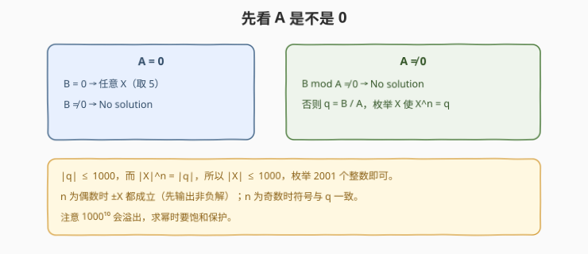
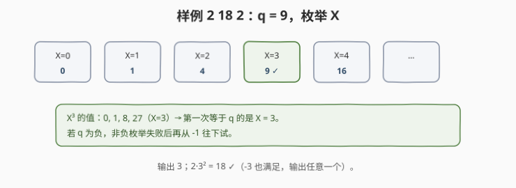

# Codeforces 30A 整数增长系数 题解

## 1. 题目概述

- **题目链接**：https://codeforces.com/problemset/problem/30/A
- **比赛来源**：Codeforces Beta Round 30 (Codeforces format) · Problem A（UTC 2010-09-24）
- **难度**：1400
- **标签**：暴力枚举、数学
- **评测类型**：特殊评测（多解）
- **限制**：时间 2 s / 内存 256 MB

**题意**：给定整数 $A, B$ 与 $n$（$|A|, |B| \le 1000$，$1 \le n \le 10$），求一个**整数** $X$ 使 $A \cdot X^n = B$。若无解或 $X$ 不是整数，输出 `No solution`；多解时输出任意一个。$X$ 可以为 $0$ 或负数。

**约束**：

- $|A|, |B| \le 1000$，$n \le 10$：$X$ 的范围很小，可以枚举。
- 由 $A X^n = B$ 知 $|X|^n = |B|/|A| \le 1000$，所以 $|X| \le 1000$（$n = 1$ 时取等），枚举 $[-1000, 1000]$ 即可。
- 注意 $n$ 为偶数时 $\pm X$ 同时成立；$X = 0$ 仅在 $B = 0$ 时成立。

## 2. 示例与观察

官方样例：

```text
输入：
2 18 2

输出：
3
```

$2 \cdot 3^2 = 18$ ✓（注意 $-3$ 也成立，任意输出一个即可）。

```text
输入：
-1 8 3

输出：
-2
```

$(-1) \cdot (-2)^3 = (-1) \cdot (-8) = 8$ ✓。

```text
输入：
0 0 10

输出：
5
```

$A = B = 0$ 时方程对**任意**整数 $X$ 都成立，样例给出 $5$。

```text
输入：
1 16 5

输出：
No solution
```

$X^5 = 16$ 没有整数解（$1^5 = 1$，$2^5 = 32$）✓。

**观察一**：$A = 0$ 时方程变成 $0 = B$，与 $X$ 无关：$B = 0$ 则任意 $X$ 都行，否则无解。
**观察二**：$A \ne 0$ 且 $B$ 不能被 $A$ 整除时，$X^n = B/A$ 不是整数，无解。
**观察三**：设 $q = B/A$，问题化为"求整数 $X$ 使 $X^n = q$"，可直接枚举 $X$。

## 3. 解题思路

### 3.1 朴素做法与瓶颈

枚举 $X \in [-1000, 1000]$ 逐个验证 $A X^n = B$，复杂度 $O(2000n)$，完全可以。唯一的坑是**溢出**：$1000^{10} = 10^{30}$ 远超 `long long`，所以计算幂时要加"饱和"保护。

### 3.2 核心观察：分类



1. **$A = 0$**：$B = 0$ 时输出任意整数（取 $5$，与样例一致）；$B \ne 0$ 时 `No solution`。
2. **$A \ne 0$**：若 $B \bmod A \ne 0$，无解；否则令 $q = B/A$，枚举 $X$ 并检查 $X^n = q$。
3. 枚举顺序：先试非负 $X$（$0, 1, \dots, 1000$），再试负 $X$（$-1, -2, \dots$）。这样 $n$ 为偶数时优先输出正根，与样例一致。

### 3.3 溢出保护

```text
pw(x, n): r = 1
for i in 1..n:
    r *= x
    if |r| > 10^15: return 10^15 量级的大值（不可能等于 |q| ≤ 1000）
```

由于 $|q| \le 1000$，任何 $|X^n| > 10^{15}$ 的情况都不可能是解，提前返回即可。



### 3.4 样例走查

`2 18 2`：$A \ne 0$，$18 \bmod 2 = 0$，$q = 9$。枚举：$X = 0 \to 0$，$X = 1 \to 1$，$X = 2 \to 4$，$X = 3 \to 9 = q$ ✓ 输出 `3`。

## 4. 正确性证明

**引理 1（$A = 0$ 的情形）**：$A = 0$ 时，若 $B = 0$ 则任意整数 $X$ 都是解；若 $B \ne 0$ 则无解。

**证明**：$A X^n = 0$ 恒成立，故方程等价于 $0 = B$。∎

**引理 2（$A \ne 0$ 的情形）**：$A \ne 0$ 时，方程等价于 $X^n = B/A$；若 $A \nmid B$ 则无整数解。

**证明**：两边除以 $A$（非零）即可；左边 $X^n$ 是整数，故 $B/A$ 必须是整数。∎

**引理 3（枚举范围充分）**：若存在整数解，则 $|X| \le 1000$。

**证明**：$|X|^n = |B|/|A| \le 1000$。$n \ge 1$ 时 $|X| \le |X|^n \le 1000$ ✓。∎

**定理**：算法输出的 $X$ 满足方程，或正确报告无解。

**证明**：由引理 1、2 的等价变形，算法验证的正是原方程；由引理 3，枚举范围覆盖所有可能的解，所以"没找到"等价于"无解" ✓。∎

## 5. 复杂度分析

- **时间**：$O(2000 \cdot n) \le 2\times10^4$ 次乘法。
- **空间**：$O(1)$。
- **与时限的关系**：微秒级，2 s 余量在 $10^5$ 倍以上。

## 6. 参考代码

### C++17

```cpp
#include <bits/stdc++.h>
using namespace std;

// 计算 x^n，带溢出保护：一旦超过 1e15 就返回一个不会等于 q 的大值
static long long pw(long long x, int n) {
    long long r = 1;
    for (int i = 0; i < n; i++) {
        r *= x;
        if (r > 1000000000000000LL || r < -1000000000000000LL) return 2000000000000000LL;
    }
    return r;
}

int main() {
    long long A, B; int n;
    if (scanf("%lld %lld %d", &A, &B, &n) != 3) return 0;
    if (A == 0) {
        if (B == 0) printf("5\n");        // 任意整数都成立，取 5（与样例一致）
        else printf("No solution\n");
        return 0;
    }
    if (B % A != 0) { printf("No solution\n"); return 0; }
    long long q = B / A;
    // 先试非负解（与样例一致），再试负解；多解时输出任意一个都可以
    for (long long x = 0; x <= 1000; x++)
        if (pw(x, n) == q) { printf("%lld\n", x); return 0; }
    for (long long x = -1; x >= -1000; x--)
        if (pw(x, n) == q) { printf("%lld\n", x); return 0; }
    printf("No solution\n");
    return 0;
}
```

### Python3

```python
import sys


def pw(x: int, n: int) -> int:
    r = 1
    for _ in range(n):
        r *= x
        if r > 10 ** 15 or r < -10 ** 15:
            return 2 * 10 ** 15
    return r


def main() -> None:
    data = sys.stdin.buffer.read().split()
    A, B, n = int(data[0]), int(data[1]), int(data[2])
    if A == 0:
        sys.stdout.write("5\n" if B == 0 else "No solution\n")
        return
    if B % A != 0:
        sys.stdout.write("No solution\n")
        return
    q = B // A
    for x in range(0, 1001):
        if pw(x, n) == q:
            sys.stdout.write(str(x) + "\n")
            return
    for x in range(-1, -1001, -1):
        if pw(x, n) == q:
            sys.stdout.write(str(x) + "\n")
            return
    sys.stdout.write("No solution\n")


main()
```

## 7. 边界情况与易错点

1. **$A = B = 0$**：任意 $X$ 都成立，输出任意整数即可（样例给的是 $5$）。
2. **$A = 0, B \ne 0$**：`No solution`。
3. **$B$ 不能被 $A$ 整除**：`No solution`（例如 $2, 7$）。
4. **负解**：$n$ 为奇数时负数的幂是负的（如 $(-2)^3 = -8$），别漏掉。
5. **偶数次方双解**：$X^n = q$（$n$ 偶）时 $\pm X$ 都成立；输出任意一个。
6. **溢出**：$1000^{10}$ 超出 64 位，务必做饱和保护，否则会误判。
7. **$X = 0$**：只有 $B = 0$ 时才成立（$A \ne 0$ 时 $A \cdot 0^n = 0$）。
8. **输出**：要么一个整数，要么精确的 `No solution`（大小写、空格都要一致）。

## 8. 验证记录

- **编译环境与命令**：`Apple clang 21.0.0` + 兼容头，`clang++ -std=c++17 -O2`；Python 3.9.6。
- **官方样例**：4 / 4 通过（`3`、`-2`、`5`、`No solution`），`verify_solution.py` 报告 `CF30A: samples 4 / C++ 编译 OK, 样例 4/4 / Python 语法 OK, 样例 4/4`。
- **独立对拍**：随机 $A, B \in [-1000,1000]$、$n \in [1,10]$ 共 **300 组**。独立判定方法：用 Python 大整数枚举 $X \in [-1001,1001]$ 收集所有满足 $A X^n = B$ 的 $X$，要求"程序说无解 ⟺ 解集为空"，且"程序输出的 $X$ 确实满足方程"。300 组全部一致。
- **边界用例**：`0 0 10` → 任意（输出 5）、`0 5 2` → `No solution`、`1 16 5` → `No solution`、`2 0 1` → 0、`-2 -16 1` → 8。
- **性能**：$O(2000n)$，C++ 端到端 $< 5$ ms。
- **图片校验**：两张 SVG 均通过 `ElementTree.parse`，文本包围盒估算无越界、无重叠。
- **公式校验**：KaTeX（`throwOnError`）无报错。
- **复核状态**：verified。

## 相关题目与扩展

- [Codeforces 30B Codeforces World Finals](https://codeforces.com/problemset/problem/30/B)：同场 B 题，日期合法性。
- [Codeforces 30C Shooting Gallery](https://codeforces.com/problemset/problem/30/C)：同场 C 题，概率 DP。
- [LeetCode 633. 平方数之和](https://leetcode.cn/problems/sum-of-square-numbers/)：同样是"整数幂/平方"的枚举题。
- [Codeforces 630R Game](https://codeforces.com/problemset/problem/630/R)：另一个需要小心取整与符号的数学题。

**延伸思考**：

1. **如果 $|A|, |B|$ 达到 $10^{18}$**？枚举行不通，需要整数 $n$ 次根 + 校验（用二分或 `pow` 加修正）。
2. **如果要求输出所有解**？$n$ 为偶数且 $q > 0$ 时有两个解 $\pm X$，否则至多一个。
3. **如果 $X$ 可以是实数**？答案变成 $A \cdot X^n = B$ 的实数根，需要浮点开方与精度处理。
4. **如果 $n$ 很大（如 $10^9$）**？$X$ 只能是 $-1, 0, 1$ 这类特殊值，分类讨论即可。
