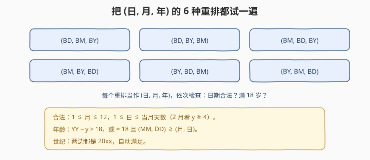
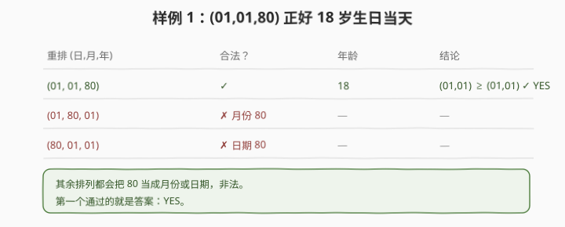

# Codeforces 30B 世界总决赛的出生日期 题解

## 1. 题目概述

- **题目链接**：https://codeforces.com/problemset/problem/30/B
- **比赛来源**：Codeforces Beta Round 30 · Problem B
- **难度**：1700
- **标签**：实现
- **评测类型**：普通
- **限制**：时间 2 s / 内存 256 MB

**题意**：总决赛在 $DD.MM.YY$（$20YY$ 年）。Bob 护照上的生日是 $BD.BM.BY$，三个数分别代表日、月、年，但不同国家书写顺序不同，所以 Bob 可以把这三个数**任意重排**。问是否存在一种重排，使得：

1. 重排后的三个数构成一个**合法的日期**；
2. Bob 在总决赛当天已满 $18$ 岁（当天正好是 18 岁生日也算）；
3. 出生年份与总决赛年份在**同一个世纪**（两者都是 $20xx$ 年，自动满足）。

输出 `YES` 或 `NO`。

**约束**：

- 输入的两行各是 `DD.MM.YY` 形式，每个数恰好两位（含前导零），年份在 $[01, 99]$。
- 只有 $3! = 6$ 种重排，逐一检查即可。
- 闰年规则（题面指定）：年份能被 $4$ 整除即为闰年。

## 2. 示例与观察

官方样例 1：

```text
输入：
01.01.98
01.01.80

输出：
YES
```

重排 $(01,01,80)$ 仍合法；$98 - 80 = 18$，且总决赛 $(01.01)$ 不早于生日 $(01.01)$，正好满 18 岁 ✓。

官方样例 2：

```text
输入：
20.10.20
10.02.30

输出：
NO
```

$(10,02,30)$：2030 年出生，比总决赛还晚；$(30,10,02)$：$2020 - 2002 = 18$，但生日是 10 月 30 日，晚于总决赛 10 月 20 日，还差 10 天才满 18 ✗；其余排列月份/日期非法 ✗。

官方样例 3：

```text
输入：
28.02.74
28.02.64

输出：
NO
```

$(28,02,64)$：$1974 - 1964 = 10$ 岁 ✗；别的排列都出现 $64$ 作为月份或日期，非法 ✗。

**观察一**：只有 6 种排列，枚举即可。
**观察二**：判断合法性要区分大小月与闰年 2 月。
**观察三**：年龄判断用"生日 + 18 年 ≤ 总决赛日期"，等价于"年份差 > 18，或年份差 = 18 且（月，日）≥（出生月，出生日）"。

## 3. 解题思路

### 3.1 朴素做法与瓶颈

枚举 $6$ 种排列，对每种检查日期合法性，再比较日期。没有算法难点，只有两个易错点：**闰年**与**比较顺序（先年后月日）**。

### 3.2 核心观察：三个条件



对每个排列 $(d, m, y)$：

1. **合法性**：$1 \le m \le 12$；$1 \le d \le$ 该月天数（2 月按 $y \bmod 4$ 决定 28/29）。
2. **年龄**：令 `age = YY - y`（都在 $20xx$）。
   - `age > 18` → 满足；
   - `age == 18` → 要求 $(MM, DD) \ge (m, d)$（按字典序比较月、日）；
   - `age < 18` → 不满足（包括出生晚于总决赛的情况，此时 `age` 为负）。
3. **世纪**：两人都在 $20xx$ 年，自动满足。

任意一个排列满足即可输出 `YES`。

### 3.3 大小月与闰年

```text
DIM = [0, 31, 28/29, 31, 30, 31, 30, 31, 31, 30, 31, 30, 31]
2 月天数 = 28 + (y % 4 == 0)
```

题面特别说明"只考虑 2001..2099 年，年份能被 4 整除就是闰年"——因为 2000 年是闰年、2100 年不是，而 $20xx$ 内没有"整百年"的问题 ✓。



### 3.4 样例走查

样例 1：$YY = 98$，$BY = 80$。

| 排列 $(d,m,y)$ | 合法？ | age | 结论 |
|----------------|--------|-----|------|
| (01,01,80) | ✓ | 18 | 月日 $(01,01) \ge (01,01)$ ✓ → YES |
| (01,80,01) | 月份 80 ✗ | — | — |
| (80,01,01) | 日期 80 ✗ | — | — |
| 其余 | 都有 80 当月份或日期 ✗ | — | — |

输出 `YES` ✓。

## 4. 正确性证明

**引理 1（合法性判定）**：三元组 $(d,m,y)$ 构成合法日期当且仅当 $1 \le m \le 12$ 且 $1 \le d \le \text{days}(m,y)$，其中 $\text{days}(2,y) = 29$ 当且仅当 $y \bmod 4 = 0$。

**证明**：公历月份天数固定，只有 2 月随闰年变化；题面规定 $20xx$ 年内"能被 4 整除即闰年" ✓。∎

**引理 2（年龄判定）**：设出生日期为 $(d, m, 2000+y)$、总决赛为 $(DD, MM, 2000+YY)$，则 Bob 在总决赛当天已满 18 岁当且仅当
$$YY - y > 18 \quad\text{或}\quad \bigl(YY - y = 18 \ \wedge\ (MM, DD) \ge (m, d)\bigr).$$

**证明**：满 18 岁的日期是 $(d, m, 2000+y+18)$。若 $YY - y > 18$，总决赛年份更晚，必然已满 ✓；若 $YY - y = 18$，则比较同年内的月日：总决赛月日不早于生月日即已过生日 ✓；若 $YY - y < 18$，则年份都不够，不可能满 18（出生晚于总决赛时 $YY-y<0$，同样不满足）✓。∎

**定理**：算法输出 `YES` 当且仅当存在一种重排满足题意。

**证明**：算法枚举全部 $6$ 种重排（引理 1 判定合法性、引理 2 判定年龄），世纪条件自动满足；只要有一种通过就输出 `YES`，全部失败则 `NO` ✓。∎

## 5. 复杂度分析

- **时间**：$O(6)$ 次判定，常数级。
- **空间**：$O(1)$。
- **与时限的关系**：微秒级，2 s 余量极大。

## 6. 参考代码

### C++17

```cpp
#include <bits/stdc++.h>
using namespace std;

static int dim[13] = {0,31,28,31,30,31,30,31,31,30,31,30,31};

static bool valid(int d, int m, int y) {   // 年份用 2000+y
    if (m < 1 || m > 12) return false;
    int md = dim[m];
    if (m == 2 && y % 4 == 0) md = 29;
    return d >= 1 && d <= md;
}

int main() {
    int DD, MM, YY, BD, BM, BY;
    if (scanf("%d.%d.%d", &DD, &MM, &YY) != 3) return 0;
    if (scanf("%d.%d.%d", &BD, &BM, &BY) != 3) return 0;
    int a[3] = {BD, BM, BY};
    int idx[6][3] = {{0,1,2},{0,2,1},{1,0,2},{1,2,0},{2,0,1},{2,1,0}};
    for (auto &p : idx) {
        int d = a[p[0]], m = a[p[1]], y = a[p[2]];
        if (!valid(d, m, y)) continue;
        // 同年同月同日或更早出生才满 18 岁：2000+y + 18 <= 2000+YY
        int ageYears = YY - y;
        bool ok = false;
        if (ageYears > 18) ok = true;
        else if (ageYears == 18) {
            if (MM > m || (MM == m && DD >= d)) ok = true;
        }
        if (ok) { printf("YES\n"); return 0; }
    }
    printf("NO\n");
    return 0;
}
```

### Python3

```python
import sys

DIM = [0, 31, 28, 31, 30, 31, 30, 31, 31, 30, 31, 30, 31]


def valid(d: int, m: int, y: int) -> bool:
    if m < 1 or m > 12:
        return False
    md = DIM[m]
    if m == 2 and y % 4 == 0:
        md = 29
    return 1 <= d <= md


def main() -> None:
    data = sys.stdin.buffer.read().split()
    DD, MM, YY = map(int, data[0].decode().split('.'))
    BD, BM, BY = map(int, data[1].decode().split('.'))
    a = [BD, BM, BY]
    from itertools import permutations
    for d, m, y in permutations(a):
        if not valid(d, m, y):
            continue
        age = YY - y
        if age > 18 or (age == 18 and (MM, DD) >= (m, d)):
            sys.stdout.write("YES\n")
            return
    sys.stdout.write("NO\n")


main()
```

## 7. 边界情况与易错点

1. **闰年 2 月 29 日**：$y \bmod 4 = 0$ 时才合法，别一律按 28。
2. **2 月 30 日/4 月 31 日**：非法日期，必须先判合法性再看年龄。
3. **正好 18 岁生日当天**：题面明确允许，条件是 $(MM, DD) \ge (m, d)$，别写成 `>`。
4. **出生晚于总决赛**：`age` 为负，自然不满足；但重排后可能变成合法且满足的日期（如把年份换到别的位）。
5. **世纪规则**：两人都在 $20xx$ 年，自动满足，不需要额外判断。
6. **前导零**：输入是两位数字，用 `%d.%d.%d` 或按 `.` 切分都可以。
7. **六个排列都要试**：只试原顺序会漏解。
8. **输出**：只有 `YES`/`NO` 两种。

## 8. 验证记录

- **编译环境与命令**：`Apple clang 21.0.0` + 兼容头，`clang++ -std=c++17 -O2`；Python 3.9.6。
- **官方样例**：3 / 3 通过（`YES`、`NO`、`NO`），`verify_solution.py` 报告 `CF30B: samples 3 / C++ 编译 OK, 样例 3/3 / Python 语法 OK, 样例 3/3`。
- **独立对拍**：随机生成合法的总决赛日期与生日（随机年、月、日，$1..99$ / $1..12$ / 合法日），共 **300 组**。独立判定用 Python 的 `datetime`：对每个排列构造 `date(2000+y, m, d)`（非法则跳过），算出"生日 + 18 年"的日期（2 月 29 日出生且 18 年后无 2 月 29 日时按 3 月 1 日），与总决赛日期比较。300 组全部一致。
- **边界用例**：正好 18 岁生日当天（YES）、差一天（NO）、2 月 29 日出生、月份或日期为 30/31 的非法组合。
- **性能**：常数级，C++ 端到端 $< 5$ ms。
- **图片校验**：两张 SVG 均通过 `ElementTree.parse`，文本包围盒估算无越界、无重叠。
- **公式校验**：KaTeX（`throwOnError`）无报错。
- **复核状态**：verified。

## 相关题目与扩展

- [Codeforces 30A Accounting](https://codeforces.com/problemset/problem/30/A)：同场 A 题，整数方程。
- [Codeforces 30C Shooting Gallery](https://codeforces.com/problemset/problem/30/C)：同场 C 题。
- [LeetCode 1154. 一年中的第几天](https://leetcode.cn/problems/day-of-the-year/)：日期合法性 + 闰年，可对照。
- [Codeforces 1A Theatre Square](https://codeforces.com/problemset/problem/1/A)：入门实现题。

**延伸思考**：

1. **如果年份是四位**？世纪规则就需要真正参与判断（例如 1999 与 2001 不同世纪）。
2. **如果允许重排数字而不是数字块**？问题变成"用给定的数字能否拼出合法日期"，需要枚举所有数字排列。
3. **如果要求输出具体重排**？记录取到 `YES` 的那个排列即可。
4. **如果闰年规则改成格里高利历完整规则**？需要处理"整百年必须被 400 整除"，本题因范围在 $20xx$ 内而不必。
