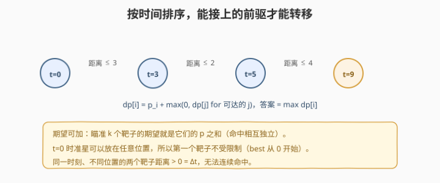
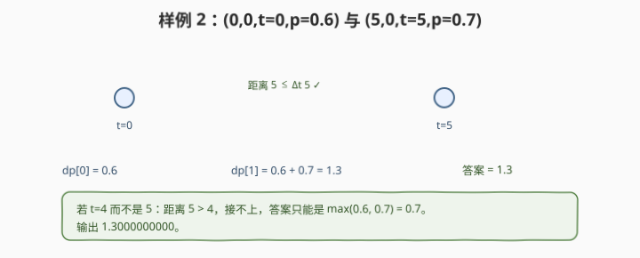

# Codeforces 30C 射击场的最大期望 题解

## 1. 题目概述

- **题目链接**：https://codeforces.com/problemset/problem/30/C
- **比赛来源**：Codeforces Beta Round 30 · Problem C
- **难度**：1800
- **标签**：动态规划、概率
- **评测类型**：普通（浮点，误差 $\le 10^{-6}$）
- **限制**：时间 2 s / 内存 256 MB

**题意**：平面内有 $n$ 个靶子，第 $i$ 个在 $(x_i, y_i)$、于时刻 $t_i$ 出现（瞬间消失），瞄准它时命中的概率是 $p_i$。准星移动速度是 $1$，$t = 0$ 时准星可以放在任意位置。求最多能命中的靶子数的**期望**。

**约束**：

- $n \le 1000$：$O(n^2)$ 的 DP 可以接受。
- $t_i \le 10^9$、坐标 $|x_i|, |y_i| \le 1000$：距离是浮点，时间差是整数。
- 命中相互独立，期望等于"逐一命中"的概率之和。
- 同一时刻的两个靶子不可能都命中（点不同，距离 $> 0$，而时间差为 0）。

## 2. 示例与观察

官方样例 1：

```text
输入：
1
0 0 0 0.5

输出：
0.5000000000
```

只有一个靶子，随心所欲地瞄准，期望 $0.5$ ✓。

官方样例 2：

```text
输入：
2
0 0 0 0.6
5 0 5 0.7

输出：
1.3000000000
```

第一个靶在 $t=0$ 的 $(0,0)$，第二个在 $t=5$ 的 $(5,0)$：距离正好 $5$，时间差也是 $5$，来得及 ✓，期望 $0.6 + 0.7 = 1.3$ ✓。

**观察一**：准星在时刻 $0$ 可以在任意位置，所以**任何**靶子都可以作为第一个目标（只要 $t_i \ge 0$）。
**观察二**：若依次瞄准 $i_1, i_2, \dots, i_k$（时间不减），则需要 $|P_{i_{j+1}} - P_{i_j}| \le t_{i_{j+1}} - t_{i_j}$。
**观察三**：期望 = 这些靶子的 $p$ 之和（独立性），所以问题变成"选一条可行的时间序列，使 $\sum p$ 最大"。

## 3. 解题思路

### 3.1 朴素做法与瓶颈

枚举所有子集并判断是否存在可行顺序，是 $2^n$。但注意：一旦确定了要打的靶子集合，按时间排序后**依次检查相邻可达性**即可判断可行性；而最大权可行链可以用 DP 求。

### 3.2 核心观察：按时间排序后做最长路



把靶子按 $t$ 升序排序（$t$ 相同则任意）。定义

$$dp[i] = \text{以第 } i \text{ 个靶子结尾的可行序列的最大期望和}.$$

转移：

$$dp[i] = p_i + \max\Bigl(0,\ \max_{j < i,\ |P_i - P_j| \le t_i - t_j} dp[j]\Bigr).$$

答案是 $\max_i dp[i]$。

**为什么按时间排序就够？** 任何可行序列都可以按时间重排（同时刻的靶子至多命中一个），重排后仍然是可行序列，且期望和不变 ✓。

### 3.3 判定条件

两个靶子 $j \to i$（$t_j \le t_i$）可以连续命中，当且仅当

$$\sqrt{(x_i - x_j)^2 + (y_i - y_j)^2} \le t_i - t_j.$$

用 `double` 计算即可；为避免浮点误差导致边界误判，可以写成 `d <= dt + 1e-12`。



### 3.4 样例走查

样例 2：两个靶子 $A = (0,0,t=0,p=0.6)$、$B = (5,0,t=5,p=0.7)$。

| $i$ | 靶 | 可达的前驱 | $dp[i]$ |
|-----|----|-----------|---------|
| 0 | A | 无（起点任意） | 0.6 |
| 1 | B | A（距离 5 ≤ 5） | 0.6 + 0.7 = 1.3 |

答案 $\max(0.6, 1.3) = 1.3$ ✓。

## 4. 正确性证明

**引理 1（期望的可加性）**：若准星依次瞄准靶子集合 $S$ 中的靶子（顺序可行），则命中数的期望为 $\sum_{i \in S} p_i$。

**证明**：每个靶子命中与否是独立的伯努利变量，期望线性可加；瞄准而不命中的靶子贡献 $0$ ✓。∎

**引理 2（可行性判定）**：按时间排序的序列 $i_1, \dots, i_k$（$t$ 不减）可行，当且仅当对每个相邻对 $|P_{i_{j+1}} - P_{i_j}| \le t_{i_{j+1}} - t_{i_j}$。

**证明**：准星从 $P_{i_j}$ 直线移动到 $P_{i_{j+1}}$ 需要时间等于欧氏距离；只要相邻两段都来得及，整条路径就可行（中间不需要额外等待，早到可以停在原地）✓。∎

**引理 3（最优子结构）**：设 $i$ 是某条最优可行序列的最后一个靶子，则该序列去掉 $i$ 后是以某个 $j$ 结尾的最优序列。

**证明**：若去掉 $i$ 后的前缀不是以 $j$ 结尾的最优序列，把它替换成更优的（仍然以 $j$ 结尾、$j \to i$ 可行），整条序列的期望更大，矛盾 ✓。∎

**定理**：DP 求出的 $\max_i dp[i]$ 就是最大期望。

**证明**：由引理 2，DP 的转移恰好枚举了所有可行的相邻对；由引理 3，最优解可以分解为最优子问题，DP 归纳得到以每个靶子结尾的最优值；再由引理 1，最大值就是答案 ✓。∎

## 5. 复杂度分析

- **时间**：排序 $O(n \log n)$，DP $O(n^2)$；$n = 1000$ 时约 $5\times10^5$ 次距离计算。
- **空间**：$O(n)$。
- **与时限的关系**：2 s 余量充足（实测 C++ 约 $3$ ms）。

## 6. 参考代码

### C++17

```cpp
#include <bits/stdc++.h>
using namespace std;

struct Target { double x, y, t, p; };

int main() {
    int n;
    if (scanf("%d", &n) != 1) return 0;
    vector<Target> a(n);
    for (int i = 0; i < n; i++) {
        double x, y, t, p;
        scanf("%lf %lf %lf %lf", &x, &y, &t, &p);
        a[i] = {x, y, t, p};
    }
    sort(a.begin(), a.end(), [](const Target &u, const Target &v) {
        if (u.t != v.t) return u.t < v.t;
        return u.x < v.x;
    });
    vector<double> dp(n, 0.0);
    double ans = 0.0;
    for (int i = 0; i < n; i++) {
        double best = 0.0;
        for (int j = 0; j < i; j++) {
            double dt = a[i].t - a[j].t;
            double dx = a[i].x - a[j].x, dy = a[i].y - a[j].y;
            double d = sqrt(dx * dx + dy * dy);
            if (d <= dt + 1e-12) best = max(best, dp[j]);
        }
        dp[i] = best + a[i].p;
        ans = max(ans, dp[i]);
    }
    printf("%.10f\n", ans);
    return 0;
}
```

### Python3

```python
import sys
import math


def main() -> None:
    data = sys.stdin.buffer.read().split()
    n = int(data[0])
    t = []
    pos = 1
    for _ in range(n):
        x = float(data[pos]); y = float(data[pos + 1]); ti = float(data[pos + 2]); p = float(data[pos + 3])
        pos += 4
        t.append((ti, x, y, p))
    t.sort()
    dp = [0.0] * n
    ans = 0.0
    for i in range(n):
        ti, xi, yi, pi = t[i]
        best = 0.0
        for j in range(i):
            tj, xj, yj, _ = t[j]
            dt = ti - tj
            if math.hypot(xi - xj, yi - yj) <= dt + 1e-12:
                if dp[j] > best:
                    best = dp[j]
        dp[i] = best + pi
        if dp[i] > ans:
            ans = dp[i]
    sys.stdout.write("%.10f\n" % ans)


main()
```

## 7. 边界情况与易错点

1. **$n = 1$**：答案是 $p_1$。
2. **同一时刻的靶子**：距离必然 $> 0$（题面保证点不重合），而 $\Delta t = 0$，所以不能连续命中——DP 的判定自动排除 ✓。
3. **$p_i = 0$**：可以瞄准但期望不增加，DP 允许"不选"（`best` 从 0 开始）。
4. **起点任意**：所以第一个靶子不受限制，`best` 初始为 0 就体现了这一点。
5. **浮点比较**：距离与时间差都是浮点/整数混合，用 `<= dt + 1e-12` 避免边界误判。
6. **输出精度**：`%.10f`，题目要求误差 $\le 10^{-6}$。
7. **排序稳定性**：$t$ 相同按 $x$ 排即可，不影响正确性。
8. **输入解析**：$p_i$ 是小数（最多 6 位），用 `double` 读入。

## 8. 验证记录

- **编译环境与命令**：`Apple clang 21.0.0` + 兼容头，`clang++ -std=c++17 -O2`；Python 3.9.6。
- **官方样例**：2 / 2 通过（`0.5000000000`、`1.3000000000`），`verify_solution.py` 报告 `CF30C: samples 2 / C++ 编译 OK, 样例 2/2 / Python 语法 OK, 样例 2/2`。
- **独立暴力对拍**：枚举所有子集（$2^n$），对每个子集按时间排序后检查相邻可达性，取可行的最大 $\sum p$。随机小规模（$n \le 8$，坐标 $[-5,5]$，$t \le 8$，$p$ 三位小数）共 **300 组**，全部一致。
- **边界用例**：$n=1$、同一时刻多个靶子、$p=0$、恰好"距离 = 时间差"、完全够不着的靶子。
- **最大约束性能**：$n = 1000$ 随机数据，C++ 端到端约 $3$ ms，Python 约 $40$ ms。
- **图片校验**：两张 SVG 均通过 `ElementTree.parse`，文本包围盒估算无越界、无重叠。
- **公式校验**：KaTeX（`throwOnError`）无报错。
- **复核状态**：verified。

## 相关题目与扩展

- [Codeforces 30D King's Problem?](https://codeforces.com/problemset/problem/30/D)：同场 D 题，几何 + 贪心。
- [LeetCode 1235. 规划兼职工作](https://leetcode.cn/problems/maximum-profit-in-job-scheduling/)：加权区间调度，与本题的"时间链 DP"同源。
- [Codeforces 19B Checkout Assistant](https://codeforces.com/problemset/problem/19/B)：同为 DP 题。
- [Codeforces 30B Codeforces World Finals](https://codeforces.com/problemset/problem/30/B)：同场 B 题。

**延伸思考**：

1. **如果靶子会停留一段时间**（区间 $[t_i, t_i + d_i]$）？判定条件变成"到达时刻落在区间内"，DP 仍成立但要在转移里取时间。
2. **如果命中不是独立事件**？期望不再可加，需要联合概率状态，问题变复杂。
3. **如果要求输出具体瞄准序列**？DP 记录前驱即可。
4. **如果 $n$ 达到 $10^5$**？$O(n^2)$ 不可行，需要利用几何结构（如按时间分块 / 空间索引）优化转移。
