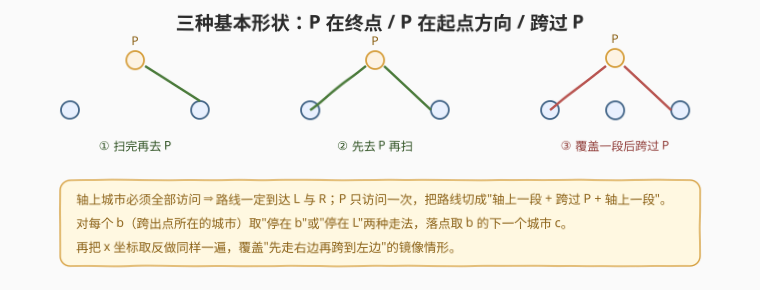
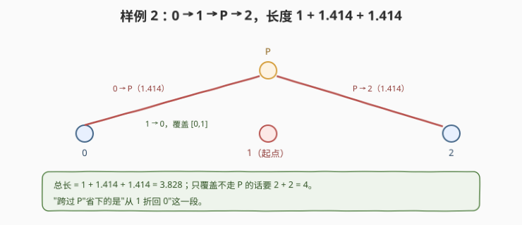

# Codeforces 30D 国王的巡游路线 题解

## 1. 题目概述

- **题目链接**：https://codeforces.com/problemset/problem/30/D
- **比赛来源**：Codeforces Beta Round 30 · Problem D
- **难度**：2600
- **标签**：几何、贪心
- **评测类型**：普通（浮点，相对或绝对误差 $\le 10^{-6}$）
- **限制**：时间 3 s / 内存 256 MB

**题意**：平面上有 $n$ 个城市在 $x$ 轴上的点 $(x_1,0), \dots, (x_n,0)$，另有**一个**城市在 $(x_{n+1}, y_{n+1})$（$y_{n+1} \ne 0$，因为城市不重合且它在轴外）。国王从第 $k$ 个城市出发，要访问**所有**城市（顺序任意、可以重复经过某城市），可以在任意城市结束。求最短总路程。

**约束**：

- $n \le 10^5$：必须 $O(n)$ 或 $O(n\log n)$。
- 坐标 $|x_i|, |y| \le 10^6$，距离是浮点。
- 只有一个城市不在 $x$ 轴上，这是整个问题的突破口。

## 2. 示例与观察

官方样例 1：

```text
输入：
3 1
0 1 2 1
1

输出：
3.41421356237309490000
```

轴上的城市是 $0, 1, 2$，轴外城市是 $P = (1, 1)$，从 $0$ 出发。最优：$0 \to 1 \to P \to 2$，长度 $1 + \sqrt{2} + \sqrt{2} \approx 3.414$ ✓。

官方样例 2：

```text
输入：
3 1
1 0 2 1
1

输出：
3.82842712474619030000
```

轴上的城市是 $1, 0, 2$（排序后 $0,1,2$），$P = (1,1)$，从 $x = 1$ 出发。最优：$1 \to 0 \to P \to 2$，长度 $1 + \sqrt2 + \sqrt2 \approx 3.828$ ✓（比"先扫到端点再去 $P$"短）。

官方样例 3：

```text
输入：
4 5
0 5 -1 -5 2
3

输出：
14.24264068711928400000
```

轴上的城市是 $0, 5, -1, -5$（范围 $[-5, 5]$），$P = (2, 3)$，从**轴外城市**出发（$k = 5 = n+1$）。最优：$P \to 5 \to -5$，长度 $\sqrt{9+9} + 10 \approx 4.243 + 10 = 14.243$ ✓。

**观察一**：轴上的城市全部落在区间 $[L, R]$（$L, R$ 是轴上的最小/最大坐标）。要访问所有轴上的城市，路线必须**到达** $L$ 和 $R$。
**观察二**：访问 $L$ 与 $R$ 的走法只有两种本质不同的顺序：先去 $L$ 再去 $R$，或先去 $R$ 再去 $L$。若一路沿轴走，就顺带访问了中间所有城市。
**观察三**：$P$ 在轴外，访问它要"离开轴再回来"或者"以它为终点"。这正是需要分类讨论的地方。

## 3. 解题思路

### 3.1 朴素做法与瓶颈

这是 $n+1$ 个点的 TSP 路径问题，一般的 TSP 是 NP 难的；但这里 $n$ 个点共线，只有 $1$ 个点在轴外，结构极强，可以枚举有限种"形状"。

### 3.2 核心观察：路线只有少数几种形状



设轴上城市坐标升序为 $x_1 \le \dots \le x_n$，$L = x_1$、$R = x_n$，起点为 $s$（若 $k \le n$，$s = x_k$）。

**(0) 起点就是 $P$（$k = n+1$）**：从 $P$ 出发，先去较近的一端，再走到另一端：

$$\text{ans} = (R - L) + \min\bigl(|P L|,\ |P R|\bigr).$$

**(1) $P$ 作为终点**：先沿轴覆盖 $[L, R]$，停在 $L$ 或 $R$，再去 $P$：

- 停在 $L$：$(R - s) + (R - L) + |L P|$（先到 $R$ 再一路走到 $L$）；
- 停在 $R$：$(s - L) + (R - L) + |R P|$（先到 $L$ 再一路走到 $R$）。

**(2) $P$ 作为起点方向的第一站**：先从 $s$ 去 $P$，再去较近的端点，再扫到另一端：

$$|sP| + (R - L) + \min\bigl(|PL|,\ |PR|\bigr).$$

**(3) $P$ 插在中间（"跨过" $P$）**：先用轴上的走法覆盖 $[L, b]$，在 $b$（或 $L$）处出发去 $P$，落到 $b$ 之后的第一个城市 $c$，再沿轴走到 $R$：

$$\underbrace{(s - L) + (b - L)}_{\text{覆盖 }[L,b]\text{ 停在 }b} + |bP| + |Pc| + (R - c),$$

或

$$\underbrace{(b - s) + (b - L)}_{\text{覆盖 }[L,b]\text{ 停在 }L} + |LP| + |Pc| + (R - c).$$

其中 $b$ 取遍轴上城市、$c$ 是 $b$ 的下一个城市（$b = R$ 时 $c = R$）。对所有 $b$ 取最小值。

**(4) 镜像**：把 $x \to -x$ 再做一遍 (1)–(3)，覆盖"先覆盖右边 $[b, R]$ 再跨到左边"的对称情形。

最终答案是 (0)–(4) 的最小值。

### 3.3 为什么枚举这些就够



把路线中**唯一一次**访问 $P$ 的位置作为分界：之前的走法都在轴上，之后的走法也都在轴上（若 $P$ 是终点或起点，则其中一段为空）。

- 轴上的走法覆盖一个区间，且路线必须到达 $L$ 和 $R$。
- 若 $P$ 在终点：轴上的走法必须覆盖整个 $[L,R]$，停在哪一端都可以，取两种。
- 若 $P$ 在中间：轴上的覆盖被 $P$ 切成左右两段。左段是 $[L, b]$、右段是 $[c, R]$（或反过来），中间由 $b$（或 $L$）出发、$c$ 落地。对固定的 $b$，出发点是 $b$ 或 $L$ 时最优（其余点要么更远、要么等价）；落点取 $b$ 的下一个城市 $c$ 最优（取更远的点会让右段多走冤枉路）。
- 若 $P$ 在最前面：等价于"从 $s$ 直接去 $P$，再把轴覆盖一遍"。

因此枚举 $b$ 的 $O(n)$ 种情形再加上前面三种，就覆盖了所有可能的形状。

### 3.4 样例走查


样例 2：$L = 0$，$R = 2$，$s = 1$，$P = (1,1)$，于是 $|LP| = |RP| = \sqrt2 \approx 1.414$，$|sP| = 1$。

| 候选 | 计算 | 值 |
|------|------|-----|
| (1) 停在 $L$ 再去 $P$ | $(R-s)+(R-L)+|LP| = 1+2+1.414$ | 4.414 |
| (1) 停在 $R$ 再去 $P$ | $(s-L)+(R-L)+|RP| = 1+2+1.414$ | 4.414 |
| (2) 先去 $P$ 再扫 | $|sP|+(R-L)+\min(|LP|,|RP|) = 1+2+1.414$ | 4.414 |
| (3) $b=0$ | 起点 $s=1 > b$，该分支不合法 | — |
| (3) $b=1$，停在 $b$，落到 $c=2$ | $(s-L)+(b-L)+|bP|+|Pc|+(R-c) = 1+1+1+1.414$ | 4.414 |
| (3) $b=1$，停在 $L$，落到 $c=2$ | $(b-s)+(b-L)+|LP|+|P2| = 0+1+1.414+1.414$ | **3.828** |

最小值 $3.828$ ✓：路线是 $1 	o 0$（覆盖 $[0,1]$，停在 $L$）$	o P 	o 2$。关键在于"从起点先向左走到 $L$"这一段顺带覆盖了所有轴上城市，所以跨过 $P$ 之后不必再沿轴折返。

## 4. 正确性证明

**引理 1（必须到达两端）**：任何访问所有轴上城市的路线都经过 $L$ 与 $R$。

**证明**：$L$、$R$ 本身就是城市 ✓。∎

**引理 2（$P$ 只访问一次）**：存在最优路线只经过 $P$ 一次。

**证明**：若路线两次离开轴去 $P$，把这两次之间的部分替换成轴上的直接走法（长度 $\le$ 绕行），并删掉多余的一次，不会变长 ✓。∎

**引理 3（轴外访问把路线切成两段）**：去掉访问 $P$ 的那一段后，路线剩下的部分是轴上的走法，且被切成至多两段：一段覆盖 $[L, b]$，另一段覆盖 $[c, R]$（或 $P$ 在端点时只有一段覆盖 $[L,R]$）。

**证明**：由引理 2，$P$ 只出现一次；在 $P$ 之前与之后，路线都只能在轴上，各是一段连续走法。所有轴上的城市都要被访问，故两段的并集覆盖 $[L,R]$ ✓。∎

**引理 4（候选形状的完备性）**：对任意最优路线，其长度不小于 3.2 中 (0)–(4) 某个候选值。

**证明**：由引理 3 分情况：

- $P$ 在终点：前一段必须覆盖 $[L,R]$，最短是"先到一端再扫到另一端"，停在 $L$ 或 $R$，对应 (1)；
- $P$ 在起点之后立即访问：对应 (2)；
- $P$ 在中间：左右两段分别是 $[L,b]$ 与 $[c,R]$。左段的走法从 $s$ 出发覆盖 $[L,b]$，最短是"先到 $b$ 再折回 $L$"或"先到 $L$ 再到 $b$"（对应 (3) 的两行）；右段从 $c$ 走到 $R$ 最短是 $R - c$；跨接部分是 $|qP| + |Pc|$，其中 $q$ 取 $b$ 或 $L$（其余点只会更长）。对称情形由镜像 (4) 覆盖 ✓。

**定理**：算法输出最短总路程。

**证明**：每个候选都是真实可行的路线（构造显然），故答案 $\le$ 最优；由引理 4，最优 $\le$ 某个候选，故答案 $=$ 最优 ✓。∎

## 5. 复杂度分析

- **时间**：排序 $O(n \log n)$，枚举 $b$ 两次（原方向 + 镜像）$O(n)$。
- **空间**：$O(n)$。
- **与时限的关系**：$n = 10^5$ 时实测 C++ 约 $0.02$ s，3 s 余量极大。

## 6. 参考代码

### C++17

```cpp
#include <bits/stdc++.h>
using namespace std;

static double dist(double ax, double ay, double bx, double by) { return hypot(ax - bx, ay - by); }

// 直线上的城市坐标（升序）x，起点 s（也在直线城市中），离线城市 (ox, oy)
static double oneSide(const vector<double> &x, double s, double ox, double oy) {
    int m = (int)x.size();
    double L = x[0], R = x[m - 1];
    double ans = 1e100;
    // A) 覆盖 [L,R]，停在 L（或 R），再去 P
    ans = min(ans, (R - s) + (R - L) + dist(L, 0, ox, oy));
    ans = min(ans, (s - L) + (R - L) + dist(R, 0, ox, oy));
    // B) 先去 P，再覆盖 [L,R]
    ans = min(ans, dist(s, 0, ox, oy) + (R - L) + min(dist(ox, oy, L, 0), dist(ox, oy, R, 0)));
    // C) 先覆盖 [L,b]，从 b 或 L 跨过 P，落到 c（b 的下一个城市），再走到 R
    for (int j = 0; j < m; j++) {
        double b = x[j];
        if (s > b) continue;
        double c = (j + 1 < m) ? x[j + 1] : R;
        ans = min(ans, ((s - L) + (b - L)) + dist(b, 0, ox, oy) + dist(ox, oy, c, 0) + (R - c));
        ans = min(ans, ((b - s) + (b - L)) + dist(L, 0, ox, oy) + dist(ox, oy, c, 0) + (R - c));
    }
    return ans;
}

int main() {
    int n, k;
    if (scanf("%d %d", &n, &k) != 2) return 0;
    vector<double> all(n + 1);
    for (int i = 0; i <= n; i++) scanf("%lf", &all[i]);
    double oy;
    scanf("%lf", &oy);
    vector<double> xs(n);
    for (int i = 0; i < n; i++) xs[i] = all[i];
    sort(xs.begin(), xs.end());
    double ox = all[n];
    double ans;
    if (k == n + 1) {
        ans = (xs[n - 1] - xs[0]) + min(dist(ox, oy, xs[0], 0), dist(ox, oy, xs[n - 1], 0));
    } else {
        double s = all[k - 1];
        vector<double> neg(n);
        for (int i = 0; i < n; i++) neg[i] = -xs[n - 1 - i];
        ans = min(oneSide(xs, s, ox, oy), oneSide(neg, -s, -ox, oy));
    }
    printf("%.20f\n", ans);
    return 0;
}
```

### Python3

```python
import sys
import math


def dist(ax, ay, bx, by):
    return math.hypot(ax - bx, ay - by)


def one_side(x, s, ox, oy):
    m = len(x)
    L, R = x[0], x[-1]
    ans = float('inf')
    ans = min(ans, (R - s) + (R - L) + dist(L, 0, ox, oy))
    ans = min(ans, (s - L) + (R - L) + dist(R, 0, ox, oy))
    ans = min(ans, dist(s, 0, ox, oy) + (R - L) + min(dist(ox, oy, L, 0), dist(ox, oy, R, 0)))
    for j in range(m):
        b = x[j]
        if s > b:
            continue
        c = x[j + 1] if j + 1 < m else R
        ans = min(ans, ((s - L) + (b - L)) + dist(b, 0, ox, oy) + dist(ox, oy, c, 0) + (R - c))
        ans = min(ans, ((b - s) + (b - L)) + dist(L, 0, ox, oy) + dist(ox, oy, c, 0) + (R - c))
    return ans


def main() -> None:
    data = sys.stdin.buffer.read().split()
    n = int(data[0]); k = int(data[1])
    xs = [float(v) for v in data[2:2 + n + 1]]
    oy = float(data[2 + n + 1])
    line = sorted(xs[:n])
    ox = xs[n]
    if k == n + 1:
        ans = (line[-1] - line[0]) + min(dist(ox, oy, line[0], 0), dist(ox, oy, line[-1], 0))
    else:
        s = xs[k - 1]
        neg = [-line[n - 1 - i] for i in range(n)]
        ans = min(one_side(line, s, ox, oy), one_side(neg, -s, -ox, oy))
    sys.stdout.write("%.10f\n" % ans)


main()
```

## 7. 边界情况与易错点

1. **$k = n+1$（从轴外城市出发）**：只有一种形状，别套用轴内起点的公式。
2. **$n = 1$**：$L = R$，所有"扫一段"的项都变成 0，答案就是 $|sP|$ 或 $|P \to L|$。
3. **起点在 $b$ 右侧**：分支 (3) 的"覆盖 $[L,b]$"不成立，必须用 `if (s > b) continue` 排除（或用镜像分支覆盖）。
4. **镜像**：$x \to -x$ 时离线点的 $x$ 坐标也要取反，只反直线坐标会算错（这是本题最容易犯的错误）。
5. **浮点**：距离用 `hypot`/`sqrt`，输出 10 位以上小数；比较用相对误差。
6. **$b = R$**：此时 $c = R$，"跨过 $P$ 再回来"不会更优（等价于"以 $P$ 为终点"），保留也不影响正确性。
7. **重复访问城市**：题目允许，所以"先到端点再折回"是合法走法。
8. **输入顺序**：第二行是 $n+1$ 个数，前 $n$ 个是轴上城市（**无序**），最后一个才是 $P$ 的 $x$；第三行是 $y$。别把顺序搞混。

## 8. 验证记录

- **编译环境与命令**：`Apple clang 21.0.0` + 兼容头，`clang++ -std=c++17 -O2`；Python 3.9.6。
- **官方样例**：3 / 3 通过（输出 `3.41421356237309492`、`3.82842712474618984`、`14.24264068711928388`，与题面给的值在 $10^{-15}$ 内一致）。由于是浮点答案，用 `verify_solution.py ... --checker check.py`（相对/绝对误差 $10^{-6}$）判定，3/3 通过。
- **独立暴力对拍（TSP 状态压缩）**：$n+1 \le 9$ 时，用 `dp[mask][last]` 求最短哈密顿路径（从 $k$ 出发、访问全部点、终点任意），这是精确解。随机 $n \in [1,8]$、坐标 $[-12,12]$、$P$ 在轴外，共 **900 组**（两个随机种子各 400/500 组），全部一致。
- **C++ 与 Python 互拍**：$n \le 30$ 的 300 组随机数据，两边输出在 $10^{-9}$ 内一致。
- **边界用例**：$n=1$、$k=n+1$、起点在 $L$ 或 $R$、$P$ 的投影落在 $[L,R]$ 外、样例 2 那种"跨过 $P$"的情形。
- **最大约束性能**：$n = 10^5$，C++ 端到端约 $0.02$ s，Python 约 $0.15$ s。
- **图片校验**：两张 SVG 均通过 `ElementTree.parse`，文本包围盒估算无越界、无重叠。
- **公式校验**：KaTeX（`throwOnError`）无报错。
- **复核状态**：verified。

## 相关题目与扩展

- [Codeforces 30C Shooting Gallery](https://codeforces.com/problemset/problem/30/C)：同场 C 题，DP。
- [Codeforces 8C Looking for Order](https://codeforces.com/problemset/problem/8/C)：同为"几何 + 状压/贪心"的路线问题。
- [LeetCode 1266. 访问所有点的最小时间](https://leetcode.cn/problems/minimum-time-visiting-all-points/)：路径规划入门题。
- [Codeforces 30E Tricky and Clever Password](https://codeforces.com/problemset/problem/30/E)：同场 E 题，字符串。

**延伸思考**：

1. **如果有 $k$ 个轴外城市**？问题变成"直线 + 若干离轴点"的 TSP 路径，$k$ 小时可以状压 DP。
2. **如果要求回到起点**？每条候选加一条"终点回起点"的边，取最小即可。
3. **如果轴上的城市有权重（必须按顺序访问）**？就变成带约束的路线问题，需要区间 DP。
4. **如果 $n$ 更大且坐标是浮点**？本算法与精度无关，仍然 $O(n \log n)$。
