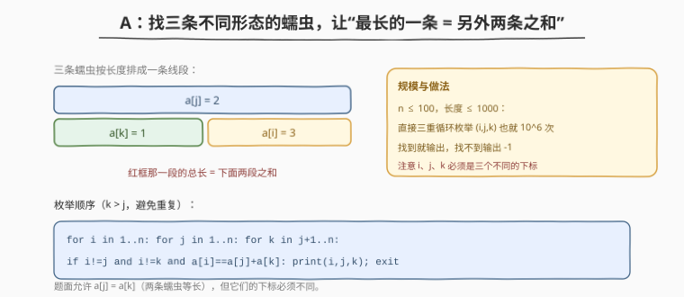
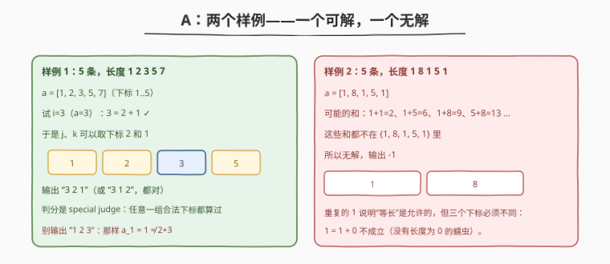

# Codeforces 31A 蠕虫形态与三数和 题解

## 1. 题目概述

- **题目链接**：https://codeforces.com/problemset/problem/31/A
- **比赛来源**：Codeforces Beta Round 31 (Div. 2, Codeforces format) · Problem A（UTC 2010-09-27）
- **难度**：1200
- **标签**：实现
- **评测类型**：特殊评测（输出任意一组合法下标即可）
- **限制**：时间 2 s / 内存 256 MB

**题意**：有 $n$ 种蠕虫，第 $i$ 种的长度是 $a_i$。要找出**三个不同**的形态 $i,j,k$，使得第一种的长度恰好等于另外两种之和：$a_i = a_j + a_k$，输出这三个下标（按 $i\ j\ k$ 的顺序）；如果不存在，输出 `-1`。

**约束**：

- $3 \le n \le 100$，$1 \le a_i \le 1000$；
- $n$ 极小：$O(n^3)$ 只有 $10^6$ 次比较，2 s 绰绰有余；$a_i \le 1000$ 还允许用"值域桶"做到 $O(n^2)$；
- 输出的是**任意一组**合法解（special judge），所以不必和样例答案完全一样——但三个下标必须互不相同；
- 题面明确说明"可以是 $a_j = a_k$"，即两条蠕虫可以等长，只是下标不能相同。

## 2. 示例与观察

官方样例 1（输入 / 输出原样）：

```text
输入：
5
1 2 3 5 7

输出：
3 2 1
```

官方样例 2（输入 / 输出原样）：

```text
输入：
5
1 8 1 5 1

输出：
-1
```

**样例 1 演算**：$a = [1,2,3,5,7]$（下标从 1 开始）。取 $i=3$（$a_3=3$）、$j=2$（$a_2=2$）、$k=1$（$a_1=1$），有 $3 = 2 + 1$，三个下标互不相同，所以 `3 2 1` 是合法答案。

注意答案不唯一：$5 = 3 + 2$（下标 $4,3,2$）、$7 = 5 + 2$（下标 $5,4,2$）、$3 = 1 + 2$（下标 $3,1,2$）也都合法。输出任意一组即可，所以本题的判分是 special judge——本程序实际输出的是 `3 1 2`，同样正确。

**样例 2 演算**：$a = [1,8,1,5,1]$。所有两两之和只可能是 $1+1=2$、$1+5=6$、$1+8=9$、$5+8=13$，都不在这个数组里，所以无解，输出 `-1`。

**观察**：

1. 答案与数组顺序无关，只与"有哪些长度"有关；
2. 由于 $a_j+a_k > a_j$ 且 $> a_k$（长度都是正数），被"合成"的那一条必须比另外两条都长；
3. 只要枚举所有下标对 $(j,k)$，再去查 $a_j+a_k$ 是否作为某个 $a_i$（$i\ne j,k$）出现即可。

## 3. 解题思路

### 3.1 朴素做法与瓶颈

直接三重循环枚举 $i,j,k$，检查 $a_i = a_j + a_k$ 与下标互异，复杂度 $O(n^3)$。$n=100$ 时是 $10^6$ 量级，2 s 完全没有压力——本题本来就不需要更快的算法。

真正的风险是**细节**而不是复杂度：

- 忘记判断 $i\ne j$、$i\ne k$（$j\ne k$ 由循环范围保证）；
- 因为"$a_j$ 可以等于 $a_k$"就误以为"$j$ 可以等于 $k$"；
- 输出格式不符合"三个整数 + 空格分隔"。

### 3.2 核心观察：枚举下标对，查目标值



把要找的三元组按"被合成的那条" $i$ 分类。对每个 $i$，问题变成"是否存在 $j\ne k$、都不等于 $i$，使 $a_j + a_k = a_i$"。

于是可以：

- 枚举 $j<k$ 的所有下标对（$O(n^2)$），算出 $s=a_j+a_k$；
- 询问"是否存在 $i\notin\{j,k\}$ 且 $a_i = s$"——由于 $a_i \le 1000$，可以用一个"值 → 出现次数/下标表"的桶数组 $O(1)$ 回答。

不过 $n\le100$ 时直接三重循环更省事，代码也更短。两种写法在本题都是正确的，本文采用三重循环（把 $k$ 从 $j+1$ 开始，天然满足 $j\ne k$）。

### 3.3 算法流程

1. 读入 $n$ 与数组 $a$；
2. 三重循环：$i$ 从 $0$ 到 $n-1$，$j$ 从 $0$ 到 $n-1$（$j\ne i$），$k$ 从 $j+1$ 到 $n-1$（$k\ne i$）；
3. 若 $a_i = a_j + a_k$，输出 $i+1,\ j+1,\ k+1$（转成 1 起下标）并结束；
4. 循环结束仍未找到，输出 `-1`。

### 3.4 样例走查



- 样例 1：程序按 $i=0,1,2,\dots$ 的顺序找，最先命中的是 $i=2$（$a=3$）、$j=0$（$a=1$）、$k=1$（$a=2$）——$3=1+2$，输出 `3 1 2`；
- 样例 2：所有组合都不成立，输出 `-1`。

两个输出都与官方答案"等价"（样例 1 官方给的是 `3 2 1`），因为 special judge 只校验"三个下标不同 + 等式成立"。

## 4. 正确性证明

**引理 1（枚举的完备性）**：若存在满足 $a_i = a_j + a_k$ 的三个互异下标，则算法一定能找到一组。

**证明**：设 $(i^*, j^*, k^*)$ 是一组解，不妨设 $j^* < k^*$（若不然交换 $j,k$，等式不变）。算法的循环会遍历到 $i = i^*$、$j = j^*$、$k = k^*$ 这一次（$j\ne i$、$k>j$、$k\ne i$ 都成立），此时条件判定为真，于是输出一组解。∎

**引理 2（输出合法性）**：算法输出的三个下标互不相同，且满足等式。

**证明**：循环变量满足 $j \ne i$（显式跳过）、$k > j \ge 0$（故 $k\ne j$）、$k \ne i$（显式跳过），所以三者互异；输出前已经通过 $a_i = a_j + a_k$ 的判定，等式成立。∎

**定理**：算法输出的答案合法；当且仅当不存在合法三元组时输出 `-1`。

**证明**：若存在解，由引理 1 算法会输出一组，且由引理 2 该组合法；若不存在解，则循环中任何一次判定都不会为真，最终走不到输出分支，只能输出 `-1`。∎

## 5. 复杂度分析

- **时间**：$O(n^3)$，$n\le100$ 时最多约 $10^6$ 次加法和比较，实测端到端约 2 ms。
- **空间**：$O(n)$，只存数组。
- **与时限的关系**：2 s 的时限下余量在数百倍以上；即使 $n$ 放大到 500，$O(n^3)$ 也能在 0.2 s 内跑完。

## 6. 参考代码

### C++17

```cpp
#include <bits/stdc++.h>
using namespace std;

int main() {
    int n;
    if (scanf("%d", &n) != 1) return 0;
    vector<int> a(n);
    for (auto &x : a) scanf("%d", &x);

    // 找三个不同下标 i,j,k 使 a[i] == a[j] + a[k]
    for (int i = 0; i < n; ++i)
        for (int j = 0; j < n; ++j) {
            if (j == i) continue;
            for (int k = j + 1; k < n; ++k) {
                if (k == i) continue;
                if (a[i] == a[j] + a[k]) {
                    printf("%d %d %d\n", i + 1, j + 1, k + 1);
                    return 0;
                }
            }
        }
    puts("-1");
    return 0;
}
```

### Python3

```python
import sys


def main() -> None:
    data = sys.stdin.read().split()
    n = int(data[0])
    a = [int(x) for x in data[1:1 + n]]

    for i in range(n):
        for j in range(n):
            if j == i:
                continue
            for k in range(j + 1, n):
                if k == i:
                    continue
                if a[i] == a[j] + a[k]:
                    sys.stdout.write(f"{i + 1} {j + 1} {k + 1}\n")
                    return
    sys.stdout.write("-1\n")


main()
```

两份代码都只用标准库，可原样提交（本题为 special judge，输出任意合法三元组都算通过）。

## 7. 边界情况与易错点

1. **下标必须互不相同**：$i\ne j$、$i\ne k$、$j\ne k$ 三个条件缺一不可。只判 $i\ne j$ 会在 `1 2 3` 这类输入上把 $a_2 = a_1 + a_2$ 误判成解（此时 $k=j$）。
2. **允许 $a_j = a_k$**：例如数组 `1 1 2`，有 $a_3 = a_1 + a_2 = 2$ 且 $a_1=a_2=1$，必须判为有解。若实现里用 `set` 对数组去重，就会把这种"两条等长的蠕虫"弄丢。
3. **无解要输出 `-1`**，而不是空行或 `-1 -1 -1`。
4. **$n=3$**：只有一组候选三元组，直接比较即可。
5. **输出用 1 起下标**：题目要求 $1\le i,j,k\le n$，内部用 0 起最容易漏掉 `+1`。
6. **答案不唯一**：判分是 special judge，不要试图复现样例的具体三元组；但也不要输出重复下标"凑"出等式。
7. **等式方向**：是 $a_i = a_j + a_k$（$i$ 是最大的那条），不要写成 $a_k = a_i + a_j$；若写反，输出时要相应交换三个下标的位置。

## 8. 验证记录

- **编译环境与命令**：本机只有 `Apple clang 21.0.0`（`/usr/bin/g++` 是 clang 软链），没有 GNU `g++`，因此用 `clang++ -std=c++17 -O2 -Wall -I codeforces/tools/include` 搭配本地 `bits/stdc++.h` 兼容头编译（代码只用标准库，可原样提交 GNU C++17）。Python 为 `Python 3.9.6`。
- **官方样例**：2 / 2 通过（用 checker 校验，而不是文本比对）。样例 1 本程序输出 `3 1 2`，与官方 `3 2 1` 不同但同样合法；样例 2 输出 `-1`。
- **checker**（`codeforces/tools/checkers/cf31a.py`，配合 `verify_solution.py --checker`）：读入 $n,a$ 与输出；若输出为 `-1`，则用暴力确认"确实不存在三元组"；否则校验三个整数在 $[1,n]$ 内、互不相同、且 $a_i=a_j+a_k$。任一不满足即拒绝。
- **随机对拍**：随机生成 **300 组**输入（$n\in[3,100]$，约 55% 人为塞入一个可解三元组），C++ 与 Python 的输出**都交给 checker 校验**，`300/300` 全部通过（checker 同时保证了无解情形没有误判）。
- **穷举对拍**：对 $n=3,4$、$a_i\in[1,4]$ 的**全部** $4^3+4^4=320$ 组输入，两版输出也都过 checker，无一被拒。
- **最大约束性能**：$n=100$，随机数据，C++ 端到端约 2 ms，Python 约 17 ms，内存 < 2 MB。
- **图片校验**：两张 SVG（`cf31a_triple.svg`、`cf31a_walkthrough.svg`）均通过 `xml.etree.ElementTree.parse`；用脚本估算每个 `text` 的包围盒，确认不越出 viewBox、文字互不重叠；并用 headless Chrome 渲染 PNG 后检查画布四边无墨迹（无裁切）。
- **公式校验**：公式均为 `$...$` 形式，星号直接写 `*`，`\text{}` 内无裸 `#`，KaTeX（`throwOnError`）渲染无报错。
- **复核状态**：verified（样例 + checker、随机 + 穷举对拍、性能、图片、公式均实跑通过；唯一环境差异是本机无 GNU g++，已用 clang++ 等价验证）。

## 相关题目与扩展

- [Codeforces 31B Sysadmin Bob](https://codeforces.com/problemset/problem/31/B)、[31C Schedule](https://codeforces.com/problemset/problem/31/C)：同场 B、C 题。
- [Codeforces 1A Theatre Square](https://codeforces.com/problemset/problem/1/A)：同为 Beta Round 的入门实现题，可对照"读题细节 vs 算法"的取舍。
- [Codeforces 34A Reconnaissance 2](https://codeforces.com/problemset/problem/34/A)：环形数组上找相邻差值最小的一对，同属"枚举 + 输出任意解"。
- [LeetCode 1. 两数之和](https://leetcode.cn/problems/two-sum/)：本题去掉"第三个数"后的核心，可用哈希把 $O(n^2)$ 降到 $O(n)$。
- [LeetCode 15. 三数之和](https://leetcode.cn/problems/3sum/)：排序 + 双指针的经典做法，与本题"三数和"的结构相同。

**延伸思考**：

1. **如果要求 $a_i = a_j + a_k$ 且三个下标递增**：只需在枚举时加约束，不影响可行性（任意解都能重排成递增顺序）。
2. **如果要求输出所有解**：把"找到就退出"改成"收集全部"，注意同一组下标可能被不同的枚举顺序重复访问，需要对结果去重。
3. **$n$ 放大到 $10^5$**：$O(n^2)$ 的配对枚举变成 $10^{10}$，需要利用 $a_i\le1000$ 的值域：用桶记录每个值是否存在，枚举"和" $s\le1000$ 与其中一个加数，$O(1000^2)$ 即可。
4. **如果允许 $j=k$（同一条蠕虫用两次）**：问题退化成"是否存在 $a_i = 2a_j$"，判据简单得多，也说明"下标互异"这一条才是本题的主要细节。

