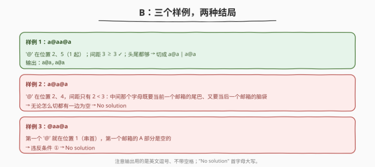

# Codeforces 31B 邮箱列表还原 题解

## 1. 题目概述

- **题目链接**：https://codeforces.com/problemset/problem/31/B
- **比赛来源**：Codeforces Beta Round 31 (Div. 2) · Problem B（2010-09-27）
- **难度**：1500
- **标签**：贪心、实现、字符串
- **评测类型**：特殊评测（输出任意一种合法划分即可）
- **限制**：时间 0.5 s / 内存 256 MB

**题意**：Berland 的邮箱地址形如 `A@B`，其中 `A`、`B` 都是**非空**的小写字母串。Bob 原来有一份用逗号分隔的地址列表，现在所有逗号都丢了，得到一个只含小写字母和 `@` 的串 $s$（长度 $\le 200$）。请把 $s$ 重新划分成若干个合法邮箱，用逗号连接输出；若做不到，输出 `No solution`。

**约束**：

- $|s| \le 200$，时限只有 0.5 s——不过这题的正解是 $O(n)$，时间完全不是问题；
- 每个邮箱**恰好含一个** `@`，且 `@` 两边都至少有 1 个字母；
- 输出的是任意一种合法划分（special judge），但必须保证"把所有逗号去掉后恰好等于 $s$"；
- 注意 `No solution` 的大小写与空格，以及逗号之间不加空格。

## 2. 示例与观察

官方样例 1（输入 / 输出原样）：

```text
输入：
a@aa@a

输出：
a@a,a@a
```

官方样例 2（输入 / 输出原样）：

```text
输入：
a@a@a

输出：
No solution
```

官方样例 3（输入 / 输出原样）：

```text
输入：
@aa@a

输出：
No solution
```

**样例 1 演算**：`a@aa@a` 里有两个 `@`（位置 2 和 5，1 起），所以邮箱数必须是 2。按"每个邮箱恰好一个 `@`"切：第一个邮箱吃 `a@a`（第 1 个 `@` 加它前面的 1 个字母和后面的 1 个字母），剩下的 `a@a` 是第二个邮箱。输出 `a@a,a@a`。

**样例 2 演算**：`a@a@a` 的两个 `@` 在位置 2 和 4，中间只隔了 1 个字符 `a`。这个 `a` 要么当前一个邮箱的结尾（则后一个邮箱 `@a` 的 `A` 为空），要么当后一个邮箱的开头（则前一个邮箱 `a@` 的 `B` 为空）——无论怎么分都有一边为空，所以无解。

**样例 3 演算**：`@aa@a` 的第一个字符就是 `@`，第一个邮箱的 `A` 部分是空的，无解。

**观察**：

1. 每个邮箱恰好一个 `@` ⇒ **邮箱个数 = `@` 的个数**，而且第 $t$ 个邮箱必须包含第 $t$ 个 `@`；
2. 于是"划分"等价于"在相邻 `@` 之间选切点"，而每个邮箱至少要分到 `@` 前 1 个字母、`@` 后 1 个字母；
3. 由此得到三个必要条件：**串首不能是 `@`**、**串尾不能是 `@`**、**相邻 `@` 之间至少隔 3 个字符**。

## 3. 解题思路

### 3.1 朴素做法与瓶颈

可以枚举所有切分点（$n-1$ 个间隙，每个选或不选），复杂度 $O(2^n)$；$n=200$ 时不可能。也可以做 DP：$f[i]$ 表示前缀 $s[0..i)$ 能否划分，转移时枚举最后一段的长度，$O(n^2)$ 也能过——但并不必要。

真正关键的是"**每个邮箱恰好一个 `@`**"这一条：它把"划分"这个自由度几乎完全固定死了。

### 3.2 核心观察：三个必要条件就是充分条件


设 `@` 的位置（0 起）为 $p_1 < p_2 < \cdots < p_m$，串长为 $n$。

- 每个邮箱恰好一个 `@`（`A`、`B` 中都不允许出现 `@`），所以**邮箱个数恰为 $m$**，第 $t$ 个邮箱里放第 $t$ 个 `@`；
- 第 1 个邮箱的 `A` 部分必须非空 ⇒ $p_1 \ge 1$；
- 最后 1 个邮箱的 `B` 部分必须非空 ⇒ $p_m \le n-2$；
- 相邻两个 `@` 之间：第 $t$ 个邮箱的 `B` 至少占 1 个字符，第 $t+1$ 个邮箱的 `A` 至少占 1 个字符，中间还夹着第 $t+1$ 个 `@` 本身，所以
  $$p_{t+1} - p_t \ge 3 .$$


这三个条件不仅是必要的，也是**充分的**——下面给出构造：

> 第 $1..m-1$ 个邮箱都在自己的 `@` 后**只取 1 个字母**，把剩下的字母全留给后面的邮箱；最后一个邮箱吃掉剩余全部。

由 $p_{t+1}-p_t\ge3$ 可知，第 $t$ 个邮箱取 `[start, p_t+2)` 之后，剩下的开头位置 $p_t+2 \le p_{t+1}-1$，正好给第 $t+1$ 个邮箱留下至少 1 个 `A` 字母；最后一个邮箱从 $p_{m-1}+2$ 到 $n$，由 $p_m\le n-2$ 知它的 `B` 部分非空。

### 3.3 算法流程

1. 找出所有的 `@` 位置；
2. 若一个 `@` 都没有、或 $p_1<1$、或 $p_m>n-2$、或存在 $p_{t+1}-p_t<3$，输出 `No solution`；
3. 否则按上面的贪心切分，用逗号连接输出。

### 3.4 样例走查



- 样例 1：`@` 在 $p_1=1,\ p_2=4$（0 起），间距 $3\ge3$ ✓，$p_1\ge1$ ✓，$p_2=4\le 6-2$ ✓ → 切成 `a@a` 与 `a@a`；
- 样例 2：间距 $p_2-p_1=2<3$ → 无解；
- 样例 3：$p_1=0<1$ → 无解。

## 4. 正确性证明

**引理 1（邮箱个数与对应关系）**：任何合法划分中，邮箱个数等于 $s$ 中 `@` 的个数 $m$，且第 $t$ 个邮箱包含第 $t$ 个 `@`。

**证明**：每个邮箱恰好含一个 `@`（`A`、`B` 只含小写字母）；所有邮箱拼起来恰好是 $s$，所以每个 `@` 都恰好属于某个邮箱；按位置顺序，前 $t-1$ 个 `@` 在前 $t-1$ 个邮箱里，故第 $t$ 个 `@` 在第 $t$ 个邮箱里，且邮箱数为 $m$。∎

**引理 2（三个条件必要）**：任何合法划分都满足 $p_1\ge1$、$p_m\le n-2$、且 $p_{t+1}-p_t\ge3$。

**证明**：由引理 1，第 1 个邮箱以 $s[0]$ 开头、包含 $p_1$，其 `A` 部分为 $s[0..p_1)$，必须非空 ⇒ $p_1\ge1$。同理最后一个邮箱的 `B` 部分是 $s[p_m+1..n)$，必须非空 ⇒ $p_m\le n-2$。再看相邻的 `@`：第 $t$ 个邮箱的 `B` 部分非空，说明它至少含有 $p_t+1$ 这个位置；第 $t+1$ 个邮箱的 `A` 部分非空，说明它至少含有 $p_{t+1}-1$ 这个位置。两个位置不能相同（否则同一个字符同时属于两个邮箱），也不能交叉（邮箱是按顺序拼接的），且它们之间还隔着 $p_{t+1}$：于是 $p_{t+1}-1 \ge (p_t+1)+1$，即 $p_{t+1}-p_t\ge3$。∎

**引理 3（贪心构造合法）**：若三个条件都成立，则第 3.2 节的切分给出一个合法划分。

**证明**：第 $t$ 个邮箱（$t<m$）是 $s[\text{start}_t,\ p_t+2)$，其中 $\text{start}_t = p_{t-1}+2$（约定 $\text{start}_1=0$）。它的 `A` 部分是 $s[\text{start}_t, p_t)$，长度 $p_t-\text{start}_t = p_t-p_{t-1}-2\ge 1$（由间距 $\ge3$）；`B` 部分只有 $s[p_t+1]$ 一个字母，非空 ✓；且恰好一个 `@` ✓。最后一个邮箱是 $s[\text{start}_m, n)$，`A` 长度 $p_m-p_{m-1}-2\ge1$，`B` 长度 $n-1-p_m\ge1$（由 $p_m\le n-2$）✓。各段首尾相接覆盖整个串，故拼接结果就是 $s$。∎

**定理**：算法输出 `No solution` 当且仅当不存在合法划分；否则输出的列表合法。

**证明**：若三个条件有任一不满足，由引理 2 不存在合法划分；若全部满足，由引理 3 贪心构造合法。∎

## 5. 复杂度分析

- **时间**：$O(n)$，只需扫描一遍找 `@` 位置、再扫一遍输出；$n\le200$。
- **空间**：$O(n)$。
- **与时限的关系**：0.5 s 的时限对 $O(n)$ 完全宽松，实测端到端约 2 ms。

## 6. 参考代码

### C++17

```cpp
#include <bits/stdc++.h>
using namespace std;

int main() {
    string s;
    if (!(cin >> s)) return 0;
    int n = (int)s.size();

    // 每个邮箱恰好一个 '@'，所以邮箱个数 = '@' 的个数
    vector<int> at;
    for (int i = 0; i < n; ++i)
        if (s[i] == '@') at.push_back(i);
    int m = (int)at.size();

    // 必要条件：第一个 '@' 前至少有 1 个字母；最后一个 '@' 后至少有 1 个字母；
    // 相邻两个 '@' 之间至少隔 3 个字符（前一个邮箱的"收尾字母" + 后一个邮箱的"开头字母" + 1 个 '@'）
    bool ok = m >= 1;
    if (ok && (at[0] < 1 || at[m - 1] > n - 2)) ok = false;
    for (int i = 0; ok && i + 1 < m; ++i)
        if (at[i + 1] - at[i] < 3) ok = false;

    if (!ok) {
        cout << "No solution\n";
        return 0;
    }

    // 构造：除最后一个邮箱外，每个邮箱在自己的 '@' 后只取 1 个字母
    string out;
    int start = 0;
    for (int i = 0; i < m; ++i) {
        int end = (i + 1 == m) ? n : at[i] + 2;      // 最后一个邮箱吃掉剩余全部
        if (i) out += ',';
        out += s.substr(start, end - start);
        start = end;
    }
    cout << out << '\n';
    return 0;
}
```

### Python3

```python
import sys


def main() -> None:
    s = sys.stdin.read().strip()
    n = len(s)

    at = [i for i, ch in enumerate(s) if ch == "@"]
    m = len(at)

    ok = m >= 1
    if ok and (at[0] < 1 or at[-1] > n - 2):
        ok = False
    for i in range(m - 1):
        if at[i + 1] - at[i] < 3:
            ok = False

    if not ok:
        sys.stdout.write("No solution\n")
        return

    parts = []
    start = 0
    for i in range(m):
        end = n if i + 1 == m else at[i] + 2      # 最后一个邮箱吃掉剩余全部
        parts.append(s[start:end])
        start = end
    sys.stdout.write(",".join(parts) + "\n")


main()
```

两份代码都只用标准库，可原样提交（本题为 special judge，任意合法划分都算通过）。

## 7. 边界情况与易错点

1. **没有 `@`**：邮箱个数为 0，不可能是"至少一个邮箱的列表"，输出 `No solution`。
2. **串首是 `@`**：第一个邮箱的 `A` 为空 → `No solution`（样例 3）。
3. **串尾是 `@`**：最后一个邮箱的 `B` 为空 → `No solution`。
4. **相邻 `@` 只隔 1 个字符**（如 `a@a@a`）：间距 2 < 3 → `No solution`（样例 2）。这类输入最容易漏判。
5. **相邻 `@` 紧挨着**（如 `a@@a`）：间距 1 → 无解。
6. **只有一个邮箱**（如 `a@b`）：只要首尾不是 `@` 就合法，输出 `a@b` 本身。
7. **输出格式**：用英文逗号 `,` 分隔、逗号后**不加空格**；无解时输出 `No solution`（首字母 N 大写，solution 小写）。
8. **不要贪心地"能切多长切多长"**：如果每个邮箱都尽量长，会把后面邮箱的 `A` 字母吃掉，反而无解；正确做法是除了最后一个，其余邮箱都**只取 1 个**尾字母。

## 8. 验证记录

- **编译环境与命令**：本机只有 `Apple clang 21.0.0`，没有 GNU `g++`，因此用 `clang++ -std=c++17 -O2 -Wall -I codeforces/tools/include` 搭配本地 `bits/stdc++.h` 兼容头编译（代码只用标准库，可原样提交 GNU C++17）。Python 为 `Python 3.9.6`。
- **官方样例**：3 / 3 通过（`a@a,a@a`、两次 `No solution`），与 JSON 中的 `out` 一致；本题输出唯一性不保证，因此另外用 checker 做了合法性校验。
- **checker**（`/tmp/cf_verify_31_B/checker.py`，配合 `verify_solution.py --checker`）：若输出为 `No solution`，用 $O(n^2)$ 的划分 DP 独立确认"确实无解"；否则校验每个逗号分隔片段都匹配 `^[a-z]+@[a-z]+$`，且所有片段拼接后恰好等于输入串。
- **随机对拍**：随机生成 **300 组**输入（长度 1–14，`@` 与字母混合），C++ 与 Python 的输出都交给 checker，`300/300` 全部通过。
- **穷举对拍**：对 $\{a,@\}$ 上长度 $1..8$ 的**全部** $510$ 个串，两版输出也全部通过 checker（既覆盖了可解情形，也覆盖了各类无解情形）。
- **最大约束性能**：$|s|=200$，C++ 端到端约 2 ms，Python 约 17 ms，内存 < 2 MB。
- **图片校验**：三张 SVG（`cf31b_structure.svg`、`cf31b_rules.svg`、`cf31b_walkthrough.svg`）均通过 `xml.etree.ElementTree.parse`；用脚本估算每个 `text` 的包围盒，确认不越出 viewBox、文字互不重叠；并用 headless Chrome 渲染 PNG 后检查画布四边无墨迹（无裁切）。
- **公式校验**：公式均为 `$...$` 形式，星号直接写 `*`，`\text{}` 内无裸 `#`，KaTeX（`throwOnError`）渲染无报错。
- **复核状态**：verified（样例 + checker、随机 + 穷举对拍、性能、图片、公式均实跑通过；唯一环境差异是本机无 GNU g++，已用 clang++ 等价验证）。

## 相关题目与扩展

- [Codeforces 31A Worms Evolution](https://codeforces.com/problemset/problem/31/A)、[31C Schedule](https://codeforces.com/problemset/problem/31/C)：同场 A、C 题。
- [Codeforces 131A cAPS lOCK](https://codeforces.com/problemset/problem/131/A)：同样是"按规则改写字符串"的实现题。
- [Codeforces 118A String Task](https://codeforces.com/problemset/problem/118/A)：字符串遍历与重建，适合热身。
- [LeetCode 93. 复原 IP 地址](https://leetcode.cn/problems/restore-ip-addresses/)：把数字串切成合法 IP，结构与本题高度相似（都是"按段长规则还原分隔"），但那里需要枚举所有方案。
- [LeetCode 468. 验证 IP 地址](https://leetcode.cn/problems/validate-ip-address/)：判定合法性的细节题，可与本题的 `A@B` 规则对照。

**延伸思考**：

1. **如果要求输出所有划分方案**：切点不再被"每个邮箱一个 `@`"完全固定（邮箱的 `B` 可以更长），方案数是指数级的，需要 DFS + 剪枝或 DP 计数。
2. **如果允许 `A` 或 `B` 为空**：条件退化成"`@` 的个数等于邮箱数"，几乎任何串都能划分（把相邻 `@` 各自成段），题目就没意思了——可见"两边非空"是本题的核心约束。
3. **如果邮箱规则允许多个 `@`**：问题变成另一种切分，需要重新分析；这也说明"先找出把哪些量固定死"是这类还原题的通用方法。
4. **如果字符串长到 $10^6$**：$O(n)$ 的判定与构造依然可行（只需一次扫描记录 `@` 位置），但要注意输出本身也是 $O(n)$。

