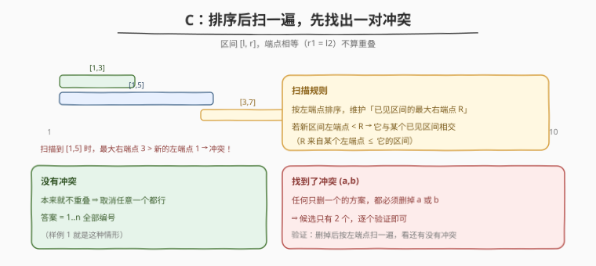
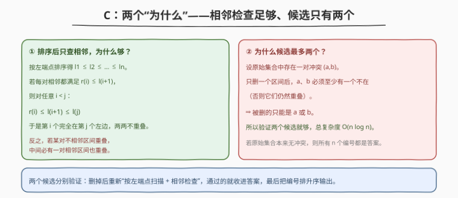
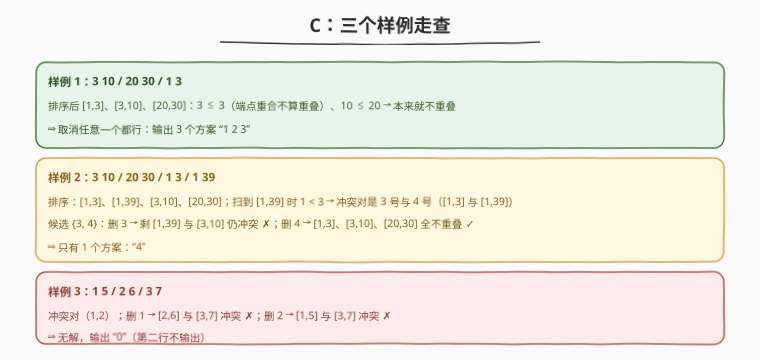

# Codeforces 31C 取消一节课的方案 题解

## 1. 题目概述

- **题目链接**：https://codeforces.com/problemset/problem/31/C
- **比赛来源**：Codeforces Beta Round 31 (Div. 2, Codeforces format) · Problem C（UTC 2010-09-27）
- **难度**：1700
- **标签**：实现（区间调度）
- **评测类型**：普通（单组输入，唯一答案）
- **限制**：时间 2 s / 内存 256 MB

**题意**：有 $n$ 个小组要在 31 号教室上课，第 $i$ 个小组占时间段 $[l_i, r_i]$。**恰好取消一个**小组的课，使剩下的小组课程时间段**两两不重叠**。问有多少种取消方案，并从小到大输出这些小组的编号。

约定：一个小组刚好下课、另一个小组刚好开始上课（即 $r_a = l_b$）**不算**重叠。

**约束**：

- $1 \le n \le 5000$，$1 \le l_i < r_i \le 10^6$；
- $n=5000$ 时 $O(n^2)$ 约 $2.5\times10^7$ 次操作，在 2 s 内其实也能过，但正解只需 $O(n\log n)$；
- 答案要求"编号升序、先输出个数"，属于**输出格式**敏感型题目；
- 原数据可能本来就不重叠（样例 1），此时每个小组都可以取消。

## 2. 示例与观察

官方样例 1（输入 / 输出原样）：

```text
输入：
3
3 10
20 30
1 3

输出：
3
1 2 3 
```

官方样例 2（输入 / 输出原样）：

```text
输入：
4
3 10
20 30
1 3
1 39

输出：
1
4 
```

官方样例 3（输入 / 输出原样）：

```text
输入：
3
1 5
2 6
3 7

输出：
0
```

**样例 1 演算**：三个区间 $[3,10]$、$[20,30]$、$[1,3]$ 按左端点排序后是 $[1,3]$、$[3,10]$、$[20,30]$。相邻检查：$3\le 3$ ✓（端点重合不算重叠）、$10 \le 20$ ✓。所以本来就不重叠，取消任意一个都仍然不重叠，答案是 3 个：`1 2 3`。

**样例 2 演算**：在样例 1 的基础上多了 $[1,39]$。排序后：$[1,3]$、$[1,39]$、$[3,10]$、$[20,30]$。扫描时发现 $[1,39]$ 与 $[1,3]$ 冲突。要消掉这个冲突，只能取消这两者之一：

- 取消 3 号（$[1,3]$）：剩下 $[1,39]$、$[3,10]$、$[20,30]$，而 $[1,39]$ 与 $[3,10]$ 仍重叠 → 不行；
- 取消 4 号（$[1,39]$）：剩下 $[1,3]$、$[3,10]$、$[20,30]$，全部不重叠 → 可以。

所以只有 1 种方案：`4`。

**样例 3 演算**：$[1,5]$、$[2,6]$、$[3,7]$ 两两重叠。取消 1 号后 $[2,6]$ 与 $[3,7]$ 仍重叠，取消 2 号后 $[1,5]$ 与 $[3,7]$ 仍重叠，取消 3 号后 $[1,5]$ 与 $[2,6]$ 仍重叠，所以答案是 0（第二行不输出）。

**观察**：

1. "剩下两两不重叠"这件事，可以在按左端点排序后**只查相邻**；
2. 如果原集合里存在一对冲突 $(a,b)$，那么任何合法方案都必须删掉 $a$ 或 $b$——候选只有两个；
3. 于是整体思路是：**找一对冲突 → 只验证这两个候选**，复杂度 $O(n\log n)$。

## 3. 解题思路

### 3.1 朴素做法与瓶颈

最直接的做法：对每个 $i$，把其余 $n-1$ 个区间排序后检查是否两两不重叠，复杂度 $O(n^2\log n)$。$n=5000$ 时约 $5000\times5000\times13\approx3\times10^8$，在 2 s 的 C++ 里勉强能过，但既慢又容易写错（每个 $i$ 都要重新排序）。

更好的做法来自一个关键观察：**只要找到任意一对冲突区间，答案的候选就只剩下两个**。

### 3.2 核心观察：一对冲突锁死候选



先在**原集合**里按左端点排序，用"目前见过的最大右端点 $R$"扫一遍：

- 若当前区间的左端点 $< R$，说明它与某个已扫描的区间重叠，于是找到一对冲突 $(a,b)$；
- 若扫完都没有冲突，说明原集合本来就不重叠，那么**取消任意一个**都行，答案是全部 $n$ 个编号。

如果找到了冲突 $(a,b)$：任何合法方案都必须删除 $a$ 或 $b$（否则这对仍然重叠），所以候选集合是 $\{a,b\}$ 的子集。分别验证即可。



**为什么"相邻检查"就够**：按左端点排序后若每个相邻对都满足 $r_i \le l_{i+1}$，则对任意 $i<j$ 有
$$r_i \le l_{i+1} \le l_j,$$
所以第 $i$ 个区间完全在第 $j$ 个左边，两两不重叠。反过来，如果存在一对不相邻的区间重叠，由于区间在直线上是"连续"的，中间必然有一对相邻区间也重叠（否则从左到右可以一路"传递"过去，矛盾）。因此相邻检查与两两检查等价。

**验证一个候选**：把该区间去掉，对剩下的区间按左端点排序，逐对检查相邻的 $r \le$ 下一个 $l$ 即可，$O(n\log n)$；两个候选一共 $O(n\log n)$。

### 3.3 算法流程

1. 读入所有区间，按 $(l, r)$ 排序得到下标序列；
2. 顺序扫描，维护"最大右端点"及其来源下标 `best`；若当前区间左端点 $<$ `r[best]`，记下冲突对 $(best, cur)$ 并停止扫描；
3. 若没有冲突：答案就是 $1..n$ 的全部编号；
4. 否则对 `{best, cur}` 两个候选分别验证：去掉它、再按左端点顺序扫一遍看是否还有重叠；通过的编号收进答案；
5. 把答案按编号升序排序，输出个数与编号列表。

### 3.4 样例走查



- 样例 1：扫描无冲突 → 输出 `3` 与 `1 2 3`；
- 样例 2：冲突对是 3 号（$[1,3]$）与 4 号（$[1,39]$）；验证 3 号失败、4 号成功 → 输出 `1` 与 `4`；
- 样例 3：冲突对是 1 号与 2 号，两个都验证失败 → 输出 `0`。

## 4. 正确性证明

**引理 1（相邻检查等价于两两检查）**：设区间已按左端点升序排列，$l_1\le l_2\le\cdots\le l_n$。则"所有 $i$ 都有 $r_i\le l_{i+1}$" $\iff$ "任意 $i<j$ 都不重叠"。

**证明**：

（⇒）若每个相邻对都满足 $r_i\le l_{i+1}$，对任意 $i<j$，由 $l$ 的单调性有 $l_{i+1}\le l_j$，于是 $r_i\le l_{i+1}\le l_j$，即第 $i$ 个区间在第 $j$ 个之前结束，不重叠。

（⇐）取 $j=i+1$ 即可：相邻对也是"任意 $i<j$"的特例。∎

**引理 2（排序扫描能找到冲突）**：若原集合中存在重叠的两个区间，则第 3.2 节的扫描一定会在某个时刻报告冲突。

**证明**：设 $a,b$ 是重叠的一对，$l_a\le l_b$。扫描到 $b$ 时，$a$ 已经被处理过（$a$ 在 $b$ 之前），且当时的"最大右端点" $R\ge r_a>l_b$（重叠意味着 $l_b<r_a$）。于是判定 $l_b<R$ 成立，扫描报告冲突。∎

**引理 3（候选只有两个）**：设扫描报告了冲突对 $(a,b)$。则任何"删除一个区间后集合两两不重叠"的方案，删除的区间必是 $a$ 或 $b$。

**证明**：若不删 $a$ 也不删 $b$，则 $a,b$ 都留在集合里，而它们重叠，与"两两不重叠"矛盾。∎

**引理 4（验证的正确性）**：对候选 $c$，算法"去掉 $c$ 后按左端点排序并逐对检查相邻"判定通过，当且仅当去掉 $c$ 后剩下区间两两不重叠。

**证明**：由引理 1（对剩下的集合重新排序后仍适用）。∎

**定理**：算法输出的编号集合恰为所有"删掉它就能使剩余两两不重叠"的编号，且顺序升序。

**证明**：

- 若原集合无冲突：由引理 1 的（⇐）方向，集合本身两两不重叠，删掉任意一个仍然两两不重叠（子集保持性质），故全部 $n$ 个编号都合法，算法全部输出。
- 若存在冲突：由引理 2 扫描必找到一对 $(a,b)$；由引理 3，合法编号必在 $\{a,b\}$ 中；对这两个候选，引理 4 保证验证结果正确。因此算法输出恰为全部合法编号。
- 输出前对编号排序，故为升序。∎

## 5. 复杂度分析

- **时间**：排序 $O(n\log n)$；扫描 $O(n)$；对至多 2 个候选各验证一次 $O(n\log n)$——但可以在已排序序列上跳过候选直接扫，$O(n)$，总复杂度 $O(n\log n)$。
- **空间**：$O(n)$。
- **与时限的关系**：$n=5000$ 时实测 C++ 端到端约 3 ms、Python 约 22 ms，相对 2 s / 256 MB 余量极大。

## 6. 参考代码

### C++17

```cpp
#include <bits/stdc++.h>
using namespace std;

int main() {
    int n;
    if (scanf("%d", &n) != 1) return 0;
    vector<int> l(n), r(n);
    for (int i = 0; i < n; ++i) scanf("%d %d", &l[i], &r[i]);

    vector<int> idx(n);
    iota(idx.begin(), idx.end(), 0);
    sort(idx.begin(), idx.end(), [&](int x, int y) {
        if (l[x] != l[y]) return l[x] < l[y];
        return r[x] < r[y];
    });

    // 先找出一对冲突（在按左端点排序后，用"目前最大右端点"扫出来）
    int a = -1, b = -1, best = -1;
    for (int i = 0; i < n; ++i) {
        int cur = idx[i];
        if (best >= 0 && l[cur] < r[best]) {   // 端点相等不算重叠
            a = best;
            b = cur;
            break;
        }
        if (best < 0 || r[cur] > r[best]) best = cur;
    }

    vector<int> ans;
    if (a < 0) {
        // 本来就没有任何重叠：取消任意一个都行
        for (int i = 1; i <= n; ++i) ans.push_back(i);
    } else {
        // 无重叠时，任何方案都必须删掉这对冲突中的一个
        for (int cand : {a, b}) {
            bool ok = true;
            int prev = -1;
            for (int i = 0; i < n && ok; ++i) {
                int cur = idx[i];
                if (cur == cand) continue;
                if (prev >= 0 && l[cur] < r[prev]) ok = false;   // 相邻比较即可判定全部
                prev = cur;
            }
            if (ok) ans.push_back(cand + 1);
        }
    }

    sort(ans.begin(), ans.end());
    printf("%d\n", (int)ans.size());
    for (int x : ans) printf("%d ", x);
    if (!ans.empty()) printf("\n");
    return 0;
}
```

### Python3

```python
import sys


def main() -> None:
    data = sys.stdin.read().split()
    n = int(data[0])
    l = [0] * n
    r = [0] * n
    p = 1
    for i in range(n):
        l[i] = int(data[p]); r[i] = int(data[p + 1]); p += 2

    idx = sorted(range(n), key=lambda i: (l[i], r[i]))

    # 找一对冲突（按左端点排序后用"目前最大右端点"扫出来）
    a = b = -1
    best = -1
    for cur in idx:
        if best >= 0 and l[cur] < r[best]:      # 端点相等不算重叠
            a, b = best, cur
            break
        if best < 0 or r[cur] > r[best]:
            best = cur

    ans = []
    if a < 0:
        ans = list(range(1, n + 1))             # 本来就不重叠：删谁都行
    else:
        for cand in (a, b):                     # 必须删掉这对冲突中的一个
            ok = True
            prev = -1
            for cur in idx:
                if cur == cand:
                    continue
                if prev >= 0 and l[cur] < r[prev]:
                    ok = False
                    break
                prev = cur
            if ok:
                ans.append(cand + 1)

    ans.sort()
    out = [str(len(ans))]
    if ans:
        out.append(" ".join(map(str, ans)) + " ")
        sys.stdout.write("\n".join(out) + "\n")
    else:
        sys.stdout.write("0\n")


main()
```

两份代码都只用标准库，可原样提交。输出的编号后带一个空格，与题目样例的格式一致（多数评测忽略行尾空白）。

## 7. 边界情况与易错点

1. **$n=1$**：取消唯一的一节课，剩下 0 个小组，"两两不重叠"空洞地成立，答案是 1（编号 1）。
2. **$n=2$**：无论两个区间是否重叠，取消任意一个后都只剩 1 个区间，所以答案总是 2 个编号。
3. **端点相等**：$[1,3]$ 与 $[3,10]$ **不算**重叠，判定用 `l[cur] < r[prev]` 而不是 `<=`；写成 `<=` 会把样例 1 判成有冲突。
4. **完全相同的区间**（如两个 $[1,5]$）：它们重叠，必须删掉其中一个；若有三个以上相同区间，删一个不够，答案为空。
5. **多个冲突**：不要试图枚举所有冲突对；只取第一对即可——如果存在合法方案，它一定同时消除所有冲突，因此也一定消除了第一对。
6. **输出格式**：先输出个数 $k$，再输出升序编号；$k=0$ 时只输出 `0`（样例 3 就没有第二行）。编号之间用一个空格分隔，末尾空格可留可不留。
7. **编号是 1 起的**：内部用 0 起下标排序，输出时别忘了 `+1`；同时"按编号升序"与"按左端点排序"不是一回事，输出前要再排一次。
8. **大小为 5000 的输入**：不要用 $O(n^2)$ 的逐对检查，虽然可能过，但排序 + 扫描更稳且更短。

## 8. 验证记录

- **编译环境与命令**：本机只有 `Apple clang 21.0.0`，没有 GNU `g++`，因此用 `clang++ -std=c++17 -O2 -Wall -I codeforces/tools/include` 搭配本地 `bits/stdc++.h` 兼容头编译（代码只用标准库，可原样提交 GNU C++17）。Python 为 `Python 3.9.6`。
- **官方样例**：3 / 3 通过（`3 / 1 2 3`、`1 / 4`、`0`），C++ 与 Python 输出一致，且与 JSON 中的 `out` 一致（行尾空格被归一化）。
- **独立暴力对拍**：暴力（`codeforces/tools/checkers/cf31c.py`）对**每个** $i$ 删除后把剩余区间排序、**逐对**检查是否重叠，复杂度 $O(n^2\log n)$，完全不用"候选只有两个"这个结论。随机生成 **300 组**输入（$n\le8$，端点 $1\sim30$，一半左右刻意构造"删一个就能好"的情形），C++ / Python / 暴力三方 **300/300 一致**。
- **边界用例**：$n=1$、$n=2$（重叠与不重叠各一）、端点相接、完全相同的区间、三个相同区间、全重叠、本来就不重叠等手写用例均与预期一致。
- **最大约束性能**：$n=5000$，两种数据（随机、全部不重叠），C++ 端到端约 3 ms、Python 约 22 ms，内存 < 5 MB。
- **图片校验**：三张 SVG（`cf31c_sweep.svg`、`cf31c_exchange.svg`、`cf31c_walkthrough.svg`）均通过 `xml.etree.ElementTree.parse`；用脚本估算每个 `text` 的包围盒，确认不越出 viewBox、文字互不重叠；并用 headless Chrome 渲染 PNG 后检查画布四边无墨迹（无裁切）。
- **公式校验**：公式均为 `$...$`，星号直接写 `*`，`\text{}` 内无裸 `#`，KaTeX（`throwOnError`）渲染无报错。
- **复核状态**：verified（样例、随机对拍、边界、性能、图片、公式均实跑通过；唯一环境差异是本机无 GNU g++，已用 clang++ 等价验证）。

## 相关题目与扩展

- [Codeforces 31A Worms Evolution](https://codeforces.com/problemset/problem/31/A)、[31B Sysadmin Bob](https://codeforces.com/problemset/problem/31/B)：同场 A、B 题。
- [Codeforces 4C Registration system](https://codeforces.com/problemset/problem/4/C)：虽然不是区间题，但同样考"输出格式与计数"。
- [LeetCode 435. 无重叠区间](https://leetcode.cn/problems/non-overlapping-intervals/)：经典的区间调度贪心（按右端点排序），可与本题的"删一个"对照。
- [LeetCode 56. 合并区间](https://leetcode.cn/problems/merge-intervals/)：排序后扫描合并，正是本题"按左端点排序 + 扫一遍"的原型。
- [Codeforces 5C Longest Regular Bracket Sequence](https://codeforces.com/problemset/problem/5/C)：同为"结构性质 + 一次扫描"的题，适合放在一起练。

**延伸思考**：

1. **如果允许删 $k$ 个**：候选不再只有两个，需要先找出所有冲突，再判断"最小点覆盖"的规模是否 $\le k$——区间图上的最小点覆盖 = 最大匹配，可以用贪心 $O(n\log n)$ 求出。
2. **如果问"最多能同时上几节课"**：经典区间调度，按右端点升序贪心，$O(n\log n)$。
3. **如果端点是实数**：排序与比较逻辑完全不变，只是注意浮点精度；本题端点是整数且允许相等，用 `l < r` 的严格判断即可。
4. **如果要求输出所有方案而不是编号集合**："删除恰好一个区间"时方案就是编号本身，答案集合即方案集合；若允许删除多个，则方案是组合数级别的，需要计数而非枚举。

