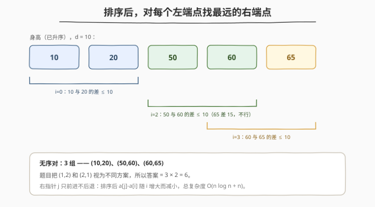
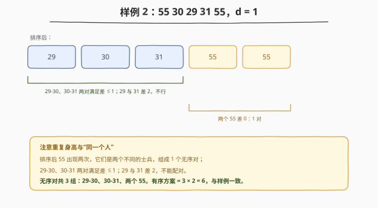

# Codeforces 32A 巡逻队的身高配对 题解

## 1. 题目概述

- **题目链接**：https://codeforces.com/problemset/problem/32/A
- **比赛来源**：Codeforces Beta Round 32 · Problem A
- **难度**：800
- **标签**：暴力枚举（brute force）
- **评测类型**：普通
- **限制**：时间 2 s / 内存 256 MB

**题意**：有 $n$ 名士兵，身高分别为 $a_1, \dots, a_n$。一个巡逻队由两名**不同**的士兵组成，要求两人的身高差不超过 $d$。求有多少种选拔方案。方案 $(i,j)$ 与 $(j,i)$ 视为不同。

**约束**：

- $1 \le n \le 1000$，$1 \le d \le 10^9$，$0 \le a_i \le 10^9$。
- 方案数最多 $n(n-1) \le 10^6$，`int` 足够，但用 `long long` 更省心。
- 身高可以相同；相同的两个士兵仍是不同的人，可以组成一个合法方案。
- 只有一组数据。

## 2. 示例与观察

官方样例 1（输入 / 输出原样）：

```text
输入：
5 10
10 20 50 60 65

输出：
6
```

**样例 1 解释**：身高差不超过 $10$ 的无序对只有 $(10,20)$、$(50,60)$、$(60,65)$ 三组；每组可以排成两种顺序，所以答案是 $3 \times 2 = 6$。

官方样例 2（输入 / 输出原样）：

```text
输入：
5 1
55 30 29 31 55

输出：
6
```

**样例 2 解释**：排序后为 $29, 30, 31, 55, 55$。满足差 $\le 1$ 的无序对是 $(29,30)$、$(30,31)$ 和两个 $55$ 组成的一对，共 $3$ 组；有序方案 $6$ 种。

注意 $29$ 与 $31$ 的差是 $2$，不满足；不能因为“三个数挨得近”就把 $\binom{3}{2}=3$ 全算上。

自造样例（标注“自造”）：

| 输入 | 输出 | 说明 |
|------|------|------|
| `1 5` / `7` | 0 | 只有一个人，凑不成两人 |
| `3 0` / `5 5 5` | 6 | 三对，每对两种顺序 |
| `4 100` / `1 2 3 4` | 12 | 全部 $\binom{4}{2}=6$ 对 |
| `3 2` / `1 4 7` | 0 | 任意两人差都大于 2 |

**观察**：如果先把身高排序，那么对每个左端点 $i$，满足 $a_j - a_i \le d$ 的右端点 $j$ 是一段连续的区间。随着 $i$ 增大，最远的 $j$ 不会向左退，因此可以用双指针在 $O(n)$ 内数完所有无序对。

## 3. 解题思路

### 3.1 朴素做法

枚举所有 $i < j$，检查 $|a_i-a_j| \le d$，计数后乘以 $2$。复杂度 $O(n^2)$，$n \le 1000$ 时最多约 $5 \times 10^5$ 次比较，完全可过。

也可以直接枚举有序对 $(i,j)$（$i \ne j$），检查后累加，答案不用乘 $2$。两种写法都对。

### 3.2 排序 + 双指针



把身高升序排列为 $a_1 \le a_2 \le \dots \le a_n$。对每个 $i$，定义 $r_i$ 为最大的下标，使得 $a_{r_i} - a_i \le d$。那么以 $i$ 为较矮一方的合法无序对恰有

$$r_i - i$$

个（$j = i+1, \dots, r_i$）。

由于 $a_i$ 随 $i$ 增大而不减，$a_j - a_i$ 随 $i$ 增大而不增，所以 $r_i$ 也**单调不减**。用一个右指针 $j$ 从头到尾只前进：

```text
sort(a)
j = 0
pairs = 0
for i = 0 .. n-1:
    j = max(j, i+1)
    while j < n and a[j] - a[i] <= d:
        j += 1
    pairs += j - i - 1
answer = pairs * 2
```

这里 `pairs` 是**无序对**的数量；题目把两种顺序视为不同，所以最后乘 $2$。

### 3.3 样例走查



排序后 $29,30,31,55,55$，$d=1$：

- $i=0$（29）：$30-29=1$ 可以，$31-29=2$ 不行，贡献 $1$；
- $i=1$（30）：$31-30=1$ 可以，贡献 $1$；
- $i=2$（31）：$55-31>1$，贡献 $0$；
- $i=3$（55）：$55-55=0$ 可以，贡献 $1$；
- $i=4$（55）：没有右端点，贡献 $0$。

无序对 $1+1+0+1+0=3$，有序方案 $6$，与样例一致。

## 4. 正确性证明

**引理 1（双指针区间正确）**：排序后，对每个 $i$，满足 $j>i$ 且 $a_j-a_i \le d$ 的下标恰为 $i+1, \dots, r_i$，其中 $r_i$ 是最大的合法下标。

**证明**：排序后 $a_{i+1} \le a_{i+2} \le \dots$，所以 $a_j-a_i$ 随 $j$ 增大而不减。若 $r_i$ 是最大的合法下标，则对所有 $i<j\le r_i$ 都有 $a_j-a_i \le a_{r_i}-a_i \le d$；而 $j>r_i$ 时 $a_j-a_i>d$。因此合法右端点正好是这段连续区间。∎

**引理 2（右指针单调）**：$r_i$ 随 $i$ 增大而不减。

**证明**：对 $i' > i$，有 $a_{i'} \ge a_i$，所以 $a_{r_i} - a_{i'} \le a_{r_i} - a_i \le d$，即 $r_i$ 对 $i'$ 仍然合法，故 $r_{i'} \ge r_i$。∎

**引理 3（计数不重不漏）**：每个合法无序对 $\{i,j\}$（$i<j$）恰好在左端点 $i$ 的区间中被数一次。

**证明**：固定无序对，较矮（排序后较前）的下标为 $i$，较后的为 $j$。它满足 $j \le r_i$，所以在 $i$ 的循环中被计入；它不会在更小的左端点被计入（左端点必须是该对的较前下标），也不会在更大的左端点被计入（更大的左端点不是这对中较前的下标）。∎

**定理**：算法输出的 `pairs * 2` 等于题目要求的方案数。

**证明**：由引理 3，`pairs` 等于合法无序对数；每个无序对有两种排列，且题目把两种排列视为不同方案，所以乘 $2$ 后恰好是全部有序方案数。∎

## 5. 复杂度分析

- **时间**：排序 $O(n \log n)$；双指针中 $i$ 和 $j$ 都只前进，$O(n)$；总 $O(n \log n)$。若用 $O(n^2)$ 暴力，$n \le 1000$ 也能过。
- **空间**：$O(n)$ 存身高。
- **数值范围**：答案最多 $n(n-1) \le 10^6$，`int` 足够；身高差最大 $10^9$，用 `long long` 比较更稳。
- **与时限的关系**：$n=1000$ 全相等、$d=10^9$ 时，C++ 端到端 200 次为 min $3.31$ ms / avg $3.75$ ms；Python3 50 次 avg $22.3$ ms（均含进程启动），相对 2 s 余量很大。

## 6. 参考代码

### C++17

```cpp
#include <bits/stdc++.h>
using namespace std;

int main() {
    ios::sync_with_stdio(false);
    cin.tie(nullptr);

    int n;
    long long d;
    cin >> n >> d;
    vector<long long> a(n);
    for (auto &x : a) cin >> x;
    sort(a.begin(), a.end());

    long long pairs = 0;
    int j = 0;
    for (int i = 0; i < n; ++i) {
        if (j < i + 1) j = i + 1;
        while (j < n && a[j] - a[i] <= d) ++j;
        pairs += (j - i - 1);
    }
    cout << pairs * 2 << '\n';
    return 0;
}
```

### Python3

```python
import sys


def main() -> None:
    data = sys.stdin.buffer.read().split()
    if not data:
        return
    n = int(data[0])
    d = int(data[1])
    a = sorted(int(x) for x in data[2:2 + n])

    pairs = 0
    j = 0
    for i in range(n):
        if j < i + 1:
            j = i + 1
        while j < n and a[j] - a[i] <= d:
            j += 1
        pairs += j - i - 1
    print(pairs * 2)


main()
```

两份代码都只依赖标准库，可原样提交。

## 7. 边界情况与易错点

1. **$n=1$**：没有两人组合，答案 $0$；双指针循环中 `j` 从 $1$ 开始，`pairs` 保持 $0$。
2. **身高相同**：相同的两个士兵是不同的人，差为 $0$，合法；排序后它们相邻，双指针会正常计数。
3. **$d$ 很大**：所有对都合法，答案应为 $n(n-1)$；不要用 `int` 存 `n*(n-1)` 后再乘 $2$ 导致溢出（$n \le 1000$ 时其实不会，但养成 `long long` 习惯）。
4. **$d=0$**：只有身高完全相同的人才能配对；样例约束 $d \ge 1$，但代码对 $d=0$ 也正确。
5. **有序与无序**：双指针数的是 $i<j$ 的无序对，最后必须乘 $2$；若直接枚举有序对，则不要乘。
6. **右指针初始化**：`j` 必须至少为 $i+1$，否则会把“自己与自己”算进去；代码里的 `if (j < i+1) j = i+1;` 就是处理这一点。
7. **右指针只前进**：循环内不要再把 `j` 重置为 `i+1`，否则退化成 $O(n^2)$（虽然本题也能过，但失去双指针意义）。
8. **比较用差值**：排序后 $a_j \ge a_i$，可直接写 `a[j]-a[i] <= d`，不必加绝对值；若没排序则必须用 `llabs`。
9. **只有一组数据**：首行是 $n,d$，没有测试组数。

## 8. 验证记录

- **编译环境与命令**：本机没有 GNU `g++`（`/usr/bin/g++` 是 Apple clang 21.0.0 的软链），用 `clang++ -std=c++17 -O2 -Wall -Wextra -I codeforces/tools/include` 配合仓库自带的 `bits/stdc++.h` 兼容头编译，**零警告**；Python 侧为 `Python 3.9.6`。
- **官方样例**：2 / 2 通过（`6`、`6`）。`verify_solution.py` 输出 `CF32A: samples 2`、`C++ 编译 OK, 样例 2/2`、`Python 语法 OK, 样例 2/2`。
- **独立暴力对拍**：另写 $O(n^2)$ 暴力，直接枚举所有有序对并检查 `abs(a[i]-a[j]) <= d`。共测 **300 组随机数据**（$n \in [1,10]$，$d \in [0,10]$，身高 $0 \dots 20$），C++、Python 与暴力**全部一致，0 处不符**。
- **最大约束性能**：$n=1000$、全部身高相等、$d=10^9$ 时，C++ 端到端 200 次 min $3.31$ ms / avg $3.75$ ms；Python3 50 次 avg $22.3$ ms（均含进程启动），相对 2 s 时限余量在 500 倍以上。
- **图片校验**：两张 SVG（`cf32a_pairs.svg`、`cf32a_sample.svg`）均通过 `xml.etree.ElementTree.parse`；按字符宽度估算的文本包围盒均在 `viewBox` 内且两两不重叠。
- **公式校验**：正文公式经 `node codeforces/tools/katex_check.cjs` 的 KaTeX（`throwOnError`）校验，0 处报错；星号直接写 `*`，证明结尾用 `∎`。
- **样例逐字核对**：`python3 codeforces/tools/check_samples.py --only 0001-0100/32` 对本文的两组官方样例报告一致。
- **复核状态**：verified（官方样例、300 组暴力、最大约束性能、图片几何、公式、样例逐字六项均实跑通过；唯一环境差异是本机无 GNU g++，已用 clang++ 等价验证）。

## 相关题目与扩展

- [Codeforces 32B Borze](https://codeforces.com/problemset/problem/32/B)：同场 B 题，三进制编码解码。
- [Codeforces 32C Flea](https://codeforces.com/problemset/problem/32/C)：同场 C 题，余数类与计数。
- [LeetCode 1. 两数之和](https://leetcode.cn/problems/two-sum/)：在数组中找满足条件的数对，可用哈希做到 $O(n)$。
- [LeetCode 167. 两数之和 II - 输入有序数组](https://leetcode.cn/problems/two-sum-ii-input-array-is-sorted/)：排序 + 双指针的模板题。
- [LeetCode 259. 较小的三数之和](https://leetcode.cn/problems/3sum-smaller/)：排序后双指针统计满足差/和条件的数对。

**延伸思考**：

1. **如果要求恰好 $k$ 个人组成巡逻队**：需要数大小为 $k$ 且极差 $\le d$ 的子集；排序后用双指针 + 组合数，或 DP。
2. **如果要求两人身高差的绝对值等于 $d$**：排序后对每个 $i$ 二分查找 $a_i+d$，用哈希表统计频次可做到 $O(n)$ 期望。
3. **如果 $n$ 放大到 $10^6$**：$O(n \log n)$ 排序仍是瓶颈；若身高范围小，可以用计数排序/桶做到线性。
4. **如果方案还要求两人性别不同**：在计数时按性别分开，分别统计每个左端点另一性别的合法人数，双指针仍然适用。
5. **如果要求输出具体配对**：在计数后再次扫描区间并输出；注意输出量可能达到 $O(n^2)$。

