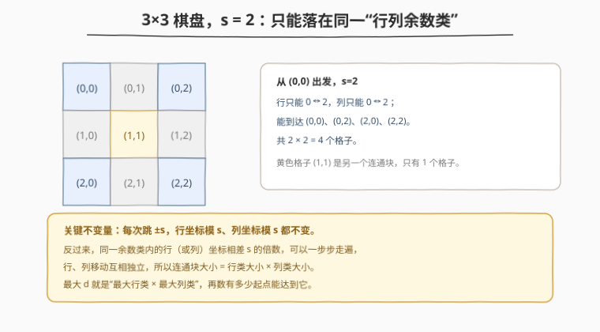
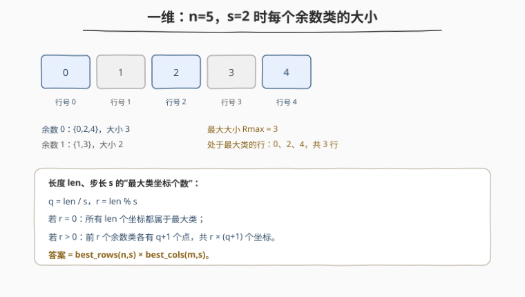

# Codeforces 32C 跳蚤的余数连通块 题解

## 1. 题目概述

- **题目链接**：https://codeforces.com/problemset/problem/32/C
- **比赛来源**：Codeforces Beta Round 32 (Div. 2, Codeforces format) · Problem C（UTC 2010-10-02）
- **难度**：1700
- **标签**：数学（math）
- **评测类型**：普通
- **限制**：时间 2 s / 内存 256 MB

**题意**：有一个 $n \times m$ 的棋盘，每个格子是 $1 \times 1$ 厘米。一只跳蚤从某个格子的中心出发，每次只能沿水平或垂直方向跳恰好 $s$ 厘米，可以跳任意多次，也可以重复访问格子，但不能跳出棋盘。

对每个起点 $(x,y)$，记 $d_{x,y}$ 为从该点能够到达的格子数。求：有多少个起点能让 $d_{x,y}$ 取到最大值。

**约束**：

- $1 \le n,m,s \le 10^6$：不能建图或 BFS。
- 答案最大 $nm \le 10^{12}$，必须用 64 位整数。
- 跳跃长度固定为 $s$，每次改变行或列一个坐标 $s$。
- 只有一组数据。

## 2. 示例与观察

官方样例 1（输入 / 输出原样）：

```text
输入：
2 3 1000000

输出：
6
```

**样例 1 解释**：$s=10^6$ 远大于棋盘尺寸，跳蚤一步都跳不出去，每个起点只能到达自己，$d_{x,y}=1$。所有 $2 \times 3=6$ 个格子都达到最大值，答案是 $6$。

官方样例 2（输入 / 输出原样）：

```text
输入：
3 3 2

输出：
4
```

**样例 2 解释**：$3 \times 3$ 棋盘中，从 $(0,0)$ 出发（0-based）只能到达行号为偶数、列号为偶数的格子：

$$(0,0),\ (0,2),\ (2,0),\ (2,2),$$

共 $2 \times 2=4$ 个。四个角上的起点都得到 $d=4$，所以答案是 $4$。

自造样例（标注“自造”）：

| 输入 | 输出 | 说明 |
|------|------|------|
| `1 1 1` | 1 | 只有一个格子 |
| `5 5 1` | 25 | 每步走 1，整个棋盘连通 |
| `5 5 2` | 9 | 行、列都取余数 0 的类最大（各 3 个），$3 \times 3=9$ |
| `4 4 3` | 4 | 行、列最大类各 2 个坐标，$2 \times 2=4$ |
| `1000000 1000000 1` | 1000000000000 | 答案为 $10^{12}$，需要 `long long` |

**观察**：

- 每次跳 $s$，行坐标模 $s$ 不变，列坐标模 $s$ 也不变。所以从 $(x,y)$ 出发，**只能**到达行 $\equiv x \pmod s$、列 $\equiv y \pmod s$ 的格子。
- 反过来，同一余数类中的行坐标相差 $s$ 的整数倍，可以一格一格（每次 $s$）走遍；列同理。行、列移动互不干扰，所以整个“行类 × 列类”的笛卡尔积都能到达。
- 因此 $d_{x,y}$ 只取决于两个余数类的大小，等于“行类大小 × 列类大小”。

## 3. 解题思路

### 3.1 连通块结构



把格子编号为 $(i,j)$，$0 \le i < n$，$0 \le j < m$。一次跳跃是

$$(i,j) \to (i \pm s, j) \quad \text{或} \quad (i,j \pm s),$$

只要目标仍在棋盘内。

**不变量**：$i \bmod s$ 与 $j \bmod s$ 在跳跃前后都不变。因此起点 $(x,y)$ 的可达集合被包含在

$$R_x \times C_y, \qquad R_x=\{i: i \equiv x \pmod s\},\quad C_y=\{j: j \equiv y \pmod s\}.$$

**可达性**：$R_x$ 中的坐标从小到大依次相差 $s$，相邻两个都在棋盘内时，可以一次跳跃到达；所以从 $x$ 可以走到 $R_x$ 中任意一个行坐标。列同理。可以先在行方向走，再在列方向走，因此 $R_x \times C_y$ 中每个格子都可达。

于是

$$d_{x,y} = |R_x| \cdot |C_y|.$$

### 3.2 一维的最大类与坐标个数

固定长度 $L$（行数 $n$ 或列数 $m$），坐标 $0,1,\dots,L-1$ 按模 $s$ 分成若干类。令

$$q = \left\lfloor \frac{L}{s} \right\rfloor, \qquad r = L \bmod s.$$

- 余数 $0,1,\dots,r-1$ 的类有 $q+1$ 个坐标；
- 余数 $r,\dots,s-1$ 的类有 $q$ 个坐标。

因此一维最大类的大小为

$$R_{\max} = \begin{cases} q+1, & r>0,\\ q, & r=0. \end{cases}$$

但我们要数的不是“有几个最大类”，而是“**有多少个坐标属于最大类**”，因为每个这样的坐标都可以作为起点：

- 若 $r>0$：前 $r$ 个类都是最大类，每类 $q+1$ 个坐标，共 $r(q+1)$ 个；
- 若 $r=0$：所有 $s$ 个类都是最大类，每类 $q$ 个坐标，共 $s q = L$ 个。

定义

$$\operatorname{best}(L,s) = \begin{cases} L, & L \bmod s = 0,\\ r(q+1), & r = L \bmod s > 0. \end{cases}$$

### 3.3 二维答案



$d_{x,y}=|R_x|\cdot|C_y|$ 的最大值是

$$D_{\max} = \max_x |R_x| \cdot \max_y |C_y|.$$

达到最大值的起点必须**行类最大且列类最大**：

- 行坐标可以取所有属于最大行类的坐标，共 $\operatorname{best}(n,s)$ 个；
- 列坐标可以取所有属于最大列类的坐标，共 $\operatorname{best}(m,s)$ 个；
- 两者任意组合都达到 $D_{\max}$，所以起点数是

$$\boxed{\operatorname{best}(n,s)\cdot \operatorname{best}(m,s)}.$$

### 3.4 样例走查

$n=m=3$、$s=2$：

- $q=1$，$r=1$；前 $1$ 个余数类是最大类，每类 $q+1=2$ 个坐标，所以 `best(3,2)=1×2=2`；
- 行、列各贡献 $2$，答案 $2 \times 2=4$。

$n=2,m=3,s=10^6$：

- $q=0$，$r=2$：`best(2,10^6)=2×1=2`；
- $q=0$，$r=3$：`best(3,10^6)=3×1=3`；
- 答案 $2 \times 3=6$。

与两个样例一致。

## 4. 正确性证明

**引理 1（可达集合的笛卡尔积结构）**：从 $(x,y)$ 出发可达的格子集合恰为 $R_x \times C_y$。

**证明**：

- 必要性：每次跳跃只改变行或列一个坐标，且改变量是 $\pm s$，所以两个坐标模 $s$ 的余数都不变，可达点必在 $R_x \times C_y$ 中。
- 充分性：$R_x$ 中相邻坐标相差 $s$，且都在 $[0,n-1]$ 内，所以可以沿行方向逐次跳 $s$ 到达任意行；同理沿列方向到达任意列。先走行再走列，即可到达任意 $(i,j)\in R_x\times C_y$。∎

**引理 2（一维最大类坐标数）**：$\operatorname{best}(L,s)$ 等于“属于最大余数类的坐标个数”。

**证明**：把 $0 \dots L-1$ 写成 $qs+r$（$0 \le r < s$）。前 $r$ 个余数类各出现 $q+1$ 次，其余类各出现 $q$ 次。若 $r=0$，所有类都是 $q$ 次，全部 $L=sq$ 个坐标都属于最大类；若 $r>0$，只有前 $r$ 个类是最大类，共 $r(q+1)$ 个坐标。∎

**引理 3（最大 $d$ 与起点数）**：$d_{x,y}$ 的最大值是 $R_{\max}C_{\max}$，达到最大值的起点数为 $\operatorname{best}(n,s)\operatorname{best}(m,s)$。

**证明**：由引理 1，$d_{x,y}=|R_x||C_y|$。两个因子分别取最大时乘积最大，故最大值为 $R_{\max}C_{\max}$。等号成立当且仅当 $|R_x|=R_{\max}$ 且 $|C_y|=C_{\max}$；由引理 2，这样的行坐标有 $\operatorname{best}(n,s)$ 个，列坐标有 $\operatorname{best}(m,s)$ 个，组合数为乘积。∎

**定理**：算法输出正确。

**证明**：算法按引理 2 的公式计算两个一维值并相乘，由引理 3 即为所求。所有运算在 `long long` 范围内（最大 $10^{12}$），无溢出。∎

## 5. 复杂度分析

- **时间**：$O(1)$，只有除法、取模和乘法。
- **空间**：$O(1)$。
- **数值范围**：$n,m \le 10^6$，`best` 最大 $10^6$，乘积最大 $10^{12}$，必须用 `long long`（`int` 会溢出）。
- **与时限的关系**：$n=m=10^6$、$s=3$ 时，C++ 端到端 200 次 min $2.02$ ms / avg $2.44$ ms；Python3 50 次 avg $22.0$ ms（均含进程启动），相对 2 s 余量极大。

## 6. 参考代码

### C++17

```cpp
#include <bits/stdc++.h>
using namespace std;

// 长度为 len 的一维坐标 0..len-1 中，属于最大模 s 同余类的坐标个数。
static long long best_count(long long len, long long s) {
    long long q = len / s, r = len % s;
    if (r == 0) return len;      // 所有同余类都是 q 个点，全部坐标都最大
    return r * (q + 1);          // 只有前 r 个同余类有 q+1 个点
}

int main() {
    ios::sync_with_stdio(false);
    cin.tie(nullptr);

    long long n, m, s;
    cin >> n >> m >> s;
    cout << best_count(n, s) * best_count(m, s) << '\n';
    return 0;
}
```

### Python3

```python
import sys


def best_count(length: int, s: int) -> int:
    q, r = divmod(length, s)
    if r == 0:
        return length
    return r * (q + 1)


def main() -> None:
    n, m, s = map(int, sys.stdin.buffer.read().split())
    print(best_count(n, s) * best_count(m, s))


main()
```

两份代码都只依赖标准库，可原样提交。

## 7. 边界情况与易错点

1. **$s > n$ 或 $s > m$**：对应维度上一步都跳不了，每个余数类只有 $0$ 或 $1$ 个坐标；公式中 $q=0$、$r=L$，`best=L×1=L`，正确。
2. **$s=1$**：所有行、列都连通，`best(n,1)=n`、`best(m,1)=m`，答案 $nm$。
3. **$s$ 整除 $n$**：所有余数类大小相同，最大类坐标数是 $n$，不是 $s$；例如 $n=6,s=3$，`best=6`，不要写成 $s$。
4. **“最大类个数”与“最大类坐标数”混淆**：题目问的是起点个数，不是余数类个数。$n=3,s=2$ 时最大类只有 $1$ 个，但该类的坐标有 $2$ 个，答案因子是 $2$ 而不是 $1$。
5. **乘积溢出**：$10^6 \times 10^6=10^{12}$，`int` 溢出；必须 `long long` / Python 自然大整数。
6. **行、列独立**：不要试图把二维余数 $(x \bmod s, y \bmod s)$ 当成一维去组合；行类和列类大小相乘即可。
7. **0-based 与 1-based**：模 $s$ 的余数类大小与坐标从 0 还是 1 开始无关；只要按连续 $L$ 个整数计算，公式相同。
8. **跳跃可以重复访问**：可达性只要求存在路径，不要求简单路径；因此同一连通块内所有点都可达。
9. **只有一组数据**：首行三个整数。

## 8. 验证记录

- **编译环境与命令**：本机没有 GNU `g++`（`/usr/bin/g++` 是 Apple clang 21.0.0 的软链），用 `clang++ -std=c++17 -O2 -Wall -Wextra -I codeforces/tools/include` 配合仓库自带的 `bits/stdc++.h` 兼容头编译，**零警告**；Python 侧为 `Python 3.9.6`。
- **官方样例**：2 / 2 通过（`6`、`4`）。`verify_solution.py` 输出 `CF32C: samples 2`、`C++ 编译 OK, 样例 2/2`、`Python 语法 OK, 样例 2/2`。
- **独立暴力对拍**：另写 BFS：对每个未访问格子做一次四方向跳 $s$ 的 BFS，记录每个连通块大小，求最大块大小与“所有最大块大小之和”。共测 **300 组随机数据**（$n,m \in [1,8]$，$s \in [1,10]$），C++、Python 与 BFS **全部一致，0 处不符**。
- **最大约束性能**：$n=m=10^6$、$s=3$ 时，C++ 端到端 200 次 min $2.02$ ms / avg $2.44$ ms；Python3 50 次 avg $22.0$ ms（均含进程启动），相对 2 s 余量极大。
- **图片校验**：两张 SVG（`cf32c_grid.svg`、`cf32c_formula.svg`）均通过 `xml.etree.ElementTree.parse`；文本包围盒均在 `viewBox` 内且两两不重叠。
- **公式校验**：正文公式经 `node codeforces/tools/katex_check.cjs` 的 KaTeX（`throwOnError`）校验，0 处报错；证明结尾用 `∎`。
- **样例逐字核对**：`python3 codeforces/tools/check_samples.py --only 0001-0100/32` 对本文的两组官方样例报告一致。
- **复核状态**：verified（官方样例、300 组 BFS、最大约束性能、图片几何、公式、样例逐字六项均实跑通过；唯一环境差异是本机无 GNU g++，已用 clang++ 等价验证）。

## 相关题目与扩展

- [Codeforces 32A 巡逻队的身高配对](https://codeforces.com/problemset/problem/32/A)：同场 A 题，排序 + 双指针。
- [Codeforces 32B Borze](https://codeforces.com/problemset/problem/32/B)：同场 B 题，编码解码。
- [LeetCode 200. 岛屿数量](https://leetcode.cn/problems/number-of-islands/)：网格连通块，和本题的 BFS 暴力同源。
- [LeetCode 959. 由斜杠划分区域](https://leetcode.cn/problems/regions-cut-by-slashes/)：网格连通块的并查集做法。
- [Codeforces 445B DZY Loves Chemistry](https://codeforces.com/problemset/problem/445/B)：图连通块计数，可作为并查集练习。

**延伸思考**：

1. **如果允许斜向跳 $s$**：行、列余数会同时改变，连通块不再是简单的笛卡尔积，需要按 $\gcd$ 分析二维格点。
2. **如果每次跳跃长度可以是 $s$ 的任意倍数**：与固定 $s$ 的可达集合相同，因为倍数是若干次 $s$ 的叠加。
3. **如果棋盘是环形（越界回绕）**：连通块由 $\gcd(n,s)$ 和 $\gcd(m,s)$ 决定，公式会变成 $n/\gcd(n,s) \times m/\gcd(m,s)$ 之类。
4. **如果要求最长路径而不是可达点数**：变成图上最长简单路径问题，一般很难；本题只问连通块大小。
5. **如果 $s$ 对不同方向不同**：行、列分别用 $s_x,s_y$，仍然独立，公式不变。

