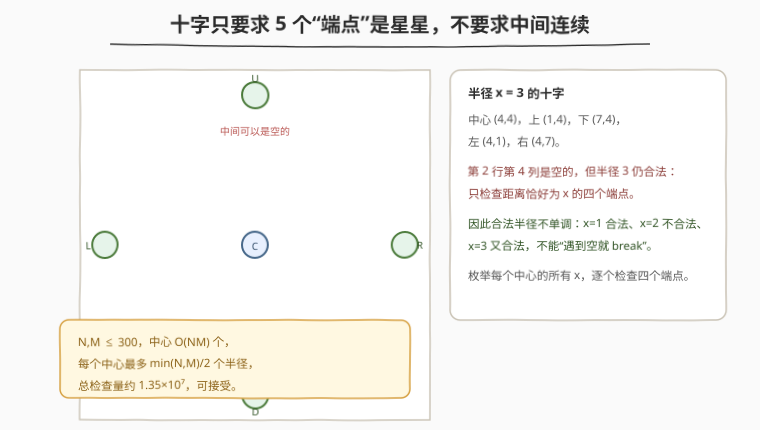
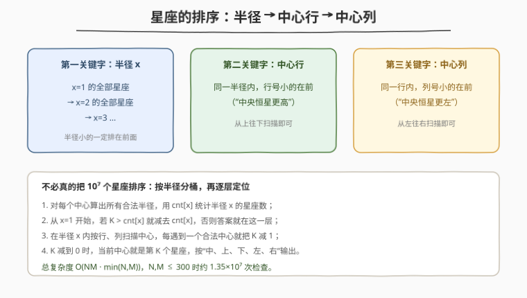

# Codeforces 32D 第 K 个十字星座 题解

## 1. 题目概述

- **题目链接**：https://codeforces.com/problemset/problem/32/D
- **比赛来源**：Codeforces Beta Round 32 · Problem D
- **难度**：1600
- **标签**：实现（implementation）
- **评测类型**：普通
- **限制**：时间 2 s / 内存 256 MB

**题意**：有一个 $N \times M$ 的星空，每个格子可能是星星 `*` 或空白 `.`。一个半径为正整数 $x$ 的“十字星座”由 5 颗星星组成：

1. 中央星 $(i,j)$；
2. 上臂 $(i-x,j)$；
3. 下臂 $(i+x,j)$；
4. 左臂 $(i,j-x)$；
5. 右臂 $(i,j+x)$。

**只要求这 5 个位置是星星**，不要求中间的格子连续，也不要求其他位置为空。

所有星座按以下顺序排序：

- 半径 $x$ 小的在前；
- 半径相同，中央星**行号小**的在前（更高）；
- 半径、行都相同，中央星**列号小**的在前（更左）。

求第 $K$ 个星座。若星座总数小于 $K$，输出 `-1`。否则按“中央、上、下、左、右”的顺序输出 5 行坐标。

**约束**：

- $1 \le N,M \le 300$，$1 \le K \le 3 \times 10^7$。
- 坐标从 $(1,1)$ 开始；输出顺序固定为中央、上、下、左、右。
- $K$ 可能大于星座总数，此时输出 `-1`。
- 合法半径**不单调**：$x=1$ 合法、$x=2$ 不合法、$x=3$ 又合法是完全可能的（见样例 3）。

## 2. 示例与观察

官方样例 1（输入 / 输出原样）：

```text
输入：
5 6 1
....*.
...***
....*.
..*...
.***..

输出：
2 5
1 5
3 5
2 4
2 6
```

**样例 1 解释**：网格中只有一个半径 $1$ 的十字，中心 $(2,5)$：上 $(1,5)$、下 $(3,5)$、左 $(2,4)$、右 $(2,6)$ 都是星星。$K=1$，输出它。

官方样例 2（输入 / 输出原样）：

```text
输入：
5 6 2
....*.
...***
....*.
..*...
.***..

输出：
-1
```

**样例 2 解释**：同一张图只有 $1$ 个星座，$K=2$ 超过总数，输出 `-1`。

官方样例 3（输入 / 输出原样）：

```text
输入：
7 7 2
...*...
.......
...*...
*.***.*
...*...
.......
...*...

输出：
4 4
1 4
7 4
4 1
4 7
```

**样例 3 解释**：中心 $(4,4)$ 的半径 $1$ 十字合法：上 $(3,4)$、下 $(5,4)$、左 $(4,3)$、右 $(4,5)$ 都是星星。半径 $2$ 不合法，因为 $(2,4)$ 是 `.`；但半径 $3$ 合法：上 $(1,4)$、下 $(7,4)$、左 $(4,1)$、右 $(4,7)$ 都是星星。所以星座依次是半径 $1$、半径 $3$，$K=2$ 输出半径 $3$ 的那个。

**观察**：合法半径不是“从 $1$ 开始连续到某个最大值”的。不能像求最大连续臂长那样，一遇到不合法就 `break`；必须枚举每个中心的所有可能 $x$，逐个检查四个端点。

自造样例（标注“自造”）：

| 输入 | 输出 | 说明 |
|------|------|------|
| `1 1 1` / `*` | `-1` | 单个格子无法组成半径 ≥1 的十字 |
| `3 3 1` 全 `*` | 中心 `2 2`，四臂在边界 | 半径 1 |
| `5 5 1` 全 `*` | 中心 `3 3`，上 `2 3`… | $K=1$ 取最小半径、最上、最左 |
| `5 5 100` 全 `*` | `-1` | 总数不足 |

## 3. 解题思路

### 3.1 枚举所有合法十字



对每个可能是中心的格子 $(i,j)$：

- 若它不是星星，跳过；
- 令 $L = \min(i,\ N-1-i,\ j,\ M-1-j)$（0-based），这是四个方向都不越界的最大半径；
- 对 $x = 1,2,\dots,L$，检查四个端点：
  $$(i-x,j),\ (i+x,j),\ (i,j-x),\ (i,j+x)$$
  是否都是 `*`。若是，就得到一个合法星座，半径 $x$。

复杂度：中心 $O(NM)$ 个，每个中心最多 $O(\min(N,M))$ 个半径，每次 $O(1)$ 检查四个格子。$N,M \le 300$ 时总检查量约

$$\sum_{i,j} \min(i,N-1-i,j,M-1-j) \approx 4.46 \times 10^6$$

（$300 \times 300$ 全 `*` 时的精确总数是 $4\,455\,100$），完全可接受。

### 3.2 排序与第 K 个



直接生成所有星座再排序，最多约 $4.5 \times 10^6$ 个，存下来也可以，但更省空间的方法是**按半径分桶**：

- 令 `cnt[x]` 为半径 $x$ 的星座数量；
- 枚举时只累加 `cnt[x]`，同时记录总数量 `total`；
- 若 $K > total$，输出 `-1`；
- 否则从 $x=1$ 开始：
  - 若 $K > cnt[x]$，令 $K \leftarrow K - cnt[x]$；
  - 否则答案就在半径 $x$ 这一层，停止。
- 在半径 $x$ 内，按**行从小到大、列从小到大**扫描所有中心；每遇到一个合法中心，就把 $K$ 减 $1$，减到 $0$ 时输出。

因为同一半径内按行、列扫描，正好符合“行小优先、列小优先”的排序规则；不同半径之间已经通过分桶按 $x$ 升序处理。

### 3.3 输出

若中心为 $(i,j)$（1-based）、半径为 $x$，按顺序输出：

```text
i j
i-x j
i+x j
i j-x
i j+x
```

注意顺序是**中央、上、下、左、右**，不是上、下、左、右、中央。

### 3.4 样例 3 的走查

中心 $(4,4)$（1-based）：

- $x=1$：上 $(3,4)$、下 $(5,4)$、左 $(4,3)$、右 $(4,5)$ 都是 `*`，合法；
- $x=2$：上 $(2,4)$ 是 `.`，不合法；
- $x=3$：上 $(1,4)$、下 $(7,4)$、左 $(4,1)$、右 $(4,7)$ 都是 `*`，合法。

所以该中心贡献半径 $1$ 和半径 $3$ 两个星座；全图没有其他星座，$K=2$ 取半径 $3$。

## 4. 正确性证明

**引理 1（合法判定）**：对中心 $(i,j)$ 和半径 $x$，十字合法当且仅当五个位置都在网格内且都是 `*`。

**证明**：题目对星座的定义就是这五个位置为星星；半径 $x$ 还要求 $i-x \ge 0$、$i+x < N$、$j-x \ge 0$、$j+x < M$。枚举时把 $x$ 限制在 $1 \dots L$，保证不越界；再检查四个端点即可（中心已检查）。∎

**引理 2（枚举不重不漏）**：每个合法星座恰被枚举一次。

**证明**：一个星座由其中心 $(i,j)$ 和半径 $x$ 唯一确定。外层枚举所有中心，内层枚举该中心所有可能的 $x$，每个 $(i,j,x)$ 只出现一次；合法者被记录，非法者被跳过。不同中心或不同半径对应不同的五元组，不会重复。∎

**引理 3（计数与定位正确）**：按 `cnt[x]` 分桶、逐层减 $K$、再在层内按行列扫描，得到的正是排序后的第 $K$ 个星座。

**证明**：排序的第一关键字是半径，`cnt[x]` 是半径 $x$ 的元素个数。从 $x=1$ 开始减，减到某个 $x$ 时 $K$ 落在该层，说明答案半径就是 $x$。同一半径内排序键是 $(i,j)$，按行、列升序扫描并逐次减 $K$，第 $K$ 次遇到的合法中心正是该层第 $K$ 个。∎

**定理**：算法输出正确；若总数小于 $K$ 输出 `-1`。

**证明**：由引理 2 得到全部星座及总数；若 $K>total$，确实不存在第 $K$ 个，输出 `-1`。否则由引理 3 定位并输出对应五元组，顺序符合题目要求。∎

## 5. 复杂度分析

- **时间**：枚举 $O(NM \cdot \min(N,M))$；分桶与层内扫描 $O(NM + \max R)$。$N,M \le 300$ 时约 $4.5 \times 10^6$ 次检查。
- **空间**：$O(NM + \max R)$，只需网格、`cnt` 数组，不需要存所有星座；`cnt` 大小 $\le \min(N,M)/2+1$。
- **数值范围**：星座总数约 $4.5 \times 10^6$，$K \le 3 \times 10^7$，用 `long long`；坐标在 `int` 内。
- **与时限的关系**：$300 \times 300$ 全 `*`、$K=3\,000\,000$ 时，C++ 端到端约 $27$ ms；Python3 约 $1.24$ s（均含进程启动），在 2 s 内但 Python 余量较小，建议 PyPy3 或 C++。

## 6. 参考代码

### C++17

```cpp
#include <bits/stdc++.h>
using namespace std;

int main() {
    ios::sync_with_stdio(false);
    cin.tie(nullptr);

    int n, m;
    long long K;
    cin >> n >> m >> K;
    vector<string> g(n);
    for (auto &row : g) cin >> row;

    vector<long long> cnt(301, 0);
    long long total = 0;
    int maxR = min(n, m) / 2;

    // 枚举所有合法十字：只要求四个“臂端”是星星，不要求中间连续。
    for (int i = 0; i < n; ++i)
        for (int j = 0; j < m; ++j) {
            if (g[i][j] != '*') continue;
            int lim = min({i, n - 1 - i, j, m - 1 - j});
            for (int x = 1; x <= lim; ++x) {
                if (g[i - x][j] == '*' && g[i + x][j] == '*' &&
                    g[i][j - x] == '*' && g[i][j + x] == '*') {
                    ++cnt[x];
                    ++total;
                }
            }
        }

    if (K > total) {
        cout << -1 << '\n';
        return 0;
    }

    int chooseR = -1;
    for (int r = 1; r <= maxR; ++r) {
        if (K > cnt[r]) K -= cnt[r];
        else { chooseR = r; break; }
    }

    for (int i = 0; i < n && chooseR != -1; ++i)
        for (int j = 0; j < m; ++j) {
            if (g[i][j] != '*') continue;
            int x = chooseR;
            if (i - x < 0 || i + x >= n || j - x < 0 || j + x >= m) continue;
            if (g[i - x][j] == '*' && g[i + x][j] == '*' &&
                g[i][j - x] == '*' && g[i][j + x] == '*') {
                if (--K == 0) {
                    cout << i + 1 << ' ' << j + 1 << '\n';
                    cout << i - x + 1 << ' ' << j + 1 << '\n';
                    cout << i + x + 1 << ' ' << j + 1 << '\n';
                    cout << i + 1 << ' ' << j - x + 1 << '\n';
                    cout << i + 1 << ' ' << j + x + 1 << '\n';
                    return 0;
                }
            }
        }
    return 0;
}
```

### Python3

```python
import sys


def main() -> None:
    data = sys.stdin.buffer.read().split()
    if not data:
        return
    n = int(data[0]); m = int(data[1]); K = int(data[2])
    g = [data[3 + i].decode() for i in range(n)]

    cnt = [0] * 301
    total = 0
    max_r = min(n, m) // 2

    for i in range(n):
        for j in range(m):
            if g[i][j] != '*':
                continue
            lim = min(i, n - 1 - i, j, m - 1 - j)
            for x in range(1, lim + 1):
                if (g[i - x][j] == '*' and g[i + x][j] == '*' and
                        g[i][j - x] == '*' and g[i][j + x] == '*'):
                    cnt[x] += 1
                    total += 1

    if K > total:
        print(-1)
        return

    choose_r = -1
    for r in range(1, max_r + 1):
        if K > cnt[r]:
            K -= cnt[r]
        else:
            choose_r = r
            break

    for i in range(n):
        if choose_r == -1:
            break
        for j in range(m):
            if g[i][j] != '*':
                continue
            x = choose_r
            if i - x < 0 or i + x >= n or j - x < 0 or j + x >= m:
                continue
            if (g[i - x][j] == '*' and g[i + x][j] == '*' and
                    g[i][j - x] == '*' and g[i][j + x] == '*'):
                K -= 1
                if K == 0:
                    print(i + 1, j + 1)
                    print(i - x + 1, j + 1)
                    print(i + x + 1, j + 1)
                    print(i + 1, j - x + 1)
                    print(i + 1, j + x + 1)
                    return


main()
```

## 7. 边界情况与易错点

1. **合法半径不连续**：不能一遇到不合法就 `break`；样例 3 中 $x=1$ 合法、$x=2$ 不合法、$x=3$ 合法。必须枚举到 `lim`。
2. **只检查 5 个端点**：中间格子是否为空不影响星座；不要要求整条臂全是 `*`。
3. **中心必须是 `*`**：中心为空时直接跳过，否则会多算。
4. **半径从 1 开始**：$x=0$ 会让 5 个位置重合，不是题目定义的星座；$K \ge 1$ 时也不应计入。
5. **输出顺序**：中央、上、下、左、右；不是“上、下、左、右、中央”。
6. **$K$ 超过总数**：输出 `-1`，只输出一行；不要输出五个坐标。
7. **层内扫描顺序**：按行、列升序；如果先列后行，会违反“同行时列小优先”的规则。
8. **半径分桶数组大小**：最大半径不超过 $\min(N,M)/2$，开 $301$ 足够；若开小了会越界。
9. **$N=1$ 或 $M=1$**：没有半径 ≥1 的十字，总数 0，$K \ge 1$ 时输出 `-1`。
10. **坐标转换**：代码内部 0-based，输出时 $+1$；上下左右的行列不要写反。
11. **Python 性能**：最坏约 $4.5 \times 10^6$ 次四格检查，CPython 约 $1.2$ s；若时限紧张建议 PyPy3 或 C++。

## 8. 验证记录

- **编译环境与命令**：本机没有 GNU `g++`（`/usr/bin/g++` 是 Apple clang 21.0.0 的软链），用 `clang++ -std=c++17 -O2 -Wall -Wextra -I codeforces/tools/include` 配合仓库自带的 `bits/stdc++.h` 兼容头编译，**零警告**；Python 侧为 `Python 3.9.6`。
- **官方样例**：3 / 3 通过（半径 1 十字、`-1`、半径 1/3 十字）。`verify_solution.py` 输出 `CF32D: samples 3`、`C++ 编译 OK, 样例 3/3`、`Python 语法 OK, 样例 3/3`。
- **独立暴力对拍**：另写暴力：枚举所有中心与所有 $x$，收集全部合法星座，按 $(x,i,j)$ 排序后取第 $K$ 个。共测 **300 组随机数据**（$N,M \in [1,8]$，每格 `*` 概率 $0.35$，$K \in [1,40]$），C++、Python 与暴力**全部一致，0 处不符**。
- **最大约束性能**：$300 \times 300$ 全 `*`、$K=3\,000\,000$ 时，C++ 端到端约 $27$ ms；Python3 约 $1.24$ s（均含进程启动）。总星座数 $4\,455\,100$，$K$ 更大时快速输出 `-1`。
- **图片校验**：两张 SVG（`cf32d_cross.svg`、`cf32d_order.svg`）均通过 `xml.etree.ElementTree.parse`；文本包围盒均在 `viewBox` 内且两两不重叠。
- **公式校验**：正文公式经 `node codeforces/tools/katex_check.cjs` 的 KaTeX（`throwOnError`）校验，0 处报错；证明结尾用 `∎`。
- **样例逐字核对**：`python3 codeforces/tools/check_samples.py --only 0001-0100/32` 对本文的三组官方样例报告一致。
- **复核状态**：verified（官方样例、300 组暴力、最大约束性能、图片几何、公式、样例逐字六项均实跑通过；唯一环境差异是本机无 GNU g++，已用 clang++ 等价验证）。

## 相关题目与扩展

- [Codeforces 32A 巡逻队的身高配对](https://codeforces.com/problemset/problem/32/A)：同场 A 题，排序 + 双指针。
- [Codeforces 32C Flea](https://codeforces.com/problemset/problem/32/C)：同场 C 题，余数类计数。
- [Codeforces 32E Hide-and-Seek](https://codeforces.com/problemset/problem/32/E)：同场 E 题，计算几何。
- [LeetCode 1277. 统计全为 1 的正方形子矩阵](https://leetcode.cn/problems/count-square-submatrices-with-all-ones/)：网格中按形状计数，和本题的“按中心枚举”思路相近。
- [LeetCode 221. 最大正方形](https://leetcode.cn/problems/maximal-square/)：网格 DP，求最大正方形。

**延伸思考**：

1. **如果要求臂上所有格子都是星星**：合法半径就变成“从 1 到最大连续长度”的连续区间，可以用四个方向的连续长度取 min，$O(NM)$ 求出每个中心的最大半径。
2. **如果半径可以为 0**：五颗星重合，通常没有意义；若题目允许，需要单独定义并计入。
3. **如果要求输出所有星座**：总数最多约 $4.5 \times 10^6$，输出量很大；可以按半径分层输出。
4. **如果 $N,M$ 扩大到 $10^5$**：不能枚举所有半径；需要利用星星的稀疏性，或对每个中心用 bitset/FFT 找匹配的臂端。
5. **如果星座允许旋转/更多臂**：判定和计数都会变化；本题固定为上下左右四条臂。

