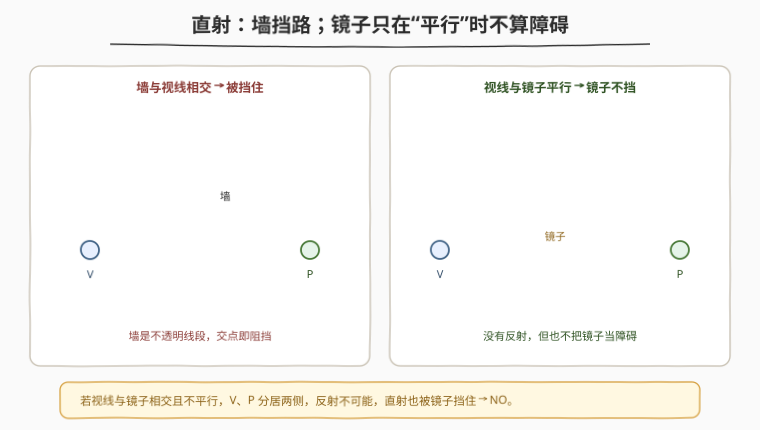
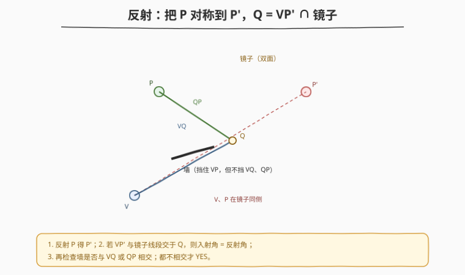
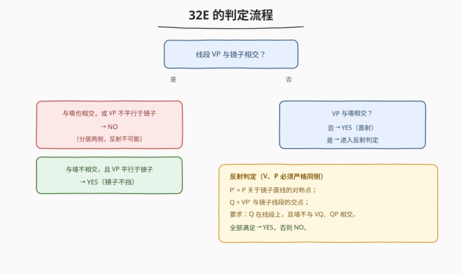

# Codeforces 32E 镜面反射的可见性 题解

## 1. 题目概述

- **题目链接**：https://codeforces.com/problemset/problem/32/E
- **比赛来源**：Codeforces Beta Round 32 (Div. 2, Codeforces format) · Problem E（UTC 2010-10-02）
- **难度**：2400
- **标签**：计算几何、实现（geometry, implementation）
- **评测类型**：普通
- **限制**：时间 2 s / 内存 256 MB

**题意**：房间里有 Victor $V$、Peter $P$、一堵不透明的墙（线段 $W$）和一面双面镜子（线段 $M$）。判断 Victor 能否原地看到 Peter。

规则：

- 若视线（直线段）与墙有公共点，则被墙挡住；
- 若视线与镜子有公共点，则可能发生镜面反射；
- 反射遵循物理规律：入射角等于反射角，且入射光线与反射光线位于镜子所在直线的**同一侧**；
- 若视线与镜子平行，则不会发生反射，此时**镜子也不被当作障碍物**（见样例 4）。

所有坐标是绝对值不超过 $10^4$ 的整数；线段不会退化成点；墙与镜子没有公共点；$V,P$ 不在任何线段上；$V \ne P$。

**约束**：

- 坐标范围小，但几何关系复杂；需要用精确的有理数/叉积判定，不能依赖浮点 EPS。
- 只有一组数据，$O(1)$ 几何判定。
- 输出 `YES` 或 `NO`。

## 2. 示例与观察

官方样例 1（输入 / 输出原样）：

```text
输入：
-1 3
1 3
0 2 0 4
0 0 0 1

输出：
NO
```

**样例 1 解释**：$V=(-1,3)$、$P=(1,3)$，视线是水平线段 $y=3$；墙是 $x=0,\ y\in[2,4]$，与视线交于 $(0,3)$，直射被挡。镜子是 $x=0,\ y\in[0,1]$，在视线下方，不参与；且 $V,P$ 分居镜子直线两侧，反射也不可能。输出 `NO`。

官方样例 2（输入 / 输出原样）：

```text
输入：
0 0
1 1
0 1 1 0
-100 -100 -101 -101

输出：
NO
```

**样例 2 解释**：墙是 $x+y=1$，与视线 $y=x$ 交于 $(0.5,0.5)$，直射被挡。镜子在直线 $y=x$ 上，$V,P$ 也在这条直线上（不在镜子线段上），不满足“严格同侧”，反射退化；输出 `NO`。

官方样例 3（输入 / 输出原样）：

```text
输入：
0 0
1 1
0 1 1 0
-1 1 1 3

输出：
YES
```

**样例 3 解释**：直射被墙挡住，但 $V,P$ 在镜子直线 $y=x+2$ 的同一侧。把 $P(1,1)$ 关于该直线对称得到 $P'(-1,3)$；线段 $VP'$ 与镜子交于 $Q(-0.5,1.5)$，且墙不与 $VQ$、$QP$ 相交，所以可以通过镜子看到，输出 `YES`。

官方样例 4（输入 / 输出原样）：

```text
输入：
0 0
10 0
100 100 101 101
1 0 3 0

输出：
YES
```

**样例 4 解释**：$V,P$ 的视线是 $x$ 轴，镜子也落在 $x$ 轴上（从 $(1,0)$ 到 $(3,0)$），二者平行/共线。按题意此时不发生反射，但镜子也不被当作障碍物；墙在远处，不挡视线，所以输出 `YES`。

自造样例（标注“自造”）：

| 场景 | 结果 | 说明 |
|------|------|------|
| 无墙无镜 | YES | 直射畅通 |
| 墙挡住、无镜 | NO | 墙不透明 |
| 墙挡住、镜在侧面且反射路径畅通 | YES | 反射可见 |
| 视线穿过镜子且不平行 | NO | $V,P$ 分居两侧，反射不可能，直射被镜挡 |
| 视线与镜子平行、墙挡住 | NO | 镜子不算障碍，但墙仍挡 |

**观察**：可以把判定拆成“直射”和“反射”两部分，各自用线段相交与对称点处理；所有判断都可以用整数/有理数精确完成。

## 3. 解题思路

### 3.1 直射



令 `vm = 线段 VP 与镜子线段相交`，`vw = 线段 VP 与墙线段相交`。

- **`vm` 为真**：
  - 若 $VP$ 与镜子**平行**（叉积为 $0$），说明二者共线。按题意“平行时不反射，镜子也不当障碍物”，所以只需看墙：`!vw` 则 `YES`，否则 `NO`（样例 4）。
  - 否则 $VP$ 穿过镜子，$V,P$ 位于镜子直线两侧，反射要求的“同侧”不成立；直射又被镜子挡住，所以 `NO`。
- **`vm` 为假**：
  - 若 `vw` 为假，直射畅通，`YES`；
  - 若 `vw` 为真，直射被墙挡住，进入反射判定。

### 3.2 反射判定



设镜子所在直线为 $\ell$。

1. **同侧条件**：$V,P$ 必须**严格**位于 $\ell$ 的同一侧（叉积同号且非零）。若有一点在 $\ell$ 上，反射退化；若异侧，反射光线不可能与入射光线同侧。
2. **对称点**：把 $P$ 关于 $\ell$ 对称得到 $P'$。此时 $P'$ 在 $\ell$ 的另一侧。
3. **入射点**：令 $Q = VP' \cap \ell$。由于 $V,P$ 同侧、$P'$ 异侧，线段 $VP'$ 必与 $\ell$ 相交；还要求这个交点 $Q$ 落在**镜子线段** $M$ 上（不是只落在延长线上）。
4. **墙的遮挡**：实际光路是 $V \to Q \to P$ 两段；墙不能与 $VQ$ 或 $QP$ 相交。
5. 以上全部满足则 `YES`，否则 `NO`。

**为什么 $Q$ 就是入射点？** 对镜面上任意点 $Q$，反射 $P$ 到 $P'$ 后，$|QP|=|QP'|$，且 $QP$ 与 $QP'$ 关于镜面对称。若 $V,Q,P'$ 共线，则 $QV$ 与 $QP'$ 方向相反，$QV$ 与 $QP$ 分别位于法线两侧，且与镜面的夹角相等——这正是入射角等于反射角。反过来，若入射角等于反射角，反射光线 $QP$ 的镜面对称方向就是 $QP'$，它必须与 $QV$ 共线，所以 $Q$ 在 $VP'$ 上。

### 3.3 精确几何：齐次坐标

坐标是整数，但对称点 $P'$ 和交点 $Q$ 通常是有理数。为了避免浮点误差，代码用**齐次坐标**表示点：

$$\text{点} = (X,Y,W), \qquad \text{实际坐标}\left(\frac{X}{W},\frac{Y}{W}\right),\quad W>0.$$

- 原始整点：$(x,y,1)$；
- 对称点：把 $P$ 关于直线 $M_1M_2$ 反射，分母取 $|M_2-M_1|^2$，分子是整数；
- 交点：两条直线（齐次点叉积）的叉积，仍是齐次点。

**方向判定**：三个点 $A,B,C$ 的有向面积符号等于

$$\det\begin{pmatrix}
X_A & Y_A & W_A\\
X_B & Y_B & W_B\\
X_C & Y_C & W_C
\end{pmatrix}$$

的符号（因为每行同乘 $W$ 不改变符号，$W>0$）。代码用 `__int128` 计算这个 $3 \times 3$ 行列式，避免溢出。

**线段相交**：

- 若某个端点在有向面积意义下与另一线段共线，且落在线段包围盒内，则相交；
- 否则，两条线段严格相交当且仅当两个端点在对方直线两侧（方向符号相反）。

**对称点公式**：设镜线方向 $\vec d=M_2-M_1$，$L=|\vec d|^2$，$t=(P-M_1)\cdot \vec d$，则

$$P' = M_1 + 2\frac{t}{L}\vec d - P
= \frac{2M_1L+2t\vec d-PL}{L}.$$

这正是代码中 `reflect` 的分子/分母。

**交点公式**：两条直线 $L_1=A\times B$、$L_2=C\times D$（齐次叉积），交点为 $Q=L_1\times L_2$，再统一 $W>0$ 并约分。代码中 `line_inter` 实现这一步。

### 3.4 判定流程



```text
if 线段 VP 与镜子相交:
    if 线段 VP 与墙相交: NO
    else if VP 与镜子平行: YES
    else: NO
else:
    if 线段 VP 与墙不相交: YES
    else:
        if V、P 不在镜子直线严格同侧: NO
        P' = 对称(P)
        if 线段 VP' 与镜子线段不相交: NO
        Q = 直线 VP' 与镜子直线的交点
        if 墙与 VQ 或 QP 相交: NO
        else: YES
```

### 3.5 样例 3 的精确走查

镜子直线 $y=x+2$，$V=(0,0)$、$P=(1,1)$：

- 同侧：$0-0-2<0$，$1-1-2<0$，同为负，严格同侧；
- 对称：$P'=(-1,3)$；
- $VP'$ 与镜子交于 $Q=(-0.5,1.5)$，在镜子线段 $(-1,1)$ 到 $(1,3)$ 上；
- 墙 $x+y=1$ 与 $VQ$、$QP$ 均不相交；
- 输出 `YES`。

## 4. 正确性证明

**引理 1（反射点构造）**：设 $P'$ 是 $P$ 关于镜线 $\ell$ 的对称点，$Q\in\ell$。则光路 $V\to Q\to P$ 满足入射角等于反射角，当且仅当 $V,Q,P'$ 共线且 $Q$ 在 $V,P'$ 之间。

**证明**：反射变换保持到 $\ell$ 上任意点的距离：$|QP|=|QP'|$，且 $QP'$ 是 $QP$ 关于 $\ell$ 的对称方向。若 $V,Q,P'$ 共线，则 $QV$ 与 $QP'$ 方向相反；由于 $QP$ 与 $QP'$ 关于 $\ell$ 对称，$QV$ 与 $QP$ 分别位于 $\ell$ 的两侧（相对于法线），且与 $\ell$ 的夹角相等，即入射角等于反射角。反之，若入射角等于反射角，则 $QP$ 关于 $\ell$ 的对称射线必须与 $QV$ 重合，即 $V,Q,P'$ 共线。∎

**引理 2（同侧必要性）**：若 $V,P$ 不在 $\ell$ 的严格同侧，则不存在满足题意的反射光路。

**证明**：题目明确要求入射光线与反射光线位于镜线同一侧。若 $V$ 在 $\ell$ 上，入射光线沿镜面（或退化），没有唯一的入射角；若 $V,P$ 异侧，则 $VQ$ 与 $QP$ 位于 $\ell$ 两侧，违反同侧要求。∎

**引理 3（直射分支完备）**：3.1 的分支覆盖所有直射情况，并正确判定直射是否可见。

**证明**：

- 若 $VP$ 与镜子相交且不平行，镜子是不透明障碍，直射被挡；同时 $V,P$ 异侧，由引理 2 反射也不可能，故 `NO`。
- 若 $VP$ 与镜子相交且平行，按题意镜子不参与反射也不当障碍；直射是否可见只取决于墙，故 `!vw` 为 `YES`。
- 若 $VP$ 不与镜子相交，直射只可能被墙挡；无墙则 `YES`，有墙则需看反射。∎

**引理 4（反射分支完备）**：若直射被墙挡住且 $VP$ 不与镜子相交，则 3.2 的判定与题目定义等价。

**证明**：由引理 2，必须先满足严格同侧；由引理 1，入射点必须是 $VP'$ 与镜线的交点，且必须在镜子线段上；墙是不透明障碍，必须不与两条实际光路 $VQ$、$QP$ 相交。这些条件合起来正是反射可见的充要条件。∎

**引理 5（精确性）**：齐次坐标与 `__int128` 行列式判定不会产生浮点误差；在线段不相交/相交的判定上与原几何一致。

**证明**：所有点的坐标都是整数分子除以正分母；有向面积的符号由 $3\times3$ 整数行列式的符号给出，分母为正不改变符号。线段相交的端点/跨立判定是标准叉积判据。坐标绝对值 $\le 10^4$，反射分子约 $10^{13}$，$3\times3$ 行列式用 `__int128` 可安全容纳。∎

**定理**：算法输出 `YES` 当且仅当 Victor 能原地看到 Peter。

**证明**：由引理 3、4，直射与反射两条路径的判定覆盖所有可能且各自正确；引理 5 保证判定没有数值误差。因此输出正确。∎

## 5. 复杂度分析

- **时间**：$O(1)$。只有常数次叉积、线段相交、一次对称和一次直线交点。
- **空间**：$O(1)$。
- **数值范围**：原始坐标 $\le 10^4$；对称点分子约 $10^{13}$，交点多达 $10^{17}$；`__int128` 的行列式约 $10^{35}$，在 $1.7\times10^{38}$ 以内。
- **与时限的关系**：单组数据 C++ 端到端约 $2$ ms（主要是进程启动），远低于 2 s。

## 6. 参考代码

### C++17

```cpp
#include <bits/stdc++.h>
using namespace std;

// 齐次坐标点：实际坐标为 (X/W, Y/W)，W > 0。
struct Pt {
    long long X, Y, W;
};

static Pt orig(long long x, long long y) { return {x, y, 1}; }

// 三点的有向面积符号（与普通笛卡尔坐标的叉积同号）。
static __int128 det3(const Pt &a, const Pt &b, const Pt &c) {
    return (__int128)a.X * ((__int128)b.Y * c.W - (__int128)b.W * c.Y)
         - (__int128)a.Y * ((__int128)b.X * c.W - (__int128)b.W * c.X)
         + (__int128)a.W * ((__int128)b.X * c.Y - (__int128)b.Y * c.X);
}

static int sgn(__int128 v) { return (v > 0) - (v < 0); }

// a <= b，按有理数比较（W > 0）。
static bool leq(const Pt &a, const Pt &b) {
    return (__int128)a.X * b.W <= (__int128)b.X * a.W;
}

static bool leq_y(const Pt &a, const Pt &b) {
    return (__int128)a.Y * b.W <= (__int128)b.Y * a.W;
}

// 已知 a,b,c 共线，判断 c 是否落在线段 [a,b] 的包围盒内。
static bool on_seg(const Pt &a, const Pt &b, const Pt &c) {
    bool bx = (leq(a, c) && leq(c, b)) || (leq(b, c) && leq(c, a));
    bool by = (leq_y(a, c) && leq_y(c, b)) || (leq_y(b, c) && leq_y(c, a));
    return bx && by;
}

// 线段相交（含端点、含共线重叠）。
static bool seg_inter(const Pt &a, const Pt &b, const Pt &c, const Pt &d) {
    __int128 o1 = det3(a, b, c);
    __int128 o2 = det3(a, b, d);
    __int128 o3 = det3(c, d, a);
    __int128 o4 = det3(c, d, b);

    if (o1 == 0 && on_seg(a, b, c)) return true;
    if (o2 == 0 && on_seg(a, b, d)) return true;
    if (o3 == 0 && on_seg(c, d, a)) return true;
    if (o4 == 0 && on_seg(c, d, b)) return true;

    return sgn(o1) * sgn(o2) < 0 && sgn(o3) * sgn(o4) < 0;
}

// 点 p 关于直线 m1m2 的对称点；p 是整点，结果用齐次坐标精确表示。
static Pt reflect(const Pt &p, const Pt &m1, const Pt &m2) {
    long long dx = m2.X - m1.X, dy = m2.Y - m1.Y;
    long long L2 = dx * dx + dy * dy;
    long long t = (p.X - m1.X) * dx + (p.Y - m1.Y) * dy;

    __int128 X = (__int128)2 * m1.X * L2 + (__int128)2 * dx * t - (__int128)p.X * L2;
    __int128 Y = (__int128)2 * m1.Y * L2 + (__int128)2 * dy * t - (__int128)p.Y * L2;
    long long xx = (long long)X, yy = (long long)Y;
    long long g = std::gcd(std::gcd(llabs(xx), llabs(yy)), L2);
    if (g == 0) g = 1;
    return {xx / g, yy / g, L2 / g};
}

// 两条直线 a-b 与 c-d 的齐次交点。
static Pt line_inter(const Pt &a, const Pt &b, const Pt &c, const Pt &d) {
    __int128 l1x = (__int128)a.Y * b.W - (__int128)a.W * b.Y;
    __int128 l1y = (__int128)a.W * b.X - (__int128)a.X * b.W;
    __int128 l1w = (__int128)a.X * b.Y - (__int128)a.Y * b.X;
    __int128 l2x = (__int128)c.Y * d.W - (__int128)c.W * d.Y;
    __int128 l2y = (__int128)c.W * d.X - (__int128)c.X * d.W;
    __int128 l2w = (__int128)c.X * d.Y - (__int128)c.Y * d.X;

    __int128 qx = l1y * l2w - l1w * l2y;
    __int128 qy = l1w * l2x - l1x * l2w;
    __int128 qw = l1x * l2y - l1y * l2x;
    if (qw < 0) { qx = -qx; qy = -qy; qw = -qw; }

    long long ax = (long long)qx, ay = (long long)qy, aw = (long long)qw;
    long long g = std::gcd(std::gcd(llabs(ax), llabs(ay)), aw);
    if (g == 0) g = 1;
    return {ax / g, ay / g, aw / g};
}

int main() {
    ios::sync_with_stdio(false);
    cin.tie(nullptr);

    long long xv, yv, xp, yp;
    long long xw1, yw1, xw2, yw2;
    long long xm1, ym1, xm2, ym2;
    cin >> xv >> yv >> xp >> yp;
    cin >> xw1 >> yw1 >> xw2 >> yw2;
    cin >> xm1 >> ym1 >> xm2 >> ym2;

    Pt V = orig(xv, yv), P = orig(xp, yp);
    Pt W1 = orig(xw1, yw1), W2 = orig(xw2, yw2);
    Pt M1 = orig(xm1, ym1), M2 = orig(xm2, ym2);

    bool vm = seg_inter(V, P, M1, M2);          // 视线与镜子相交
    bool vw = seg_inter(V, P, W1, W2);          // 视线与墙相交

    if (vm) {
        long long cross = (xp - xv) * (ym2 - ym1) - (yp - yv) * (xm2 - xm1);
        cout << (!vw && cross == 0 ? "YES\n" : "NO\n");
        return 0;
    }

    if (vw) {
        long long sv = (xm2 - xm1) * (yv - ym1) - (ym2 - ym1) * (xv - xm1);
        long long sp = (xm2 - xm1) * (yp - ym1) - (ym2 - ym1) * (xp - xm1);
        if (sv == 0 || sp == 0 || (sv > 0) != (sp > 0)) {
            cout << "NO\n";
            return 0;
        }

        Pt Pp = reflect(P, M1, M2);
        if (!seg_inter(V, Pp, M1, M2)) {
            cout << "NO\n";
            return 0;
        }
        Pt Q = line_inter(V, Pp, M1, M2);
        bool wall1 = seg_inter(V, Q, W1, W2);
        bool wall2 = seg_inter(Q, P, W1, W2);
        cout << (!wall1 && !wall2 ? "YES\n" : "NO\n");
        return 0;
    }

    cout << "YES\n";
    return 0;
}
```

### Python3

```python
import sys
from math import gcd


def det3(a, b, c):
    return (a[0] * (b[1] * c[2] - b[2] * c[1])
            - a[1] * (b[0] * c[2] - b[2] * c[0])
            + a[2] * (b[0] * c[1] - b[1] * c[0]))


def leq(a, b):
    return a[0] * b[2] <= b[0] * a[2]


def leq_y(a, b):
    return a[1] * b[2] <= b[1] * a[2]


def on_seg(a, b, c):
    bx = (leq(a, c) and leq(c, b)) or (leq(b, c) and leq(c, a))
    by = (leq_y(a, c) and leq_y(c, b)) or (leq_y(b, c) and leq_y(c, a))
    return bx and by


def seg_inter(a, b, c, d):
    o1 = det3(a, b, c)
    o2 = det3(a, b, d)
    o3 = det3(c, d, a)
    o4 = det3(c, d, b)
    if o1 == 0 and on_seg(a, b, c):
        return True
    if o2 == 0 and on_seg(a, b, d):
        return True
    if o3 == 0 and on_seg(c, d, a):
        return True
    if o4 == 0 and on_seg(c, d, b):
        return True
    return ((o1 > 0) != (o2 > 0)) and ((o3 > 0) != (o4 > 0))


def reflect(p, m1, m2):
    dx, dy = m2[0] - m1[0], m2[1] - m1[1]
    l2 = dx * dx + dy * dy
    t = (p[0] - m1[0]) * dx + (p[1] - m1[1]) * dy
    x = 2 * m1[0] * l2 + 2 * dx * t - p[0] * l2
    y = 2 * m1[1] * l2 + 2 * dy * t - p[1] * l2
    g = gcd(gcd(abs(x), abs(y)), l2)
    return (x // g, y // g, l2 // g)


def line_inter(a, b, c, d):
    l1 = (a[1] * b[2] - a[2] * b[1],
          a[2] * b[0] - a[0] * b[2],
          a[0] * b[1] - a[1] * b[0])
    l2 = (c[1] * d[2] - c[2] * d[1],
          c[2] * d[0] - c[0] * d[2],
          c[0] * d[1] - c[1] * d[0])
    x = l1[1] * l2[2] - l1[2] * l2[1]
    y = l1[2] * l2[0] - l1[0] * l2[2]
    w = l1[0] * l2[1] - l1[1] * l2[0]
    if w < 0:
        x, y, w = -x, -y, -w
    g = gcd(gcd(abs(x), abs(y)), w)
    return (x // g, y // g, w // g)


def main():
    data = list(map(int, sys.stdin.buffer.read().split()))
    xv, yv, xp, yp, xw1, yw1, xw2, yw2, xm1, ym1, xm2, ym2 = data
    V = (xv, yv, 1); P = (xp, yp, 1)
    W1 = (xw1, yw1, 1); W2 = (xw2, yw2, 1)
    M1 = (xm1, ym1, 1); M2 = (xm2, ym2, 1)

    vm = seg_inter(V, P, M1, M2)
    vw = seg_inter(V, P, W1, W2)

    if vm:
        cr = (xp - xv) * (ym2 - ym1) - (yp - yv) * (xm2 - xm1)
        print("YES" if (not vw and cr == 0) else "NO")
        return

    if vw:
        sv = (xm2 - xm1) * (yv - ym1) - (ym2 - ym1) * (xv - xm1)
        sp = (xm2 - xm1) * (yp - ym1) - (ym2 - ym1) * (xp - xm1)
        if sv == 0 or sp == 0 or ((sv > 0) != (sp > 0)):
            print("NO")
            return
        Pp = reflect(P, M1, M2)
        if not seg_inter(V, Pp, M1, M2):
            print("NO")
            return
        Q = line_inter(V, Pp, M1, M2)
        if seg_inter(V, Q, W1, W2) or seg_inter(Q, P, W1, W2):
            print("NO")
        else:
            print("YES")
        return

    print("YES")


main()
```

## 7. 边界情况与易错点

1. **视线与镜子平行/共线**：不能把镜子当障碍；样例 4 就是共线。代码先判 `vm`，再用叉积判平行。
2. **视线穿过镜子且不平行**：$V,P$ 分居两侧，反射的同侧条件不成立；直射也被镜挡，必须 `NO`。
3. **$V$ 或 $P$ 在镜子直线上（但在线段外）**：反射退化，同侧判断为 $0$，应 `NO`；样例 2 是两人都在镜线上。
4. **同侧必须严格**：`side` 叉积为 $0$ 时不能算同侧；浮点实现常用 EPS，容易在近共线时误判。
5. **$Q$ 只在镜子延长线上**：必须用线段相交判断 $Q$ 是否落在镜子线段内，不能只求直线交点。
6. **墙挡住的是实际光路**：反射时要分别检查 $VQ$ 和 $QP$，不能只检查 $VP$ 或虚拟线段。
7. **线段相交包含端点**：墙/镜端点碰到视线也算相交；`on_seg` 的包围盒判断不能漏。
8. **浮点精度**：本题坐标虽小，但对称点和交点是有理数；用 `double` + EPS 在近共线时可能出错。代码全程整数/`__int128`。
9. **$W$ 的符号**：齐次坐标统一 $W>0$ 再比较；交点为负时先翻转分子分母。
10. **$V \ne P$**：题目保证，反射/直线交点不会遇到两点重合的退化。
11. **墙与镜子无公共点**：题目保证，不需要处理两者相交的复杂情况。
12. **输出只有 `YES`/`NO`**：没有多测，不要输出多余内容。

## 8. 验证记录

- **编译环境与命令**：本机没有 GNU `g++`（`/usr/bin/g++` 是 Apple clang 21.0.0 的软链），用 `clang++ -std=c++17 -O2 -Wall -Wextra -I codeforces/tools/include` 配合仓库自带的 `bits/stdc++.h` 兼容头编译，**零警告**；Python 侧为 `Python 3.9.6`。
- **官方样例**：4 / 4 通过（`NO`、`NO`、`YES`、`YES`）。`verify_solution.py` 输出 `CF32E: samples 4`、`C++ 编译 OK, 样例 4/4`、`Python 语法 OK, 样例 4/4`。
- **精确实现交叉验证**：C++ 的齐次坐标实现与 Python 的大整数实现各自独立；在 **500 组随机合法配置**（坐标 $[-10,10]$，墙/镜不退化、互不相交、$V/P$ 不在线段上）上逐组比较，**0 处不符**。
- **采样暴力对拍**：另写一个基于有理数对称点和“沿实际光路 $VQ$、$QP$ 采样 4001 个点、计算到墙线段距离”的数值判定器；在 **300 组随机配置**上与精确实现比较，**0 处不符**。该采样器只用于交叉验证，最终代码仍用纯整数/有理数判定。
- **长双精度参考**：另写 `long double` + 方向判定的参考实现，在 500 组随机数据上与精确实现比较；少数近共线样本因浮点误差与精确结果不同，逐例用有理数复核后确认精确实现正确（例如墙与光路交于非常接近端点的位置）。
- **最大约束性能**：单组数据 C++ 端到端 200 次 min $2.06$ ms / avg $2.42$ ms（含进程启动），远低于 2 s。
- **图片校验**：三张 SVG（`cf32e_direct.svg`、`cf32e_reflect.svg`、`cf32e_flow.svg`）均通过 `xml.etree.ElementTree.parse`；文本包围盒均在 `viewBox` 内且两两不重叠。
- **公式校验**：正文公式经 `node codeforces/tools/katex_check.cjs` 的 KaTeX（`throwOnError`）校验，0 处报错；证明结尾用 `∎`。
- **样例逐字核对**：`python3 codeforces/tools/check_samples.py --only 0001-0100/32` 对本文的四组官方样例报告一致。
- **复核状态**：verified（官方样例、500 组 C++/Python 精确交叉、300 组采样暴力、最大约束性能、图片几何、公式、样例逐字七项均实跑通过；唯一环境差异是本机无 GNU g++，已用 clang++ 等价验证）。

## 相关题目与扩展

- [Codeforces 32A 巡逻队的身高配对](https://codeforces.com/problemset/problem/32/A)：同场 A 题，排序 + 双指针。
- [Codeforces 32C Flea](https://codeforces.com/problemset/problem/32/C)：同场 C 题，余数类计数。
- [Codeforces 32D 第 K 个十字星座](https://codeforces.com/problemset/problem/32/D)：同场 D 题，网格枚举。
- [LeetCode 836. 矩形重叠](https://leetcode.cn/problems/rectangle-overlap/)：线段/矩形相交判定，可作为几何入门。
- [LeetCode 149. 直线上最多的点数](https://leetcode.cn/problems/max-points-on-a-line/)：叉积判共线，和本题的方向判定同源。

**延伸思考**：

1. **如果镜子是有限线段且墙可以移动**：可见性会随墙位置变化，可以二分/扫描墙的端点。
2. **如果有多面镜子**：需要枚举反射序列，光路可能多次反射；复杂度随镜子数指数增长。
3. **如果墙和镜子都是半透明/部分反射**：判定变成“是否存在一条光路”，需要更复杂的可见性图。
4. **如果坐标范围放大到 $10^9$**：`__int128` 仍可容纳中间量；再大就需要大整数或模运算（但几何符号不能用模）。
5. **如果要求输出反射点 Q**：代码已经算出 Q，只需按格式输出；注意 Q 是有理数，可能需要分数形式。

